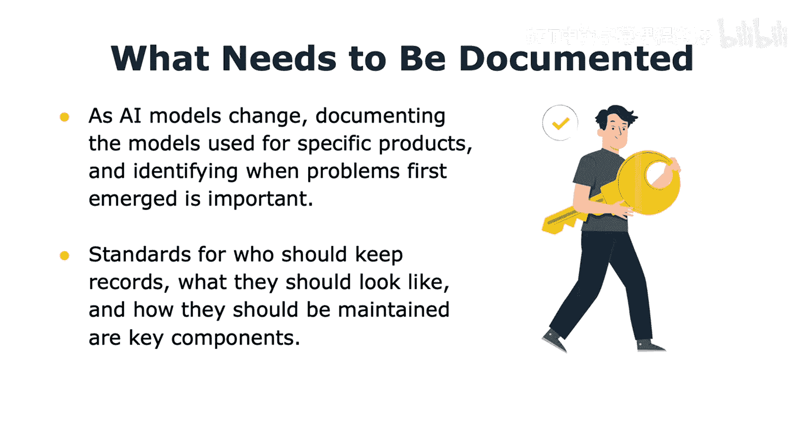
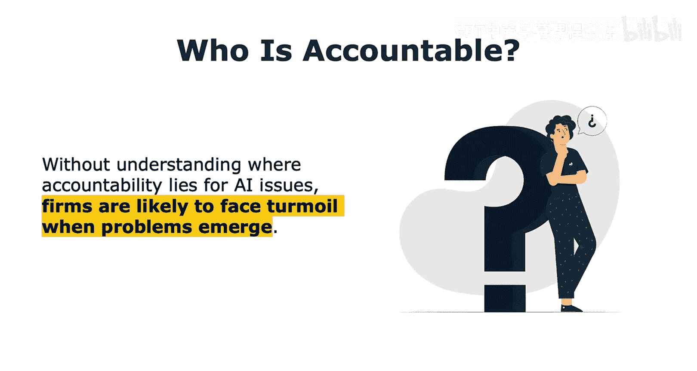
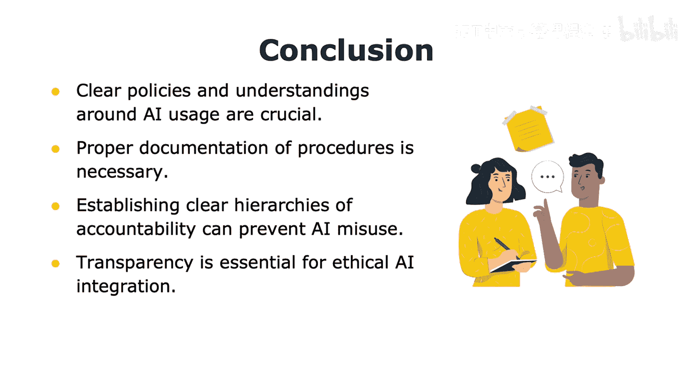

# 应对颠覆：工作场所的生成式人工智能：P37：变革时期的透明度 🧭

在本节课中，我们将探讨人工智能融入工作场所时，如何通过建立透明度来管理其带来的变革。我们将重点讨论制定清晰政策、确保数据安全、建立审计流程和明确责任归属的重要性。

随着人工智能进入工作场所，并介入员工、工作场所和消费者之间的关系，最重要的问题之一便是人工智能如何被整合进来。虽然人工智能的动态性及其影响否定了任何“一刀切”的解决方案，但确实存在一些明确的总体政策，可以帮助促进人工智能的整合，并确保其不会对这些关系造成积极伤害。

其中，最突出的需求是透明度。工作场所需要清晰的政策、面向消费者的信息、文档记录、流程以及问责策略。

## 制定清晰的人工智能使用政策 📜

上一节我们提到了透明度的总体需求，本节中我们来看看如何通过具体政策来实现。有效的人工智能整合需要工作场所制定人工智能使用政策。员工需要知道他们可以用人工智能做什么，不可以做什么。

同时，公司也需要明确何时、何地将引入人工智能。

这些政策应涵盖以下方面：
*   **如何使用人工智能**：具体的操作指南和工具使用规范。
*   **何时使用人工智能**：明确人工智能适用的场景和任务。
*   **人工智能在决策过程中的范围**：界定人工智能在决策中的角色和权限。

例如，如果人工智能用于员工招聘，应如何被使用？员工应以何种方式确保人工智能的使用是公平的，并符合道德和法律标准？如果人工智能用于提供信息或内容，人工智能与员工各自应扮演什么角色？员工应在何时评估人工智能工具的输出结果？潜在问题应如何处理？

## 管理数据使用与安全 🔐

除了使用政策，数据管理同样关键。许多人工智能工具的有效使用涉及收集和存储大量数据，包括组织自身的数据以及与其互动的对象的数据。

然而，当数据提供给人工智能工具时，确保人工智能不会学习到关于组织或其客户的不当信息至关重要。安全有效地存储数据也极为重要，以防止公司内部新获取和可用的数据面临被外部窃取或滥用的风险。

事实上，一种策略是许多公司可能与人工智能提供商签订合同，将数据保留在公司内部。

以下是数据管理的关键考量：
*   **明确数据共享边界**：理解哪些数据可以与人工智能共享，哪些不能。
*   **遵守法规**：确保数据的新用途符合各种数据保护法规，例如欧洲的《通用数据保护条例》（GDPR）。
*   **控制工具访问**：公司需要谨慎管理由谁、在何种情况下使用哪些工具，以确保组织内部以及必要时的外部透明度。

确保公司了解正在使用的工具非常重要，这样才能对其进行适当的审查，并对公司内部使用这些工具的个人进行培训和教育。公司政策需要澄清这些问题，因为未能建立强有力的政策将导致在公司不知情的情况下进行实验，并使员工不确定什么是适当或不适当的使用。

## 建立文档记录流程 📝

围绕上述问题，普遍需要建立对人工智能流程、决策和结果的文档记录。理解人工智能使用的哪些组成部分以及人工智能的产出需要作为日常职场实践的一部分被记录下来，这一点至关重要。

如果人工智能模型使用工作场所内容进行优化或训练，则必须详细记录该模型的训练、测试和部署方式。这包括公司为评估人工智能使用是否存在错误所做的任何努力。

随着人工智能模型的变更，记录哪些模型被用于特定产品，并识别问题在训练或更新过程中首次出现的时间点，这非常重要。关于应由谁保存记录、记录应包含什么内容以及应如何维护的标准，是关键组成部分。

## 实施审计与审查程序 🔍

人工智能系统可能会出现各种问题。确保人工智能的使用得到适当的审计和审查，构成了公司需要标准化的另一套程序。

仅凭人工智能在某一特定时间未产生偏见的证据，不足以断定这种偏见以后不会出现。定期检查以验证人工智能输出是否符合道德准则、公司价值观和行业标准，是必不可少的。

当人工智能故障或失灵变得明显时，也应有相应的处理程序。这些问题在人工智能系统中是固有风险，因此正式的人工智能使用必须建立在“问题会出现”的预期之上。

## 保持内外部透明度 👁️

在许多情况下，向客户和消费者明确说明产品和服务中如何使用人工智能非常重要。这不仅对建立信任至关重要，还可能提高消费者从公司产品中获得有用见解的能力。

如果客户发现他们正在与人工智能驱动的聊天机器人互动，而不是与人工客服交流，他们可能会感到不满。但如果从一开始就透明地说明人工智能的用途，这个问题就不太可能出现。

## 明确责任归属 🎯

最后，人工智能的使用要求有人对人工智能产品和决策负责。这需要成为围绕人工智能的角色和职责的一部分。

一个有问题的产品应归因于特定的开发者、最终用户还是管理者？如果不理解人工智能问题的责任归属，公司在问题出现时很可能面临混乱。

相反，建立清晰的责任结构使公司能够处理与人工智能相关的问题，并明确在公司流程中谁对人工智能产品负责。

## 总结

本节课中，我们一起学习了在变革时期确保人工智能透明度的关键要素。所有这一切都凸显了围绕人工智能用途及其在公司内部的建立方式，拥有清晰政策和理解的重要性。

清晰的流程文档、组织内外的透明度以及明确的责任层级，可以帮助公司避免因滥用人工智能而导致的最危险错误。当人工智能问题出现时，他们也不太可能措手不及。

因此，透明度对于合乎道德的人工智能整合至关重要，并为维持与员工和消费者的信任奠定了基础。