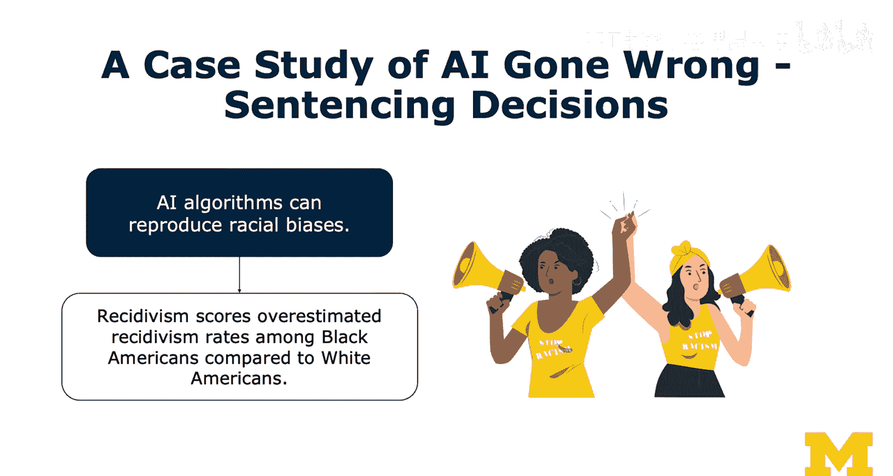
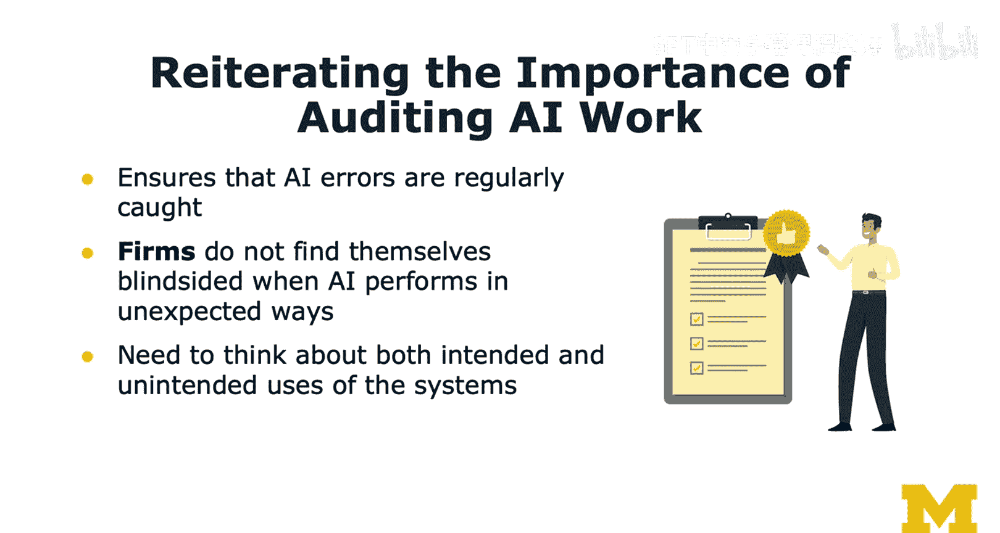
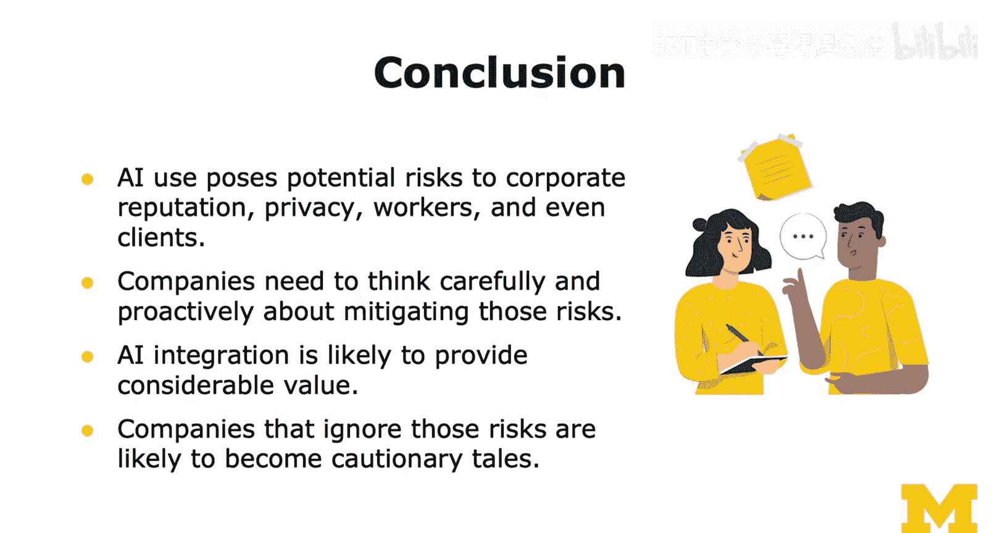
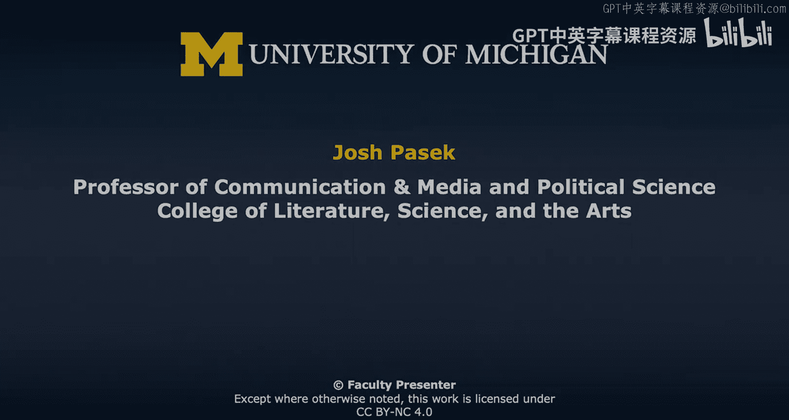

# 应对颠覆：工作场所的生成式人工智能：P38：风险、收益与保障措施 🛡️

在本节课中，我们将探讨将人工智能整合到工作场所时伴随的风险与收益，并学习如何通过建立适当的保障措施来确保其应用既恰当又高效。我们将通过一系列真实案例，理解人工智能可能带来的问题及其规避方法。

---

## 人工智能的风险：以司法系统为例 ⚖️

上一节我们介绍了人工智能在工作场所的潜力，本节中我们来看看其潜在风险。一个著名的案例来自美国的刑事司法系统。

人们早已知道美国刑事司法裁决中存在偏见。为规避这些偏见，一种策略是使用人工智能来评估犯罪个体在不被监禁的情况下再次犯罪的可能性。多家公司开发了用于评估再犯风险的算法，并被许多城市采用，旨在减少法官仅凭个人裁量进行判决的情况。

然而，对这些算法的分析揭示，尽管它们未将种族作为评估指标，却仍然倾向于复制种族偏见。与美国白人相比，算法给出的再犯风险分数高估了美国黑人的再犯率。

这些种族差异只有在研究人员开始检查算法提供的实际数据后才变得明显，因为模型本身并未给出存在种族差异的线索。这些偏见的证据给相关公司带来了公关危机，并在工具被使用时造成了实际伤害。

---

## 风险与收益的平衡 ⚖️➡️🚀

实施不当、测试不充分且透明度不足的人工智能工具可能带来诸多风险。未经充分测试的人工智能工具可能造成严重损害。

例如，亚马逊推出的一款新招聘工具在未意识到其给女性评分更低的情况下上线，严重损害了公司声誉。又如，微软发布的聊天机器人Tay因保障措施不足，被用户诱导发表了种族主义和仇恨言论。

但这些风险并不能否定人工智能在提升效率方面的巨大潜力。人工智能通过自动化常规任务、起草流程和促进团队协作来提升生产力，减少了完成多项任务所需的时间，并将人力解放出来，从事更具认知性和创造性的监督工作。

因此，企业需要在人工智能的风险与收益之间取得平衡。实现这一平衡需要遵循三项核心原则。

以下是实现平衡所需的三项核心原则：

1.  **透明度**：人工智能的使用必须在公司内部以及公司与外部利益相关者之间保持透明。
2.  **审计**：对人工智能的工作进行审计至关重要，不能假设人工智能系统的输出本身是充分的。
3.  **政策**：制定关于人工智能使用透明度和公司内部如何使用人工智能的政策，是建立信任和问责制的基础。

---

## 实施保障措施：透明度、审计与政策 📜

上一节我们提到了平衡风险与收益的三项原则，本节我们将详细探讨如何实施这些保障措施。

**透明度**是信任的基石。公司需要明确说明正在使用哪些人工智能系统、如何使用、收集哪些数据，以及采取了哪些措施来保护这些数据免遭不当使用。这关系到公司声誉和公众信任。

**审计**人工智能系统的使用，能确保定期发现人工智能的错误，避免公司在人工智能出现意外行为时措手不及。审计人员不仅需要思考系统的预期目的，还需考虑系统可能出现的任何非预期行为。他们必须致力于评估过程，并遵循一系列道德标准。

拥有**人工智能部署和实施道德准则**的公司，不仅更不容易引入有问题的人工智能内容，而且在算法出错时也更有可能获得谅解。

**政策和流程**构成了恰当使用人工智能的支柱。当公司制定了明确的政策，指导员工何时及如何使用人工智能，以及如何向客户部署和展示人工智能时，潜在风险就会低得多。那些为数据使用、人工智能系统部署和审计制定了周全指南的公司，将能更好地应对人工智能系统的意外行为。缺乏这些标准的公司则容易陷入被动。

---

## 总结与展望 🎯

本节课中，我们一起学习了人工智能在工作场所整合时伴随的风险与收益。我们看到，人工智能虽能带来巨大的效率提升，但也可能对企业声誉、隐私、员工乃至客户构成潜在风险。

想要充分利用人工智能革命的公司，需要仔细、主动地思考如何减轻这些风险。只要它们能在利用收益的同时理解和减轻风险，人工智能的整合就可能带来可观的价值。相反，那些忽视这些风险的公司，则可能成为警示案例。

通过建立**透明度**、进行定期**审计**以及制定明确的**政策**，企业可以构建一个更安全、更负责任的人工智能应用环境，从而在数字时代稳步前行。