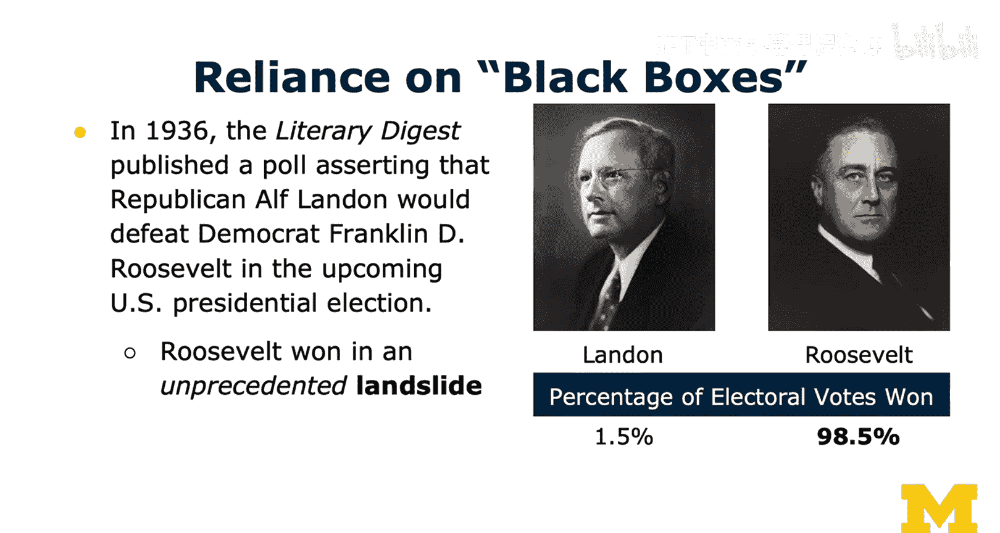
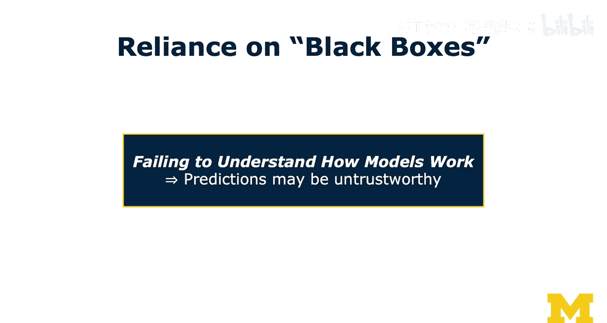
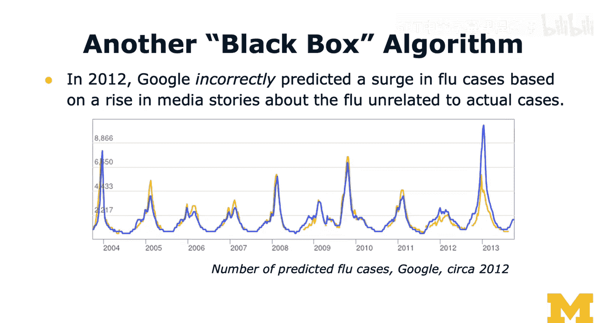
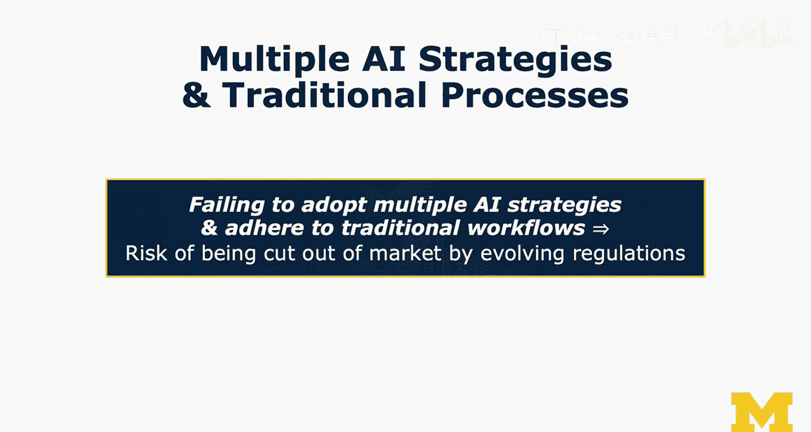
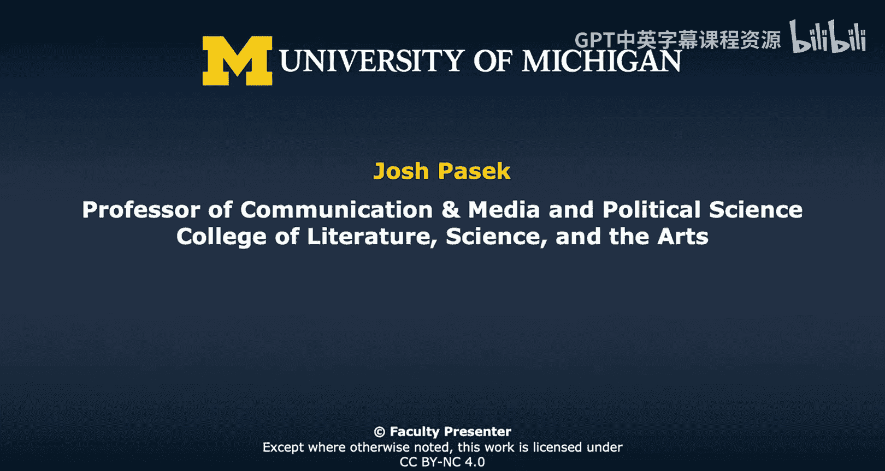

# 应对颠覆：工作场所的生成式人工智能｜P39：11_历史镜鉴 📜

在本节课中，我们将通过回顾历史上的技术变革，来理解人工智能可能带来的挑战与风险。历史是一面镜子，它能帮助我们识别并避免在拥抱新技术时可能犯下的常见错误。

回顾历史有助于揭示几种危险：忽视劳工条件、依赖“黑箱”而不理解其原理、对客户缺乏透明度、过度依赖单一方法，以及过分关注新技术而遗忘传统方式。通过清晰了解其他颠覆性技术曾如何出错，我们或许能避开同样的陷阱。

## 劳工关系与权利 ⚖️

上一节我们提到了从历史中汲取教训的重要性，本节中我们首先来看看劳工关系的变化。大规模生产的出现极大地改变了工作场所与工人之间的关系。

然而，在一系列企业灾难（如1911年三角内衣厂火灾）和普遍存在的童工剥削中，那些最依赖大规模生产体系的公司发现自己受到了工人的挑战，工人们开始主张自己的权利。工会的兴起，在许多方面，正是大规模生产雇主未能考虑工人福利的产物。

随着人工智能改变工作场所，企业面临着选择：要么拥抱安全、公平的劳动实践并支持员工，要么无视这些并承担风险。如果公司不能确保员工得到良好对待，员工很可能会提出要求。我们已经开始看到围绕人工智能出现的新劳工组织活动，工人们试图在动态变化的劳动环境中确立自己的角色。

## “黑箱”风险与错误预测 📊

另一个与人工智能尤为相关的历史教训，是依赖“黑箱”的风险。1936年，《文学文摘》杂志发布了一项民意调查，自信地断言阿尔夫·兰登将在即将到来的选举中击败罗斯福。结果是罗斯福以压倒性优势获胜。

该杂志的信心并非源于对民意调查方法的理解（他们的方法本身存在严重缺陷），而是源于他们前几次选举预测的惊人准确性。由于不理解那些预测为何准确，他们便假定同样的机制在未来会继续有效。

然而，1936年的情况已大不相同，他们自己都未真正理解的模型因此存在严重缺陷。从这个错误中得到的教训是：如果我们不理解预测产生的原因，那么这些预测可能并不可信。

人工智能在此背景下带来了巨大风险，因为AI算法的复杂性，我们常常不清楚AI为何会得出其预测。没有这种理解，我们可能无法很好地判断预测何时可能出错，并可能以有问题的方式依赖它们。

这种过度依赖在谷歌创建利用搜索结果预测流感流行程度的工具时就曾出现。该工具在2012年严重高估了流感发病率，当时媒体关于流感的报道引发了大量搜索，但这些搜索与实际疾病情况并不相符。

## 透明度与客户信任 🤝

当新技术改变市场中产品的价值时，如果客户收到的产品是某物的新技术版本，而非他们以为自己会收到的产品，客户很可能会感到被背叛。

古腾堡早期的《圣经》印刷版，其制作所需精力远少于传统抄写版本，最初却以高价出售。当客户开始发现他们收到的《圣经》所需精力少得多时，他们对价格变得亲民的《圣经》的兴奋就转变为了不满。

如果销售人员能更透明地说明生产过程，这种反弹或许根本不会发生。类似地，如果客户未被告知产品是AI生成的，也极有可能引发反弹。这里的教训再次表明，透明度至关重要。

## 避免过度依赖与保持多样性 🌱

过于迅速地投入一项新技术也存在相当大的危险。一个潜在的担忧源于对某些方法的过度依赖，这些方法在特定情况下可能并不奏效。另一个问题可能出现在公众或其他利益相关者尚未为大规模推出新技术做好充分准备之时。

19世纪中期，当太多爱尔兰农民将全部田地用于种植土豆时，歉收导致了大规模饥荒。同样，许多公司在21世纪初的互联网泡沫中遭受损失，因为他们在一个新领域过度投资，而公众尚未准备好接受他们的许多产品。

那些采取多元化方法、考虑多种AI策略并保留部分传统工作流程的公司，将能更灵活地应对AI革命可能带来的挑战。特别是，随着许多国家开始围绕人工智能使用推出有意义的法规，那些在不再被视为可接受或合法的方法上投入过多的公司，可能会发现自己被排除在曾经主导的市场之外。

这些警示故事鼓励计划采用人工智能的公司进行广泛思考。那些系统性地梳理多方利益相关者的经验和期望，然后考虑潜在陷阱的公司，远不太可能发现自己将“所有鸡蛋放错了篮子”。

## 总结 📝

本节课中，我们一起学习了如何从历史的技术颠覆中汲取教训，以更明智地应对人工智能带来的挑战。我们探讨了维护劳工权益的重要性、理解AI“黑箱”预测的必要性、保持对客户透明度的关键价值，以及避免过度依赖单一技术、保持方法多样性的战略意义。历史告诉我们，成功的技术整合需要平衡创新与责任，兼顾多方利益，并始终保持审慎与远见。