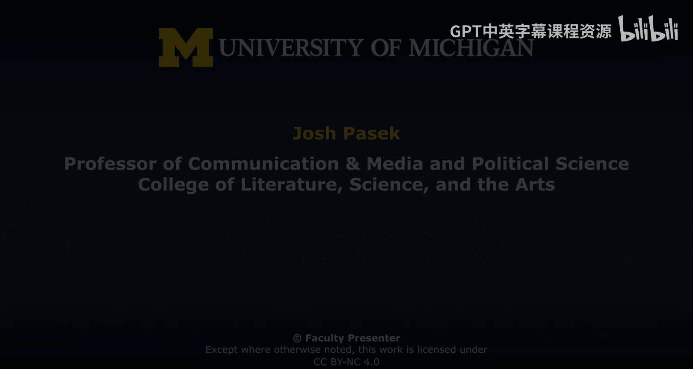
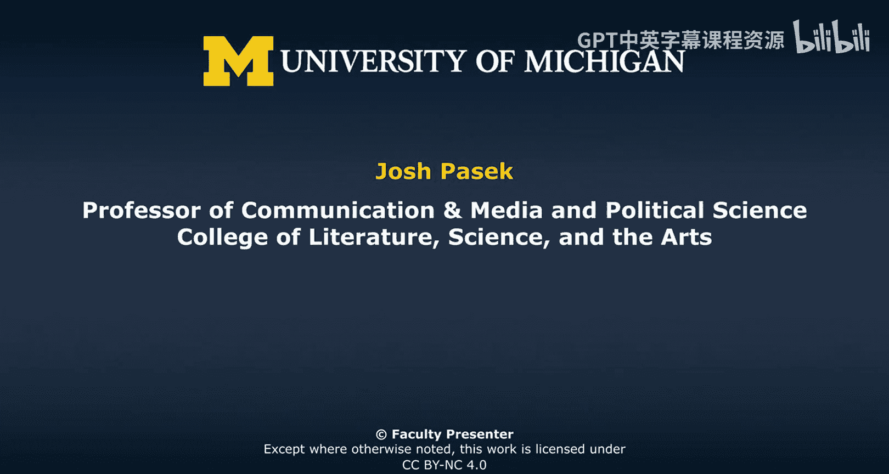

# 应对颠覆：工作场所的生成式人工智能：40：0_系列概述课程简介

大家好，我是乔希·帕索克，密歇根大学传播学、媒体学和政治学教授。

欢迎来到《工作场所的生成式人工智能：政策、伦理与风险》课程。这是《应对颠覆：工作场所的生成式人工智能》四门系列课程中的最后一门。

在本课程中，我们将探讨将生成式人工智能引入工作场所，会如何增加一系列潜在风险。这些风险可能损害公司目标，甚至引发法律或声誉挑战。

在开始之前，我先简单介绍一下自己。

我的背景是传播学研究员，我的学术研究围绕人们如何理解新闻话题展开。

我运用多种数据科学和机器学习技术来了解公众舆论状况，以及人们如何利用信息做出社会和政治决策。

我研究中使用的一些数据分析方法，构成了现代人工智能系统的核心。

从技术视角及其作为信息和通信技术的角色来理解人工智能，能为我们提供宝贵的见解，帮助我们看清人工智能的**功能**或**能力**将如何与社会世界互动。

事实上，在社会科学和数据科学的交叉领域工作，以及曾担任密歇根数据与人工智能社会研究所副所长的经历，使我处于关于人工智能可能产生的社会影响讨论的中心。

在这个短期系列课程中，我们将探讨人工智能将如何影响当代工作场所。

鉴于人工智能可能带来的巨大变革，以及人工智能未来发展和我们如何应对的不确定性，我以审视过去的信息和通信技术如何塑造其时代的社会和工作环境为视角来设计本课程。

这些历史案例的经验教训，为我们思考人工智能的影响提供了背景。

要理解人工智能将对工作场所产生何种影响，以及它可能在何处引入意想不到的障碍，需要理解四个关键领域，这也是本短期系列课程的重点。

首先，评估人工智能的影响要求我们理解当代人工智能究竟是什么。

聚焦于生成式人工智能，本系列的第一门课程名为《生成式人工智能：预测颠覆》。它将人工智能置于早期颠覆性技术的背景下，审视其工作原理，并剖析不同的使用方法如何产生不同的结果。

理解人工智能影响的第二个支柱，源于关注人工智能将如何改变构成当代工作场所的各类任务。

第二门课程名为《生成式人工智能：塑造工作与任务》，重点介绍了来自各类工作场所的一系列工作岗位。

该课程探讨了哪些工作任务更容易或更不容易被人工智能替代或增强，以及人工智能的整合可能如何改变人们的工作内容。

接下来，我们扩大视野，思考角色和职责的转变将如何更广泛地改变知识工作，以及在公司、员工和客户之间，人工智能整合后的互动可能发生怎样的变化。

本系列的第三门课程《生成式人工智能整合：对劳动力和劳动力的影响》探讨了这些问题以及公司应如何准备。

最后，本系列以审视当代及近期人工智能系统在工作场所实施中可能带来的诸多挑战作为结束。

在《工作场所的生成式人工智能：政策、伦理与风险》这门课中，我们将研究以下问题：哪些类型的人工智能使用可能被认为是适当或可接受的；公共政策如何处理人工智能；以及这项技术未来的发展方向。

虽然你可以选择性地学习这些课程，但我认为按照这个顺序学习会获得最大的价值。

理解生成式人工智能的工作原理，是理解它可能对工作任务产生何种影响的重要基础。而理解这一点，对于把握即将到来的颠覆对工作场所更广泛的影响至关重要。

识别可能发生的变化，有助于你为思考何时何地可能出现问题做好准备。

如果你已经完成了本系列的前几门课程，欢迎回来。如果还没有，我建议在学习本课程之前，先学习《应对颠覆：工作场所的生成式人工智能》系列的其他课程，以理解人工智能的工作原理、不同工作岗位的任务如何可能受到人工智能影响，以及任务的变化将如何导致工作场所的变化。这些内容为本课程提供了宝贵的基础。

在《工作场所的生成式人工智能：政策、伦理与风险》课程中，我们将探讨有效采用人工智能需要克服的障碍。

在本课程中，你将学习如何识别何时使用人工智能是可接受或适当的，并初步了解人工智能伦理和法律方面的挑战。

我们还将探讨人工智能算法的透明度问题，以及该技术未来的发展方向。

学习本课程后，你应该能够：
*   识别人工智能算法可能导致决策偏见的方式。
*   预见算法不透明对决策的影响。
*   思考关于人工智能将如何被监管以及人工智能产品将如何被看待（例如在版权方面），我们已知和未知的内容。
*   主动规划以保护公司数据和用户隐私。
*   在人工智能决策的每个阶段都考虑伦理问题。

非常高兴你能加入我们学习这门课程，希望你觉得它有价值。

