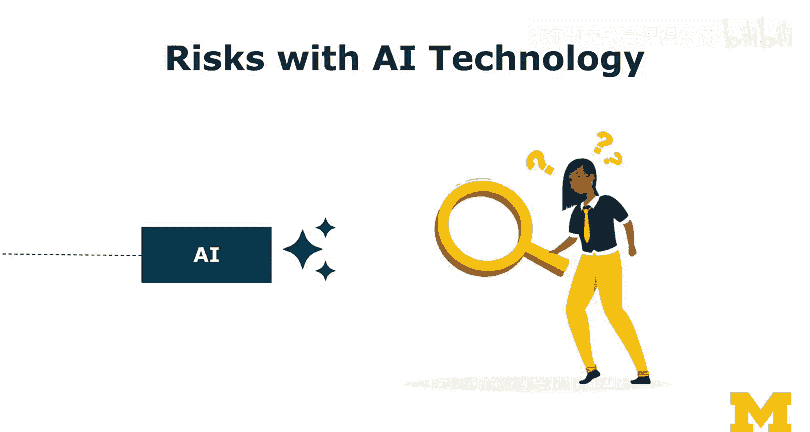
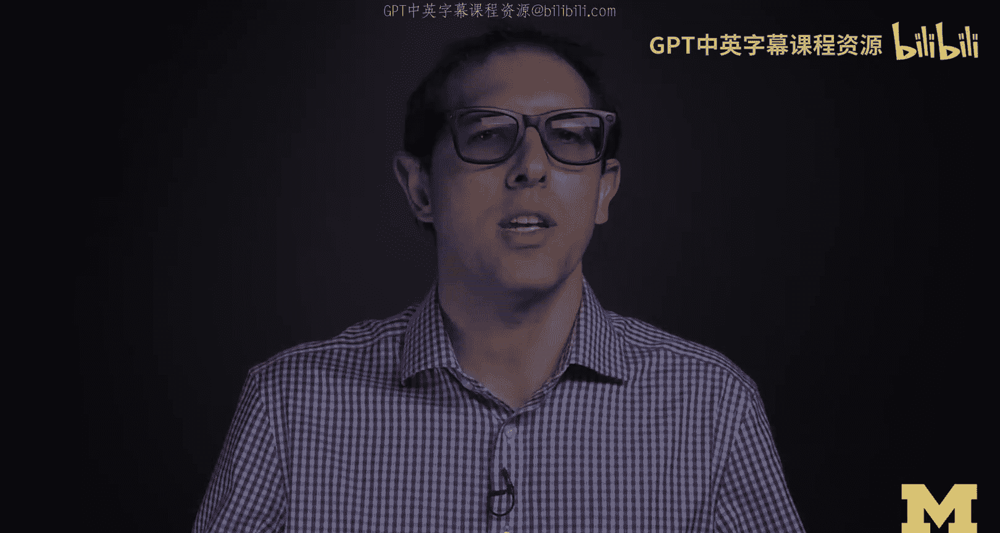
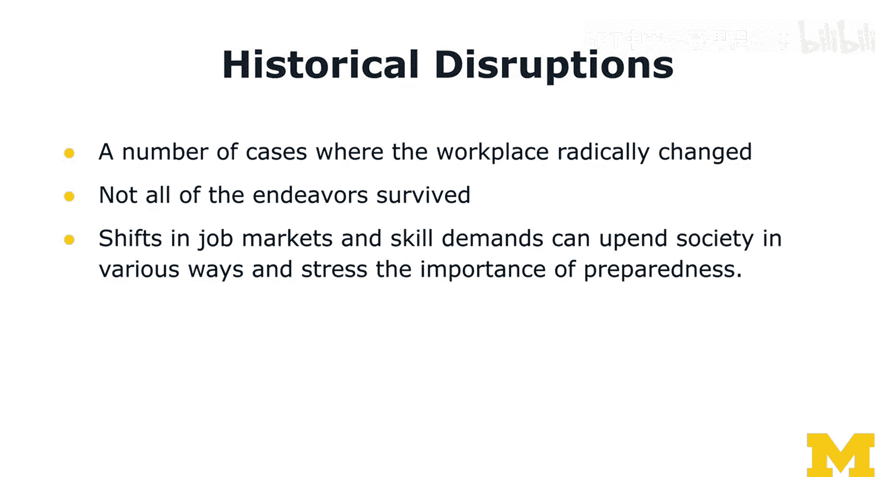
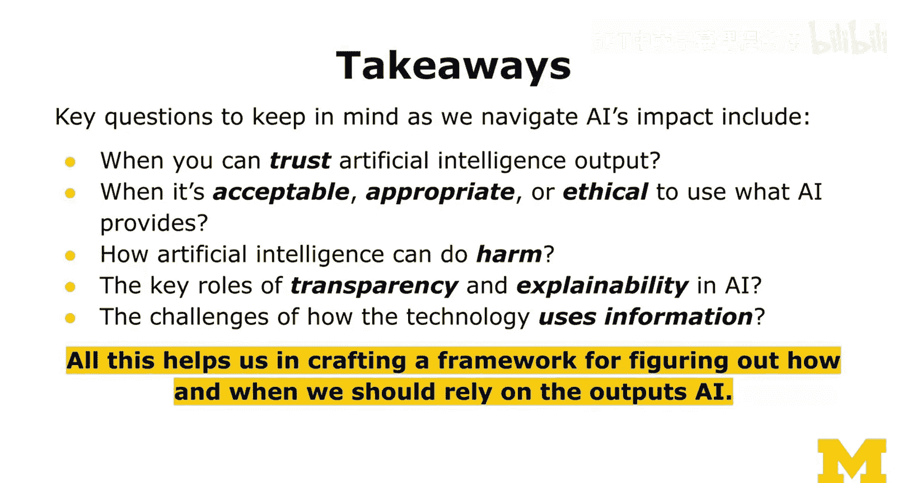
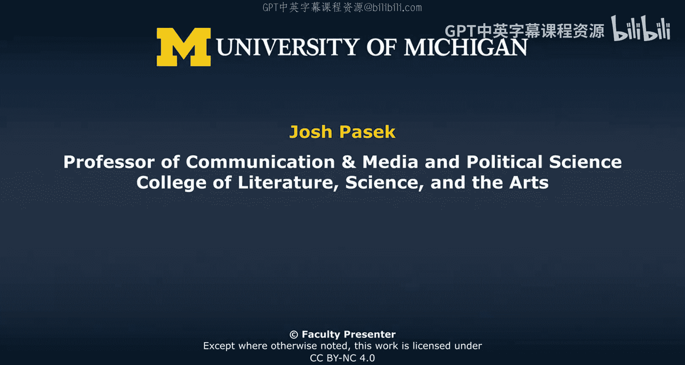

# 应对颠覆：工作场所的生成式人工智能｜P1：颠覆带来的风险 🚨

在本节课中，我们将要学习人工智能（AI）如何重塑我们的工作方式，以及这种颠覆性变革所带来的潜在风险。我们将探讨这些风险的历史背景、具体表现，以及它们对个人、工作场所和社会的广泛影响。

人工智能正从根本上重塑我们生活的许多领域，特别是人们在社会中完成工作的方式。人工智能有能力改变各行各业的各项任务，留下一连串的颠覆，并引发关于人类劳动将如何变化以及未来工作形态的疑问。与人工智能带来的诸多机遇相伴，这种颠覆也伴随着固有的风险。具体而言，人工智能包含一系列陷阱，工作者及其雇主在投身其中之前需要有所认识。

## 历史视角下的颠覆风险

上一节我们介绍了人工智能颠覆的总体概念，本节中我们来看看这些风险的历史背景。从历史经验中，我们可以更好地理解当前变革的轨迹。

由人工智能颠覆带来的一系列挑战和风险，与过去技术变革带来的风险相似。工业革命、互联网的出现以及其他各种转变塑造了劳动的本质、人类的沟通方式，并对劳动力以及公司、工作者和客户之间的关系产生了深远影响。这些影响需要数十年才能稳定下来。

当我们回顾历史上的颠覆时，可以观察到许多案例，其中工作场所在引入新技术后发生了根本性变化。以下是几个关键的历史转折点：

*   **工业革命**：导致了从农业社会向工业社会的广泛转型，对劳动力市场、城市化和生活方式产生了重大影响。
*   **互联网的兴起**：重塑了通信、商业和信息获取方式。
*   **企业的兴衰**：在这些挑战中，一些公司几乎一夜之间崛起，成为全球市场的主要参与者，而其他曾经强大的公司则逐渐衰落，变得相对默默无闻。

然而，并非所有在20世纪90年代互联网热潮中涌现的企业都得以幸存。许多企业失足，要么是因为高估了技术的普及速度，要么是因为误解了技术的能力。这些过去颠覆的教训告诉我们，就业市场和技能需求的转变会以各种方式颠覆社会，并突显了做好准备的重要性。

## 颠覆的深远影响

上一节我们回顾了历史上的技术颠覆，本节中我们来看看这些变革带来的更广泛的社会和政策影响。这些影响往往超出技术本身，触及社会结构和治理层面。

历史经验突显了为被新技术取代的工人提供再培训计划等举措的必要性。它们也告诉我们技术对社会结构和规范的潜在影响。例如，城市迁移改变了人们在社会中的互动方式，并改变了家庭动态；印刷术的发明在社会中引发了一波新的公众识字浪潮。

这些颠覆需要新的政策和法规、管理技术影响的方法，以及对技术能做什么、不能做什么以及应如何管理的更广泛理解。工业革命推动了新劳动法的发展，制造技术催生了环境法规。对于希望驾驭并充分利用不断变化的工作场所的公司来说，预测这些颠覆带来的次级和三级影响至关重要。

## 当前人工智能颠覆的领域

了解了历史模式后，我们现在将目光转向当下。今天的人工智能颠覆已经在影响许多领域，并注定会塑造更多领域。以下是人工智能正在产生重大影响的几个关键行业：

*   **医疗保健**：人工智能正参与诊断，帮助重塑治疗方法，甚至实现个性化医疗。
*   **金融**：人工智能深度参与欺诈检测、算法交易和客户服务。
*   **零售**：人工智能协助库存管理、市场营销和消费者洞察。
*   **交通运输**：我们看到了自动驾驶汽车和物流优化的发展。

生成式人工智能将把这类转变带到更多类型的行业中。生成式人工智能实现了与公司的个性化互动，客户服务角色可能部分被自主代理取代，并为数据分析、文本创作、图像生成甚至计算机代码编写开辟了新的自动化机会。

## 人工智能的具体风险

然而，就像过去的技术及其引发的转变一样，人工智能颠覆伴随着各种相关风险。以下是当前面临的主要挑战：

*   **工作替代与技能错配**：随着工作场所需求与工人所能提供的技能之间出现分歧，存在工作被替代和技能不匹配的风险。
*   **加剧不平等与社会伦理问题**：人工智能招聘工具中的偏见可能影响招聘决策，从而引发不平等和社会伦理担忧。
*   **不断演变的监管框架**：对于从版权到国际竞争等一系列问题，如何理解人工智能生成内容的意义，其监管框架仍在不断演变。

为了理解这些变化及其影响，理清人工智能所涉及的风险至关重要。在本课程中，我们将提出一系列问题，探讨人工智能何时以及如何为工作场所和工作引入风险和偏见。

## 本课程的核心探讨框架

为此，我们将考虑以下关键问题，这些问题构成了我们评估和应对风险的基本框架：

*   **何时可以信任人工智能的输出？**
*   使用人工智能提供的内容，何时是可接受的、恰当的或符合伦理的？
*   **人工智能如何可能造成伤害？**
*   透明度和可解释性在人工智能中的关键作用是什么？
*   该技术如何使用信息面临哪些挑战？

所有这些问题都有助于我们理解人工智能，并提供了一个框架，用以判断我们应该如何以及何时依赖它。这进而对工作场所内的人工智能政策如何运作、个人如何被对待以及公共政策格局的性质产生影响。

在本课程中，我们重点关注事情可能出错的方式和原因，以及工作者和工作场所可以采取哪些策略来避免这些负面外部效应。

---

**本节课中我们一起学习了**人工智能颠覆工作场所所带来的双重风险：一类与历史上技术变革（如工业革命、互联网）带来的结构性挑战相似，包括就业市场转变和社会结构调整；另一类则源于人工智能技术本身的特性，如输出可靠性、伦理偏见和监管空白。我们回顾了历史教训，审视了AI在当前各行业（如医疗、金融）的应用与潜在冲击，并建立了一个核心问题框架，用以系统性地评估何时及如何信任与使用AI，从而为后续制定应对策略奠定基础。