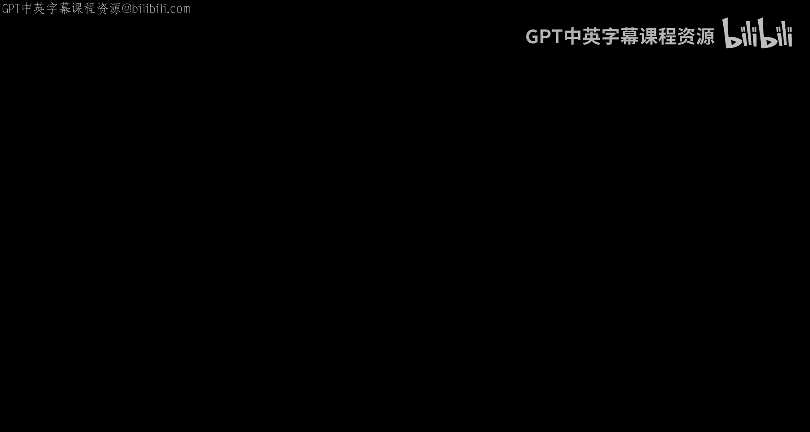
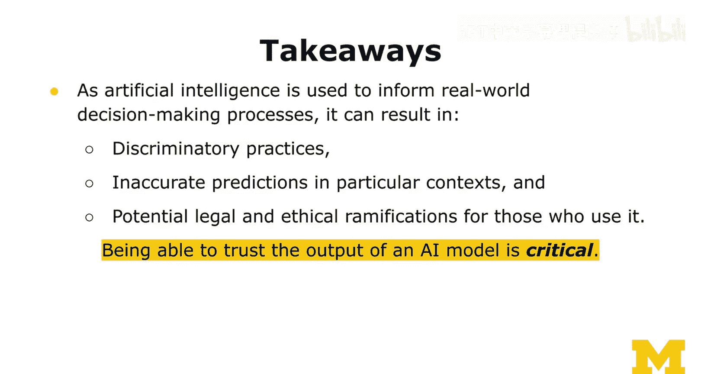
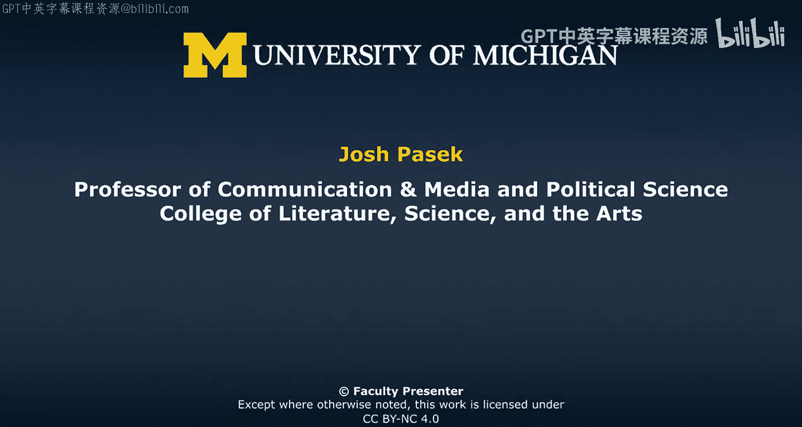

# 应对颠覆：工作场所的生成式人工智能：P42：何时可以信任人工智能输出

在本节课中，我们将要学习一个关键问题：在严肃的工作场景中使用人工智能时，何时可以信任其输出。如果无法信任人工智能生成的内容，那么它在许多用途上就不可用。因此，我们将讨论信任在人工智能系统中的重要性，影响人工智能输出可信度的关键因素，以及思考这些问题的方法。

## 准确性：信任的基石 🎯

上一节我们介绍了信任人工智能输出的重要性，本节中我们来看看第一个关键因素：准确性。

人工智能信息必须为其应用目的提供足够的准确性。如果人工智能正在收集关于某个特定事件或个人的信息，那么了解该信息是否正确并以某种方式进行验证就非常重要。在准确性至关重要的情境下，如果人工智能获取的事实信息出错，可能会引发各种风险。

人工智能输出不准确的原因有多种。理解人工智能模型的本质有助于理解这些不准确的来源。其中一个值得注意的领域是所谓的“幻觉”。这是指人工智能模型可能对查询提供一个看似事实性的答案，但实际上这个答案是模型编造的。

这种情况之所以发生，是因为人工智能使用预测关系来试图理解接下来应该说什么。这些预测关系可能无法产生准确的答案，可能是因为模型中没有足够的信息，也可能是因为模型对特定问题提供了听起来合理的回答，而没有任何真正的基础记忆来核实其提供的信息。也就是说，人工智能是基于“什么看起来可能”来生成估计，而不是基于某些基础的知识体系来做出回应。

近期的一系列证据表明，幻觉可能是人工智能的一个固有特征。尽管许多研究都致力于减少其发生频率，但可能不存在真正无幻觉的生成式人工智能。

## 虚假信息与深度伪造的威胁 🚨

认识到准确性问题的存在后，我们需要关注信任人工智能输出的第二个主要担忧：虚假信息或误导信息的潜在风险。

人工智能可以很容易地用来生成听起来可信但不准确的信息，例如新闻故事或其他虚假声明。其中一种特别有害的形式被称为“深度伪造”，即可以创建看似展示了实际并未发生的场景的音频或视频内容。

在某些深度伪造视频中，公众人物被合成到实际并未发生的场景中。人工智能使得创建和传播这类不准确信息变得相对容易。深度伪造不仅对政治信息有潜在影响，也可能损害公司声誉，因为虚假的视频、音频或文本信息可能导致重大的公关问题，并引发声誉危机。

认识到不准确信息的潜在风险，公司和员工需要意识到，可能存在虚假信息、误导信息、深度伪造以及其他威胁，这些可能被用来破坏隐私和声誉，甚至进行敲诈勒索。建立清晰的信息渠道对于确保人们能够在潜在的虚假信息活动中识别准确信息至关重要。

## 算法偏见：数据中的陷阱 ⚖️

除了直接的信息错误，人工智能输出的可信度还涉及另一个令人担忧的领域：算法偏见。

由于人工智能从训练数据中学习，它可能从不能完全反映与特定个体或术语相关的全部背景的训练数据子集中学习。例如，如果一个人工智能模型被训练来识别哪些皮肤图像表明是黑色素瘤，那么如果其训练图片中癌变图片的比例远高于真实人群中癌变皮肤异常的比例，该模型就可能错误估计黑色素瘤的患病率。在这里，训练数据中误导性的癌症发生率导致了诊断上的错误识别。

当人工智能模型在其训练范围之外进行估计时，也可能提供不准确的信息。许多人工智能模型主要基于少数几个相对知名的西方国家的数据进行训练。当这些模型被用来对其他文化中的事物进行估计时，它们可能被证明是不准确的。例如，面部识别系统的准确性往往因种族群体而异，部分原因是这些系统在训练时使用了更多来自某些背景的个体，而来自其他背景的个体较少。

训练数据也可能基于各种历史案例，这些案例可能不适用于当前时刻，或者无法从一个社会政治背景转换到另一个。这意味着，当人工智能被用来为现实世界的决策过程提供信息时，它可能导致歧视性做法、在特定情境下的不准确预测，以及对使用者产生潜在的法律和伦理后果。

## 总结与关键要点 📝

本节课中，我们一起学习了何时可以信任人工智能输出的核心考量。

在许多情况下，能够信任人工智能模型的输出至关重要。认识到人工智能的输出并非天生可信，是其中的一个重要组成部分。鉴于人工智能在各个领域普遍倾向于听起来非常权威，在评估人工智能模型质量时，一个关键要点是关注人工智能并不一定像听起来那样可信这一事实。

