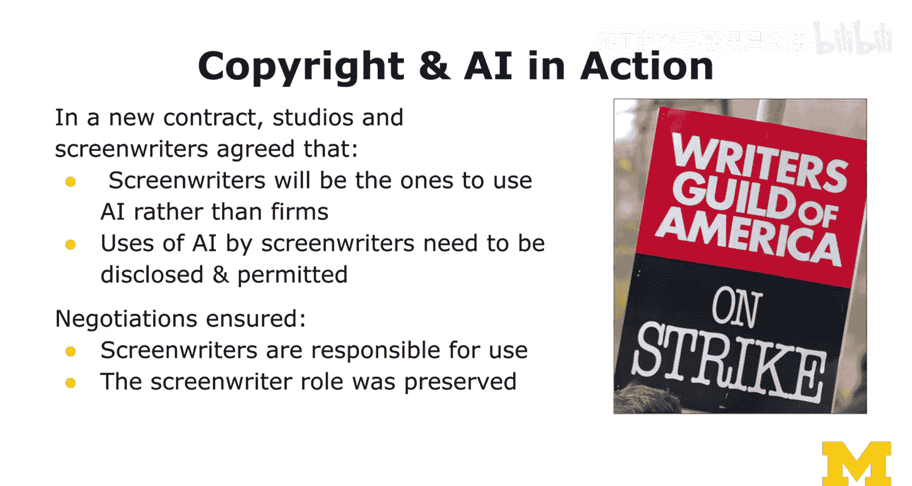
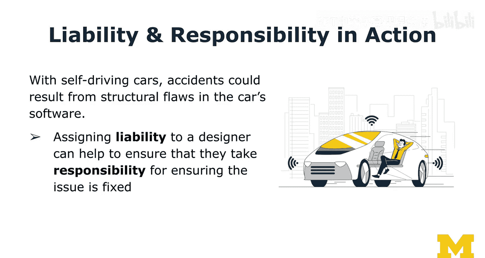
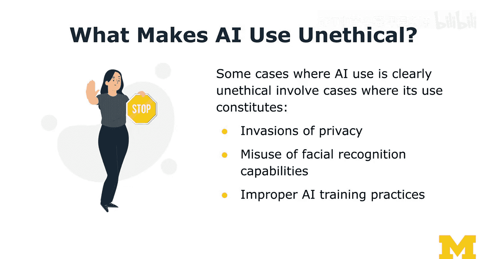
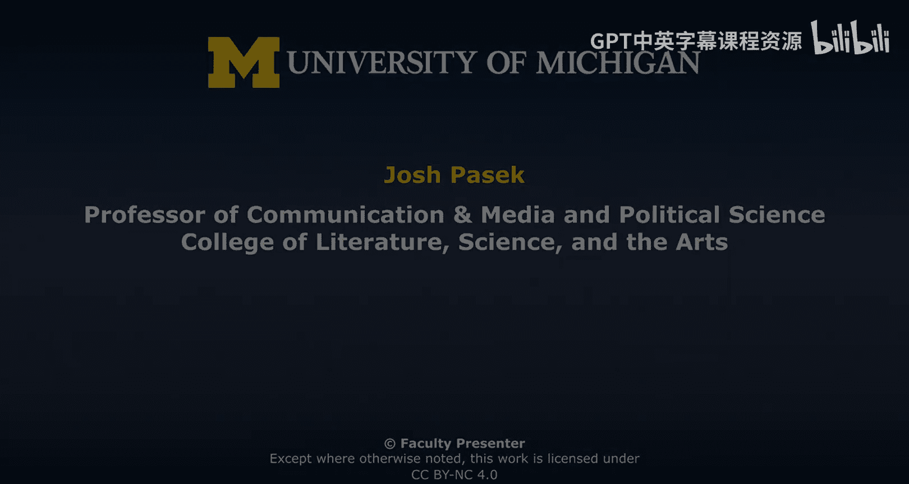

# 应对颠覆：工作场所的生成式人工智能：P43：决定使用人工智能时的考量因素

在本节课中，我们将要学习在决定是否以及如何使用人工智能时，必须考虑的一系列关键因素。这些因素包括责任归属、知识产权、伦理风险以及社会影响，它们共同构成了在职场中负责任地部署人工智能的基础框架。

---

## 责任归属与协商的必要性

在许多情况下，关于“谁有资格执行特定任务”的规定，可能会对人工智能的应用价值构成重大挑战。此外，人工智能的使用常常需要在多方参与者之间进行协商，以确保其应用是恰当且合理的。

在这些情况下，一个核心问题就变成了：**谁将对人工智能生成的内容负责？**

---

## 案例研究：2023年美国编剧工会罢工

这个问题在2023年美国编剧工会的罢工中得到了很好的裁决。编剧们提出的诉求之一，就是明确人工智能在剧本和电影创作中的使用方式。

以下是谈判中涉及的核心关切：

*   **学习来源**：人工智能是否能够学习编剧的作品？
*   **角色替代**：制片公司是否会使用人工智能来绕过编剧的角色？
*   **工具使用**：编剧自己能否使用人工智能？
*   **决策权**：谁有权决定是否以及何时可以使用人工智能？

这些问题不仅关系到人工智能在行业中的使用方式，也深刻影响着工作者的岗位。它们反映了在许多工作场所使用人工智能时都需要协商解决的核心挑战。

---

## 知识产权与所有权问题

上一节我们介绍了责任归属的复杂性，本节中我们来看看与之紧密相关的知识产权问题。一系列问题围绕着人工智能的版权状态展开。

具体来说，**人工智能产出的版权归谁所有？** 如果一个人工智能工具生成了内容，版权是属于提出需求的公司、输入提示词的个人、开发该人工智能工具的团队，还是说因为人工智能不能成为作者，所以以上都不成立？

这些问题本身就为将人工智能产品视为一种“产出”带来了内在的难题，尤其是在没有明确的人类参与整合过程的情况下。

对于编剧而言，这些问题的答案最终被写入了他们的合同。制片公司和编剧们达成协议：**使用人工智能的必须是编剧本人，而非雇佣他们的公司**；并且，编剧对人工智能的使用必须向其雇主明确披露并获得许可。

这次谈判的结果解决了双方的关切，既确保了编剧需对其使用行为负责，也维护了他们在剧本创作过程中的核心角色。

---

## 从谈判到更广泛的挑战

上述谈判中提出的问题，突显了更广泛的挑战。这不仅涉及理解知识产权，还包括界定作品的归属，以及我们应如何理解作品的价值——尤其是在人工智能参与之后。

对于制片公司和编剧而言，这次谈判也解决了围绕**人工智能学习**的挑战。因为被允许使用人工智能的人，正是人工智能最初学习其作品的来源，这使得谈判巧妙地避开了一系列额外的归属权问题。

---

## 责任与过失认定的核心难题

责任与过失认定是一个关键问题。当社会中出现问题时，我们倾向于评估谁应对问题负责。在人工智能领域，这一点在**自动驾驶汽车**的挑战上体现得尤为明显。

在不久的将来，我们或许能创造出完全自动驾驶的汽车，其平均表现甚至可能优于人类。尽管一些汽车制造商声称已经实现，但最佳证据表明我们尚未达到这一水平。

然而，即使我们拥有了这样的自动驾驶汽车，仍然需要处理事故，因为驾驶本质上是一项危险活动，不存在完全无事故的环境。道路上可能发生许多导致事故的情况，无论是机械故障、对情况的误判，还是无法避免的意外事件。

当此类事件发生时，我们会尝试**认定事故责任**，并试图理解谁（如果有的话）存在过错。虽然在某些情况下可以宣布无人对特定错误负责，但我们不希望总是如此。

*   **软件缺陷**：如果自动驾驶软件存在结构性缺陷，认定责任有助于确保设计者承担责任并修复问题。
*   **个人责任**：如果个人对事故负有责任，应由其保险进行赔付。
*   **第三方责任**：如果责任在于其他方，例如城市未能填补危险的路面坑洞，那么该方也需要承担责任并进行必要的修复和赔偿。

---

## 责任归属的现实困境

挑战在于，要完美地归因某件事的原因往往非常困难。一场事故可能部分由危险的路况引起，部分由驾驶员的鲁莽或疏忽造成。

正如驾驶员在考取驾照时，就接受了在艰难抉择中承担伦理和道德责任一样，当我们将关键任务（例如决定在事故情境中如何反应）交给自主智能体时，我们也必须将重大的伦理和道德问题交给驱动车辆的软件来处理。

例如，可能存在一种情况：汽车在冰面上失去抓地力，伤害已无法避免。当软件最终不得不在两个糟糕的结果之间做出选择时，关于伦理的决策就必须被编码进算法中。如果软件最终选择了其中一种方案，那么软件在某种程度上就应对这个选择负责，而不应被完全免除责任。

这一切都突显了当任务的一部分由机器完成时，理解责任归属所面临的挑战。因为没有人能够完全观察人工智能工具复杂的决策过程——无论这个工具是在生成新的文本内容，还是在试图避免一场事故——这些挑战始终存在。

---

## 思考潜在风险与不当使用

上一节我们探讨了责任认定的困境，本节中我们来看看如何通过思考潜在风险来界定人工智能的适当使用。当医疗系统诊断个体时，如果出现误诊，是谁的过错？我们如何分配责任？如果一个算法交易系统导致了金融动荡（如我们将在后续课程中讨论的“闪电崩盘”），我们应如何处理其后果？

思考何时使用人工智能是恰当的，这就要求我们必须同时考虑可能出错的情况及其潜在影响。问题可能出现在哪里？关于责任状态，以及算法使用者、创造者和其他参与者的角色。

现在，可能存在许多情况，我们可以说使用人工智能是明显不道德的。我们可能判定某些人工智能的使用构成了过度的隐私侵犯。

以下是可能被视为不当使用的例子：

*   **面部识别**：在某些情境下使用面部识别技术是不可接受的。
*   **数据隐私**：为自动化工具学习提供某些类型的数据，可能会损害个人的隐私和地位。例如，根据一些新闻来源，一个目标预测模型可能通过向一位少女的地址寄送婴儿用品邮件，在她告知父母之前，就向她的父亲“泄露”了她怀孕的信息。

创建算法来推断此类信息并将其用于营销，可能会造成直接伤害。

仔细思考这一系列不可接受的用途以及边界案例，可以帮助我们想象围绕“是否应该使用人工智能”这一决策的潜在风险和后果，并帮助我们界定什么是可接受且恰当的使用，什么不是。

我们需要考虑人权、公民自由、隐私期望，以及算法工具如何相互作用，甚至可能产生我们意想不到的结果。我们还需要思考我们选择的社会和经济影响，因为这些后续后果不仅关乎个人的生活，也关乎整个社会。

---

## 总结：复杂的伦理考量

因此，在特定领域思考人工智能应用的伦理并非一项简单的任务。关于责任与过失、潜在风险与危害的这些重大问题始终存在。

本节课中我们一起学习了在决定使用人工智能时必须权衡的多重因素。从责任归属和知识产权谈判，到自动驾驶汽车的责任认定困境，再到对隐私侵犯等伦理风险的评估，我们认识到，负责任地部署人工智能需要全面、审慎地考虑技术、法律、伦理和社会等多个维度。