# 应对颠覆：工作场所的生成式人工智能：44：人工智能与法律 👨⚖️

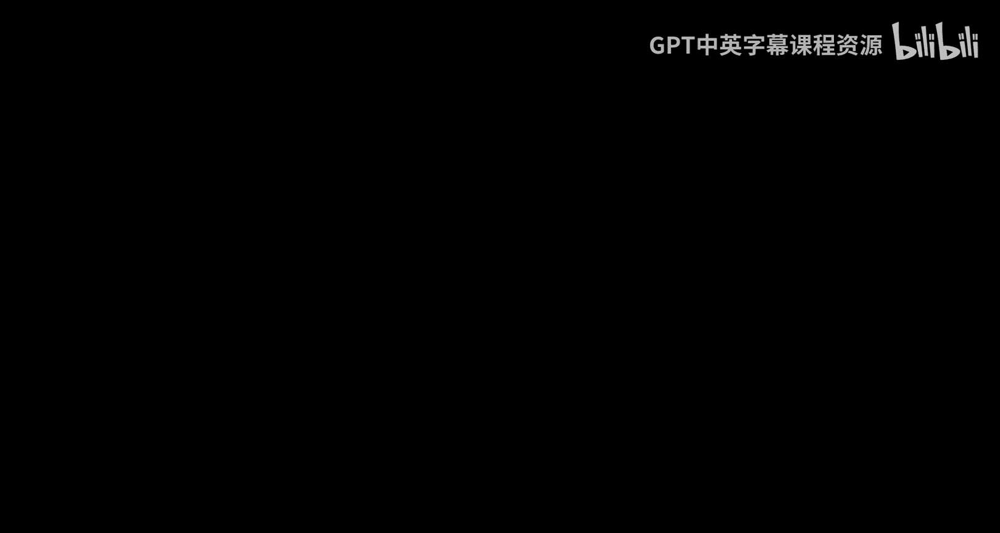

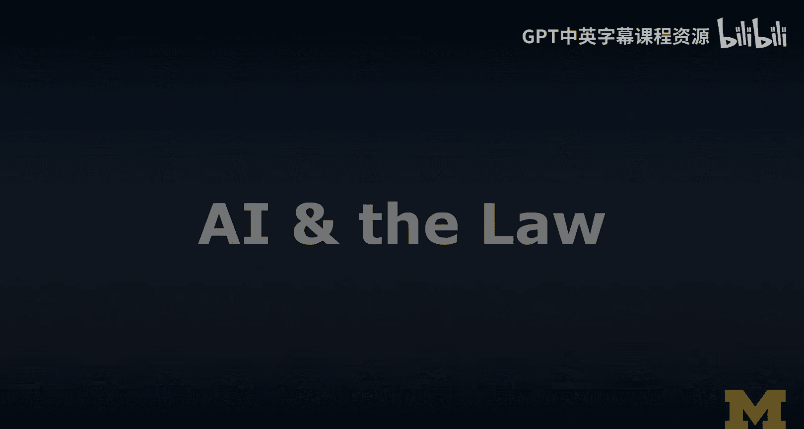

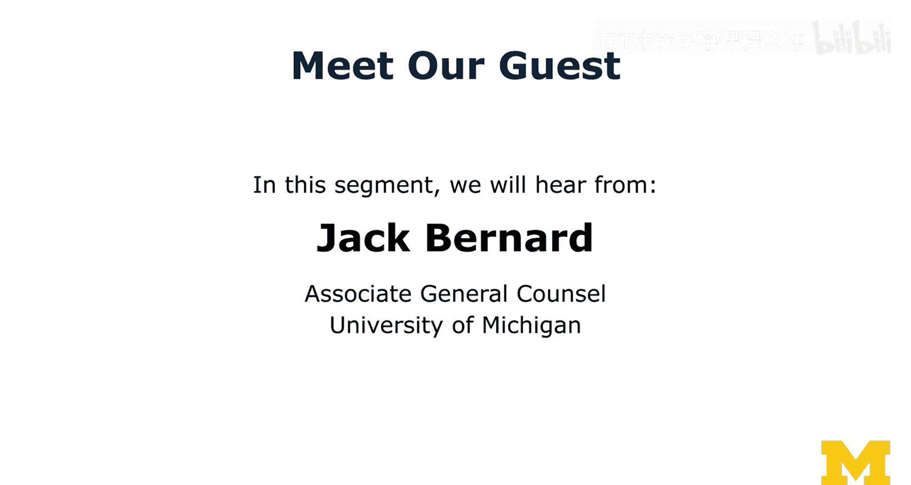

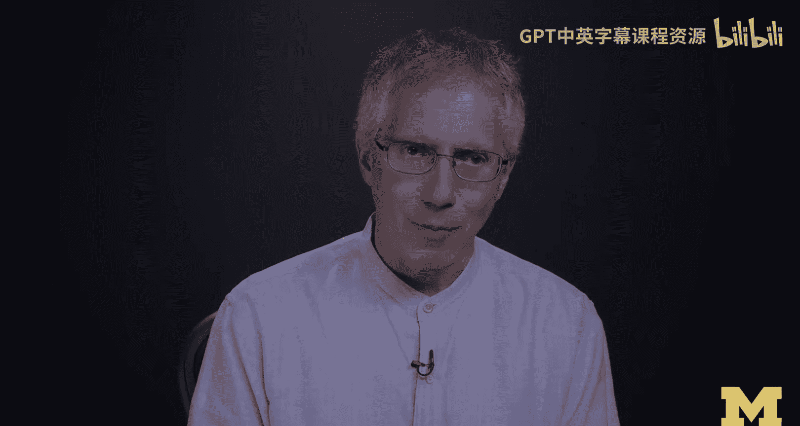

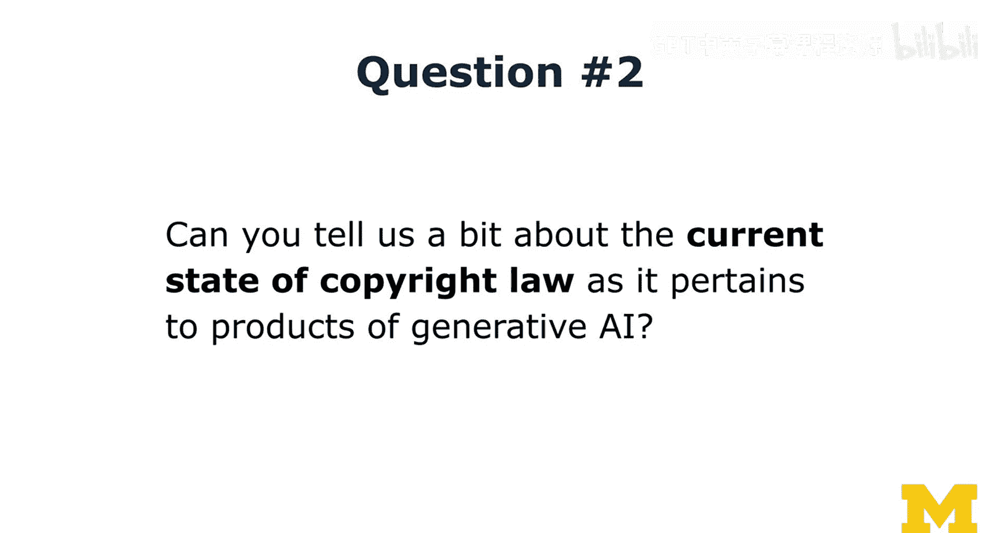

在本节课中，我们将探讨人工智能，特别是生成式人工智能，与版权法及其他相关法律的交叉问题。我们将从输入和输出两个角度分析法律风险，并讨论当前的法律现状、国际差异以及组织在应用AI时需要考虑的实际问题。

大家好，我是杰克·伯纳德，是密歇根大学总法律顾问办公室的一名律师。我同时在法学院、教育学院、公共政策学院和信息学院任教。

今天，我将与大家讨论人工智能、生成式人工智能与版权法，以及其他一些相关法律的交叉问题。

## 版权法基础 📜

版权法是法律中保护作者身份的部分。它保护的是以有形媒介表达的、固定的作者作品。例如，你写下的文字、拍摄的照片、他人制作的电影，甚至是你此刻正在涂鸦的笔记。这些都属于版权的范畴。

在当今时代，可受版权保护的作品已成为我们思考人工智能的一个重要方面。当你在此背景下思考版权作品时，你会发现它们无处不在，构成了人工智能程序为了学习而吸收的内容。同时，人工智能生成的内容看起来也非常像版权可能保护的对象。不过，正如我们将要看到的，目前版权通常不保护由人工智能创造的事物。

## 生成式AI的输入与输出 🔄

上一节我们介绍了版权保护的基本对象。本节中，我们来看看生成式人工智能如何处理这些对象。当你思考训练生成式人工智能（如大型语言模型）的内容时，可能包括书籍、计算机代码或图像等作者作品。这些是我们每天体验和创造的人类创作。

这些内容被吸收进语言学习模型或人工智能系统，并融入AI在收到查询时生成结果的方式中。这个过程与人类学习的方式非常相似。人工智能吸收所有这些信息来学习和发展识别各种人类创作（无论是言语、图像还是声音创作）之间关系的能力。

当人工智能产生结果时，这些输出是否会产生版权问题？从法律角度看，一个核心问题是：如果AI产生的输出与先前存在的作品实质性相似，这会构成版权侵权吗？即使这不构成侵权，你对这些输出的使用方式是否可能构成侵权？社会目前正通过大量诉讼案件试图厘清这些问题。

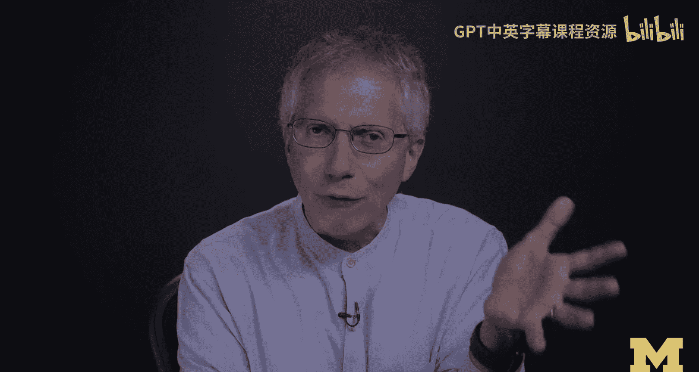

从版权角度思考什么可能是合法的（即不侵权的），什么可能是不合法的，我建议你从两个大的方面来考虑：**输入**和**输出**。

目前有超过一打的诉讼案件正在审视这个问题，即大型语言模型公司或生成式人工智能公司是否通过输入第三方可受版权保护的作品，并允许用户生成另一端的内容，从而侵犯了他人的版权。这些案件目前尚未解决，因此我们无法确定法院将如何处理这些问题。但我们可以对区分输入和输出的用处有一些想法。

### 关于输入的分析

法院完全有可能，并且我认为很可能，会说为了让模型学习和训练而对受版权保护的作品进行复制的**输入**行为，可能构成版权法所称的**合理使用**。这是一种由国会授权的使用，是一种不会对版权持有者造成损害的使用。

### 关于输出的分析

另一方面是**输出**。我认为对于大多数生成式人工智能模型来说，其目标是输出并非输入内容的复制品，而是全新的东西。这类似于当你向生成式AI系统提问时，它每次的回答都会不同，就像人回答问题的方式不同一样。

在许多方面，将我们观察到的这种现象类比于人类的行为是有益的。例如，你接触了大量的第三方知识产权，然后从中产生自己的成果——你写下一些东西或表达想法，这都源于你之前的经验总和。生成式人工智能模型模仿的正是这一点：它们吸收旧内容，并赋予其新的、不同的生命。

## AI生成内容的版权状态 🤖

现在值得谈谈输出的版权状态。根据美国现行版权法，任何由机器独立于人而产生的作品（这正是我们试图通过AI达到的状态）都**不受版权保护**，即使它看起来类似于人类可能产生的作品，如艺术品、代码、音乐、文本或各种图像。这些通常属于人类范畴的事物，我们不予以保护。

你可能记得报纸上著名的“猴子自拍”案例：一位摄影师将相机留在野外，一只猴子看到自己的脸并按下了按钮拍照。尽管那是一张照片，而大多数照片都受版权保护，尽管相机通常完成了所有工作（这次是猴子按下了按钮），但法院和版权局一致认为它**不受版权保护**。还有猫画画或大象画画的例子，它们从我们的视角创造了美丽的作品，但因为不是人类创造的，所以不受版权保护。

我们面临的一个有趣挑战是：如果人类做了大量工作（例如通过多次提问以从AI获得特定结果），这意味着什么？例如，你试图获得一件特定的艺术品，可能会反复向AI输入提示，直到得到你想要的东西。那么，提示者是否对输出享有某种保护？我们目前不知道这个问题的答案，但我认为这将是未来一个根本性的问题：需要多少人类参与，以及参与点必须在哪里。

## 对组织的实际影响 🏢

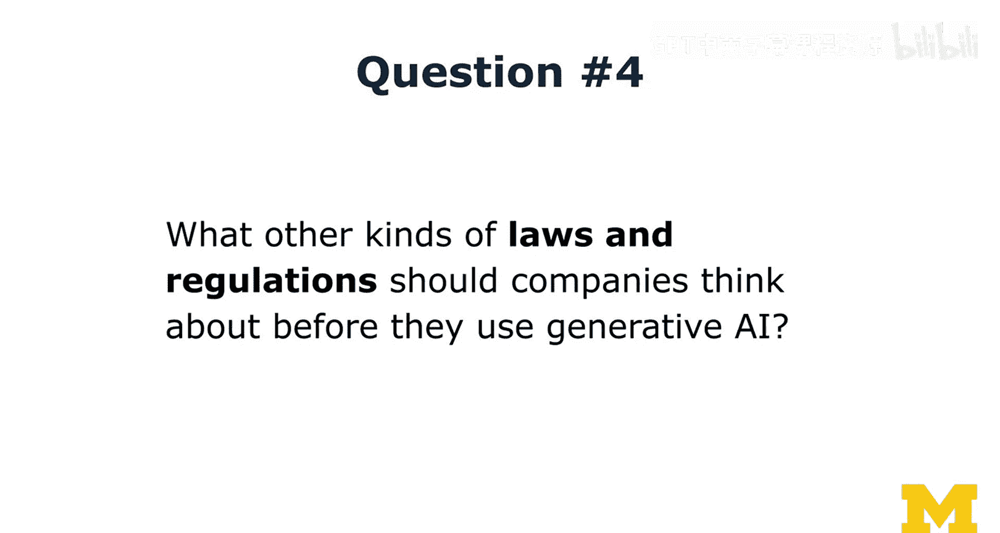

由于AI产生的作品不受版权保护，这可能意味着如果你的组织正在创作这些作品（无论管理层是否知情），这些作品将无法获得与其他类型版权作品相同的保护。

例如，如果我写一封信，它将获得版权保护，我的雇主将拥有其版权。这是相当规范的标准，事实上《版权法》就是这样组织的。但是，如果我通过给出合理的提示，让AI生成一封与我亲自写的信非常相似的信，那么这封信将**不受任何版权保护**。

这并不意味着公司没有办法保护那件作品。例如，如果产出的内容不与人分享，或仅在合同下与人分享，你可以采取类似措施，但你将无法为此目的依赖基本的版权保护。我认为这可能会改变公司对“谁在做什么”的思考方式。

这也可能意味着公司在谈判时会稍微修改合同，或者如果你的公司为第三方生产内容，你可能会在与客户的合同中声明，希望他们以特定方式对待这些材料（即不以特定方式使用它们）。例如，你可能会说：此处产生的任何内容，我们不希望你将其吸收到某些第三方产品或某些第三方AI中。或者你可能会说，作为我们向世界销售的此产品的一部分，有些内容是由AI创建的，你应该意识到这一点。

事实上，我怀疑我们将开始看到一些关于透明度的监管：当我们交互的内容或公司可能产生的内容是由AI而非人类创建时，需要透明化。我认为我们看到人们正朝着这个方向前进，尽管我不确定我们最终是否会到达那里。在社会中，当然有很多地方我们期望人们因其工作而获得赞誉，也许有一天我们会期望特定的AI因其完成的工作而获得赞誉，因为我们希望能够追溯事物的来源。

## 国际视角与法律差异 🌍

在思考这个时代的人工智能时，另一个挑战是我们如何在国际上对待事物。不同国家有不同的规则。欧洲已经颁布了与AI相关的法律，而欧洲的AI相关法律并不特别适合移植到美国。

在欧洲，有一种真正的倾向是保护作者的精神权利，即艺术家与艺术之间的内在联系（有时称为“精神权利”）。同时，欧洲也坚定地致力于保护隐私概念。这并不是说美国没有隐私保护，但欧洲的保护更为 robust。而在美国，对第一修正案的保护意识更强，我们的制度下蕴含着更强烈的“粗犷个人主义”理念。因此，这些理念并不完全一致。

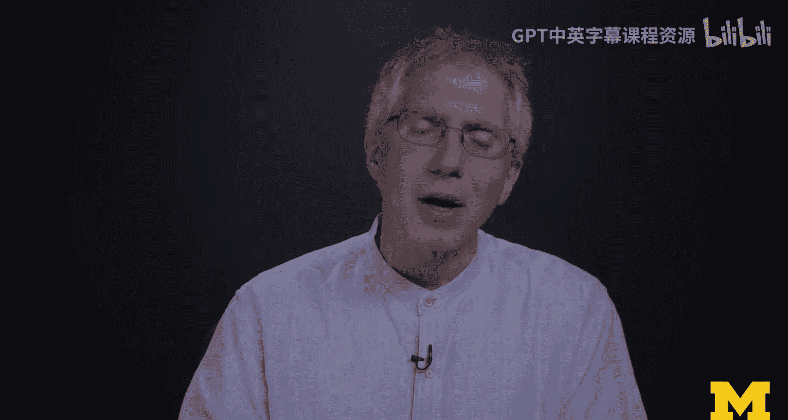

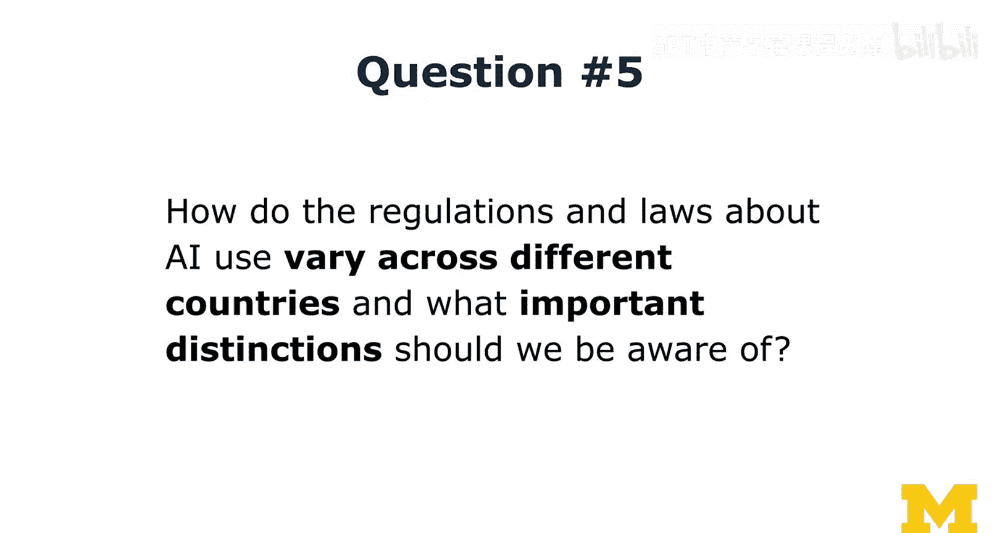

目前美国还没有围绕AI的健全法律，尽管拜登总统在2023年10月发布了一项行政命令。这项命令更多是愿景性的，而非具有深刻实质性内容，但它谈到了AI带来的生存关切，确保事物受到保护，人们的身份得到保护，同时我们在这个领域保持竞争力。该命令中没有太多实质内容，我相信随着时间的推移会得到完善。

我还应该提到，人们对影响AI的因素以及人类自身琐碎的偏见是否被融入了生成式AI的产出中存在担忧，而且几乎可以肯定确实如此。因此，行政命令中也对此表示了关切。

## 超越版权的法律考量 ⚖️

目前，没有太多专门针对AI的稳固法律。考虑到这一点，也值得说明的是，版权只是我们思考监管AI时所考虑的方面之一。版权有其边界，我们不应该使用版权作为约束AI或在超越AI职责范围的领域调整或推动它的工具。

隐私法仍然适用。关于你可以在国际上分享什么的法律，或个人拥有自己人格权、其形象不被以某种方式利用的权利，这些法律仍然有效。有一系列法律可能与AI相互作用，你所在社区的一般实践规范在AI背景下仍将倾向于适用。

我完全期望在未来，我们将开始看到一套法律体系逐渐成长起来，围绕在AI的周边，并在其独特的领域内，使其最好地为我们服务。

## 总结 📝

本节课中，我们一起学习了人工智能与法律，特别是版权法的交叉问题。我们了解到：

1.  **版权基础**：版权保护以有形媒介固定的人类创作。
2.  **AI的输入与输出**：需要从输入（训练数据的使用，可能涉及合理使用）和输出（AI生成内容）两个层面分析法律风险。
3.  **AI生成内容的版权状态**：目前在美国，由机器独立生成的内容不受版权保护，人类参与的程度是未来判定的关键。
4.  **对组织的实际影响**：AI生成的作品缺乏传统版权保护，组织需要通过合同、透明度声明等方式管理风险。
5.  **国际差异**：不同司法管辖区（如美国与欧洲）在版权、隐私、个人权利等方面的法律理念存在差异，影响AI的监管环境。
6.  **更广泛的法律图景**：版权只是AI法律考量的一部分，隐私法、人格权法等其他法律同样适用。

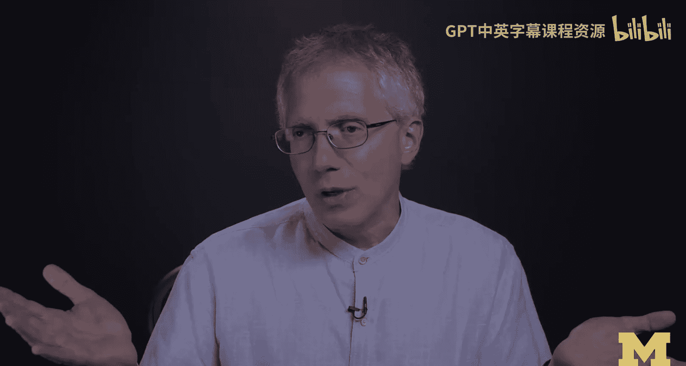

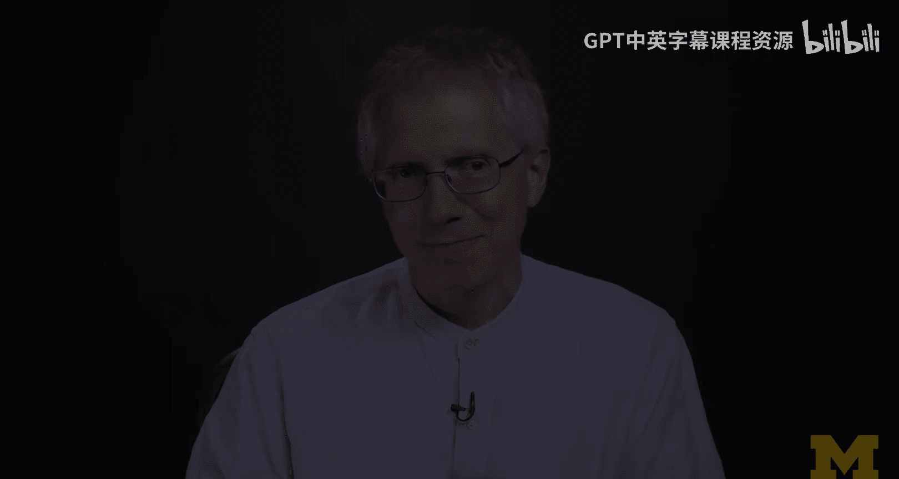

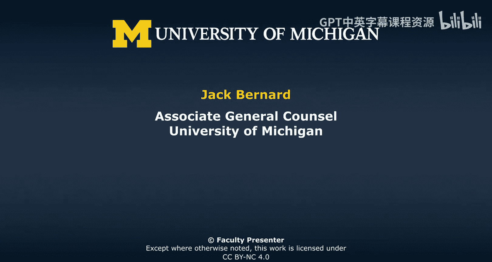

对于组织而言，在向前推进使用AI时，存在着深刻的公共政策问题和许多务实的议题需要考虑。