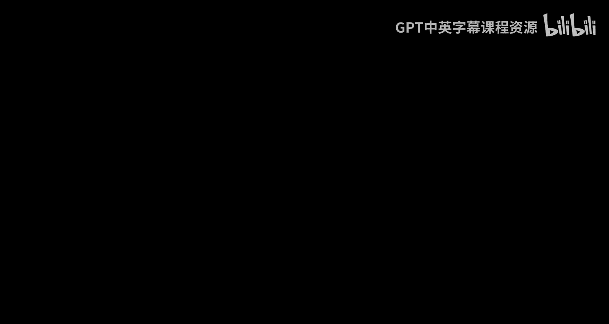
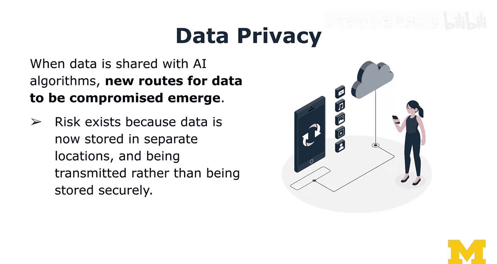
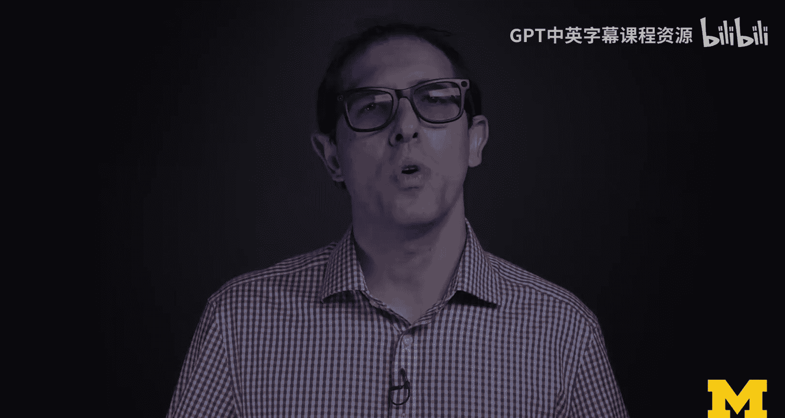
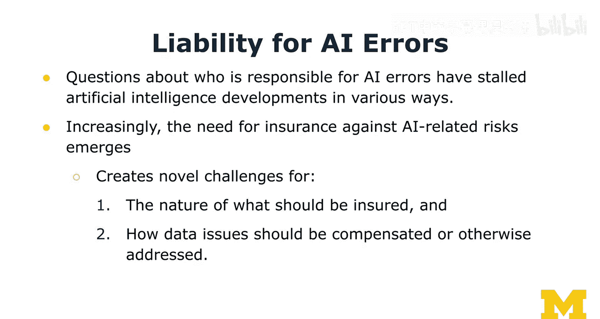
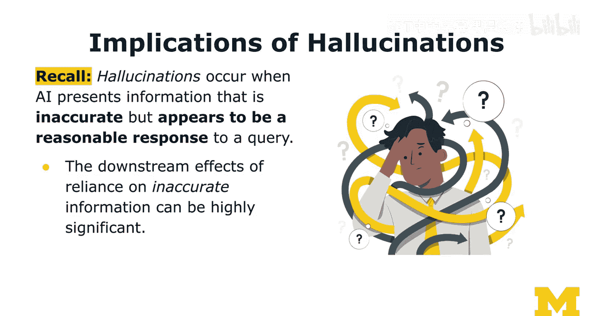
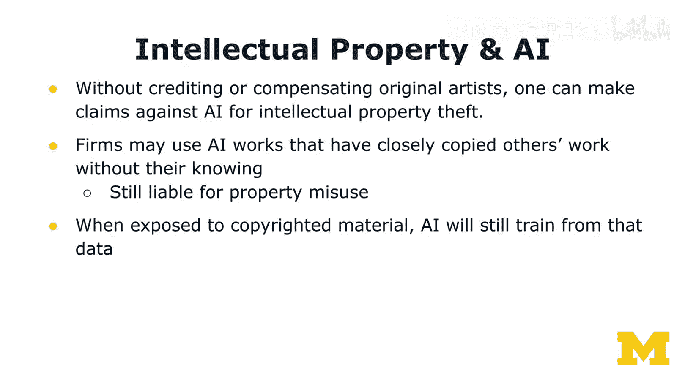
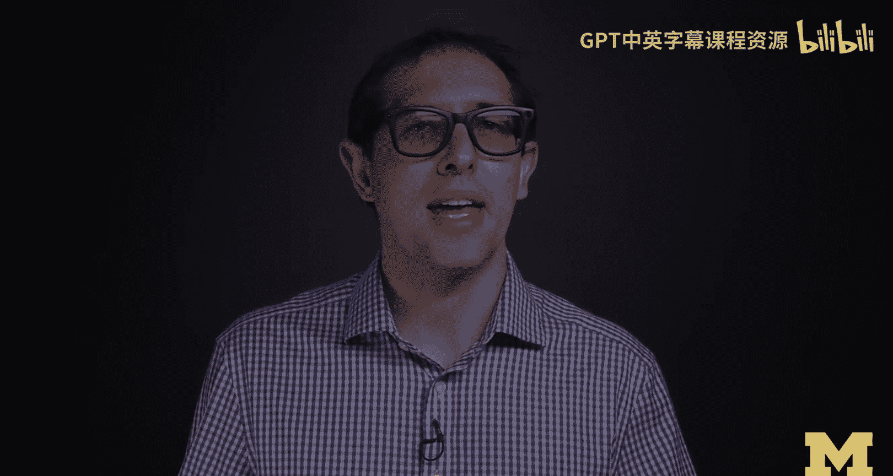
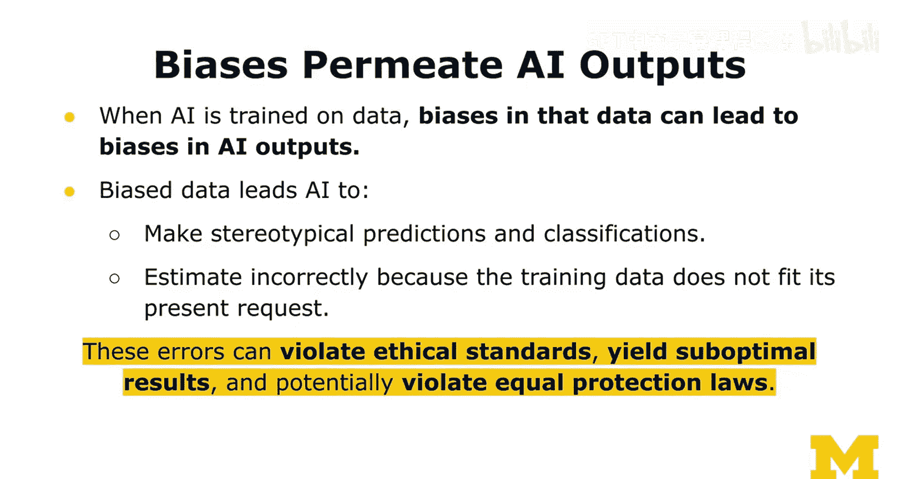
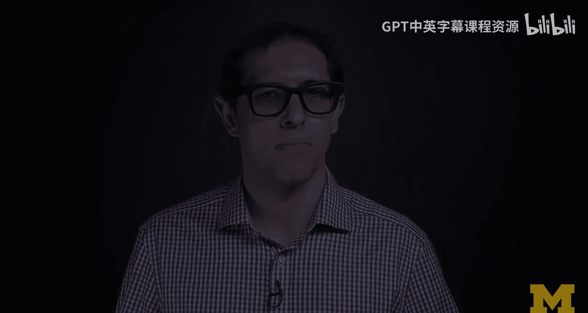
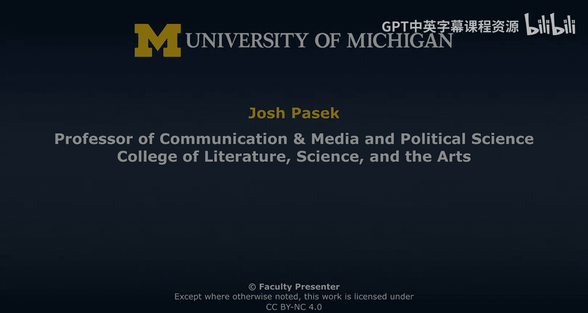

# 应对颠覆：工作场所的生成式人工智能：45：人工智能的潜在危害 🚨

在本节课中，我们将探讨在工作场所应用人工智能可能带来的多种潜在危害。理解这些风险至关重要，因为只有充分认识它们，企业才能通过制定适当的政策和目标来有效规避。

## 概述：人工智能的四大风险领域

人工智能在工作场所的实施，可能在多个方面对公司及其服务对象造成严重损害。这些风险主要可归纳为四类：**数据隐私风险**、**责任与错误风险**、**知识产权风险**以及**社会偏见风险**。接下来，我们将逐一深入分析。

## 数据隐私风险 🔒

上一节我们概述了主要风险类别，本节中我们来看看具体的数据隐私问题。人工智能系统本质上是数据收集与分析程序。它们通过自动化流程或直接交互来收集输入的信息，并利用这些数据训练其模型。

与人工智能交互，尤其是在向AI算法共享数据时，可能为数据泄露开辟新的途径。这些新风险之所以存在，是因为数据被存储在独立的地方，并以可能带来额外安全风险的方式进行传输。

以下是数据泄露可能带来的具体影响：

*   **对个人的直接伤害**：个人的医疗记录和信用卡信息等敏感数据被暴露。
*   **对公司的损害**：发生数据泄露的公司会遭受财务和声誉上的双重打击。

因此，全面思考如何在与人工智能产品交互时维护数据安全，以及如何确保不应离开公司或特定服务器的数据得到妥善保护，是一个至关重要的问题。

## 责任与错误风险 ⚖️

在数据隐私之外，人工智能产品还以多种方式涉及法律责任问题。关于谁该为AI错误负责的疑问，已经在多个方面阻碍了人工智能的发展。

例如，能够自动驾驶的电动汽车的发展，在某种程度上就因需要明确法律责任而受到阻碍。这一切带来的一个影响是，对AI相关风险保险的需求日益增长，这为“承保内容”和“如何补偿数据问题”带来了新的挑战。

以下是两个具体的责任风险场景：

*   **医疗诊断错误**：依赖有问题的AI医疗诊断工具，可能导致对使用该算法的公司和医生提起误诊索赔，也可能对软件公司本身提起诉讼。
*   **金融系统故障**：例如在“闪电崩盘”事件中，算法交易系统导致股票被快速抛售，并在特定一天拖垮了股市，此类问题会引发法律和财务处罚。

监管机构必须决定如何分配这些处罚。此外，“幻觉”是另一种形式的AI危险，即人工智能工具自信地提供不准确的信息。它只是针对特定查询提供看似合理的信息，但依赖这些错误信息可能产生非常严重的下游影响。

## 知识产权风险 🎨

除了责任问题，人工智能背景下的知识产权问题也带来了额外的挑战。当人工智能生成一幅新画作时，该画作可能是在现有艺术家作品的基础上训练而成的。

在某种程度上，这种训练与人类艺术家通过临摹杰作来学习的方式并无不同。但在另一方面，AI能够紧密模仿某种方法和风格，这可能侵犯原作者的权益。

以下是知识产权领域的主要关切点：

*   **对原创者的侵权**：如果原创艺术家没有从人工智能工具本身获得适当补偿（至少迄今为止这并非常态），那么针对人工智能创造者以及那些生产准版权作品的人，就存在合理的知识产权主张。
*   **对使用者的风险**：公司可能最终使用了AI生成的产品，而这些产品本身是密切复制他人作品的，即使他们不知道原作的来源，也可能需要为此承担使用责任。

另一个关键挑战在于，人工智能服务会从它们接触到的内容中学习。当它们接触到可能被公司（甚至该公司员工）拥有版权的作品时，它们可能会学习并利用这些内容来生成进一步的输出。

在法律和实践层面，如何保护公司的产品不被人工智能学习利用，以及如何识别知识产权是否通过AI工具被挪用，都是一个需要大量充实完善的领域。这里还存在一些复杂的问题，例如AI复制作品的标准是什么。一幅画被艺术家复制与被AI代理复制，其含义截然不同，尤其是当复制过程中加入了细微改动时。因此，许多这类问题都需要在未来得到大量澄清才能解决。

## 社会偏见风险 🚫

最后，当AI基于数据进行训练时，数据中的偏见会导致AI输出结果产生偏见。这可能导致AI在某些情况下做出刻板化的预测和分类。

它也可能导致AI的估计严重偏离实际，因为其训练数据与所应用的情境存在系统性差异。此类错误可能违反道德标准，产生次优结果，甚至导致公司违反平等保护法律。

## 总结与启示

从以上例子中，我们可以看到一系列因公司应用人工智能而可能产生的潜在危害。这些危害可能源于公司最初向AI暴露了信息，也可能源于AI以其他方式提供了本不应提供的内容。

这类关切不仅对“何为适当或不适当使用”的法律标准提出了重要问题，也对公司应如何推进AI应用提出了挑战，特别是考虑到关于人工智能信息来源及其使用方式的这些关键问题。通过本课的学习，我们认识到，主动识别并管理这些风险，是负责任地部署工作场所人工智能的关键一步。