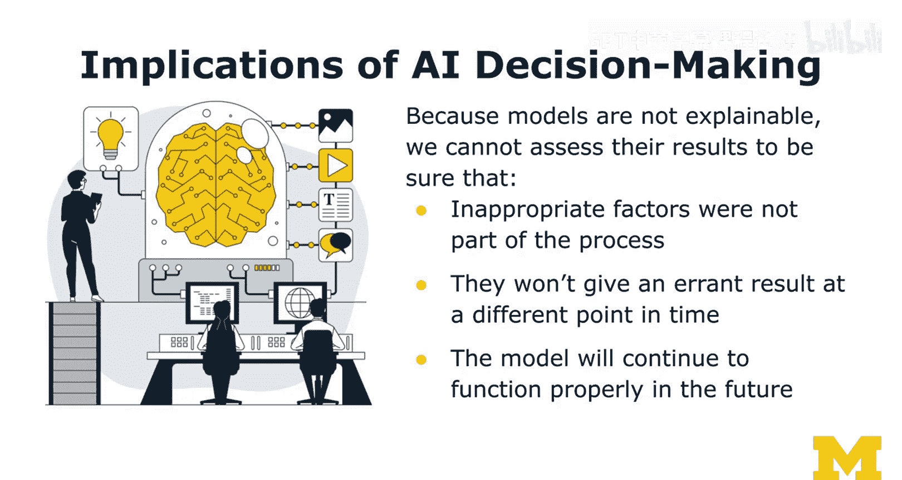
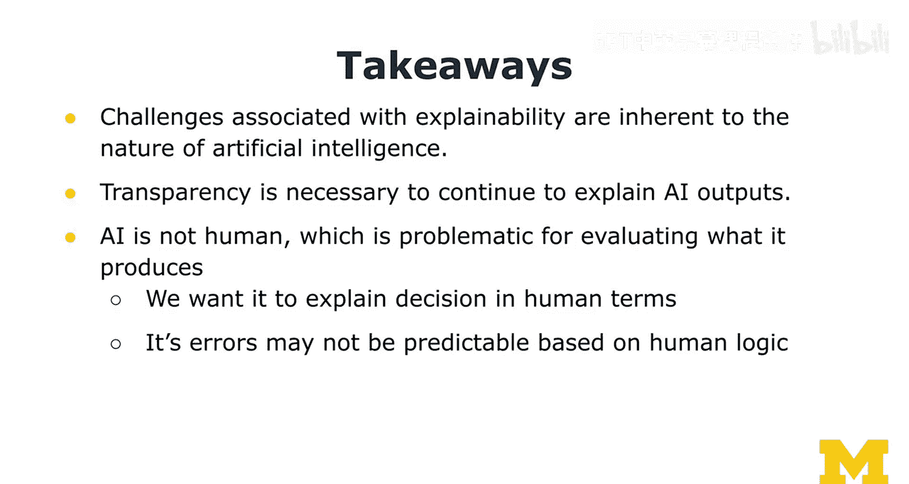

# 应对颠覆：工作场所的生成式人工智能：P46：透明度与可解释性

在本节课中，我们将要学习人工智能模型运作的基本原理，并深入探讨当前AI模型普遍存在的“黑箱”问题，即其决策过程缺乏透明度与可解释性。我们将了解这一特性带来的风险，以及为何强调透明使用和培养AI素养至关重要。

## 人工智能的运作原理

人工智能模型通过理解词语、图像和声音之间的关系来运作。它们生成对这些事物如何相互关联的上下文理解，从而推断用户在提示模型时想要什么样的回应。

在构建此类模型的过程中，计算机科学家使用**神经网络**。神经网络将文本流中的词语或图像中的像素，通过逐层链接，最终关联到模型的输出结果。

这个过程是通过理解模型各组件之间的关系，并生成多个连续的预测结果来实现的。其核心可以抽象为一系列复杂的函数变换：
`输出 = f(输入; 权重)`
其中，`f`代表由神经网络定义的复杂非线性函数，`权重`是模型通过学习数据调整得到的参数。

## 可解释性的挑战

然而，由于所产生预测结果的性质，以及所涉及模型的庞大规模，当代人工智能模型对人类直接的检查而言是不透明的。

人们无法简单地查看模型、检查其输出，并追溯某个特定预测因子或输入如何导致最终结果产生的过程。

由于这一限制，当代人工智能是“不可解释的”，因为我们无法追溯某个输出结果的来源。

这种可解释性和透明度的缺乏初看似乎是学术问题，但对个人和企业使用和理解AI输出的方式构成了真实风险。因此，它关系到使用此类模型所带来的各种风险。

## 可解释性人工智能的重要性

可解释人工智能是当代计算机科学的一个重要领域，学者们越来越多地借鉴心理学技术来理解模型将产生何种输出。

理解模型为何产生特定结果，有助于诊断模型何时可能提供不准确的结果，并能澄清模型是否确实以恰当的方式完成了被要求执行的任务。

以医疗诊断为例。我们可能希望训练一个模型来观察一张特定皮肤病变的图片，并判断其是否可能癌变。

在缺乏可解释性的情况下，我们得到的只是：输入一张图片，然后得到一个“癌变”或“非癌变”的结果。关键在于，我们不知道它为何得出该结论，也不知道哪些信息参与了该决策过程。

虽然可以询问AI算法为何产生该信息，但其回答可能并不准确，因为这些模型不具备任何算法层面的自我意识。在某些方面，这与人类常常无法解释自己行为原因的情况类似。

但与人类不同，AI倾向于对这些判断表现得非常自信，并且有太多潜在的输入参数，使得AI自身的解释完全不可靠。也就是说，人工智能算法在某种意义上并不知道自己为何得出关于图片是否癌变的结论。

## 缺乏可解释性的风险

这一点很重要，因为AI模型可能依赖于在某些情况下不相关的判断依据，或者模型可能学到了用于特定评估的不恰当依据，但由于这些模型基本上不可解释，这一点并不明显。

我们无法评估模型的结果，并确信不恰当的因素没有构成决策过程的一部分。我们无法评估模型的结果，并知道它们不会在另一个时间点给出错误的结果。我们也无法确信今天有效的方法明天会继续有效。

## 透明使用的必要性

可解释性的缺失，将责任转移到了人工智能模型的使用者身上，要求他们的行为必须透明。

透明地使用人工智能，明确说明其使用的时间和方式、为何以特定方式使用、以及我们对使用效果了解多少，这对于与用户建立信任至关重要。确立特定应用使用AI的理由也基于此。

因此，透明度对于问责制至关重要，也是确保AI流程公平的必要条件。只有当我们对AI被使用和整合的过程保持透明时，我们才能有意义地审计这些过程，以检查AI的使用是否按照我们希望的方式运作。

## 未来的方向与当前策略

理想情况下，在未来某个时刻，我们或许能找到方法让人工智能算法的结果更具可解释性。这可能不是通过完全理解输入到输出的过程来实现，而是通过更严肃地理解人工智能中各种选项的概率在不同情况下以及随着条件变化如何运作。

认识到至少在当前，我们面对的是一个“黑箱”，这迫使我们必须重点关注对提示内容以及提问语境的披露，以此作为理解导致特定结果原因的一种方式。

这也凸显了对**AI素养**的需求。只有具备AI素养，用户才可能理解我们对AI为何给出特定结果知道什么、不知道什么。这一点尤其关键，因为人工智能有可能产生“幻觉”或不恰当地复制内容。

对特定情况下此类问题发生频率有一个共同理解，对于能够信任人工智能的输出至关重要。

## 总结与警示

本节课中，我们一起学习了与可解释性相关的挑战是当代AI固有的特性。这提出了使用必须透明以及我们需要持续寻求解释人工智能输出的需求。

但在这方面我们必须非常谨慎。因为人工智能不是人类，在评估其产出时很容易不恰当地将其拟人化。当我们试图用人类术语解释人工智能为何做出某些决策时，它可能不会做出与人相同的决策，其错误也可能无法基于广义上人类错误的典型模式来预测。

我们需要定期审视AI的输出，并对其缺乏可解释性所带来的挑战保持警惕。通过不断评估人工智能的哪些方面有效、哪些无效，我们可以准备好标记出可能出错的情况，并有可能在问题出现时加以预防。