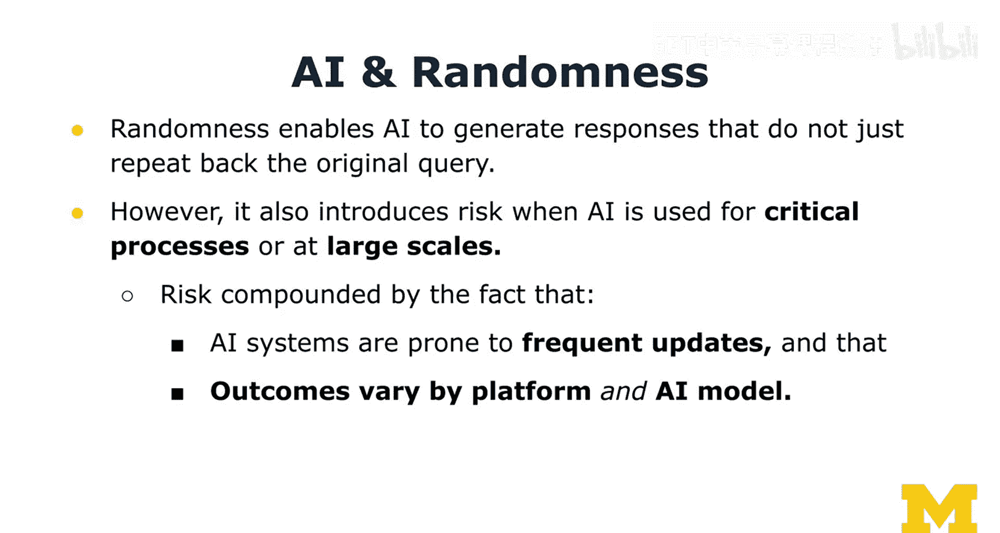
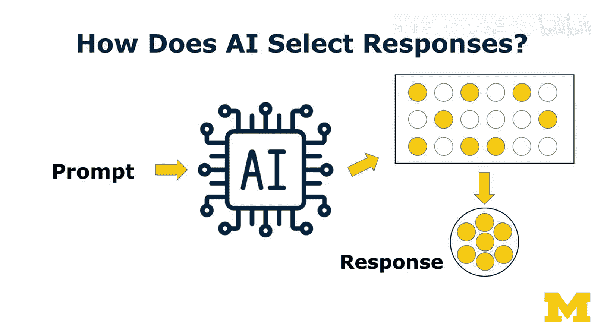
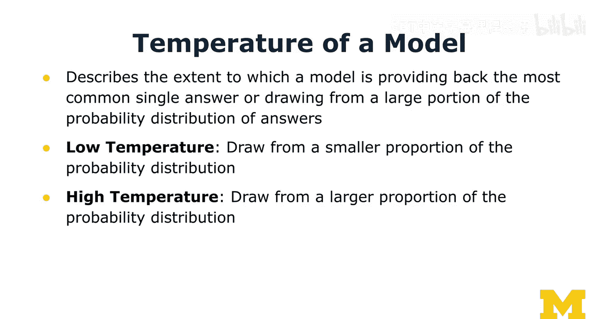
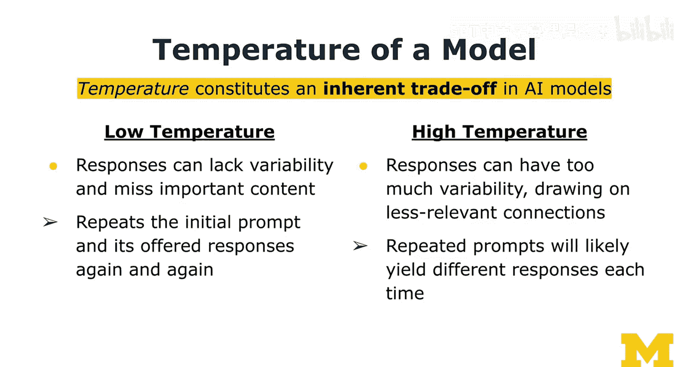
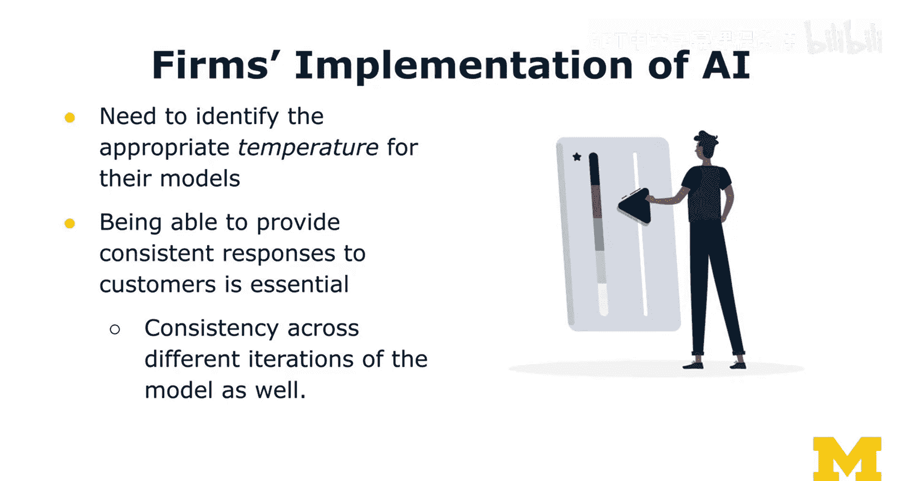

# 应对颠覆：工作场所的生成式人工智能：P47：依赖随机性的技术演进平台 🎲

在本节课中，我们将要学习人工智能的核心特性之一：随机性。我们将探讨随机性如何为AI带来创造力和新颖性，同时也引入了风险和不确定性。理解AI模型的随机性原理及其控制参数，对于在企业环境中可靠地应用AI至关重要。

人工智能的许多核心风险与益处，都源于其基于随机性原则这一事实。用计算机科学的术语来说，它是**随机性**的。

因为人工智能基于随机性原则，它能产生新颖性，而不仅仅是精确重复给定的特定词语。但这种过程中的随机性，在人工智能被用于关键流程或大规模应用时，会引入风险。

这些风险会因人工智能系统倾向于频繁更新而加剧。所使用的平台结果，会因所采用的特定AI模型版本不同而有所差异。

理解人工智能系统的动态特性，能帮助我们理解固有的随机性以及这些变化对人工智能输出可靠性的影响。

意识到这些过程并为之做好计划，对于降低风险至关重要。

## 理解AI如何生成响应

上一节我们介绍了AI的随机性本质，本节中我们来看看AI模型是如何根据提示生成具体响应的。

当用提示词查询人工智能时，返回的结果是从算法根据提示词模式或其他内容确定的最可能的期望内容中**采样**得到的。

要理解这些响应从何而来，我们需要观察人工智能系统在实践中学习到的内容分布。人工智能系统会从与提示词共享关键组成部分的其他内容中学习。

收到提示词后，新创建的响应会大量借鉴与提示词相关的、以不同事物存在频率为相对比例而存在的内容。

举个例子，如果我谈论“游泳”，AI算法会立即识别出游泳很可能与适合游泳的地点相关联，例如“游泳池”或“海滩”。

AI算法随后会利用上下文环境中的词语，来推断我最可能去游泳的是哪种环境，并在其响应中提供符合该上下文的信息。

AI算法倾向于从分布中出现频率最高的部分大量采样。

因此，如果在外部文本中谈论游泳时，“游泳池”的使用频率是“海滩”的两倍，那么在AI模型中，“游泳池”相比“海滩”的使用比例可能会更加不成比例。

当AI模型提供响应时，这是人工智能系统程序员的常见选择，因为它使他们能够基于出现的最常见响应提供高质量的反馈。

简而言之，AI程序员假设用户想要一个相对常见的响应，并且提供这类响应的频率甚至比它们在典型人类文本中出现的频率更高。

评估与游泳上下文可能相关的不同事物出现的程度，本质上将取决于这些不同概念的相对频率。

但是，最顶部的几个概念比其他所有概念的可能性高出多少的具体选择，将取决于一个叫做**模型温度**的参数。

## 核心控制参数：模型温度

上一节我们了解了AI如何从概率分布中采样，本节我们将深入探讨控制采样行为的核心参数——温度。

模型的温度本质上对应于模型是提供最普遍的单一答案这种确定性反馈的程度，还是从构成查询潜在响应的基础概率分布中抽取更大比例的程度。

**温度较低的模型**从概率分布中抽取较小的比例，而**温度较高的模型**则从概率分布中抽取较大的部分。

这两种选择都有风险，温度构成了AI模型中固有的权衡。

较低的**温度**可能产生无法提供趣味性或足够多样性以提供新内容的文本。低温度模型本质上可能一遍又一遍地重复提示词和它已经生成的内容。

相比之下，高**温度**模型更可能抽取与特定查询相关性较低、但也可能成立的内容。对于一个高质量模型重复相同的提示词，通常会得到新的东西，而对一个低温度模型重复提示词，则倾向于再次生成相同的输出。

在某些情况下，**变异性**非常有价值。例如，当你在谷歌这类服务上搜索信息时，谷歌希望为你的查询提供高概率的响应，但他们也希望呈现你可能在寻找的一系列事物。也就是说，他们不希望只提供相同类型的响应，以防你寻找的东西与最顶部的单一答案略有不同。

虽然谷歌搜索并非以这种方式随机，但其设计旨在同时提供最高质量的响应，同时覆盖用户可能寻找的响应范围。这相当于随着你向下浏览搜索结果，响应的温度越来越高。

提供更多变异性的模型可能有助于揭示你本意的其他替代方案，或识别出低温度模型可能不会突出的其他可能性。围绕模型温度的这些选择，也影响着模型是否可能产生极其意外的结果。

因此，产生极其意外结果的风险越高，模型的温度就应该设置得越低。基线温度在某些情况下很有意义，但在其他情况下则不然。一定程度的变异性对于从模型中引出响应非常有帮助。

但在寻找精确信息时，变异性可能等同于引入不准确性。

随着企业开始试验人工智能输出，思考模型的适当温度至关重要。

在与AI交互时，温度可以通过多种方式设置，尽管对于使用最基本交互平台的用户来说并不常见。事实上，许多与人工智能交互的自动化方式的质量，都依赖于正确的温度设置。

认识到真正古怪响应的风险，对于减轻人工智能固有随机性的危险非常重要。

## 模型更新与可靠性考量

上一节我们讨论了如何通过温度参数控制单次输出的随机性，本节我们将关注另一个影响AI可靠性的动态因素：模型本身的迭代更新。

在企业环境中思考人工智能使用可靠性的另一个关键部分，是随着模型自身变化，在不同版本的人工智能模型迭代中可能观察到的结果的一致性。

自ChatGPT在2022年首次爆发以来，新模型大约每几周或几个月就会推出一次，而更大的更新大约每年一次。这些更新从根本上改变了人们对AI模型输出的预期，通常使输出更加复杂、略微改变其形式，或仅仅改变其外观。

虽然这类变化本身不是问题，但与AI模型固有的随机性相结合，它们构成了系统可能崩溃、人工智能结果可能与之前截然不同的转折点。

这可能导致事情突然出错的情况。由于在神经网络本身内部精确定位这些问题背后的错误非常困难，企业需要意识到这种可能性，并定期对算法的结果进行抽查，以及更系统地评估其可靠性，以及它是否确实适合其用途。

那么在实践中，理解人工智能的动态特性——既包括模型固有的随机性，也包括新更新导致模型结果发生巨大变化的趋势——有助于帮助企业系统地评估和记录他们所用模型的评估结果，也有助于防止在事件和其他情况可能发生变化时过度依赖人工智能。

也就是说，意识到人工智能的动态特性和底层过程，并对人工智能可以在何时何地使用以及为何以这种方式使用进行强有力的记录保存，不仅有助于降低风险，还能识别出何时情况可能发生变化。

## 总结

本节课中我们一起学习了人工智能中随机性的核心作用。我们了解到，AI的创造力和风险都源于其随机性本质。通过“温度”参数，我们可以控制AI输出是更确定、更常见，还是更具探索性和多样性。同时，AI模型的频繁更新也带来了结果一致性的挑战。理解这些动态特性，并建立系统的评估和记录机制，对于在企业中安全、可靠地应用生成式人工智能至关重要。