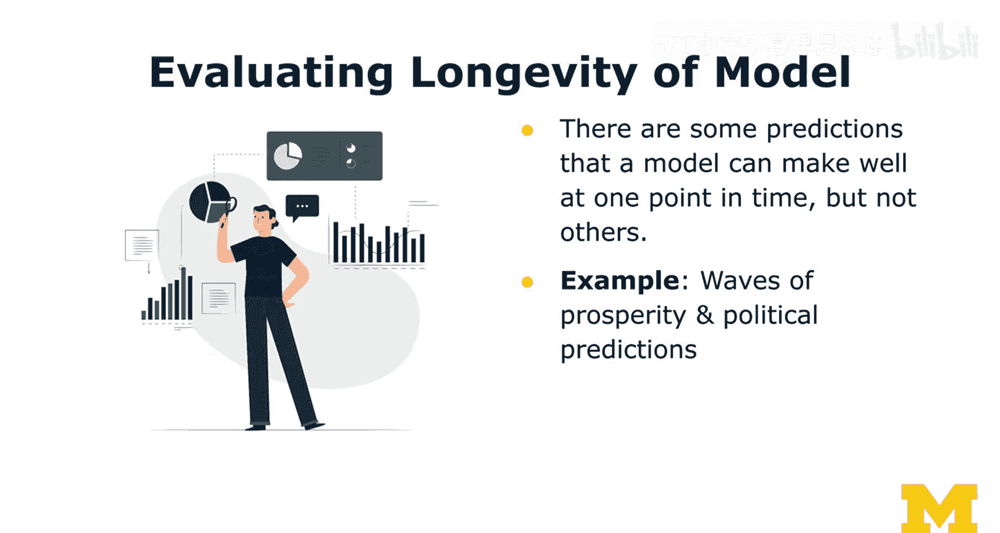
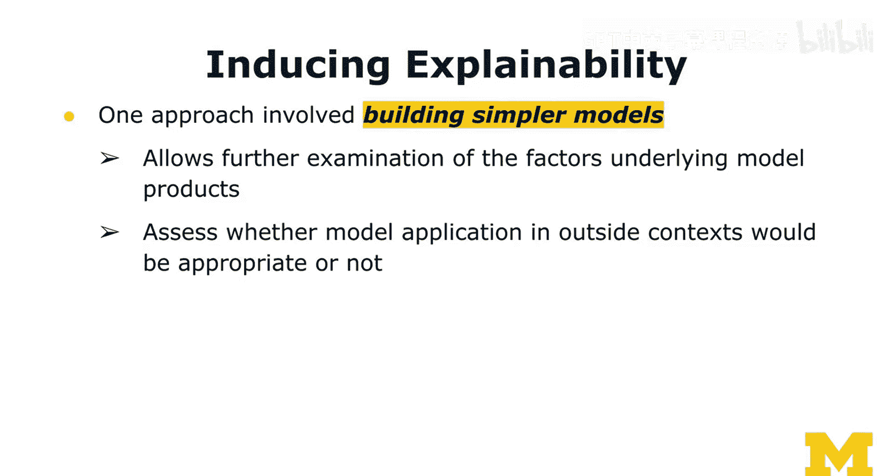

# 应对颠覆：工作场所的生成式人工智能：P48：过度依赖的风险

在本节课中，我们将要学习过度依赖人工智能模型所识别出的模式会带来哪些风险。核心风险在于，当模型所依赖的模式发生变化或遇到全新情况时，基于这些模式做出的预测可能会失效，甚至导致严重后果。我们将通过具体案例来理解这一风险，并探讨如何通过扩大训练数据范围、考虑时间因素以及增强模型可解释性等方法来应对。

## 人工智能的核心与风险

人工智能的核心是一个模式学习的过程。这个过程通过学习模式并基于这些模式进行预测，可以展现出强大的能力，但也可能引发问题。

上一节我们介绍了人工智能的基本原理，本节中我们来看看过度依赖模式识别能力会带来的核心风险。当我们过度依赖识别模式的能力时，一个核心风险是，我们可能无法理解这些模式在预测未来时存在哪些局限和挑战。

## 过度依赖模式的风险

基于少量模式构建得过于僵化的模型，在模式发生变化或引入新动态时，可能会以非常奇怪的方式运行。认识到过度依赖现有模式的风险，有助于避免在使用人工智能模型时出现一些更具挑战性的问题。

以下是两个具体案例，说明了过度依赖算法的后果：

*   **2010年美股闪崩**：2010年，一系列股票市场模型在决定是否交易某些股票。由于发生了一组前所未有的事件，多个模型以某种方式相互作用，迅速导致了美国股市的大规模抛售，市场经历了所谓的“闪崩”或急速下跌。高频交易算法快速做出以更低价格卖出股票的决定，导致巨额资金损失。这一事件揭示了过度依赖算法交易实际上可能导致市场不稳定的情况。事实上，在闪崩当天，情况变得非常糟糕，股市被迫暂停，直到问题解决前不允许进行新的交易。
*   **模型失效的日常案例**：模型在面对我们称之为“样本外数据”时往往会失效。所有模型都是在某些信息样本上进行训练的。但根据其训练数据的性质和训练过程，当模型遇到与训练环境不符的信息时，情况可能会迅速崩溃。

## 样本外数据与模型失效

有时这些情况会导致无意的偏见。例如，机场的水龙头传感器在训练时只接触了开发人员的手，而没有接触与开发人员手部特征差异很大的手。这意味着肤色较深的个体无法使用这些水龙头。

语音识别算法通常基于美国人的语调和声音进行训练，当遇到苏格兰口音或说话方式不同的人时，经常会失败。这类失败源于模型在一组数据上训练，然后被应用到该范围之外的数据上。

这在一定程度上对训练人工智能模型有启示，即需要确保模型的训练尽可能广泛，同时也对模型的应用有启示。因为识别应用是否发生在训练数据之外，对于理解人工智能模型何时可能产生误导性结果至关重要。

例如，一个设计用于估计美国某产品销量的模型。如果一家公司突然用该模型来估计同一产品在泰国的销量，模型很可能会失败。这不是因为模型对其训练过的情况是错的，而是因为应用环境差异太大，预测因子可能以完全不同的方式运作。

人工智能模型的“黑箱”特性使得我们难以理解模型可能依赖了哪些在不同环境下不成立的属性。这意味着模型的最终用户需要评估模型是否适用。

## 应对过度依赖的方法

有多种方法可用于解决人工智能模型可能过度依赖训练数据的问题。

以下是几种关键的应对策略：

*   **扩大训练数据范围**：首要方法是尝试扩大人工智能训练数据的范围。对于使用自有模型训练AI的公司而言，确保用于训练过程的数据覆盖了潜在应用的全部范围，并重新评估其是否确实覆盖了该范围，这一点非常重要。未能完全覆盖范围可能导致在该范围外应用时出现模型设定错误。
*   **考虑时间因素**：用户需要询问的另一个关于人工智能模型范围的问题与时间有关。在某些情况下，模型可能在某个时间点有效，但在其他时间点无效。这同样是因为背景环境不同了。

例如，当经济状况良好时，如果有民主党在任总统，民主党人倾向于对民主党总统候选人的胜算感觉更好；如果经济状况良好但有共和党在任总统，他们则会对本党候选人的胜算感觉更糟。共和党人的情况则相反。在某些时间点，经济良好让民主党人对本党胜算感觉更好；而在另一些时间点，经济良好让共和党人对本党候选人胜算感觉更好。这些都是相当合理的反应，但如果我们仅使用民主党在任时期的数据来构建模型，我们可能会从根本上误解这种关系，甚至得到完全相反的结论。当共和党在任时，我们的预测将是错误的。

*   **增强模型可解释性**：解决这类问题的一个关键方法是尝试在模型中引入可解释性。这可以通过几种方式实现。一种方法是构建一个更简单的模型，来检查可能影响模型输出的因素，并利用这个模型来思考模型的应用是否会发生在训练范围之外。当我们能够观察到模型中重要的因素时，问题有时是显而易见的。但在人工智能环境中，我们处理的是黑箱，我们看不到这些信息。因此，除非我们创建一个替代的简化模型来验证我们的证据，否则当模型在高风险情况下停止工作时，我们可能会措手不及，因为它可能恰恰从错误的东西中进行了学习。

## 总结与资源需求

为了避免这些问题，我们要么需要真正审视可解释的模型，要么需要定期重新评估模型的准确性。这两种方法都需要大量资源，超出了直接使用人工智能的成本。

本节课中，我们一起学习了过度依赖人工智能模式识别能力所带来的风险，包括在面对样本外数据或环境变化时模型可能失效，甚至引发像“闪崩”这样的系统性风险。我们探讨了应对这些风险的主要方法：尽可能扩大训练数据的覆盖范围、考虑时间等上下文因素对模型的影响，以及通过构建可解释模型来理解黑箱内部的逻辑。认识到这些局限并采取相应措施，对于负责任且有效地应用人工智能至关重要。