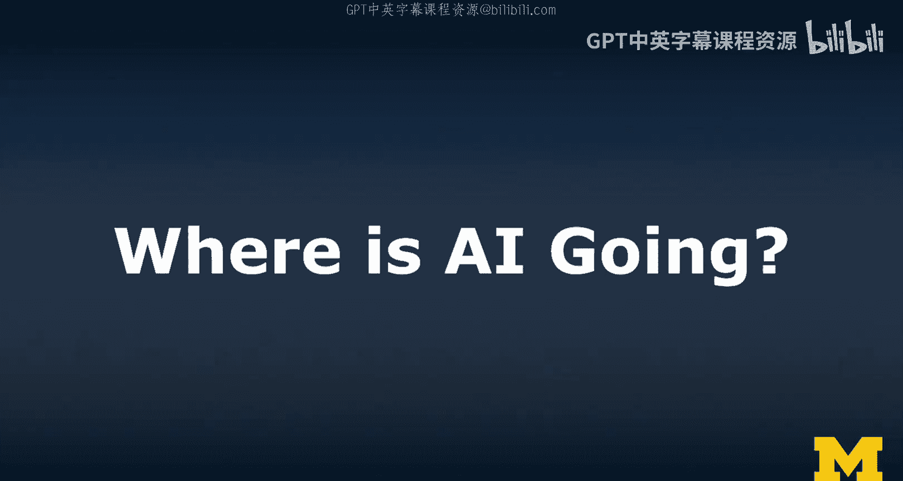
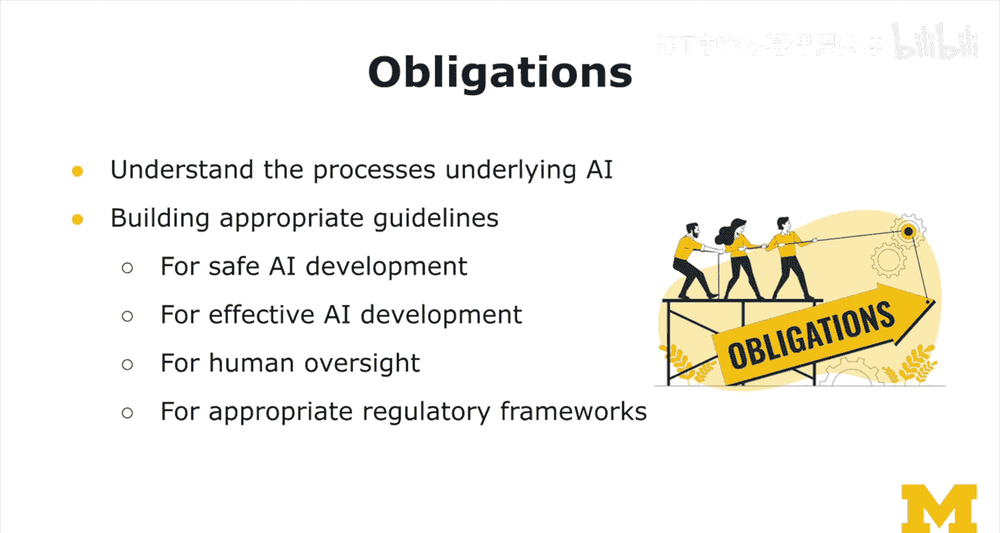
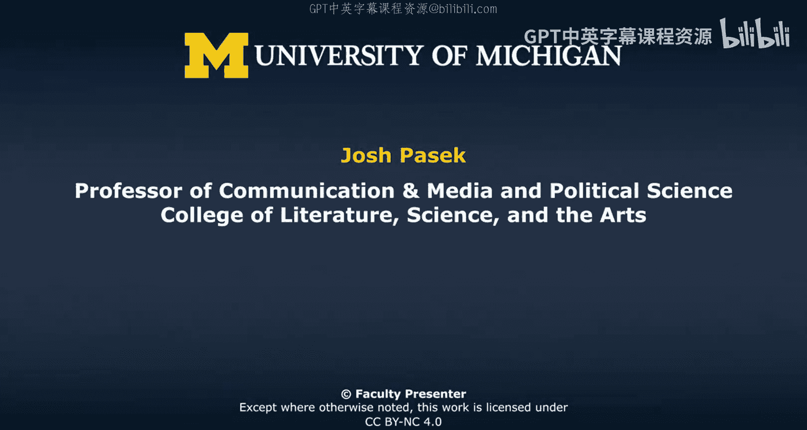

# 应对颠覆：工作场所的生成式人工智能：P49：人工智能的发展方向 🤖

在本节课中，我们将探讨人工智能未来的几种可能发展方向。理解这些可能性至关重要，因为它们将深刻影响工作场所的未来以及人工智能在社会中的角色。虽然我们无法确切预知未来，但思考这些可能性有助于我们围绕人工智能设计企业、制定政策，并为即将到来的变革做好准备。

## 人工智能发展的多种可能性

目前，我们正处于人工智能转型的初期阶段。关于其未来，存在多种不同的可能性。

以下是几种主要的未来设想：

1.  **能力持续增强**：人工智能可能继续获得越来越多的能力，变得更加强大和智能。
2.  **达到能力上限**：另一种可能是，基于当前公开可用的信息类型，人工智能的学习能力已基本达到极限。
3.  **能力退化风险**：甚至存在风险，即随着发展，人工智能在某些方面可能出现能力退化。

## 奇点：超越人类的智能 🚀

上一节我们介绍了人工智能发展的几种宏观可能性，本节中我们来看看一个备受关注的未来设想——技术奇点。

这个概念源于科幻作品，描述了人工智能可能达到或超越人类智能水平，并开始自我迭代改进，最终超越人类的临界点。其核心公式可以表述为：

**AI -> 自我改进的AI -> 超级智能 -> 奇点**

如果奇点来临，社会将发生根本性变革。大量工作可能不再需要人类完成，这促使一些未来学家建议实施诸如**全民基本收入**等政策，以应对大规模失业的可能性。

虽然人机大战的设想可能被夸大或为时过早，但奇点的可能性迫使我们思考：当人工智能执行任务的能力远超人类，甚至人类自身都无法有效评估其输出质量时，人类的角色将是什么？

## 模型崩溃：自我侵蚀的风险 ⚠️

与奇点带来的指数级增长设想相反，另一种风险是人工智能的自我侵蚀，即“模型崩溃”。

理解人工智能未来面貌的一个关键问题是：当人工智能越来越多地使用AI生成的内容进行训练时，会发生什么？随着训练数据中AI生成或增强的内容比例越来越高，模型本身会如何变化？

一些早期证据表明，使用生成式AI内容训练的生成式AI模型，其能力实际上会下降。人工智能可能开始污染自己的训练数据，递归学习会导致奇怪的行为。例如，如果模型始终从高概率响应中采样数据，再基于这些数据生成新的高概率响应，它可能会变得越来越确定性和缺乏创造性。

这意味着，人工智能的价值或其进一步学习的能力，可能被自身所阻碍。如果人工智能模型持续在递归生成的数据上训练，它们实际上可能会“崩溃”，产生越来越低质量的响应。

## 平衡创新与安全的责任 ⚖️

那么，人工智能会加速学习创新，走向失控的自我完善，还是开始自我蚕食？我们不得而知。

但当我们思考未来及其可能的发展方向时，我们有一些责任确保自己理解人工智能的底层过程。这是为了在创新应用与安全担忧之间取得平衡。

我们应确保为人工智能的发展建立适当的指导方针：

*   **安全发展**：制定确保AI系统安全、可靠、符合伦理的开发准则。
*   **有效发展**：引导AI技术朝着有益于人类社会的方向演进。
*   **人类监督**：在任何强大的AI系统中保留必要的人类监督和最终控制权。
*   **监管框架**：为可能出现的各种情况建立灵活且适当的监管框架。

## 总结与展望

本节课中，我们一起探讨了人工智能未来发展的几种关键可能性：持续进步、达到极限、奇点超越以及模型崩溃风险。

关于人工智能，有一点是明确的：作为一种颠覆性技术，它的影响将非常深远且持久。正如我们从印刷术的发展中看到的，从其发明到其影响稳定下来，中间经历了数个世纪。人工智能很可能也是如此。

这是一项将塑造未来的技术。即使它没有像许多预测那样发展得那么远，其影响也必将持续而深刻。我们有责任以审慎而积极的态度，引导这项技术为人类社会带来福祉。