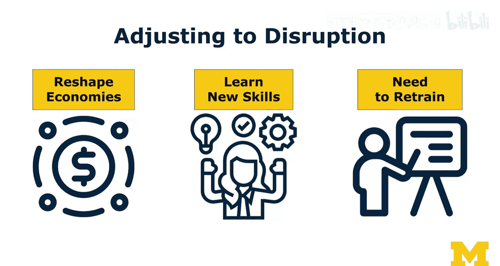
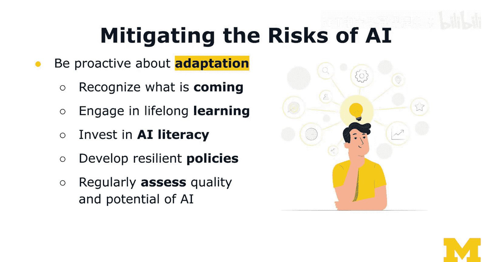
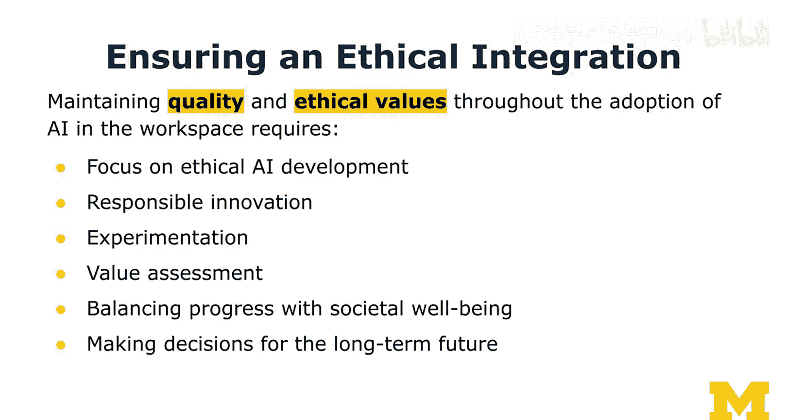
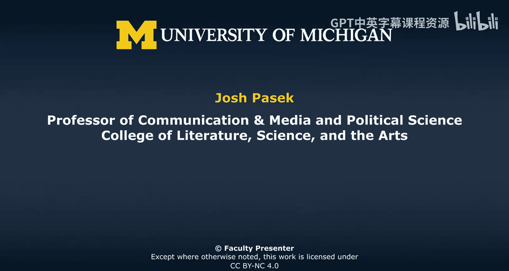

# 应对颠覆：工作场所的生成式人工智能：P50：10_回溯经典颠覆性技术

在本节课中，我们将回顾人工智能作为一种颠覆性技术，并将其与历史上的其他颠覆性技术进行比较。我们将探讨社会、工作场所和个人应如何适应这种变革，并总结出成功应对人工智能时代的关键策略。

## 📜 回顾历史：人工智能并非首次颠覆

在本课程中，我们讨论了使用人工智能所固有的诸多风险，并将这些风险置于企业可能如何使用和整合人工智能到其工作中的背景下。

在整个系列课程中，我们将人工智能视为一种颠覆性技术，它可能影响众多工作场所的任务，并塑造工作场所的运作方式。

上一节我们探讨了人工智能带来的具体风险与机遇，本节中我们来看看，人工智能的颠覆性并非史无前例。

## 🔄 历史上的技术颠覆与人类适应

在工业革命、互联网的出现、印刷术、电报以及其他塑造人们沟通和生产方式的创新中，我们已经见证了需要人类进行调整的历史性颠覆。

这种调整通常涉及重塑经济、个人在职业变化时学习新技能的需求，以及开发再培训计划以应对新技术并建立新的技能组合，例如识字能力或流水线经验。

随着时间的推移，颠覆性技术会产生社会影响，整个社会会适应它们改变人们行为及其方式。

广大人群在新的时代成长起来，做事的方式已经不同。

需要制定政策，以在新技术的影响与社会运作方式之间建立适当的接口。

以下是历史上技术颠覆带来的主要社会调整：
*   **经济重塑**：新产业兴起，旧产业转型或消亡。
*   **技能更新**：个人需要学习新技能以适应变化的岗位。
*   **再培训体系**：社会建立机制（如教育、职业培训）来培养新技能。

## ⚖️ 人工智能：新一轮的颠覆与挑战

新的技术变革会引发监管响应，以及人们操作和理解事物的新规范。

人工智能作为一种颠覆性技术，正蓄势待发地带来这类变革。

这是几十年来首次出现的新技术，它准备挑战那些通常因其工作而备受推崇和重视的个人的地位。

随着知识工作本身的演变，为个人准备知识工作岗位的工作也需要转变。

那些处于易受人工智能颠覆的就业领域的人，需要发展技能以维持其价值，或者必须适应新的领域。

认识到这场即将到来的颠覆，个人和企业将投入大量精力进行人工智能实验，识别其有效之处、无效之处、可靠之处和风险之处。

新的工作流程将会出现，它们将以不同于以往的方式结合人工智能和人类劳动。

## 🛡️ 主动应对：降低风险的策略

存在一些方法来降低风险：主动适应、认清未来趋势而非逃避、参与终身学习、投资于人工智能素养、制定有韧性的政策，以及思考定期评估质量和潜力的框架与方法，这些都至关重要。

以下是应对人工智能颠覆的关键策略：
*   **主动适应**：积极拥抱变化，而非抗拒。
*   **终身学习**：持续更新知识和技能。
*   **投资AI素养**：理解人工智能的基本原理、能力和局限。
*   **制定韧性政策**：在组织层面建立灵活、适应性的规则和流程。
*   **建立评估框架**：定期审视人工智能应用的质量、效果和潜在影响。

## 🌍 更广泛的影响与未来责任

人工智能的影响不仅限于工作场所，也关乎国际竞争力。

认真思考如何以合乎道德的方式整合人工智能，并应对不断变化的监管动态，将是至关重要的。

我们未来的挑战是，在人工智能融入劳动力的过程中，认真思考如何在道德上保持质量和价值观等关键优先事项。

这将需要专注于合乎道德的人工智能开发、负责任的创新、实验、价值评估、平衡进步与社会福祉，并为长远的未来做出决策。这些努力都很重要。

这些努力不仅对单个企业重要，对整个社会也至关重要。

我们还必须持续预测风险并重新评估我们使用人工智能的收益。

这些责任存在于各个层面。跨越个人、企业、政府和社会结构，共同努力实现整合人工智能以促进竞争力和更大社会福祉的目标，是至关重要的。

当我们思考人工智能的影响时，工作场所发生的变化将波及社会的方方面面。

有条不紊地分析这些变化可能如何发生，理解其收益和风险，并让个人和工作场所为这些变化做好适当准备，是我们的核心优先事项。

## 🎯 课程总结

本节课中我们一起学习了如何将人工智能置于历史技术颠覆的背景下进行理解。我们看到，社会曾成功适应过印刷术、工业革命和互联网等变革，而人工智能是这一系列颠覆中的最新篇章。

成功的关键在于主动而非被动：通过终身学习、培养人工智能素养、制定灵活的政策以及建立持续的评估机制来做好准备。这不仅仅是企业的任务，也是个人、政府和整个社会的共同责任。

我希望我为您列出的这一系列思考，能帮助您认真思考如何为工作场所的人工智能做好准备，以及如何制定能引领您走向人工智能成功的政策、框架和评估方法。

感谢您加入本课程的学习。