# Python程序员的羊驼：P1：欢迎来到课程 🦙

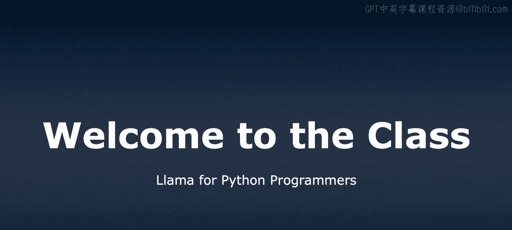

在本节课中，我们将要学习这门课程的概述、目标以及你将如何通过实践来掌握Llama2这一开源大语言模型。

欢迎来到《Python程序员的羊驼》课程。我是克里斯·布鲁克斯，密歇根大学信息学院的副教授。我的背景是计算机科学，在密歇根大学的研究和教学重点在于应用数据科学、机器学习和人工智能来改善基础教育、中等教育和终身学习领域。我很高兴能为大家带来这门关于开源大语言模型的课程，特别是由Meta创建的Llama模型，并很高兴能在Coursera平台上向大家展示。在这里，你无需在自己的机器上安装任何软件，就可以实验、探索和学习如何编程这些模型。

## 关于Llama模型 🚀

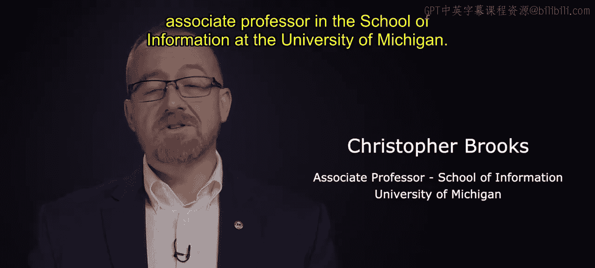

上一节我们介绍了课程的基本情况，本节中我们来看看我们将要学习的核心模型——Llama。

第一个Llama模型由Meta AI于2023年2月发布。我将要教给大家的是同年夏季晚些时候发布的Llama2模型变体。与最知名的大语言模型ChatGPT不同，Llama2模型都可以在免版税许可下下载，并允许你将其直接集成到你可能有兴趣构建的应用程序或服务中。这一点至关重要，如果你在高度监管的行业或处理敏感数据的领域工作，例如医疗、教育，或任何你更倾向于不将数据发送给第三方（如OpenAI）的情况。这些模型也非常适合以最低成本进行原型开发和开发，因为你可以在自己已有的硬件上运行它们。你还可以将它们扩展并部署到你已经拥有硬件的生产环境中，无论是几台机器还是私有数据中心网络。但需要注意的是，Llama2模型并非玩具模型，它们与商业产品具有竞争力，并且可以作为服务器在一些流行的云平台（如Microsoft Azure或Amazon Web Services）上进行扩展。

## 课程结构与学习方式 💻

了解了模型的重要性后，我们来看看你将如何学习它。

本课程将是讲座与实践的混合体。第一个模块以基础讲座为主，随后的模块将包含实时代码演示。代码演示将使用VS Code环境中的Jupyter笔记本，并在Coursera平台上进行。在这里，你将可以访问网络托管的VS Code版本。这将允许你跟随视频讲座实时修改代码，探索Llama2以及我们将使用的名为Llama CBP的软件包是如何工作的。

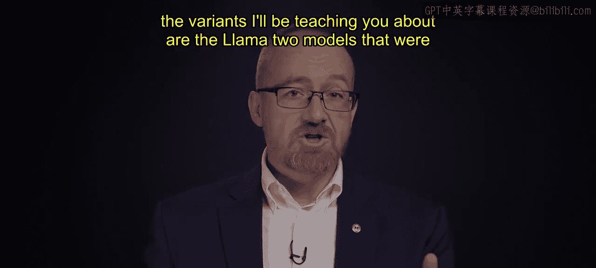

Coursera平台最令我兴奋的一个方面是，它允许你在听我讲解的同时练习你正在学习的内容。我鼓励你这样做：不要只是被动地观看视频，要成为一名积极的参与者，并使用这个实验工作空间来确保在本课程中取得成功。

## 预备知识与课程评估 📝

在开始动手之前，我们还需要明确学习本课程所需的基础和评估方式。

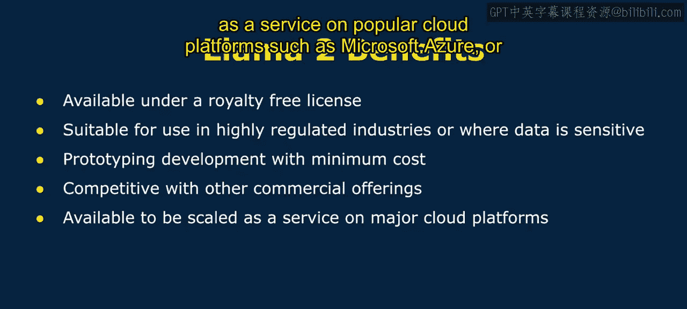

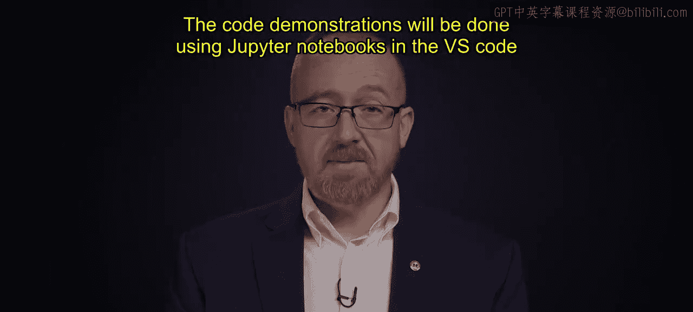

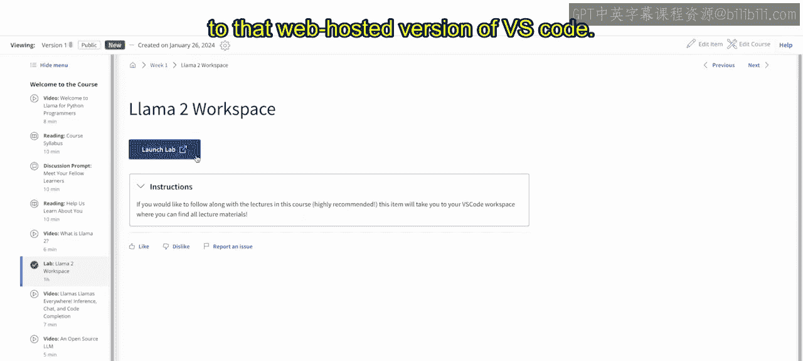

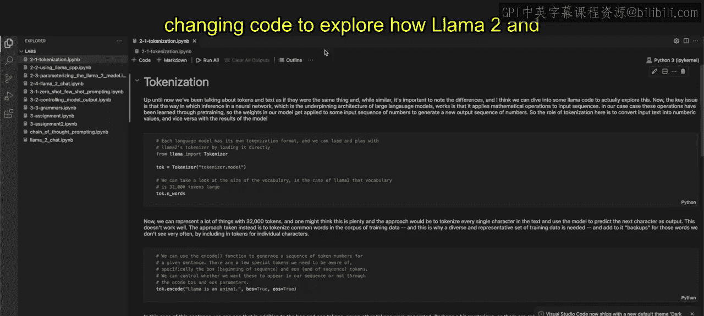

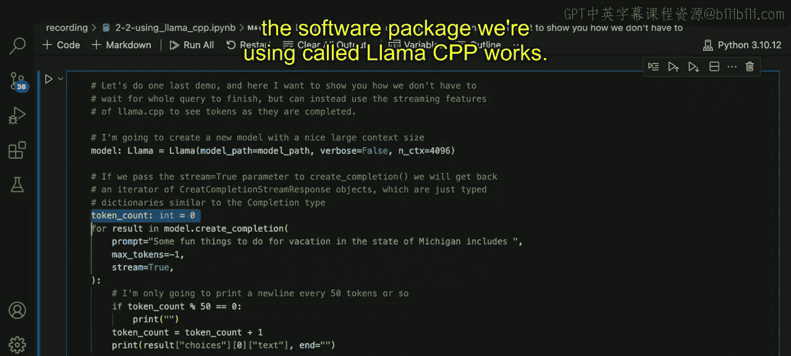

我期望你具备一些Python的基础知识。我的演示将使用Python3。课程中的大部分评估将是简答题、选择题和一些编程题的混合。大语言模型的世界是一个快速发展的领域，我很高兴能为大家带来这门课程。

## 课程互动与期望 🤔

最后，在正式开始学习材料之前，我想与你互动一下。我实际上无法在Coursera上见到我的许多学生，但我有机会阅读你们对我在视频中提出的开放式问题的回答。

我保证不会问太多问题，但在我们深入我为你准备的材料之前，我想请你花点时间思考一下：你希望在这门课中学到什么？以及为什么？

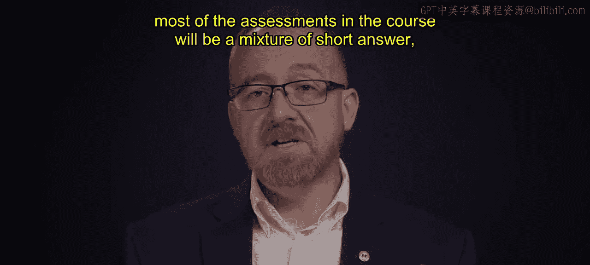

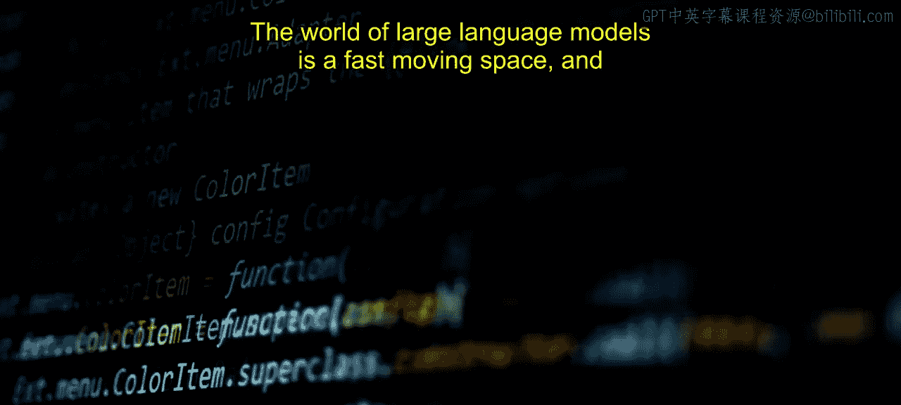

感谢你与我分享你的想法。现在，让我们开始深入学习Llama2吧。

---

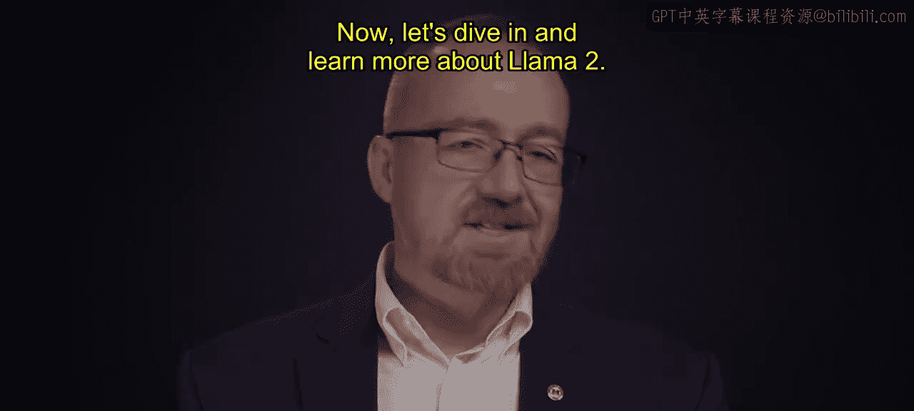

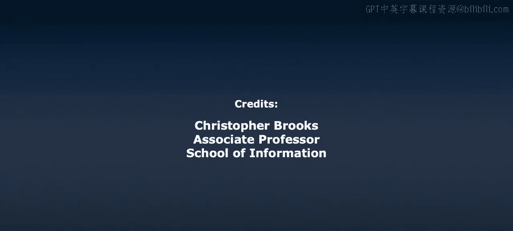

本节课中我们一起学习了《Python程序员的羊驼》课程的概述，了解了Llama2开源模型的重要性、课程将采用理论与实践相结合的教学方式、学习所需的Python基础，并思考了个人学习目标。接下来，我们将正式开启Llama2的学习之旅。