# Python程序员的羊驼：P3：2_到处都是羊驼——推理、聊天和代码完成

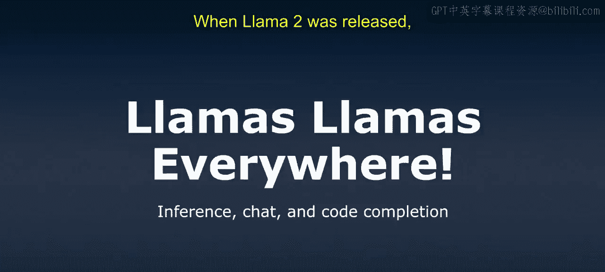

## 概述

在本节课中，我们将要学习Llama 2模型家族的不同变体，特别是专注于代码生成的Code Llama模型。我们将了解基础模型、聊天模型和代码模型之间的区别，并深入探讨Code Llama的架构、训练过程以及其独特的微调方法。

---

## Llama 2的三种风味 🦙

当Llama 2发布时，Meta提供了三种不同的模型变体。

首先是**基础模型**。这是一个经过良好训练的模型，适用于推理任务。当你向模型提供一个提示时，它会以完成该提示的形式返回响应。该模型的重点在于使用预训练过程生成高质量且事实正确的回答。

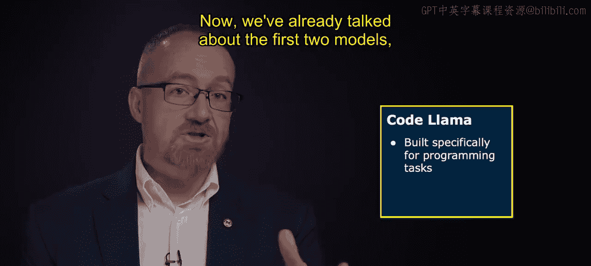

其次是**聊天模型**。这是一个专门为通过聊天进行人机交互而构建的模型。其重点很大程度上在于对话交互。通过使用基于人类偏好的强化学习在一系列不同指标上进行微调，这个过程提升了聊天模型的能力。重要的是，Meta在这个微调过程中投入了大量精力，以确保该模型具有适当的安全性和无害性护栏。

最后是**Code Llama**。这个模型实际上在其他模型发布几个月后才推出，是专门为编程任务构建的。

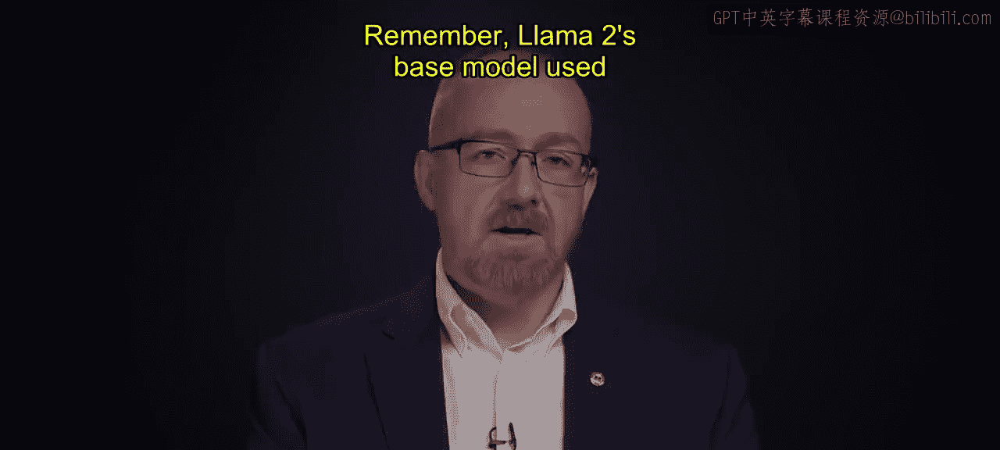

我们已经讨论了前两种模型。那么，这个Code Llama有何不同呢？

---

## Code Llama的模型种类与规模 📊

实际上，Code Llama有三种不同的模型，它们都是基于Llama 2的基础模型进行训练的。

请记住，Llama 2的基础模型使用了**2万亿个令牌**进行训练，并提供了三种规模：**70亿**、**130亿**和**700亿**参数。

事实上，还有一个未发布的**340亿**参数模型。Code Llama的发布部分基于70亿、130亿和340亿参数的模型。

在2024年1月，大约在三个Code Llama模型发布四个月后，Meta发布了一个**700亿**参数的Code Llama变体。我认为这应该能让你感受到训练这些模型所需的工作量。生成这些大型统计模型需要数月的高性能计算，并且可以想象，试验模型架构可能需要更长的时间。

---

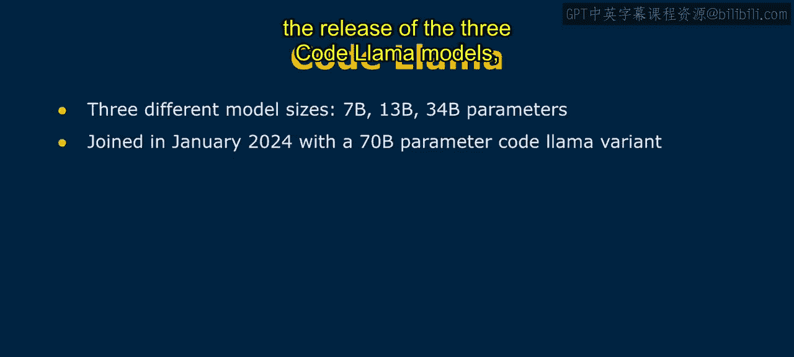

## Code Llama的微调任务：补全与填充

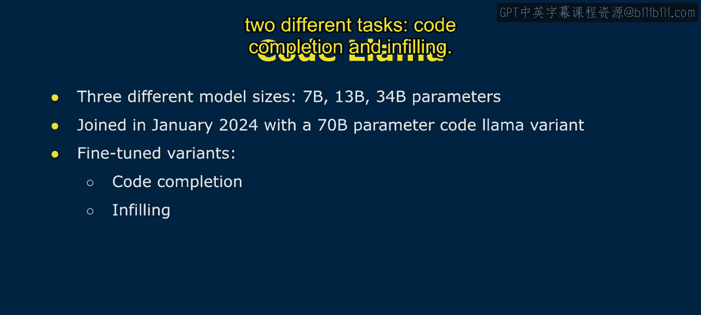

对于每个基础模型，Meta使用两种不同的任务创建了微调版本：**代码补全**和**代码填充**。

代码补全任务与基础模型的推理机制非常相似。给定一些输入数据（即代码），预测接下来应该出现的代码。如果你使用过GitHub Copilot或类似工具，你可能体验过这种情况：模型根据你已经编写的上下文来预测你接下来可能写什么。

代码填充任务则更为专业。在这个任务中，模型同时接收已编写代码的**前缀**和后续代码的**后缀**。

可以想象成将光标放在你已编写的两个函数之间，然后查询Llama 2，要求它编写位于两者之间的代码。

在这两种情况下，都额外使用了**5000亿个令牌**来微调模型，这些令牌同样来自开放的互联网资源。

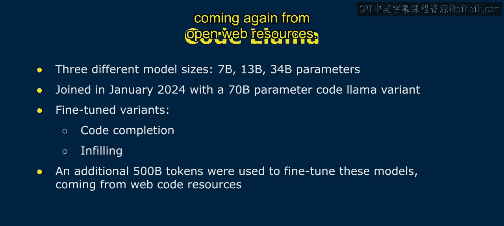

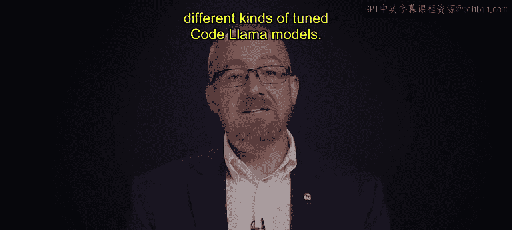

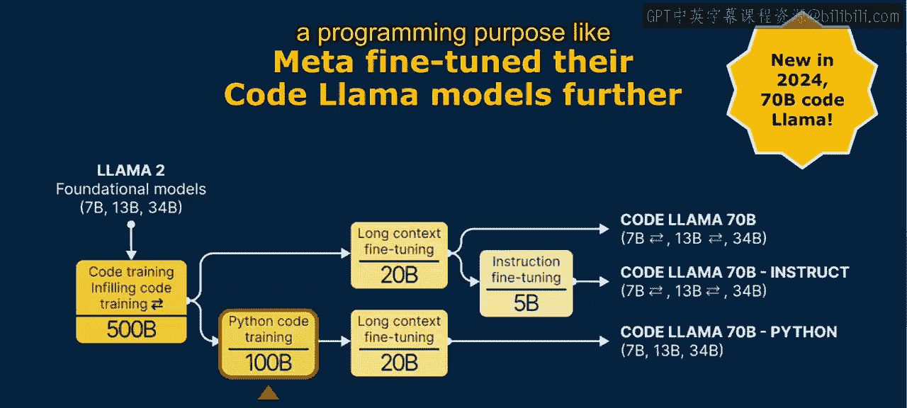

---

## 专门的微调模型：Code Llama Python

然而，这还不是全部。Meta还花时间创建了不同类型的微调Code Llama模型。

例如，他们通过使用额外的**1000亿个**Python训练代码令牌进行微调，创建了**Code Llama Python**模型。这个模型特别擅长编写Python代码。

从这里你可以看到，为特定编程目的（如Python编程）微调这些基础模型（有时称为基础模型）所需的工作量要少得多。

通过像Meta对Llama 2所做的那样自由发布模型权重，社区可以围绕微调过程形成，利用高质量的基础模型，同时针对特定任务进行专业化。

---

## Code Llama Instruct：基于执行的微调

Meta还创建了一个名为**Code Llama Instruct**的模型，这是一个通用目的的Code Llama模型，额外使用了**50亿个**人类语言令牌。这个模型提高了根据自然语言指令生成高质量代码的能力。

但有趣的是，他们在这个微调过程中没有使用基于人类偏好的强化学习。

相反，因为代码实际上可以执行，从而可以确定其输出，Meta使用**700亿**参数的基础模型生成了大约**5万个**独特的面试风格编程问题。对于每个问题，他们让Code Llama生成一系列单元测试，以及10个不同的Python解决方案。

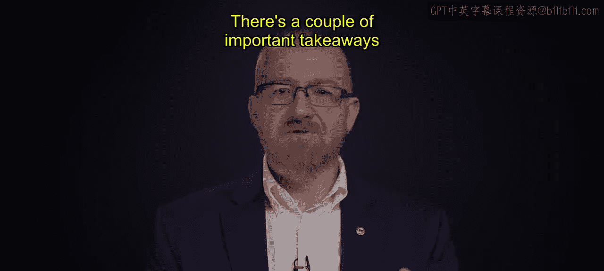

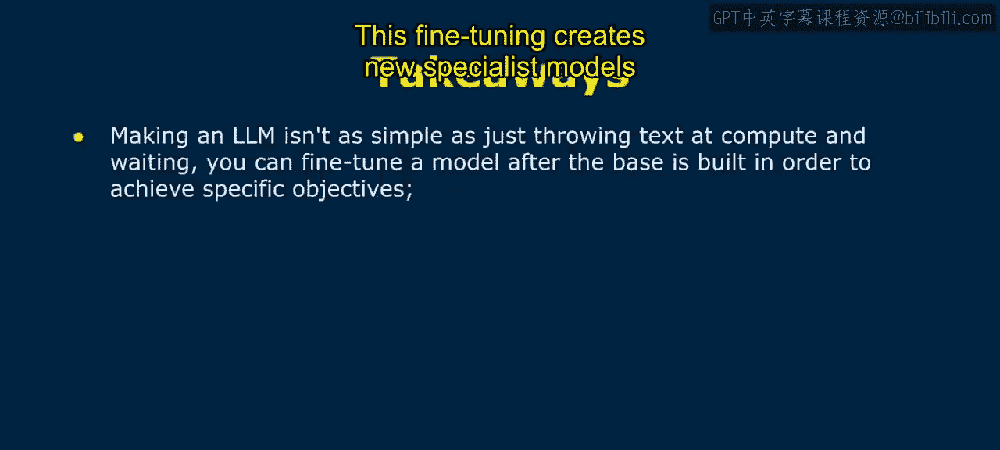

然后，在这些测试解决方案上运行单元测试，并将第一个通过测试的解决方案、其来自700亿参数模型的问题提示以及单元测试添加到微调数据库中。

这种面试风格机制，连同代码本身的执行来微调模型，是一种巧妙的方法，适用于那些你可以客观衡量成功且不需要人工评估结果的领域或任务。

---

## 核心要点与总结

关于Llama 2的这些早期课程，有几个重要的收获。

第一，你不仅仅是训练一个模型就结束了，而是可以继续**微调**模型，以特定方式提高其性能。这种微调创造了新的专家模型，这些模型可以有不同的输入假设（例如Code Llama的代码填充任务），以及修改后的权重，从而改善特定任务的结果。

第二，微调过程可以使用**非常少的数据**（至少与基础模型相比），并且你可以继续利用基础模型的能力。例如，Code Lama Instruct系列模型仅在基础Code Llama模型之上使用了50亿个令牌，而基础Code Llama模型使用了5000亿个令牌，并且基于2万亿个令牌的基础模型。随着令牌数量的减少，这意味着你的训练数据不需要那么长时间，并且可以更便宜地完成。

第三，尽管人类偏好被大量用于生成这类模型（尤其是在聊天模型中），但我们还可以使用其他有趣的机制进行强化学习。强化学习领域比大语言模型要广泛得多。但我认为Code Llama Instruct的训练过程是一个很好的例子，它展示了由任务独特性（编写可工作的代码）所启用的过程。

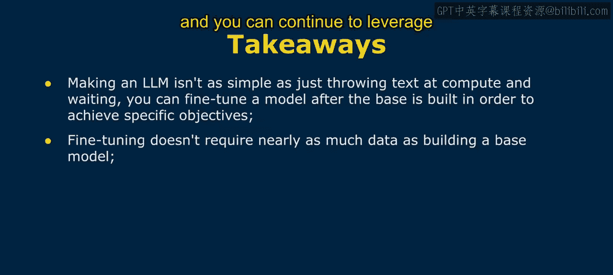

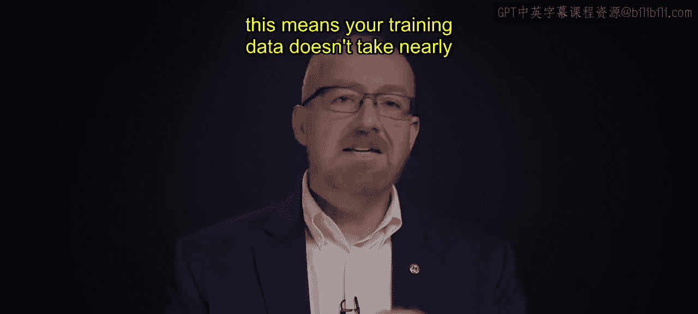

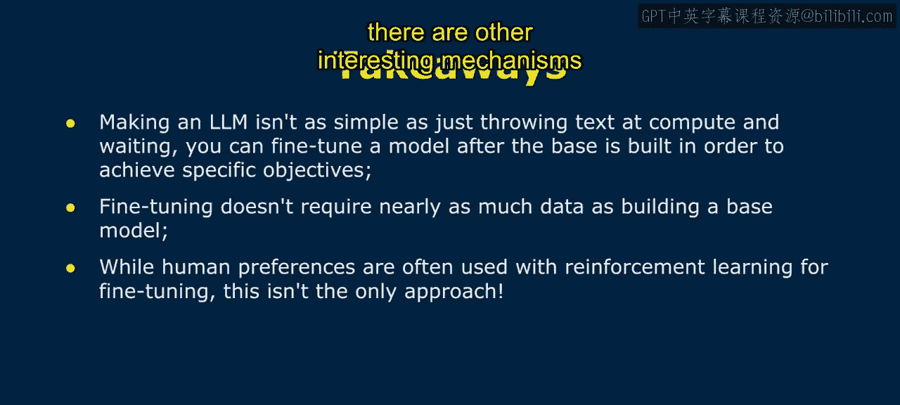

值得反思一下：我们还能利用像Meta所做的类似架构，从哪些其他类型的任务中生成强化学习数据集呢？你将如何微调一个你可能想用的模型，无论是为了工作、爱好还是其他目的？

---

## 总结

本节课中，我们一起学习了Llama 2模型家族，特别是Code Llama的多样化变体。我们了解了基础模型、聊天模型和代码专用模型的目标与区别，探讨了Code Llama基于不同参数规模和任务（代码补全与填充）的构建方式。我们还深入分析了通过额外数据（如Code Llama Python）和独特方法（如Code Llama Instruct基于代码执行的微调）进行专业化微调的过程。最后，我们总结了微调的价值在于能以较少成本创建专家模型，并思考了将类似方法应用于其他领域的可能性。