# Python程序员的羊驼：P4：开源LLM——羊驼及其竞争对手 🦙

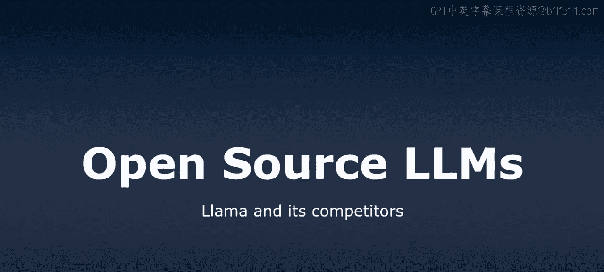

在本节课中，我们将要学习开源大型语言模型（LLM）的概念，特别是以Llama 2为例，探讨其开源定义、许可证特点，并了解其主要的竞争对手。我们将分析开源在AI领域的独特挑战，以及这对开发者和企业意味着什么。

---

## 开源LLM的定义 🤔

上一节我们介绍了Llama 2的发布背景，本节中我们来看看“开源”对于大型语言模型意味着什么。

对于软件，开源的定义由开源促进会（OSI）设定，其核心在于遵循10项特定原则的许可证。然而，当我们将此概念应用于大型语言模型时，情况变得复杂。模型的软件部分只是使其有用的一个小组件。

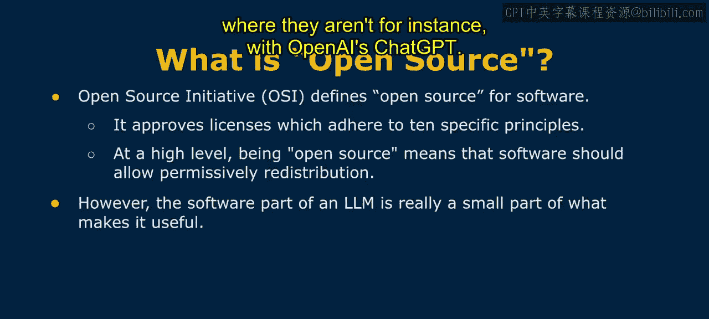

以下是几个关键问题：
*   模型的训练数据是否也必须开放和自由分发，模型才能被视为开源？
*   预训练模型的权重是否开放就足以认定模型本身是开源的？

这些问题目前没有明确的答案。尽管如此，一个更清晰的区分正在形成：一类是权重可供下载的模型（如Llama 2），另一类是权重不开放的模型（如OpenAI的ChatGPT）。

---

## Llama 2的发布历史与开源状态 📜

Llama 2的发布历史颇具趣味。Meta最初并未公开第一个Llama模型，申请者仅限于特定研究人员。然而，有人通过研究员渠道获得副本后，在4chan上以种子文件形式发布了该模型。

从实用主义角度看，Llama 2代码库确实是开源的。但它并不完全符合OSI的定义，因为它使用的是**Llama社区许可证**，这是一个专有许可证，尚未获得OSI认可。你可以在GitHub上自由浏览模型架构的源代码。

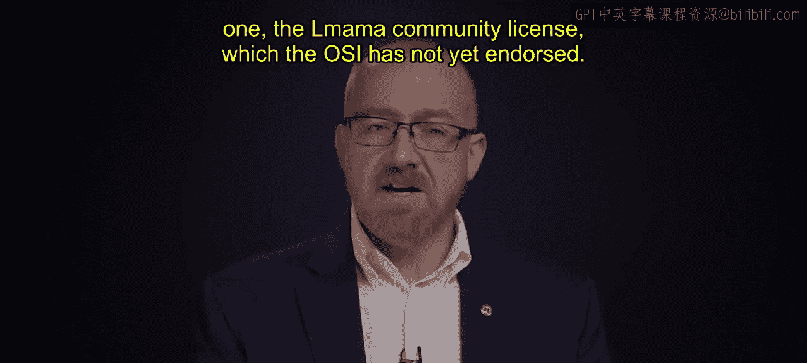

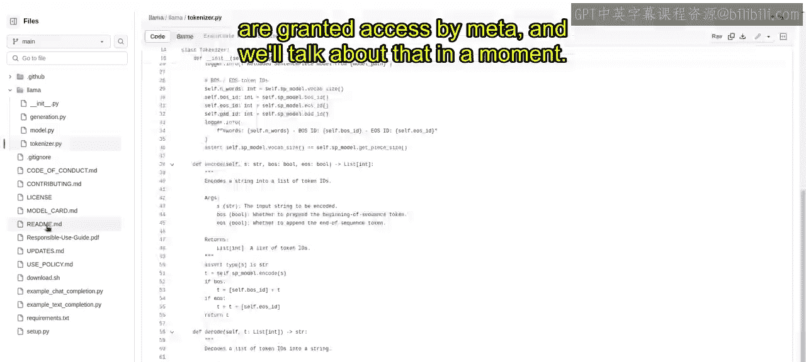

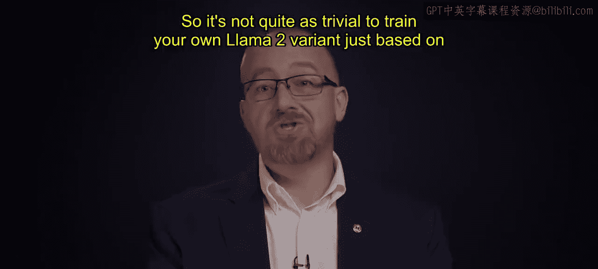

同样，预训练模型的权重在申请并获得Meta批准后也可获取。但若考虑整个生态系统，包括所有训练数据、强化学习与微调系统等，仍有部分环节缺失。因此，仅凭已发表的论文和提供的代码来训练自己的Llama 2变体并非易事。

---

## Llama 2许可证详解 📄

Llama 2的许可证极其宽松且简短。它为开发者和公司提供了免版税许可，允许使用Llama的基础模型、权重及相关软件。你还可以自由分发你微调后的模型，并将其集成到产品中，无需向Meta付费。这对于任何不希望付费或将数据发送给第三方服务的组织来说意义重大。

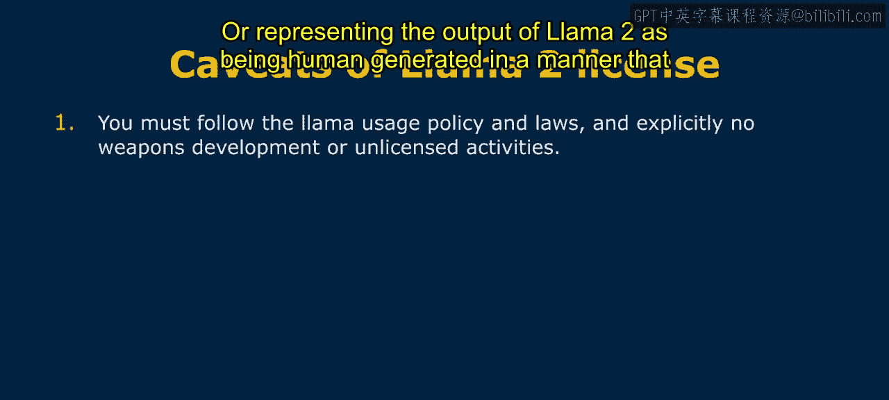

许可证包含几个注意事项：
1.  你必须遵守当地法律并遵循Llama使用政策。
2.  使用政策充当了Llama的道德约束，强调在使用Llama 2时需要遵守法律，并禁止将模型用于可能导致人身伤害的行为（例如武器开发，或冒充人类生成可能造成伤害的内容，如无执照的医疗建议）。
3.  使用政策还明确要求你必须向最终用户披露AI系统的任何已知风险。

这些使用政策的要求，与OSI“不歧视任何应用领域”的原则存在冲突。该原则意味着OSI批准的许可证不能阻止人们将软件用于任何他们认为合适的目的。

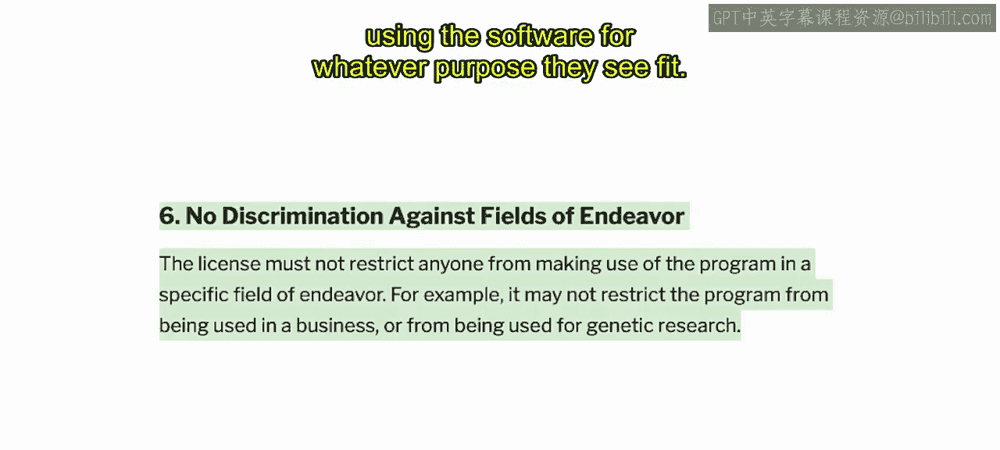

---

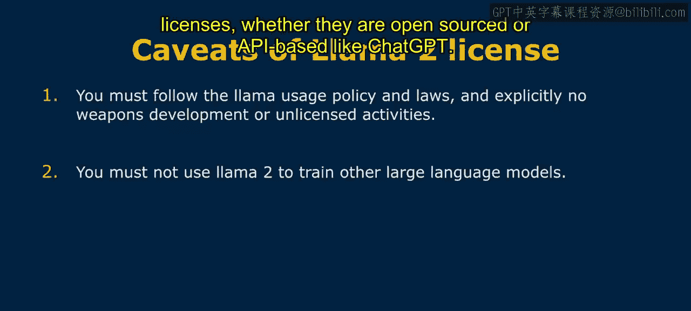

## 许可证中的竞争条款与商业限制 ⚖️

许可证还禁止使用Llama 2来改进其他大型语言模型。考虑到预训练这些模型的巨大成本，可以理解Meta为何将此条款纳入许可证，这涉及竞争关切。

此外，如果你的组织月活跃用户超过7亿，你必须向Meta申请单独的商业许可证。这一条款主要影响少数大型科技公司。

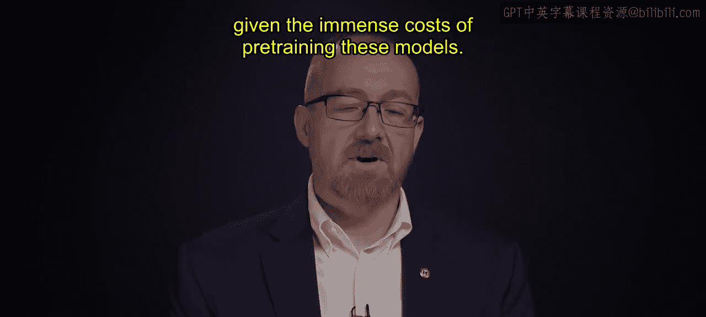

课程中链接了许可证和使用条款的副本，它们非常简短。建议你阅读并思考这项新技术如何融入你可能接触的更广泛的软件生态系统。

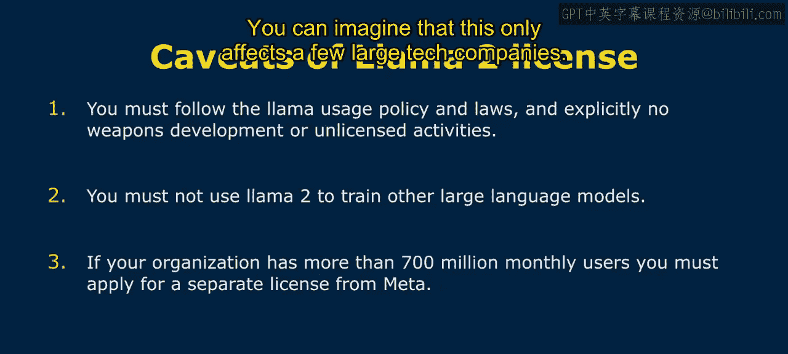

---

## 竞争对手与开源格局 🌍

Meta提高了标准，许多其他大型语言模型科技公司也开始至少部分开源其模型。

以下是几个主要竞争对手：
*   **Mistral AI**：训练了多个高性能语言模型，并开源了其中几个的权重。其系统的软件部分在OSI批准的**Apache 2许可证**下发布。但这目前仅适用于其Mistral 7B和Mixtral 8x7B模型，其服务端点后的模型（类似于OpenAI）并未开源。
*   **微软Phi-2**：这是一个27亿参数的小型模型。2023年12月，它仅在微软研究许可证下向研究人员发布。到2024年1月中旬，许可证已改为OSI批准的**MIT许可证**。
*   **Falcon模型**：包括400亿和1800亿参数模型。这些模型与Llama 2类似，使用的是未经OSI批准的专有许可证，并要求开发者遵守可接受使用政策（该政策可能随时间变化）。此许可证还包含一项条款：如果你将模型作为服务托管供他人使用，则需要获得单独的商业许可证。

庞大的预训练数据、模型权重以及这些数据通常源自版权状态不明或混合的数据集，这些独特因素正在挑战我们对AI产品“开源”含义的理解。

各国政府也在思考开源模型的定义。在本讲座录制时，旨在规范欧盟AI发展的《欧盟AI法案》最终草案，实际上为开源模型制定了特定的豁免条款。这无疑将继续推动像Llama 2这样的开源语言模型的创新。

---

## 总结 🎯

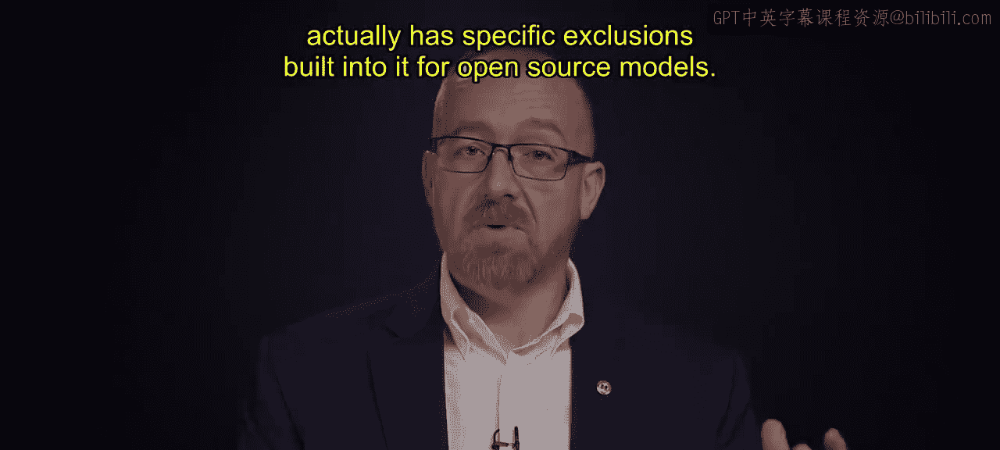

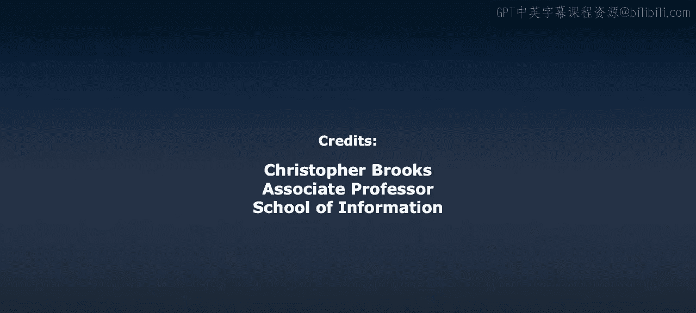

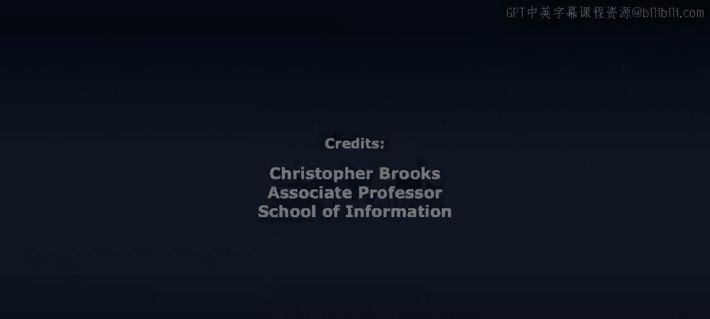

本节课中我们一起学习了开源大型语言模型的核心概念。我们探讨了Llama 2的开源定义及其与OSI标准的差异，详细分析了其宽松但附有使用限制的许可证。我们还了解了包括Mistral AI、微软Phi-2和Falcon在内的主要竞争对手及其开源策略。最后，我们认识到，AI模型的开源正在重塑软件生态，并面临数据版权、许可证定义等独特挑战，这将继续是行业创新和法规关注的焦点。