# Python程序员的羊驼：5：4_房间里的大象——在小硬件上运行大型语言模型 🐘💻

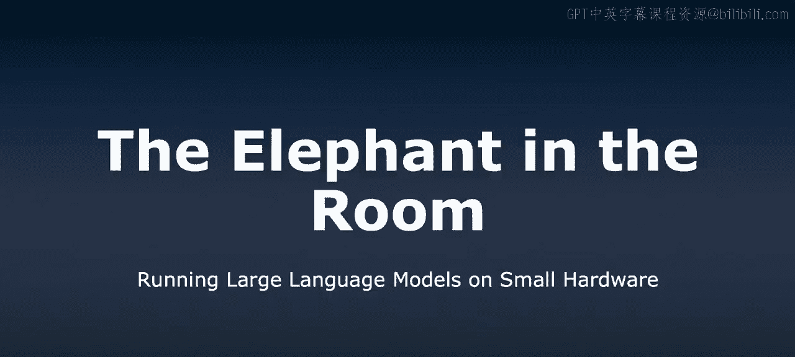

在本节课中，我们将要学习一个核心挑战：如何在消费级硬件上运行大型语言模型。我们将探讨模型量化等关键技术，并介绍一个强大的工具——Llama.cpp，它使得在普通CPU上运行Llama 2等大模型成为可能。

## 核心挑战：硬件需求与模型规模

我们都希望能在自己的台式机、笔记本电脑甚至手机上本地运行代码并使用大型语言模型。

但在开始之前，我们必须正视一个核心问题。

我们如何在消费级硬件上实际运行这些大型模型？

虽然这确实取决于模型的架构，尤其是一些新模型（如混合专家模型），但我们可以通过一个简单公式来估算所需内存：**模型参数量 × 4字节**。

因为每个参数通常由一个32位浮点值表示。

这意味着，一个70亿参数的模型需要**28 GB**的内存才能完全加载以进行推理。

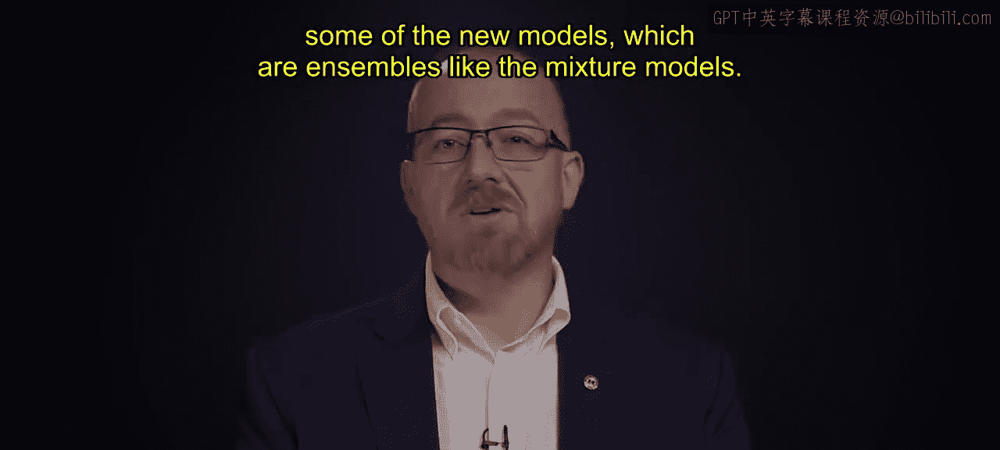

这还不包括你的应用程序可能需要的任何额外开销。

更复杂的是，这类计算最好在图形处理器上进行。

所以我们讨论的不是台式机或笔记本电脑的RAM，而是显卡的VRAM。

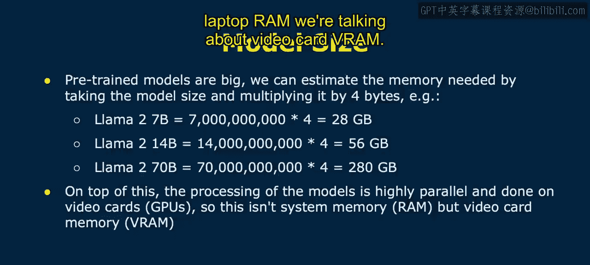

在录制本视频时，顶级的消费级显卡是Nvidia GeForce RTX 4090。

而它只有**24 GB**的显存，甚至不足以运行最小的Llama 2模型。

## 解决方案：模型量化技术

上一节我们介绍了运行大模型对硬件的苛刻要求，本节中我们来看看如何通过技术手段缩小模型体积。

我们可以通过几种技术来缩减模型的大小。

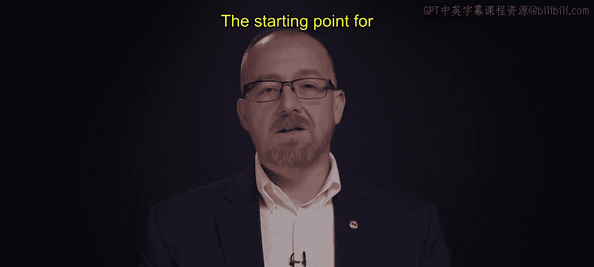

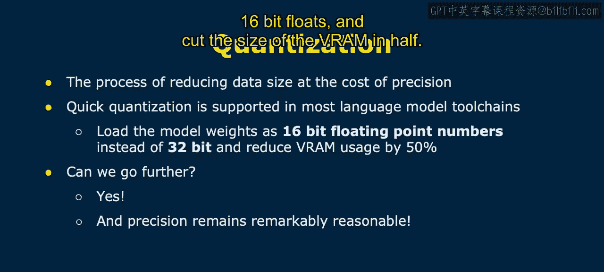

缩小模型尺寸的起点是**量化模型权重**。

我们不再将每个权重存储为32位浮点数，而是可以将其降低到16位浮点数，从而将VRAM需求减半。

结果是，现在我们可以在消费级显卡上运行最小的Llama 2模型进行推理。

我们所付出的代价是模型的一些精度损失。现在，我们可以进一步运用这个技巧。

如果我们能将每个权重减少到1个字节甚至半个字节（4位），为什么还要用2个字节存储呢？

当然，精度权衡在这里很重要。但在实践中，

事实证明，当我们将Llama模型的每个参数量化到4、5或6位时，它们仍然表现良好。

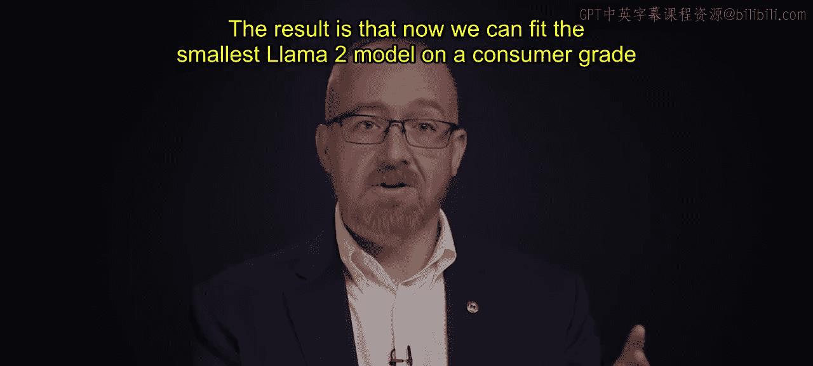

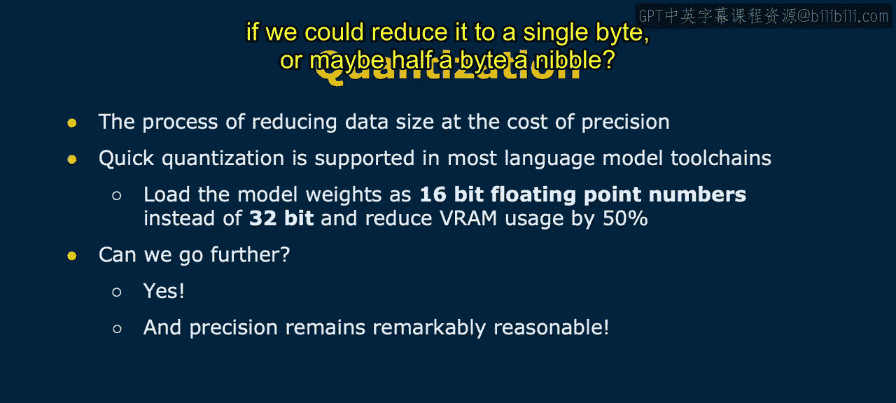

这与我们最初每个参数32位相比，节省了巨大的空间。

## 数据类型转换：从GPU到CPU的推理

当我们改变模型权重时，还会出现第二个有趣的机会。

那就是将数据类型从浮点数改为整数。

显卡和即将涌现的AI处理单元擅长并行处理浮点数。

但通常拥有多核的CPU在处理整数时表现尤其出色。

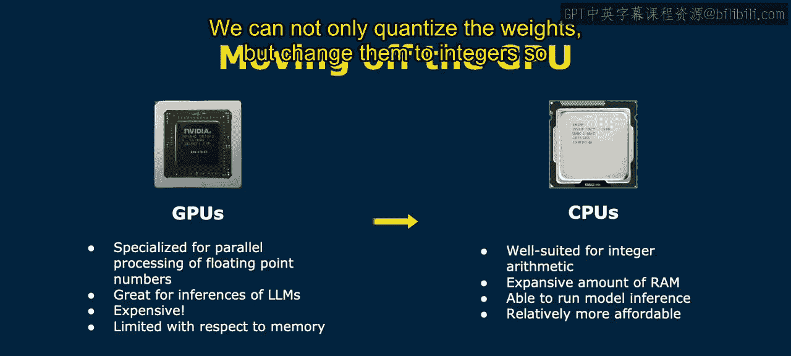

我们不仅可以量化权重，还可以将它们转换为整数，以便直接在CPU上进行推理。

现在这种权衡——主CPU擅长整数运算，但在浮点数学上需要协助——可能看起来是我们这个时代的独特产物，

但其实并非如此。在我成长的过程中，我父亲有一台基于Intel 386 DX的电脑，我尽可能多地使用那台机器。

但那台机器的特别之处在于，它有一个独立的数学协处理器，

专门处理浮点数的运算。

虽然这两个处理器以33 MHz的惊人速度协同工作，

但处理器设计已经取得了长足的进步，我们现在拥有16核、18核的消费级处理器，

以及从32 GB到超过200 GB的RAM。因此，量化模型以减小尺寸是我们在显卡上可以采用的方法，

但我们也可以完全不用显卡来运行模型推理。

事实上，在本课程中，

我们配置的Coursera实验环境完全没有使用显卡，

允许你探索或测试我所教授的任何内容，而无需安装任何软件。

## 关键工具：Llama.cpp 介绍

我们用来转换这些模型的工具，以及我们将用来与它们交互的API，叫做**Llama.cpp**。

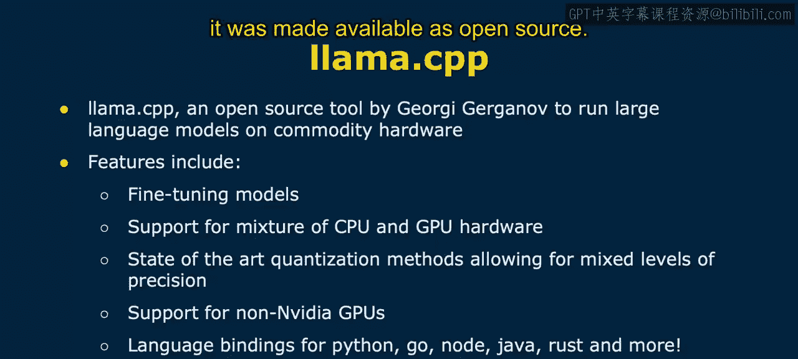

它是由Georgi Gerganov在一个晚上快速搭建起来的，

并以开源形式发布。

这个项目已经蓬勃发展，现在拥有超过500名贡献者，对于一个诞生不到一年的项目来说，这是一个惊人的成就。

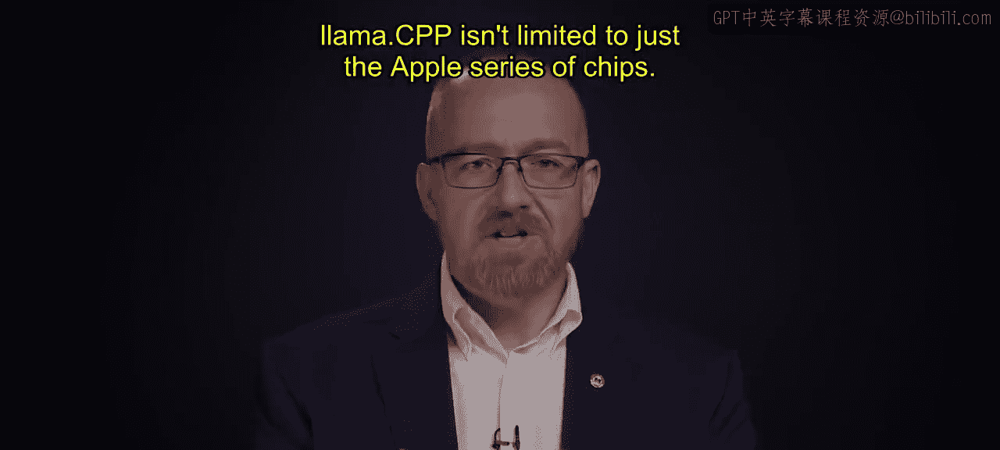

他的目标是将Meta的Llama代码移植到纯C语言中，并启用量化功能，以便在Apple处理器上运行，

但Llama.cpp并不仅限于Apple系列芯片。

事实上，该项目已经发展得远不止于此，现在支持许多调整模型的选项，

包括对模型进行分区，以便部分（而非全部）模型在GPU上可用；支持最先进的量化方法，允许混合精度；支持非Nvidia显卡加速；以及为多种编程语言提供绑定。

## 课程实践与展望

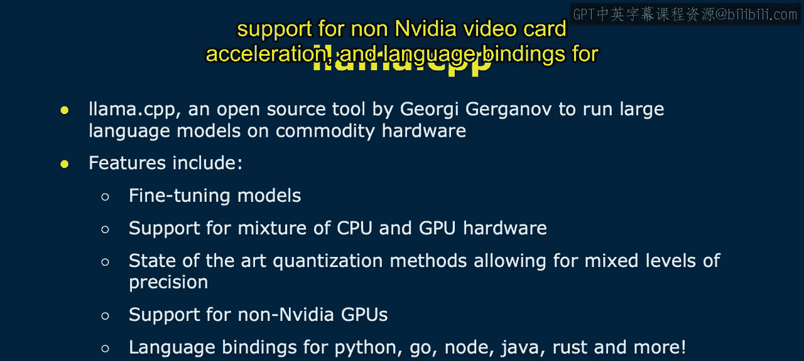

在本课程中，我们将使用Llama.cpp及其Python绑定作为与Llama 2语言模型交互的主要方法。

但你实际上完全不必使用Python或任何其他编程语言。

Llama.cpp还会构建一个命令行可执行文件，允许你直接从终端提示模型。

我将在下一个视频中为你快速演示一下，然后在接下来的模块中，我们将深入探讨Llama 2与Llama.cpp的内部工作原理。

## 总结

本节课中我们一起学习了在有限硬件资源上运行大型语言模型的核心挑战与解决方案。我们了解到通过**量化技术**（如将权重从32位浮点数降至4-6位）可以大幅减少模型的内存占用。同时，利用**Llama.cpp**这样的工具，我们能够将模型转换为适合CPU进行整数运算的格式，从而完全摆脱对高端GPU的依赖。这为在普通电脑上探索和应用大模型打开了大门。