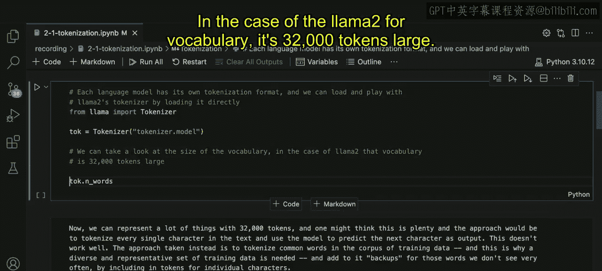
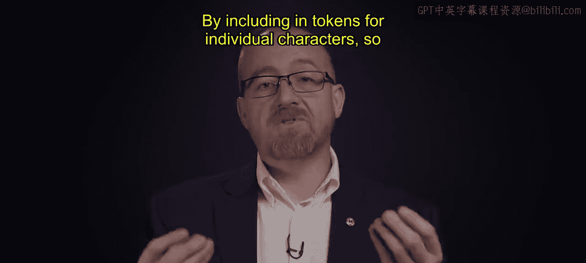
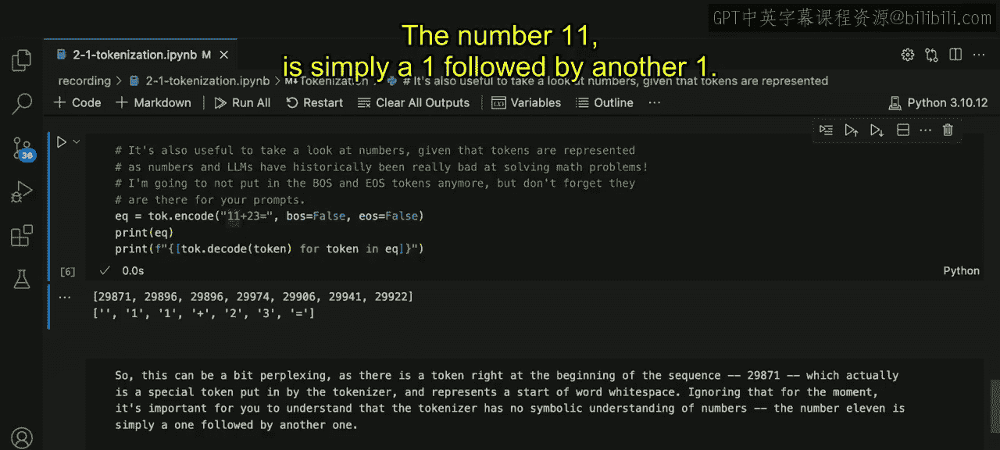

# Python程序员的羊驼：P6：羊驼2的标记化 🦙

在本节课中，我们将要学习Llama 2模型如何处理文本的核心环节——标记化。我们将探讨文本与标记的区别，了解标记器的工作原理，并通过代码示例直观地展示这一过程。

---

## 文本与标记的区别

上一节我们介绍了语言模型的基本概念，本节中我们来看看文本输入是如何被模型处理的。

神经网络架构，即模型训练所基于的底层结构，并不直接处理文本。它处理的是数值。模型对输入的数值序列应用数学运算。在我们的案例中，这些运算是通过预训练过程学习得到的。模型中的权重被应用于这个输入的数字序列，最终生成一个新的输出数字序列。

标记化的作用就是将输入文本转换为数值，反之亦然。

## 加载Llama 2的标记器

每个语言模型都有自己的标记化格式。我们可以直接加载并使用Llama 2的标记器。它被称为`tokenizer.model`。

现在，我们来看看词汇表的大小。在Llama 2的案例中，其词汇表包含**32，000**个标记。用32，000个标记可以表示很多内容。有人可能认为这足够了，方法是标记文本中的每一个字符，并使用模型来预测下一个字符的输出。

## 标记化的策略

这种方法实际上效果并不好。取而代之的策略是，在训练数据的语料库中标记常见的单词。这就是为什么拥有多样化和具有代表性的训练数据集非常重要。

然后，我们通过为单个字符包含标记来为不常见的单词添加后备方案，这样我们实际上可以拼写出这些单词。

我们可以使用`encode`函数为给定的句子生成一个标记数字序列。现在，有几个特殊标记需要我们注意，特别是`BOS`（序列开始）和`EOS`（序列结束）标记。我们可以通过包含这两个参数来控制是否希望这些标记出现在我们的序列中，就像我在这里做的那样：`bos=True` 或 `eos=True`。

对于这个句子，我们可以看到除了`BOS`和`EOS`标记外，还生成了七个其他标记。这有点神秘，因为句子中实际上只有四个单词。让我们回到代码中，解包每个标记，看看Llama标记器是如何工作的。我将遍历每个标记，并让标记器为我们解码它。

## 解码标记序列

我们可以看到，开始和结束标记没有可见的表示，这似乎很合理。但令人惊讶的是，单词“Llama”并不在词汇表中。相反，标记器实际上已经回退到逐个字母地拼写它，直到遇到一个在词汇表中的标记，在本例中是字符串“ama”。

我们看到单词“is”、“an”、“animal”以及句号都在词汇表中。现在让我们进一步探索和测试这个标记器。

以下是我们的原始句子：“Llama is an animal.”。我们先处理这个句子，然后我在这里做一个非常小的改动。我将改变开头字母“L”的大小写。大小写确实有影响。然后说实话，这是我第一次拼写它时的错误拼写，因为我就是这么拼写的。

所以，拼写和大小写都很重要。我们看到“Llama”这个词仍然没有直接出现在词汇表中。但是，小写单词和首字母大写的“Llama”的标记化导致了不同长度的序列，其中包含不同的标记值。我们还看到，“animal”的错误拼写返回了两个标记，而不是一个。看看数字也很有用，因为标记被表示为数字，而LLM历来在解决数学问题方面表现很差。

现在我不会在这里放入`BOS`和`EOS`，你可能在本课程中不会再看到它们了。实际上，这里我将使用一个非常简单的字符串：“11 plus 23”。这就是我们所有人都会说的方式。让我们看看Llama会怎么说。

这可能会有点令人困惑，因为在序列的开头有一个标记`29871`，这实际上是标记器放入的一个特殊标记，代表一个单词开始前的空格。我们暂时忽略它。重要的是要理解标记器对数字没有符号化的理解。数字“11”只是一个“1”后面跟着另一个“1”。

## 标记化的意义与上下文长度

从高层次理解这个过程很重要，因为我们的语言模型并不操作单词、句子甚至文本。它操作的是标记序列。这在理解使用LLM的更高级概念时很重要，例如检索增强生成（RAG），其中LLM可以访问一个文档数据库，所有文档都按块索引，这些块实际上是表示为向量的标记。虽然细节现在并不重要，但重要的是你要知道，标记和标记序列是大型语言模型输入和输出的基本单位。

这也让我们可以讨论另一个重要的概念：上下文长度。我们将在下一讲中通过编写一些提示词来探讨这一点。

---

本节课中我们一起学习了Llama 2模型的标记化过程。我们明确了文本与标记的区别，了解了标记器如何将文本转换为模型可处理的数字序列，并通过实例看到了词汇表、大小写、拼写和数字处理对标记化的具体影响。理解标记是LLM的基本操作单元，是掌握后续高级应用（如上下文长度管理和RAG）的基础。