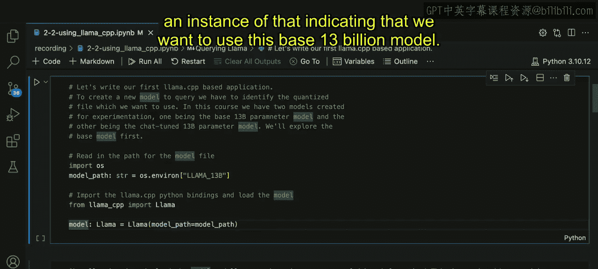
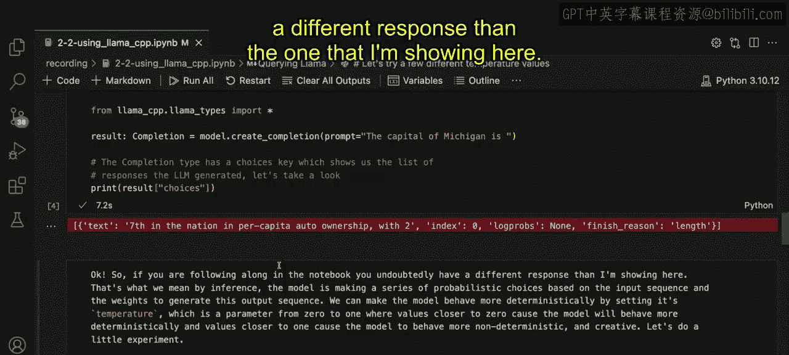
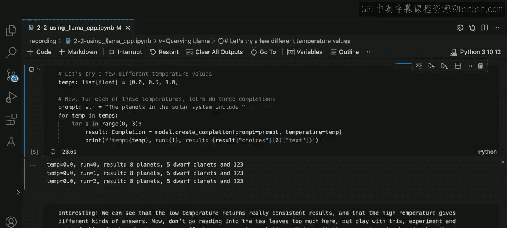
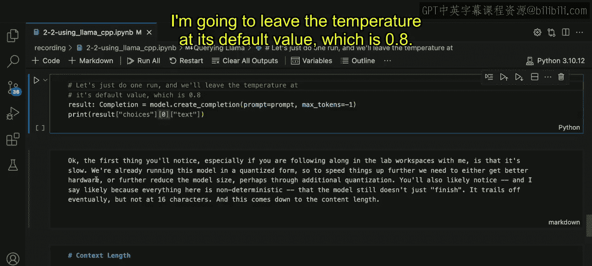
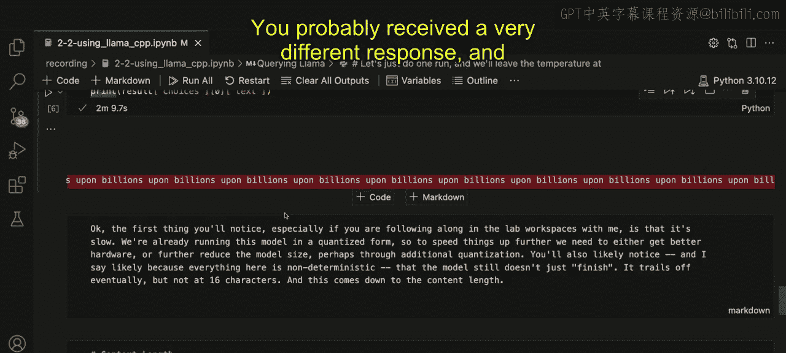
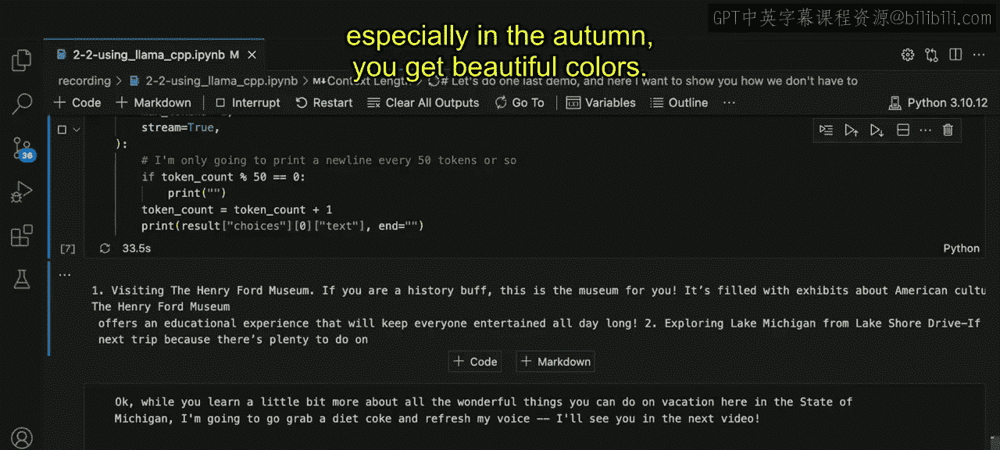

# Python程序员的羊驼：7：用羊驼C++构建我们的第一个羊驼2应用程序 🦙


## 概述
在本节课中，我们将学习如何使用Llama.cpp库来加载Llama 2模型并进行首次推理查询。我们将涵盖模型加载、参数设置、生成文本以及理解上下文长度等核心概念。

---

现在我们已经了解了Llama 2表示数据的基本原理，包括模型架构内部以及进出模型的令牌序列，我们可以开始实际查询模型了。这里我用了“查询”这个词，但并非指关系数据库中的查询，而是更偏向于人类语言意义上的提问。数据库查询是确定性的，如果数据和查询不变，结果总是相同。但语言模型则更具非确定性。描述我们与模型交互的更精确词语是“推理”或“预测”。


---

### 加载模型与初始化

上一节我们介绍了模型的基本原理，本节中我们来看看如何实际操作。让我们编写第一个Llama.cpp应用程序来创建一个用于查询的新模型。首先，我们需要指定要使用的量化模型文件。在本课程中，我们有两个用于实验的模型：一个是基础的130亿参数模型，另一个是聊天版本。我已在你的Co shell中创建了一个名为`LAMA_13B`或`LAMA_13B_CHAT`的环境变量。

我们将导入Llama.cpp库。用于预测的基础模型类称为`Llama`，我们将创建它的一个实例，并指定使用这个基础的130亿参数模型。



```python
import llama_cpp

# 假设环境变量 LAMA_13B 指向模型文件路径
model = llama_cpp.Llama(model_path=“${LAMA_13B}”)
```

---

### 理解模型输出信息

好的，我们刚刚加载了模型，Llama.cpp给出了大量调试信息。这值得快速浏览一下，特别是如果你可能使用多种不同类型的模型（不同架构或不同量化级别）时。


我们看到这是一个Llama 2模型，上下文长度最多为4096个令牌，我们稍后会详细讨论。我们还看到一些关于特殊令牌的信息。目前，我们可以看到模型中的层数，这关系到内部数据结构，以及这些层是否被配置为卸载到GPU上。Llama.cpp最有趣的选项之一是，你不必在CPU和GPU之间二选一，实际上可以根据你的硬件设置同时使用两者。

在我们继续之前，我想稍微减少输出的详细程度。你可以自由地将其设置为`True`以查看更多细节，但我会将`model.verbose`设置为`False`。

```python
model.verbose = False
```

---

### 执行首次推理

现在我们已经有了实际的模型，让我们进行一些推理。我们将使用的方法是`create_completion`。默认情况下，我们只需要传递一个提示词让它补全，它会返回一个称为“补全对象”的东西。我将问它“密歇根州的首府是什么”，它会返回一个补全对象。

补全对象是这些字典类型之一。因此，我们将打印出`choices`，这实际上是我们感兴趣看到的文本。

```python
completion = model.create_completion(prompt=“What is the capital of Michigan?”)
print(completion[‘choices’][0][‘text’])
```




如果你跟着笔记本操作，你无疑会得到一个与我这里展示的不同的回答。这就是我所说的“推理”。模型基于输入序列和训练所得的权重，进行一系列概率性选择。

---

### 探索温度参数



我们可以通过设置模型的“温度”来使其行为更具确定性。温度是一个从0到1的参数，值越接近0，模型行为越具确定性；值越接近1，模型行为越具非确定性或创造性。让我们在Jupyter笔记本中对此进行一些实验。

以下是温度参数如何影响模型输出的示例：

```python
temperatures = [0.0, 0.5, 1.0]
for temp in temperatures:
    for _ in range(3):
        completion = model.create_completion(prompt=“What is the capital of Michigan?”, temperature=temp, max_tokens=16)
        print(f“Temp {temp}: {completion[‘choices’][0][‘text’]}”)
```

有趣的是，我们可以看到低温结果给出了非常一致的答案，而高温结果给出了各种不同的答案。现在不要对此过度解读，但请尝试这个实验，感受温度如何影响你的提示词补全。

在底层，温度实际上改变了从候选令牌集合中挑选下一个令牌的方式。因此，较高的温度值在重复查询时会更快地产生彼此不同的结果。

---


### 调整生成令牌数量



你无疑已经注意到，我们只得到了简短的回答。生成令牌很慢，默认情况下，`create_completion`方法将返回的令牌数量限制为仅16个。如果我们将其改为`-1`，我们就可以生成任意多的令牌，只要模型和上下文窗口允许。

让我们只运行一次。这里我将温度保持为其默认值0.8。

```python
completion = model.create_completion(prompt=“What is the capital of Michigan?”, max_tokens=-1)
print(completion[‘choices’][0][‘text’])
```

好的，你首先会注意到——特别是如果你在实验环境中跟着我操作的话——它很慢。我们已经以量化形式运行这个模型了，所以为了进一步加速，我们需要要么获得更好的硬件，要么通过额外的量化进一步减小模型大小。

但我真正想指出的是，模型的回答似乎会逐渐偏离主题。这个模型有一个特别有趣的回答，它说“Mars has been known...”，最后还有一点内容。但如果我们滚动查看模型的输出，我们看到它还说“compared with our own Milky Way galaxy which contains billions upon billions upon billions upon billions upon billions...”。实际上，如果我们继续滚动，我们会发现这不会结束——模型陷入了某种循环中。

记住，这并非真正的循环。这个模型的工作方式是：它接收一个令牌序列，预测下一个最佳令牌。因此在这里，利用整个上下文，它识别出在单词“billions”之后是“upon”，然后在“upon”之后又是“billions”，它就这样持续下去，直到填满这个上下文窗口。


你可能收到了一个非常不同的回答，我鼓励你跳进讨论区谈论这一点，因为模型在现有温度设置下的非确定性意味着每个人都应该得到略有不同的回答，有时不仅仅是略有不同，有时是显著不同。

---

### 理解上下文长度



一旦你理解了令牌化，上下文长度就非常简单了。它只是模型训练时所依据的令牌序列的最大长度。

对于原始的Llama模型，上下文长度刚刚超过2000个令牌，这意味着用于训练模型的输入数据被分割成这些最多2000个令牌长的块。对于Llama 2，这个长度增加到了刚刚超过4000个令牌。

你可以将上下文长度视为LLM对于给定查询所拥有的“内存”量。它越大，你可以在查询中放入的内容就越多，因此LLM在返回响应时对这些内容的了解也就越多。使用较大的上下文长度进行训练和推理可以提高输出质量，但代价是增加了计算量。

当你创建一个新的Llama.cpp对象时，默认的上下文长度设置为512个令牌。

```python
# 创建模型时指定上下文长度
model = llama_cpp.Llama(model_path=“${LAMA_13B}”, n_ctx=2048)
```

---


### 使用流式输出

让我们做最后一个演示，这里我想向你展示，我们实际上不必等待整个查询完成，而是可以使用Llama.cpp的流式功能来查看令牌的生成过程。

我将创建一个非常相似的新模型，在这里设置一个较大的上下文窗口。如果我们向`create_completion`传递`stream=True`参数，我们实际上会得到一个迭代器，它将遍历这些“创建补全流响应对象”。同样，所有这些对象实际上只是类型化字典，这个类似于补全类型。

我将在这里设置一个令牌计数器，然后遍历这个创建补全过程中返回的所有令牌。我将使用的提示词是：“在密歇根州度假可以做的一些有趣的事情”。我希望你会考虑来密歇根，随时可以来大学看看，并做任何其他Llama 2告诉你要做的有趣事情。

重要的是，我这里有一个`mod 50 == 0`的条件，这只是为了让我可以打印换行符，否则所有内容都会在一行上。让我们看看这是什么样子。

```python
model = llama_cpp.Llama(model_path=“${LAMA_13B}”, n_ctx=4096)
prompt = “Some fun things to do for vacation in the state of Michigan.”
response_iterator = model.create_completion(prompt, stream=True, max_tokens=200)

token_count = 0
for chunk in response_iterator:
    token = chunk[‘choices’][0][‘text’]
    print(token, end=‘’, flush=True)
    token_count += 1
    if token_count % 50 == 0:
        print() # 每50个令牌换行
```

模型加载需要一点时间，然后我们开始收到这个流。第一个是“参观亨利·福特博物馆”，这实际上很棒，我喜欢亨利·福特博物馆，经常带我的孩子们去，那是个很棒的地方。哦，看，“从湖岸大道探索密歇根湖”，也是密歇根州的另一个绝佳选择，尤其是在秋天，你会看到美丽的色彩。

好的，当你了解更多关于在密歇根州度假可以做的所有美妙事情时，我要去喝点东西，润润嗓子，我们下个视频见。😊

---



## 总结
本节课中我们一起学习了如何使用Llama.cpp库与Llama 2模型进行交互。我们涵盖了从加载量化模型、执行基础推理查询，到调整温度参数以控制输出的确定性，以及理解上下文长度的重要性。最后，我们还探索了流式输出功能，使我们能够实时观察模型的生成过程。这些是构建基于Llama 2的应用程序的基础步骤。