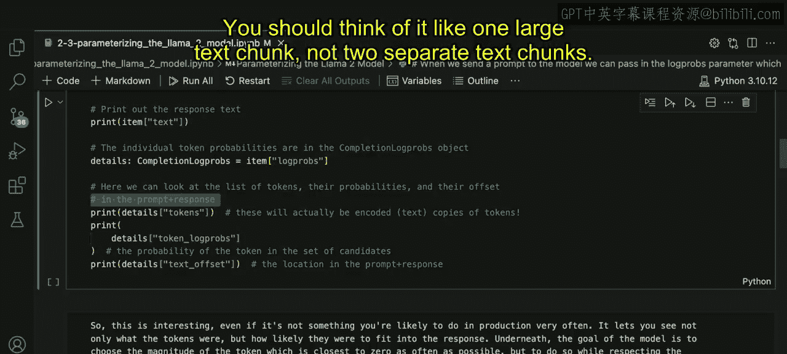
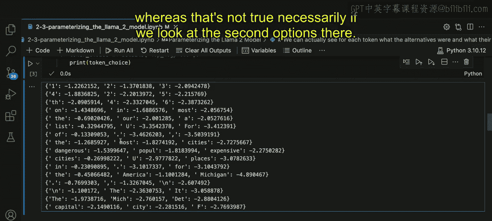
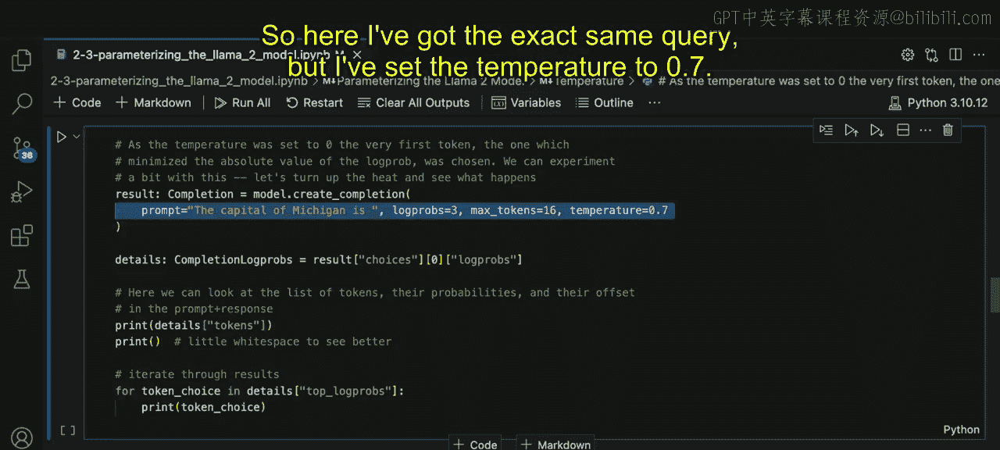
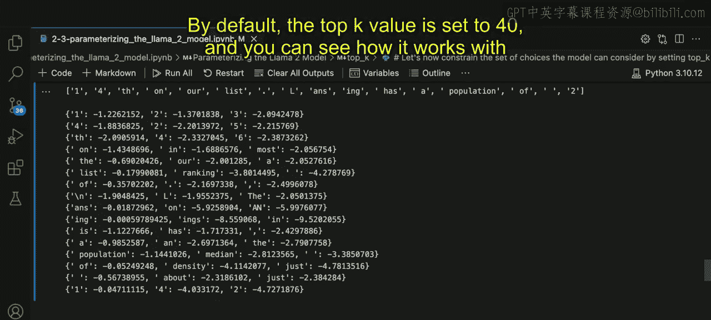
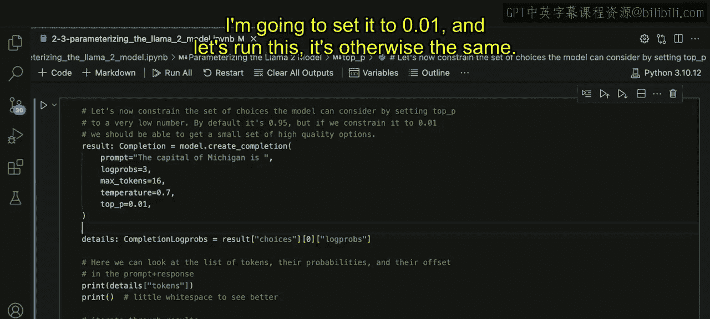

# 密歇根大学《Python程序员的羊驼》课程｜Llama2 for Python Programmers：P8：选择参数 🎛️


在本节课中，我们将学习如何通过配置Llama模型来观察其内部工作机制，并深入理解几个关键参数——温度（Temperature）、Top-K和Top-P——如何影响模型生成文本的随机性和多样性。我们将通过代码示例来直观展示这些参数的作用。

---


我们之前讨论了大语言模型（特别是Llama 2）的一些基本原理，以及它们是如何基于预训练权重来预测词元序列的非确定性概率机器。

如果我们愿意，实际上可以通过在加载模型时进行配置，来观察Llama CPP中这种选择的部分内部运作。这在生产部署中并不常见，但有助于我们更好地理解如何改变模型的行为。接下来，让我们具体看看。

---

## 观察词元概率 🔍

我们将像之前一样导入Llama CPP绑定。请注意，这里我将所有操作浓缩到了一行代码中。我们将加载模型并设置其详细程度。这里我们使用了一个新参数：`logits_all=True`。这个设置实际上会捕获每个词元的概率信息。

当我们向模型发送提示时，可以传入`logprobs`参数，该参数决定了我们将看到多少个备选词元。这里我们只查看前三个备选。你会看到我将`max_tokens`设置为16（输出会很快被截断），将`temperature`完全设置为0以使其具有相当的确定性，并将`logprobs`设置为3。



我将从`content`对象中提取响应并打印出来。单个词元的概率实际上位于`completion.logprobs`对象中。由于所有内容都是类型化字典，我们可以直接从该项中取出`logprobs`。接下来，我们将打印出所有词元、它们的概率以及在提示和响应中的偏移量列表。这里需要重点注意：它包含了提示和响应，你应该将其视为一个大的文本块，而不是两个独立的部分。

以下是相关代码示例：
```python
# 示例：加载模型并设置参数以获取词元概率
from llama_cpp import Llama
llm = Llama(model_path="./models/7B/ggml-model.bin", logits_all=True, verbose=False)

prompt = "The weather is"
output = llm(prompt, max_tokens=16, temperature=0.0, logprobs=3)
print(output['choices'][0]['text'])

# 提取并打印词元概率信息
logprobs_info = output['choices'][0]['logprobs']
for i, token_info in enumerate(logprobs_info['tokens']):
    print(f"Token {i}: '{token_info}'")
    print(f"  Top alternatives: {logprobs_info['top_logprobs'][i]}")
```


这很有趣，即使你在生产中可能不常这样做。它不仅能让你看到选择了哪些词元，还能看到它们被选入响应的可能性有多大。模型的目标是尽可能选择对数概率值（最接近零的数字）最高的词元，但同时要遵循温度参数的设定。不过，这有点过于简化了。

实际上，模型还会考虑另一个名为Top-P的参数。这个参数决定了我们最初会考虑多少个词元进入候选集。温度和Top-P以不同的方式共同决定下一个被选择的词元。对于这两个参数，数值越高意味着选择越多，因此输出的确定性越低。让我们更深入地探讨一下Top-P和温度之间的关系。

---

## 理解参数：温度、Top-K与Top-P ⚙️

我们可以实际看到每个词元的备选项及其对数概率。由于我将`logprobs`设置为3，我们将遍历词元集合并看到每个词元的前三个选项。

例如，第一个词元的对数概率可能是-1.2，第二个是-1.3，第三个是-2.0。如果你跟着操作，你得到的具体数字可能会略有不同，但由于温度设置为0，也有可能得到相同的数字。

有趣且重要的是，词汇表中的一些词元（即标记）在开头包含空格，这是Llama2使用的分词器的一个特点。当然，其中也包含控制序列，比如换行符或回车符。

因为你可以查看备选项，所以你能感觉到对话可能以哪些不同的方式进行。开头可能涉及一堆数字，但在第四个词元之后，我们得到了一堆字母，而如果我们看第二个选项，情况可能并非如此。

我们可以使用几个参数来约束或指导语言模型为下一个词元做出选择。详细探讨这些参数有点超出本短期课程的范围，但我想让你对它们的工作原理有一个直观的理解。






第一个我们已经讨论过，叫做**温度**。我们可以利用新发现的查看词元概率的能力，来更好地理解它实际是如何工作的。当温度设置为0时，实际上选择的是对数概率绝对值最小的第一个词元。但让我们稍微实验一下。这里我有完全相同的查询，但我将温度设置为0.5。

```python
# 示例：调整温度参数
output_high_temp = llm(prompt, max_tokens=16, temperature=0.5, logprobs=3)
print(output_high_temp['choices'][0]['text'])
```

运行并查看输出。我们可以看到，返回的序列并非仅由候选集中概率最低的词元组成。实际上，由于一定的随机性，你甚至可能看到一些候选集中的词元超过三个。高温导致模型实际上选择了一个甚至不在前三的备选词元。

这里需要注意两点：即使我们将`logprobs`设置为3，那也不是完整的候选词元集，而只是程序化返回给我们的那部分。

我们工具箱中的另一个参数叫做**Top-K**。这个参数更强制地约束语言模型，告诉它只能从固定数量的可能匹配项中选择。这个参数是一个整数值。例如，如果我们将其设置为1，模型将只有一个选择，温度参数将完全不起作用。让我们看看。

```python
# 示例：使用Top-K参数
output_topk = llm(prompt, max_tokens=16, temperature=0.8, top_k=2, logprobs=3)
print(output_topk['choices'][0]['text'])
```


现在，让我们通过将Top-K设置为2来约束模型的选择。我将温度设置得很高，以获得更多的多样性和创造性。我仍然将`logprobs`设置为3，这样我们只能从实际可选的Top-2候选词中选择，但我仍然想看到前三名的概率。运行这个。

你可以看到，因为我将`logprobs`设置为3，我仍然被展示了潜在的词元，但它们实际上在模型从列表中采样之前就从候选集中被修剪掉了，因为Top-K值被设置为2。默认情况下，Top-K值设置为40，你可以看到它如何与温度共同决定哪些词元被放入输出序列。

我们还有另一个可用于调整的变量，叫做**Top-P**。这个变量稍微复杂一些。它根据词元的累积概率分布来约束候选词元集。它是一个从0到1的浮点数，其中1代表词汇表中的所有可能词元。

你可以这样理解：每个候选词元都有一个被选中并放入输出序列的概率。我们只想从一组真正好的选项中选择，所以我们取一些高概率项放入候选集。我们不想将该集合的大小固定为10或15，相反，一旦该集合中的项目其组合概率等于Top-P的值，我们就会停止向集合中添加项目。所以它很像Top-K，目标都是约束候选集的大小，但对于输出序列中的每个位置，我们将选择的项目数量会根据项目概率的高低而变化。



让我们看一下。

```python
# 示例：使用Top-P参数
output_topp = llm(prompt, max_tokens=16, top_p=0.01, logprobs=3)
print(output_topp['choices'][0]['text'])
```

现在，让我们通过将Top-P设置为一个非常低的数字来约束模型可以考虑的选择集合。默认值实际上很高（0.95），但我要将其约束得相当厉害，设置为0.01。其他设置相同，运行这个。

如此小的Top-P结果是，候选选择集非常小，因此集合中任何给定选择的概率可能会有很大差异。然而，保留在候选集中的词元会被重新加权，然后温度决定选择给定候选词元的可能性。


---



## 总结 📝

本节课中，我们一起学习了如何通过Llama CPP观察大语言模型生成词元的概率细节。我们深入探讨了三个核心生成参数：

1.  **温度**：控制输出的随机性。公式上，它调整了softmax函数前的logits分布：`P(i) = exp(logit_i / T) / sum(exp(logit_j / T))`，其中`T`是温度。`T`值越高，概率分布越平缓，输出越多样、越有创造性；`T`值越低（接近0），分布越尖锐，输出越确定、越可预测。
2.  **Top-K**：将下一个词元的选择限制在概率最高的K个候选词元内。这是一个硬性限制，直接缩小了采样池。
3.  **Top-P**（核采样）：根据累积概率动态选择候选词元。它从最高概率的词元开始累加，直到总和达到P，然后仅从该集合中采样。这确保了选择来自一个高概率的“核”，同时允许候选集大小根据上下文变化。


这些参数通常结合使用，例如同时设置`temperature=0.8`和`top_p=0.9`，是控制生成文本“创造性”与“连贯性”平衡的常见做法。理解它们有助于你根据具体应用场景（如创意写作、代码生成、事实问答）精细调整模型的行为。如果你想更深入地了解这些生成模型如何选择响应，我鼓励你查阅本周可选阅读材料中Holtzman等人的论文，或者进一步阅读关于核采样、Top-K采样和束搜索等主题的资料。