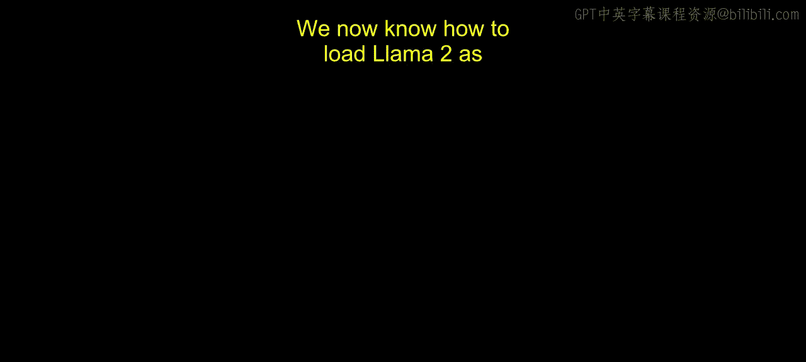
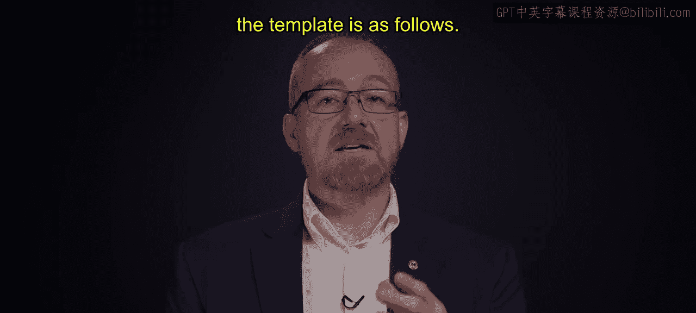
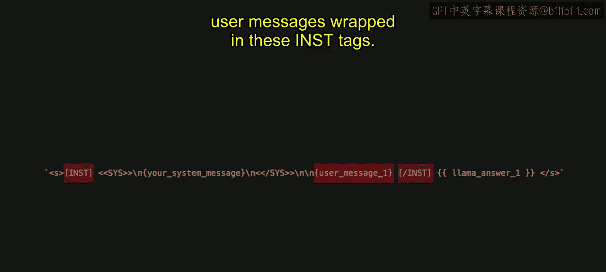
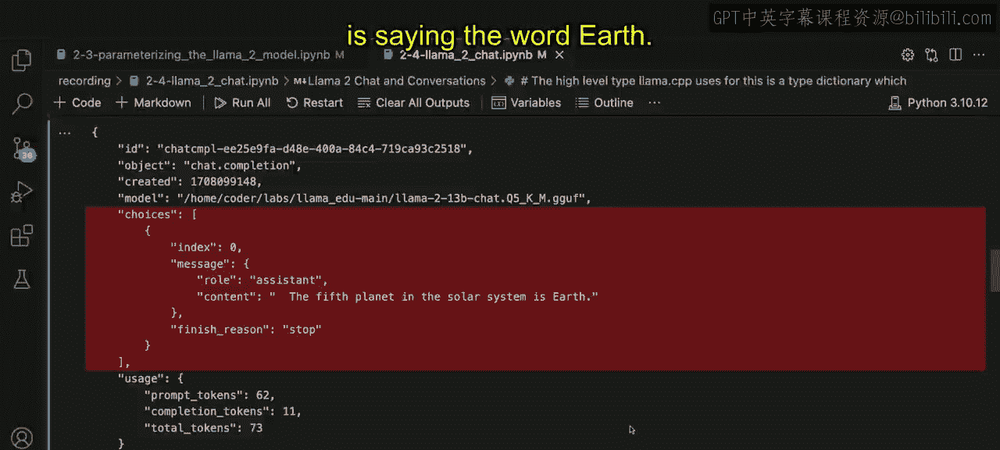
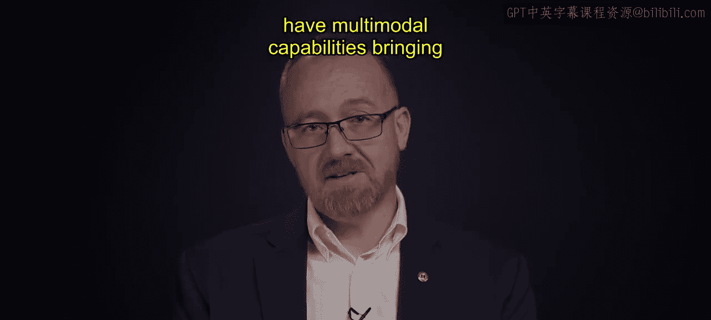
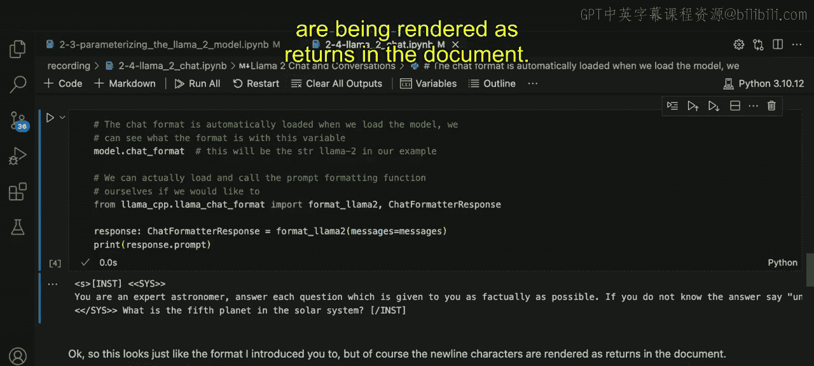
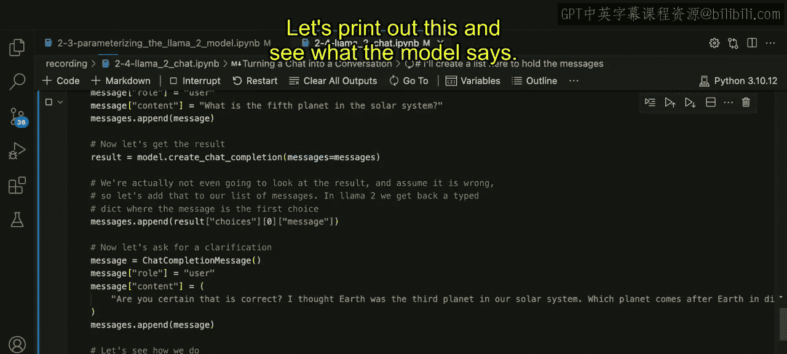
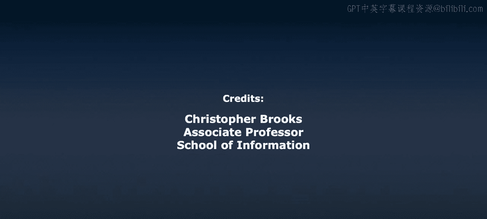

# Python程序员的羊驼：9：8_羊驼2的聊天和对话




在本节课中，我们将要学习如何与Llama2聊天模型进行交互。我们将了解其特定的对话格式，如何使用LlamaCPP的Python绑定来简化这一过程，以及如何构建多轮对话。我们还将探讨如何查看和利用模型内置的聊天格式化器。

## 理解Llama2的聊天格式 🧩

上一节我们介绍了如何加载基础Llama2模型。本节中我们来看看专为对话设计的聊天模型有何不同。

聊天模型在微调过程中使用了特定的提示模板。理解这个模板对于生成合理的提示至关重要。

根据Llama2论文，其聊天模板如下：
*   序列以 `<s>` 开始。
*   接着是 `[INST]` 字符串，表示一个指令的开始。
*   然后是系统消息，格式为 `<<SYS>>\n{系统消息}\n<</SYS>>`。
*   之后是用户的实际查询内容。
*   指令以 `[/INST]` 结束。
*   模型的回复会附加在后面。
*   同一对话中后续的查询应作为用户消息，包裹在 `[INST]` 和 `[/INST]` 标签中。






模板中包含各种空白字符，这些在微调数据中使用过，因此很重要。

## 使用LlamaCPP进行聊天交互 💬

虽然模板细节较多，但LlamaCPP及其Python绑定帮助我们封装了这种格式。


以下是使用LlamaCPP进行聊天交互的步骤。

首先，加载聊天模型。这里使用一个不同的环境变量指向13B参数的聊天模型，并设置相关参数。

```python
# 示例：加载聊天模型并设置参数
model = Llama(model_path=os.environ[‘LAMA_13B_CHAT’], verbose=False, temperature=0)
```

LlamaCPP使用一种称为 `chat completion message` 的高级类型字典。在推理时，这个字典会根据模型类型被转换为底层LLM所需的格式。

为了便于阅读和格式化，可以引入辅助库。以下是如何构建一个简单的对话。

```python
# 初始化消息列表
messages = []

# 添加系统消息
messages.append({
    “role”: “system”,
    “content”: “你是一位天文学专家。请尽可能准确地回答向你提出的每个问题。”
})

# 添加用户查询
messages.append({
    “role”: “user”,
    “content”: “太阳系中第五颗行星是什么？”
})
```

运行对话时，我们使用 `model.create_chat_completion` 方法并传入消息列表。



```python
# 获取模型回复
response = model.create_chat_completion(messages)
print(response)
```

执行后，我们得到模型的回复。在这个例子中，助手回复了“地球”。这个答案可能不准确，但这引出了一个问题：我们如何知道消息的实际格式以及可用的规则？

## 探索聊天格式化器与多轮对话 🔄

这涉及到抽象层。LlamaCPP不仅适用于Llama2，每种模型都根据其微调方式有自己的聊天格式。

尽管模型的使用方式看似相似，但潜在差异巨大。LlamaCPP经过抽象，可与多种模型协同工作，包括其他开源模型如Mistral。每个模型都有自己的词汇表、架构、预训练权重和微调消息格式，有些甚至具备多模态能力。



回到Llama2，如果我们想查看消息如何被转换为文本，可以查看LlamaCPP中可用的聊天格式化器。

```python
# 查看模型使用的聊天格式
print(model.chat_format)
```

这会输出类似“llama-2”的字符串，其对应的模板格式与我们之前介绍的一致。格式化器中的换行符在文档中会被渲染为回车。

聊天模型的一个真正强大之处在于支持多轮对话。大语言模型在一个设定的上下文窗口内工作。在Llama2中，默认上下文窗口最多可达4000个令牌。为了节省计算资源，LlamaCPP默认创建512个令牌的上下文窗口。

对于Llama2模型，最直接的对话就是一系列消息被追加成一个更长的序列，通过与人轮流交互，迭代地加入模型的回复。




让我们看一个多轮对话的例子。

```python
# 继续之前的对话，添加用户追问
messages.append({
    “role”: “user”,
    “content”: “你确定这是正确的吗？我以为地球是太阳系的第三颗行星。”
})



# 再次获取模型回复
response = model.create_chat_completion(messages)
print(response)
```


对这个结果可能感到失望，但请记住，我们使用的是较小的130亿参数模型，并且为了在课程环境的CPU上运行，对其进行了高度量化（压缩）。量化程度较低或更大的模型（如700亿参数模型）可能表现更好。我们也可以尝试进一步调整提示，使用一些提示工程策略。

## 总结与展望 📝

本节课中我们一起学习了与Llama2聊天模型交互的核心知识。

我们动手使用Python和LlamaCPP操作了Llama2，探索了分词的工作原理以及调整模型输出随机性的参数。我们还看到，不同的模型根据其微调方式，具有不同的交互规范，Llama2聊天模型就是一个简单但重要的模板范例。

在这个模板中，我们看到了三种消息角色：
1.  **系统消息**：可选，用于设定模型应如何响应的规范。
2.  **用户消息**：代表对话中用户的回合。
3.  **助手消息**：代表模型在对话中的回复。

现在，我想向你学习：你会如何着手改进Llama2对这个问题的回答？不必局限于课程中谈到的概念，可以自由运用从其他视频或阅读材料中获得的知识。请大胆尝试，实际操作笔记本，运行一些查询，试试这些模型并修改它们。

在下一个模块中，我们将更深入地探讨如何以编程方式与大语言模型集成，并会给你一个简短的练习作业。





