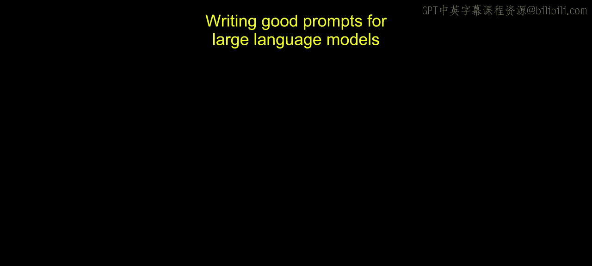
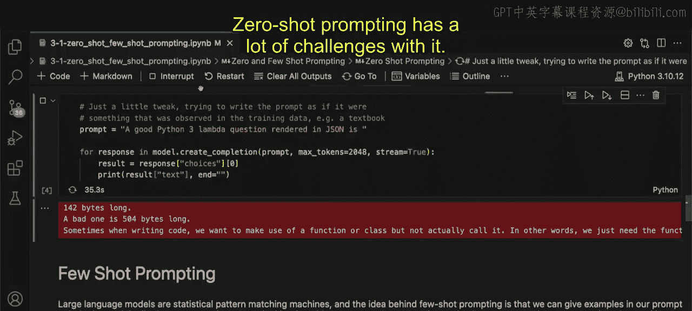
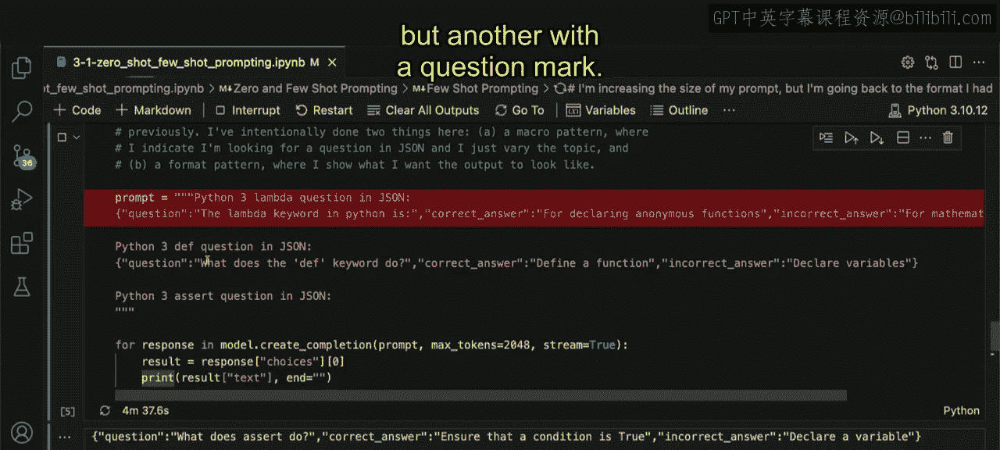
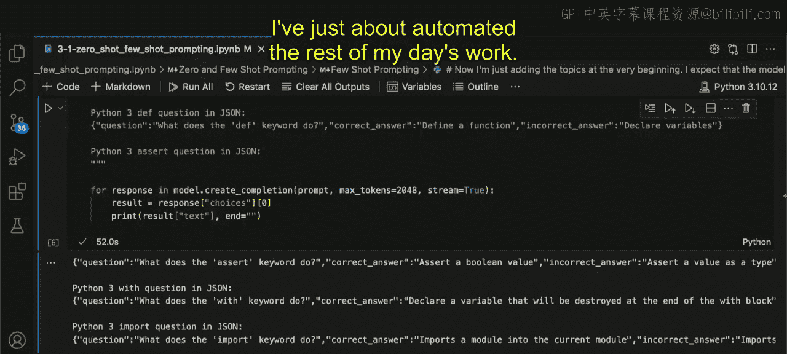
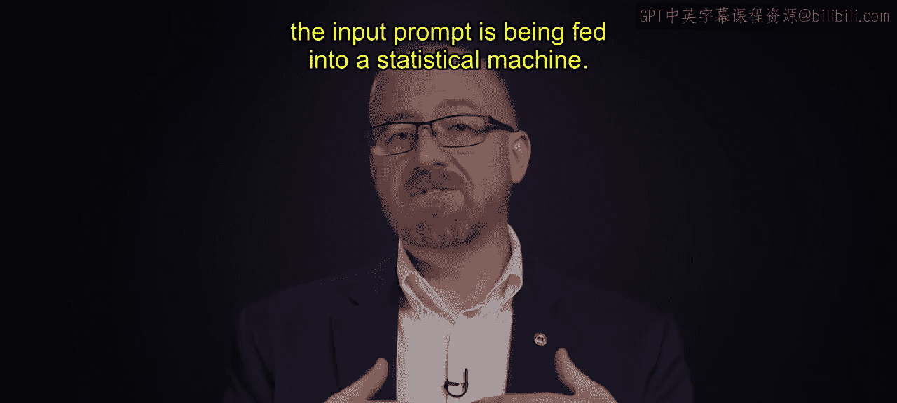
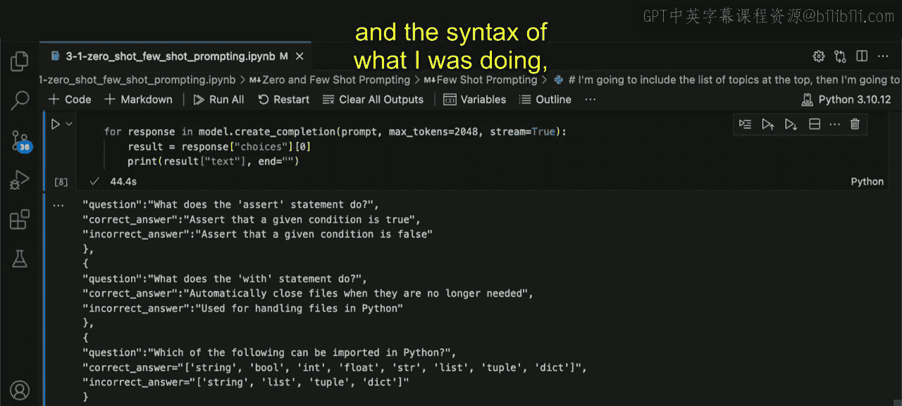

# 密歇根大学《Python程序员的羊驼》课程：P10：零次与少量提示 🎯



在本节课中，我们将学习两种核心的提示工程策略：**零次提示**与**少量提示**。我们将通过一个实际任务——生成用于测验的JSON格式Python问题——来演示这两种方法的工作原理、优势与局限性。通过对比，你将理解如何通过提供示例来引导大型语言模型生成更符合预期的输出。

## 概述

为大型语言模型编写优秀的提示，是艺术、科学，或许还需要一点技巧和运气的结合。模型本质上是一个统计机器，它接收数字化的输入序列，并根据模型中的预训练数据、输入序列本身以及调用模型时可用的各种参数，来生成匹配的输出序列。

上一节我们介绍了模型的基本工作原理，本节中我们来看看两种具体的提示策略。虽然存在更多策略，但这两种构成了当前实践的良好基础，并且与Llama模型配合良好。

## 零次提示 🤔

你实际上在课程中已经多次见过第一种策略——**零次提示**。它简单地给模型一组指令让其响应，并让模型使用其预训练的权重来生成输出序列。

严格来说，将这些输入称为“指令”可能并不准确。我们大多数人习惯于ChatGPT式的对话，但模型实际上只是在做输出序列预测。因此，零次提示就是提供一个输入序列，并从模型中获取一个预测的、合适的输出序列。


在本讲座中，我将使用一个非常真实的任务。我在密歇根大学的日常工作和Coursera平台上教授大量编程课程，内容涵盖Python、数据科学和应用人工智能。我喜欢给学生提供更多快速问题来测试他们的知识，但想出好问题很难，然后我还必须将它们全部输入到某种测验工具中。有趣的是，大多数这些工具可以接受JSON格式的问题，但我发现手动输入JSON文档既慢又容易出错。因此，让我们看看是否能共同构建一个对话代理来帮助完成这项任务。

### 首次尝试

首先，我们设置Llama模型，这次我将稍微增加上下文窗口的大小。这可能会降低速度，但也会导致返回更多的输出令牌，我认为这对当前任务特别有用。

在零次提示中，我们只是要求语言模型使用其预训练权重来续写我们的文本。由于我想生成一些JSON格式的Python3 Lambda问题，这似乎是一个好的起点。我只需写下：`Python3 Lambda question in JSON:`，这里的冒号有点像提示接下来会发生什么。让我们看看结果如何。

模型回复道：“我正在尝试对POST请求使用Lambda函数，但我得到一个错误，提示该值不是有效的JSON。” 这听起来没问题，但这不是我想要的。

### 调整思路

因此，我在这里做一点调整。我将尝试将提示写成好像在训练数据中观察到的东西一样。我稍微改变了思考方式，就像它在教科书中看到过类似内容。所以，我写道：`A good Python3 Lambda question rendered in JSON is:` 我认为这可能会给我们带来稍好一点的结果。



模型回复说：“一个好的以JSON呈现的Python 3 Lambda问题有142字节长。” 这看起来奇怪且随意，虽然是对句子的合理回应，但效果不佳。然后它开始谈论不好的问题是什么并编写代码。这些都没有很好地解决问题，我们需要做更多工作。

**零次提示面临很多挑战。**

## 少量提示 ✨

大型语言模型是统计模式匹配机器。**少量提示**背后的理念是，我们可以在提示中提供一些示例，以帮助模型将其输出调整到我们实际寻找的目标。这被证明是提示工程中一种非常简单的“超能力”，当你希望将模型的响应约束到特定格式时非常有帮助。让我们看看它是否在这里能帮助我们。


我增加了提示的大小，但将回到之前的格式。我在这里特意做了两件事：
1.  我创建了一个宏观模式，表明我正在寻找一个JSON格式的问题，并且只改变主题。
2.  我创建了一个格式模式，向它展示我希望输出看起来是什么样子。

以下是具体做法：

首先，我列出希望问题涵盖的主题：`The topics: lambda, def, assert, with, import`。

然后，我提供几个具体的问题示例。每个示例都以 `"A Python3 [主题] question in JSON:"` 开头，后面跟着一个格式良好的JSON对象，包含 `question`、`correct_answer` 和 `incorrect_answer` 字段。

例如：
```
A Python3 lambda question in JSON:
{
  "question": "What does the 'lambda' keyword in Python do?",
  "correct_answer": "It creates an anonymous function.",
  "incorrect_answer": "It defines a new class."
}
```

我提供了多个这样的示例，这就是“少量”中的“几”的含义。我们不是在预训练或微调模型，而是给它几次改进的机会。

最后，我给出一个未完成的提示，让模型来补全：`A Python3 assert question in JSON:`。

### 结果分析

我们可以看到，这立刻比我们之前的尝试效果好得多。模型只是继续并完成了我要求的事情。它说了一个关于 `assert` 的合理问题，并提供了正确和错误的答案。



但有趣的是，模型也识别出了宏观模式。在我提供的示例之后，它开始自动生成类似 `"A Python3 list question in JSON is..."`、`"A Python3 tuple question in JSON is..."` 的条目。然而，它生成的问题如 `"A list is:"`、`"A tuple is:"`，从教学法角度看是非常糟糕的问题，而且也不是我想要的。我原本希望有更多样性。

这就是为什么我在我的“少量”示例中，一个用了冒号，另一个用了问号。**如果我增加“少量”示例中的问题数量及其多样性，它就不会拾取这种微观模式，并会为我产生更好的输出。**

### 进一步约束与JSON化


我实际上从系统中得到了非常好的输出。但在我这边，我看到大量看起来相同的问题，我实际上想稍微约束一下。我想确保模型只创建关于我正在教授的主题的问题。

用“少量提示”实现这一点的方法是，我只需在开头添加主题列表，然后给出完全相同的少量问题示例，希望它能拾取主题列表与我给出的问题之间的模式。





但有时结果并不包含我可能想要的所有JSON字段。请记住，这里一切都是令牌和序列，输入提示被馈送到一个统计机器中。让我们看看是否能进一步调整。

我知道我告诉过你不喜欢手动编写JSON，但这就是我要在这里做的。我将像之前一样在顶部包含主题列表，但我会把所有内容都写成JSON，并让它看起来像是机器应该继续编写JSON。

以下是我的做法：
1.  我设置一个JSON变量来存储主题列表：`{"topics": ["lambda", "def", "assert", "with", "import"]}`。
2.  然后我指示 `"questions"` 将是一个列表。
3.  在列表中，我提供几个示例字典，每个字典都有 `"question"`、`"correct_answer"`、`"incorrect_answer"` 等字段。

这里有几个有趣的地方。你会注意到有一些应该被拾取的模式，比如末尾的逗号和换行，以及以左大括号开始、然后以 `"question"` 开始的行等等。我认为机器会很好地拾取这些。实际上，我们与Llama的编程交互方式没有任何其他变化。

运行后，结果非常可靠。我认为真正酷的地方在于，我并不是在与模型对话或试图引导它成为专家。我只是开始编写一个JSON文档，而它既捕捉到了我正在做的事情的含义（编写带有正确和错误答案的问题），也捕捉到了我正在做的事情的语法（编写格式良好的JSON）。而这一切都是在一个量化到130亿参数的模型中完成的。

## 总结与练习 🚀

本节课中我们一起学习了两种核心的提示策略：**零次提示**与**少量提示**。零次提示简单直接，但可能无法产生特定格式或高度定制化的输出。少量提示通过提供少量示例，能有效引导模型理解任务格式和期望，是约束模型输出的强大工具。

现在是一个跳转到Coursera实验环境，使用Notebook进行实验并亲身体验的好时机。以下是你可以尝试的几个任务，它们运用了你所学到的一些知识：

以下是具体练习建议：
1.  你如何**使用Llama2聊天模型重新实现这段代码**？
2.  你如何**重写这些提示，使其包含多个错误答案（都在它们自己的JSON列表中）**？




请在实验工作区中尝试这些任务，并随时在课程讨论区分享你对这些问题的回应或你的成果。