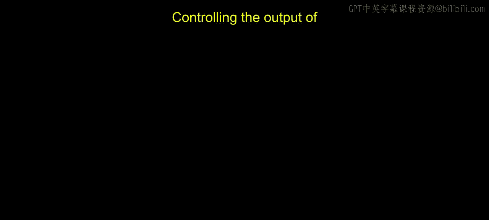
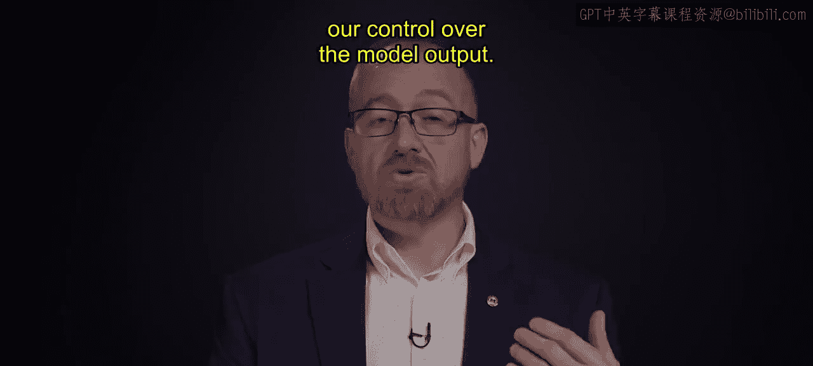
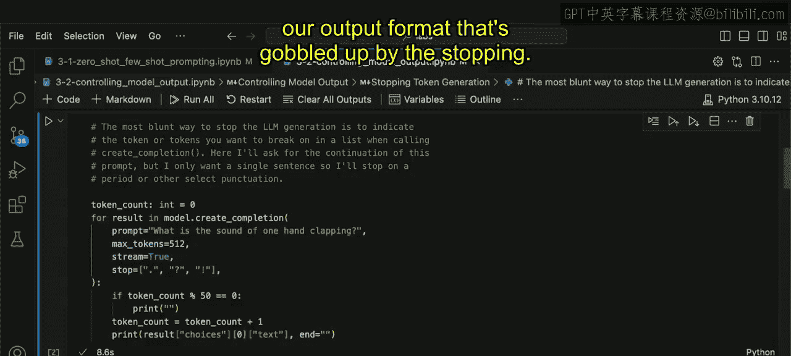
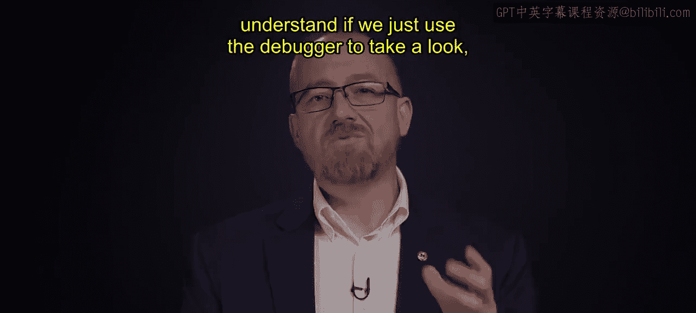
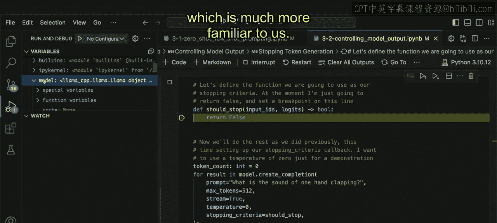
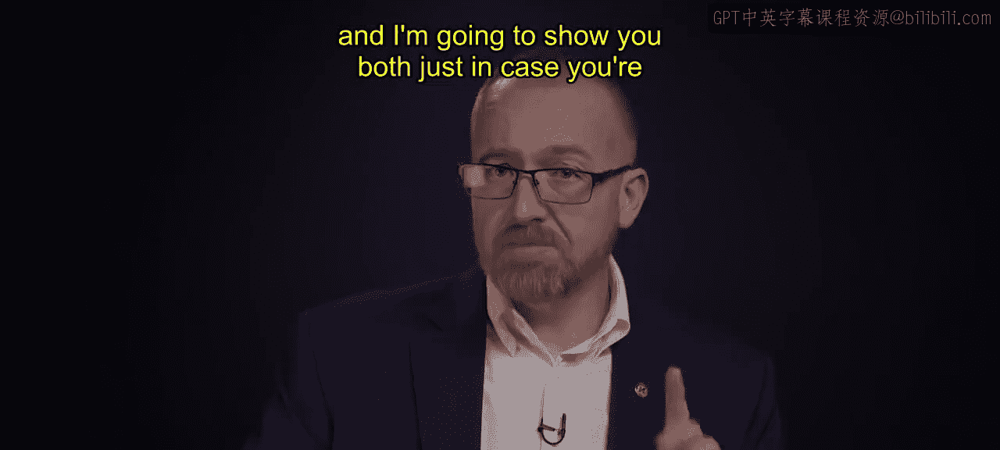
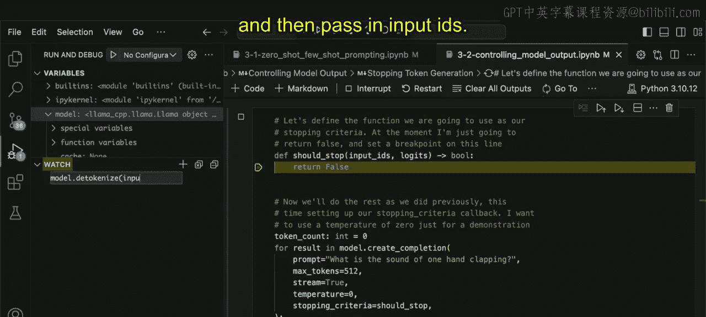
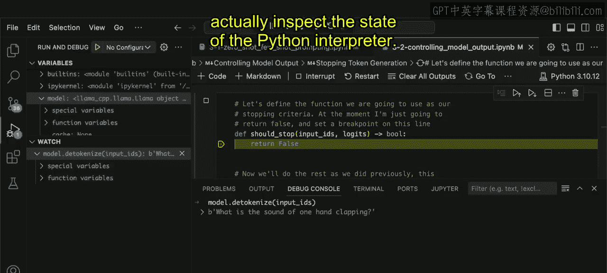
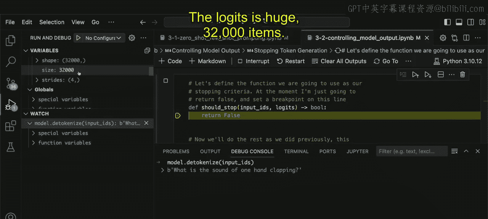
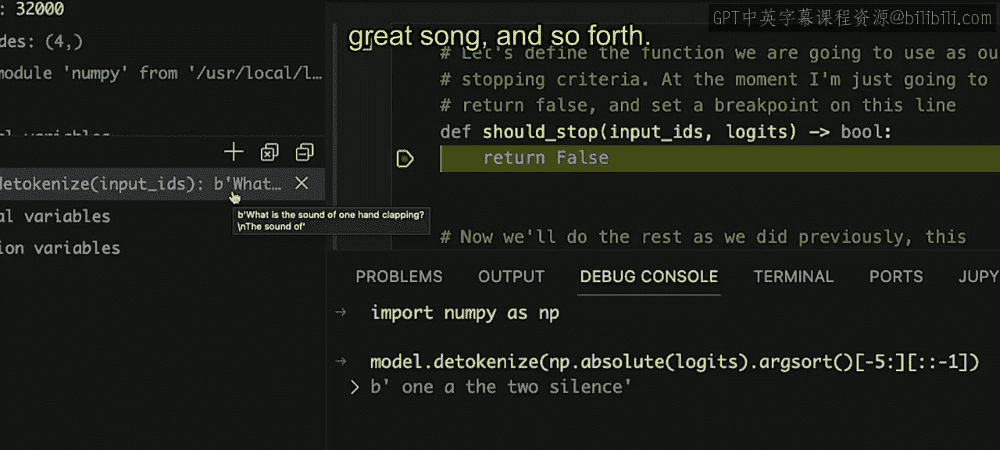

# 密歇根大学《Python程序员的羊驼》课程｜Llama2 for Python Programmers：P11：控制模型输出 🎛️



在本节课中，我们将学习如何控制语言模型的输出。控制语言模型的输出是一项具有挑战性的任务。正如你在上一讲中所见，我们可以使用少量示例提示来帮助满足某些格式要求。然而，让模型在生成一个项目后立即停止可能有些棘手。

幸运的是，Llama CPP 提供了另外几种机制，我们可以利用它们来增强对模型输出的控制。第一种机制被称为停止条件。



## 配置模型

首先，我们将像往常一样加载和配置模型。这里使用的是基础模型 `noncha`。

```python
# 加载和配置模型的代码示例
from llama_cpp import Llama



llm = Llama(model_path="./models/noncha.gguf")
```

## 使用停止标记列表

控制LLM生成最直接的方法是，在调用 `create_completion` 函数时，指定一个你希望在其处中断的标记列表。

我们通过在这里指示一个包含所有标记的列表来实现这一点。当然，这些最终会被标记化，它们本身在这里并不是标记。如果在输出流中识别出这些标记中的任何一个，处理就会停止。

```python
# 示例：使用停止标记列表
response = llm.create_completion(
    prompt="What is the sound of one hand clapping?",
    stop=["."]  # 遇到句号则停止
)
```

在这个例子中，我们看到它实际上停止了，因为它很可能遇到了一个句号。这个句号实际上并没有出现在我们的输出格式中，它被停止机制“吞掉”了。

## 使用停止条件回调函数



现在，这种形式的停止实际上是在 Python 库本身中完成的，而不是在底层的 Llama CPP 中。

不过，还有一种选择是设置一个回调函数来决定何时停止。这个停止条件实际上是在 Llama CPP 内部完成的。

这里我需要坦白一件事。这是我对我们正在使用的一些工具感到沮丧的地方。虽然这些工具运行良好，但文档有时会滞后或不清晰。这些工具的新颖性，以及在这个领域缺乏明确的标准甚至占主导地位的开发工具，也使得理解底层发生的事情变得有些困难。

如果我们查看 Llama CPP Python 绑定网站的文档，我们会看到停止条件实际上是一个可调用对象（即函数）的列表。这些函数接收两个参数，都是 NumPy 数组。第一个参数是一个无符号整数数组，第二个参数是一个单精度浮点数值数组。

这里的期望是回调函数将返回一个布尔值，大概是表示我们是否应该停止处理。

我认为，如果我们直接使用调试器来查看，可能会更容易理解这一点。那么，我们现在就来做这件事。

## 调试停止条件函数

我将为我们的停止条件定义这个函数 `should_stop`。它完全遵循我们讨论过的签名：接收输入ID和逻辑值，并返回一个布尔值。在这里，我们将始终返回 `False`。

```python
def should_stop(input_ids, logits):
    # 在此处设置断点以进行调试
    return False
```

我们将以完全相同的方式设置模型，但我要做的一个不同之处是添加一个调试断点。我将在 `return False` 这一行特别设置一个断点。

要在 VS Code 中调试这个单元格，我们实际上使用这个下拉菜单，然后选择“调试单元格”。通常当你运行一个单元格时，你可以使用工具栏上的“运行”或按 `Ctrl+Enter`，但这里我想调试这个单元格。

现在调试器运行了，并且在这一行中断了，这意味着我们的回调函数正在被调用。你可以看到顶部出现了这个调试工具栏，我们可以用它来控制一些前进和后退的操作。





在左侧的调试面板中，我们可以看到局部变量。所以我们有这个 `input_ids` 变量和 `logits` 变量，它们就来自我们创建的 `should_stop` 函数。如果我们展开 `input_ids`，我们会看到关于它的更多信息。如果我们向下滚动，我们会看到它的形状和大小，表明其中有11个值。它们都是数字，这些数字本身的大小是4。

花点时间思考一下，根据我们目前讨论的问题，你认为这些数字实际上是什么？事实证明，这些是一个标记序列。



如果我们展开调试器的全局部分，我们可以看到 Llama 对象在这里作为一个模型。我们之前研究过标记化，模型对象有一个方便的函数 `detokenize`，可以将序列转换回我们更熟悉的文本表示。

要做到这一点，我们有几种选择。我将向你展示两种方法，以防你对 VS Code 的调试功能不熟悉。


第一种是添加一个监视变量。这是一个在多次调试运行中持续存在的表达式，当你调试循环时，这是一个方便的方法。我将在这里添加监视表达式。

```python
# 在调试器中添加监视表达式
model.detokenize(input_ids)
```

一旦我这样做，就清楚多了，提示实际上就在这里。我们可以把这个窗口再滑开一点。“What is the sound of one hand clapping.” 这很好。这里非常清楚，`input_ids` 是序列中的标记。当我们对其进行反标记化时，我们就得到了我们的提示。

另一个选择是使用窗口底部的调试控制台。这允许你编写任意的 Python 代码与解释器交互。如果我把同样的代码放在这里，我们应该得到相同的结果。

所以，一个方便的方法是，我们只需转到“视图”，然后选择“调试控制台”，现在我们实际上有了一个完整的控制台，一个 Python 解释器，或者可以访问正在运行的 Python 解释器，我们可以把同样的代码放在这里。

很好，我们得到了完全相同的输出。这是两种不同的方式，你可以在调试器中断在一行时，实际检查 Python 解释器的状态时使用。




这并非 Llama 2 独有，但如果你想能够理解新的和新兴的软件包，这是一项重要的技能。如果你以前没有见过这个，我鼓励你尝试一下，也许可以查找一个关于在 VS Code 中调试的视频。如果你能掌握你的工具包，你解决问题的能力将会加倍提高。

现在让我们回到这个函数。我们在这里返回 `False`，这表明我们实际上不应该停止处理。我们有几个选择。如果我们只想继续运行，我们可以按顶部的播放按钮，或者按 `F5`。所以我就按几次。

你可以看到，当我按下它时，Python 解释器启动，然后再次中断，因为下一个标记已经到来。如果我们按几次，然后我们可以去看这里的文本字符串，我们看到“What is the sound of one hand clapping\n the sound of”已经被返回了。



## 理解逻辑值

现在我们理解了 `input_ids`，让我们把注意力转向 `logits`。`logits` 数组非常庞大，有 32,000 个项目，所以你可以想象这与我们的词汇表是对应的。

`logits` 数组中的每个值，都是一个给定标记将成为下一个响应正确标记的对数几率。不要让这个吓到你，对数几率（logit）基本上只是一个概率值，范围从负无穷到正无穷。


我不打算详细介绍这个映射是如何实际完成的，但我们实际上想要的是这里最接近零的值。这些是我们最有可能的候选标记，而那些趋向于正无穷或负无穷的值是我们最不可能的候选标记。

为了做到这一点，我首先要导入 `numpy`，然后我将取 `logits` 数组的绝对值，并按大小排序，然后取最后五个项目。这些将是我们最接近零的五个标记，并对它们进行反标记化，看看它们是否有意义。

请记住，当你看到字符串输出时，它实际上是倒序的：最可能的标记是最后一个。所以我们可以使用 NumPy 语法对最后五个项目进行切片来反转它们。

```python
import numpy as np



# 获取最可能的五个标记
top_indices = np.argsort(np.abs(logits))[-5:]
top_tokens = [model.detokenize([idx]) for idx in top_indices[::-1]]  # 反转顺序
```

我们可以看到，模型建议的最佳选择是标记“1”、“a”、“the”、“two”和“silence”。到目前为止，它得到的是“What is the sound of one hand clapping. The sound of”，你可以看到所有这些都有意义：“the sound of one”（也许它会继续谈论“one hand clapping”），“the sound of silence”（一首好歌），等等。

## 总结

在本节课中，我向你展示了两种不同的控制 LLM 输出的方法。

第一种是通过你作为列表提供的一系列停止项。第二种是通过停止条件，你可以在其中提供多个不同的回调函数，这些函数作用于模型响应的底层概率。

这两种方法都很有用。你可以想象，在停止条件中使用一个函数，你可以做任何你可能想在 Python 中做的事情，包括验证响应是否符合特定的正则表达式模式，甚至将部分完成的提示发送给另一个服务、进程或人员进行沿途验证。

我演示了如何使用 VS Code 环境来深入了解 LLM 的底层操作。坦率地说，我只展示了一个非常简单的例子。一旦你掌握了平台内的调试技能，你就可以通过单步执行代码来快速掌握像 Llama CPP 的 Python 绑定这样的软件包，看看它是如何工作的。


我认为这是一项极其重要的开发人员技能，而我们往往没有很好地教授它。所以我希望你能考虑自己探索这一点，以更好地理解 Llama CPP 包及其工作原理。