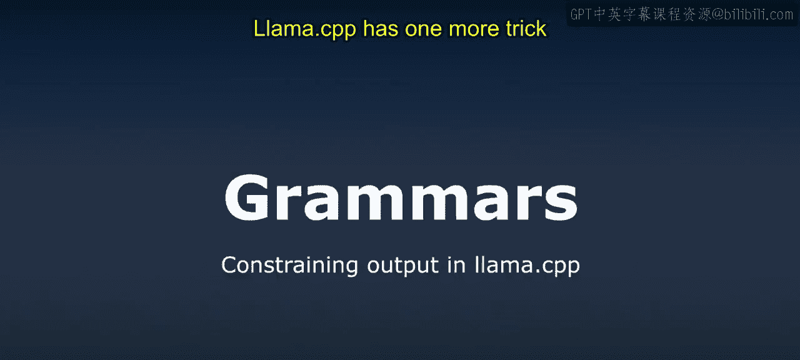
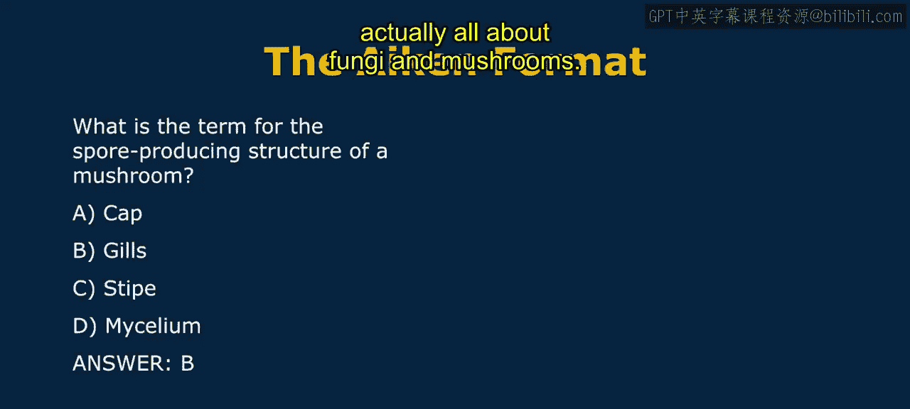
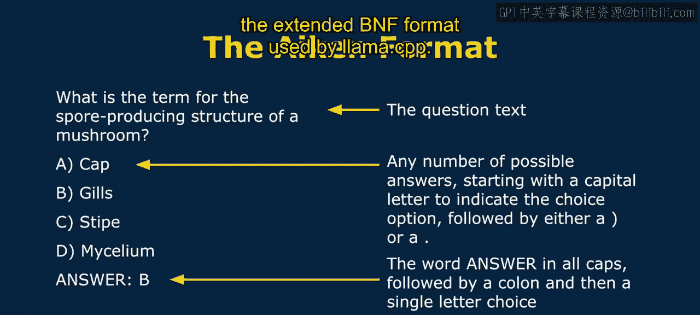
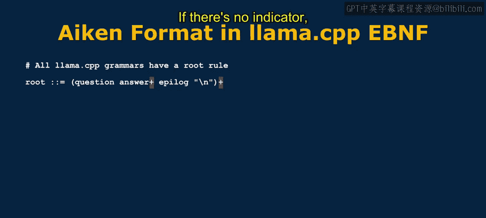
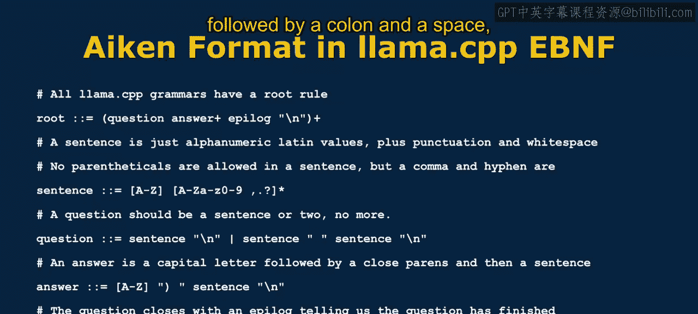
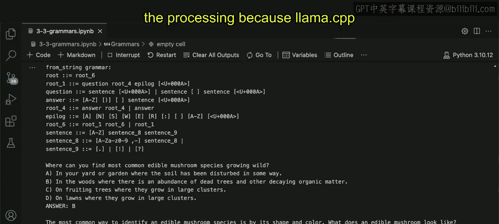
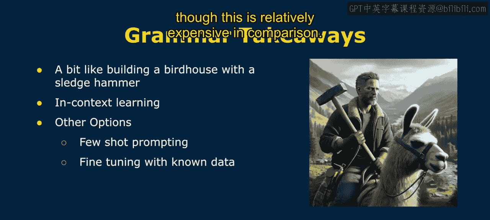

# Python程序员的羊驼：P12：使用语法 🧠




在本节课中，我们将学习如何使用Llama CPP的“语法”功能来控制模型输出。语法是一种形式化定义，用于约束模型生成文本的结构和格式。我们将通过一个创建多选题的例子，来了解如何定义和使用语法。

---

## 语法简介

上一节我们介绍了通过提示工程引导模型输出。本节中我们来看看一种更结构化的控制方法：语法。

语法是用于定义文档语法和语义的形式化规则。它们描述了我们在使用计算机时习以为常的大多数过程。例如，编程语言、网页文档、网络协议等都有其对应的语法。

Llama CPP使用一种称为“扩展巴科斯范式”的语言来编写语法。

## 扩展巴科斯范式入门

如果你没有传统的计算机科学背景，可能对EBNF感到陌生。让我们通过一个例子来了解它的基本结构。

我们将使用Llama2模型来生成多选题。多选题有一种简单的格式，称为“Aiken格式”。





以下是Aiken格式的一个例子：
```
蘑菇的哪个部分主要负责吸收水分和养分？
A) 菌盖
B) 菌柄
C) 菌丝体
D) 孢子
ANSWER: C
```

在这个格式中，一个问题由一两句话组成，后面跟着一系列用大写字母标记的选项，最后一行用“ANSWER:”指明正确答案。



## 将Aiken格式转换为EBNF语法

现在，让我们将这个简单格式转换为Llama CPP使用的EBNF语法。

在最高层级，你可以将语法视为一组规则。规则的左侧是规则名称（称为“非终结符”），右侧表示该规则的可用格式选择。

格式选择可以由任何非终结符引用以及“终结符”（即字符串值）组成。许多正则表达式的约定也得到支持，例如指示可以输出的字符类型，或某个文本值是可选的还是必需的。

在Llama CPP中，我们总是从根规则开始。我将根规则建模为：由一个**问题**、至少一个**答案**和一个**结尾**（我称之为指示正确答案的那一行）组成，最后加上一个换行符。


```ebnf
root ::= question answer+ epilogue "\n"
```

对于这组事物，我希望它们至少出现一次，但可以出现多次（问题越多越好）。请注意，右侧唯一的终结符是换行符“\n”，这意味着我必须至少再创建三个规则：分别对应问题、答案和结尾。

此外，这里的加号“+”表示一个项目必须至少存在一次，但可以出现多次。如果没有指示符，则它必须出现且仅出现一次。Llama CPP语法还允许你用星号“*”表示某物出现零次或多次，或用问号“?”表示完全可选。

## 定义详细规则



在继续创建这些规则之前，我想添加一个辅助规则来定义一个句子。

当我最初使用少样本提示来生成一些问题时，我发现Llama2会在答案中添加比我想要的更多的解释，通常包括大型括号内的陈述，这基本上泄露了答案。

除了加号、星号或问号符号外，无法约束返回的标记数量。但考虑到Llama2是在大量自然文本上训练的，我们可以稍微约束一下，这将有助于引导它的响应量。

我在这里将一个句子定义为以大写字母开头，并且只使用拉丁字母（通过在方括号内给出A-Z范围）。然后，模型可以自由选择任何大写、小写或数字字符，以及空格、逗号、句点或问号。我不允许在此语法中使用括号陈述，但星号为模型确定句子的实际长度提供了相当大的自由度。


请注意，句子规则右侧的所有项目都是终结符，右侧没有规则。

```ebnf
sentence ::= [A-Z] [a-zA-Z0-9 ,.?]*
```

接下来是问题规则。我将重用我们创建的句子规则。我希望一个问题是一个以换行符结尾的句子，或者是两个由空格分隔、以换行符结尾的句子。这是一个简单的规则，应该比单个句子提供更多选项。

```ebnf
question ::= sentence "\n" | sentence " " sentence "\n"
```

在我们的根规则中，我们指出必须至少存在一个答案，但可以有多个答案。我将一个答案定义为一个单独的大写字母开头，后跟一个右括号和空格，然后是一个句子和一个换行符。这与我的少样本示例数据非常吻合，应该能满足我的需求。

请注意，没有简单的方法来强制答案必须具有唯一的标签或必须按字母顺序排列。

```ebnf
answer ::= [A-Z] ") " sentence "\n"
```

最后，我们添加结尾部分，即全大写的单词“ANSWER”，后跟冒号、空格，然后是代表正确答案的字母。

```ebnf
epilogue ::= "ANSWER: " [A-Z]
```

这并不是Aiken格式的完美表示，但它确实展示了所支持功能的基础。Llama CPP文档包含了更多信息和其他几个示例。



## 在Llama CPP中使用语法


现在我们已经定义了语法，让我们看看如何在Llama CPP中使用它。

我将加载基础模型（非聊天模型），并将上下文窗口设置为大约一半大小2048，这已经相当大了。

这里我有几个不同的提示，也就是几个简短的Aiken格式问题示例。

我们的语法与讲座中讨论的完全一致。关于Llama CPP语法的一个有趣之处是，我们可以在其中添加注释，我已经包含了一些注释。

当我们想在模型上调用此语法时，只需指示应发送此语法。在这里，我添加了`model.create_completion`，指示我希望强制执行的语法，指定我希望流式传输，并给出最大标记数。

现在让我们看看它的实际效果。

我们可以看到，语法被描述为一个图，并且我们开始从Llama2推理引擎获得响应，完成我们的问题，为我们创建更多符合Aiken格式的问题。如果格式不符合，那么我们必须已经到达处理的末尾，因为Llama CPP在底层改变了那些逻辑。

## 语法的工作原理



现在你知道了如何使用语法来强制Llama2产生某种输出，我们应该谈谈它的底层工作原理。

请记住，模型本身只是根据输入的标记集来预测下一个标记。它通过检查所有可用标记的逻辑值来实现这一点，然后使用温度等各种参数从该集合中进行采样。

Llama CPP强制执行语法的方式是，它将不符合语法的标记的逻辑值设置为负无穷大。

这就是全部。Llama2实际上在这里没有知识或作用，它是一个基于逻辑值选择标记的统计机器。模型之上的工具包正在改变可能标记的权重，以强制执行我们感兴趣的语法。


## 使用语法的注意事项

说实话，使用语法有点像试图用大锤建造鸟舍。模型并不计划符合语法，甚至不知道语法的存在。如果你尝试在没有少样本提示的情况下使用语法，你很可能会对结果感到非常失望。

当你拥有多个示例时，模型可以从这些示例中的模式学习，这称为“上下文学习”，因为示例存在于上下文窗口中。

你还有其他选择。例如，你可以先尝试少样本提示，然后在你的应用程序代码中使用任何你想要的解析库来强制执行语法。或者，你可以基于一些已知的良好训练数据对模型进行微调，尽管相比之下这相对昂贵。

我很少使用语法，当我使用时，往往是在我将一个查询或查询的变体发送到多个小模型，然后对返回的结果进行多数投票的情况下。

---




本节课中我们一起学习了如何使用Llama CPP的语法功能来结构化模型输出。我们了解了EBNF的基本概念，并通过定义Aiken多选题格式的语法，实践了从规则设计到代码调用的完整流程。记住，语法是一种强大的约束工具，但通常需要与少样本提示结合使用才能获得最佳效果。