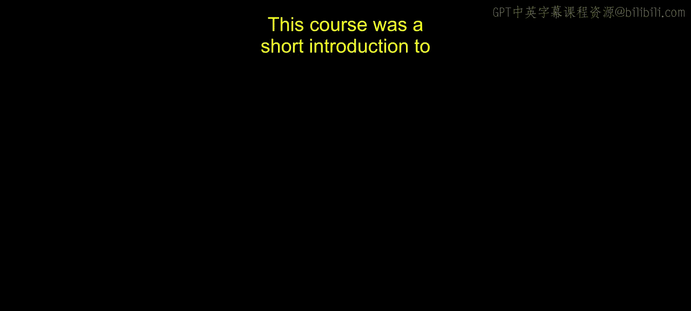
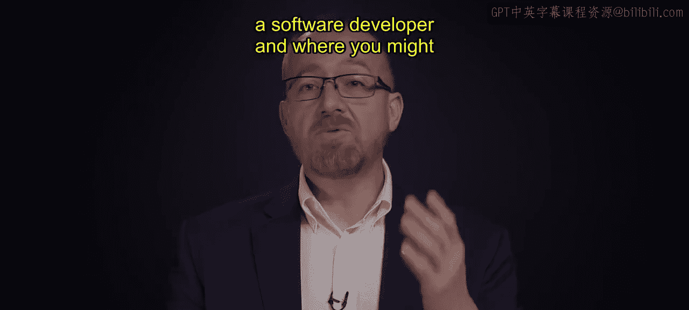

# Python程序员的羊驼：13：课程结论 🎯

在本节课中，我们将对《Python程序员的羊驼》课程进行总结，回顾我们所学到的关于Llama2模型的核心知识，并展望未来的学习方向。

## 课程回顾 📚

上一节我们探讨了提示策略与API机制，本节中我们来看看整个课程的要点总结。

本课程是对Meta公司开源Llama2模型的简短介绍。我们讨论了Llama2的不同版本，包括基础模型、对话模型和代码模型，以及使用这些模型所面临的挑战。这些模型拥有70亿甚至700亿个参数，体积高达数十GB。

## 核心学习要点 ✨

以下是本课程涵盖的核心技术要点：

*   **模型量化**：你学习了量化技术，即通过降低模型精度来压缩模型。这允许你在已有的普通硬件上运行这些大模型。其核心思想可以表示为：`量化 ≈ 降低权重精度（如FP32 -> INT8）`。
*   **推理引擎**：你了解了Llama.cpp如何让你在模型推理中混合使用CPU和GPU资源。
*   **分词机制**：我们深入探讨了分词的工作原理，并理解了它在大型语言模型中的重要性。模型的输入和输出主要基于**令牌序列**。
*   **生成参数**：你也看到了如何使用诸如温度（`temperature`）、Top-P（`top_p`）和Top-K（`top_k`）等各种参数来改变模型对给定提示的响应方式。其底层逻辑是基于概率从候选令牌池中进行采样。
*   **提示与约束**：在课程的最后一个模块，我们探索了如何使用少量示例提示等策略，以及Llama.cpp API中的语法机制来引导和约束模型的输出。

## 生态与展望 🚀

以上内容仅仅是应用开发者如何集成Llama2并构建引人注目的语言模型应用的一个初步体验。

我们简要讨论了微调，但其细节足以构成一门独立的课程。我们也提到了围绕这些开源模型的软件生态系统如何为我们提供新的能力，例如语法约束。

目前，这个生态系统正在迅速扩展，出现了许多用于更高层次抽象的大型软件框架，例如LangChain和LlamaIndex，以及用于模型服务和生产的开发运维环境，如vLLM。

这个领域有很多知识需要学习，我鼓励你广泛且定期地阅读技术论坛，并利用你的开发工具链（如VS Code调试器）来理解不断涌现的新技术。

## 课程活动与思考 💡

我们还有最后一项课程活动——一个编码作业。但在开始之前，我想请你从日常经验的角度反思一下这门课程。

你是否在这里学到了关于Llama2和Llama.cpp的知识，并认为可以将其应用于你的日常生活，无论是工作、学习还是其他追求？

请随时与我分享这门课程如何与你作为软件开发者的目标相关联，以及你接下来可能如何利用这项令人兴奋的技术。

---

**本节课中我们一起学习了**Llama2模型的基础知识、量化与推理、分词原理、生成参数调控以及提示策略。这只是进入开源大模型世界的起点，期待你运用这些知识，在AI应用开发的旅程中继续探索。