# 01：欢迎来到课程 🦙

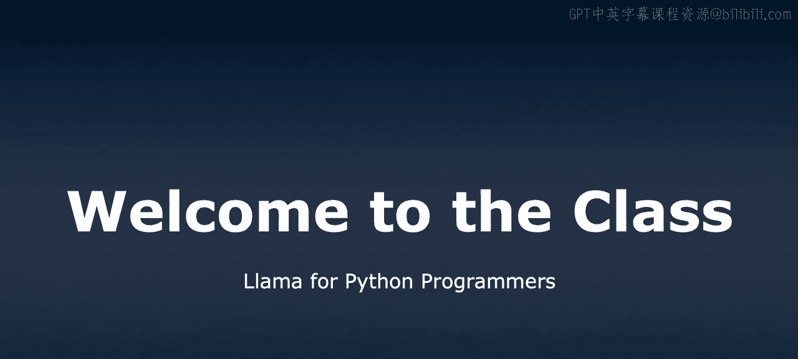

在本节课中，我们将要学习这门课程的概述、目标以及你将使用的工具和环境。我们将了解Llama2模型的重要性，并为你接下来的学习做好准备。

欢迎来到《Python程序员的Llama》课程。我是克里斯·布鲁克斯，密歇根大学信息学院的副教授。我的背景是计算机科学家，在密歇根大学的研究和教学重点是将数据科学、机器学习和人工智能应用于改善基础教育、中等教育和终身学习领域。

我很高兴能为大家带来这门关于开源大语言模型的课程，特别是由Meta创建的Llama模型。我将在Coursera平台上为大家讲解，在这里你可以实验、探索和学习如何编程这些模型，而无需在自己的机器上安装任何软件。

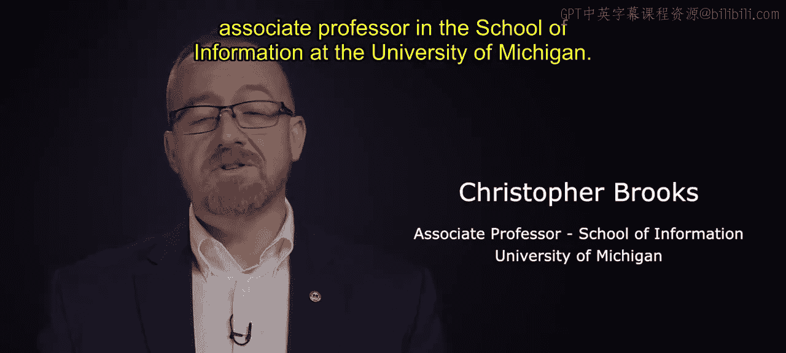

## 认识Llama2模型

上一节我们介绍了课程的基本情况，本节中我们来看看我们将要学习的核心模型——Llama2。

第一个Llama模型由Meta AI于2023年2月发布。我将要教给大家的是同年夏天晚些时候发布的Llama2模型变体。与最知名的大语言模型ChatGPT不同，Llama2模型全部可以在免版税许可下下载，并允许你将其直接集成到你可能有兴趣构建的应用程序或服务中。

这一点在高度监管的行业或涉及敏感数据的领域（例如医疗、教育，或任何你更倾向于不将数据发送给第三方（如OpenAI）的情况）中极其重要。这些模型也非常适合以最低成本进行原型开发，因为你可以在自己已有的硬件上运行它们。你还可以将它们扩展并部署到生产环境中，无论你拥有的是几台机器还是私有数据中心网络。

但需要注意的是，Llama2模型并非玩具模型。它们与商业产品具有竞争力，并且可以作为服务器在一些流行的云平台（如Microsoft Azure或Amazon Web Services）上进行扩展。

## 课程结构与学习工具

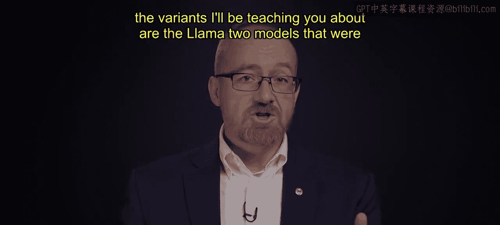

了解了模型的基本情况后，接下来我们看看这门课程将如何展开，以及你将使用哪些工具进行学习。

本课程将是讲座与实践的混合体。第一个模块以基础讲座为主，随后的模块将包含实时代码演示。代码演示将使用VS Code环境中的Jupyter笔记本，并在Coursera平台上进行。在这里，你将可以访问网络托管的VS Code版本。这将允许你跟随视频讲座实时修改代码，探索Llama2以及我们将使用的名为`Llama CBP`的软件包是如何工作的。

Coursera平台最令我兴奋的一个方面是，它允许你在听我讲解的同时练习你正在学习的内容。我鼓励你这样做：不要只是被动地观看视频，要成为一名积极的参与者，并使用这个实验工作空间来确保你在这门课程中取得成功。

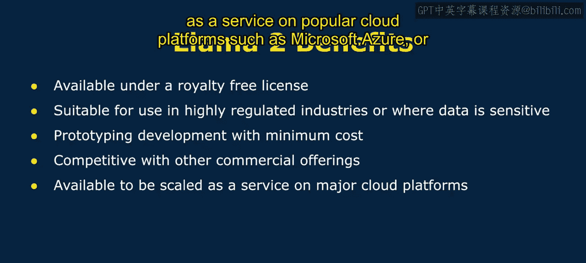

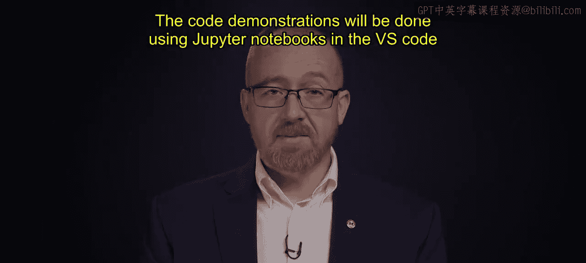

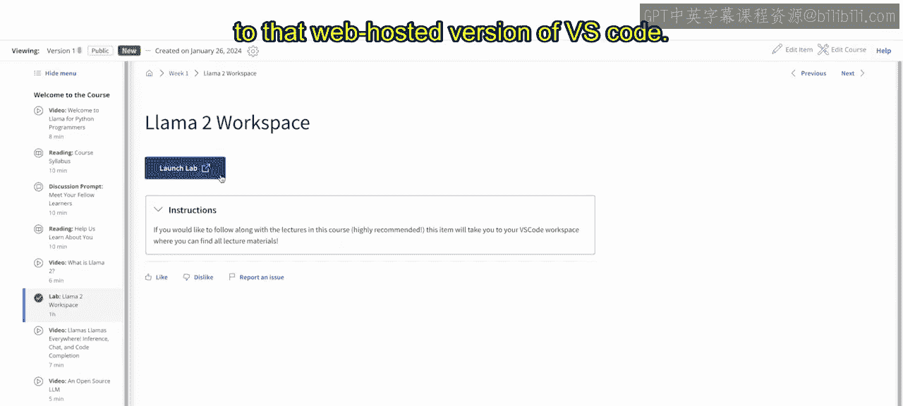

## 预备知识与课程评估

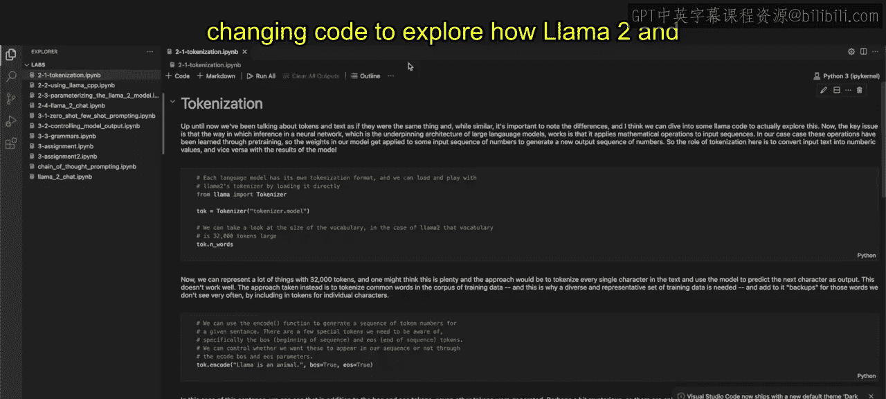

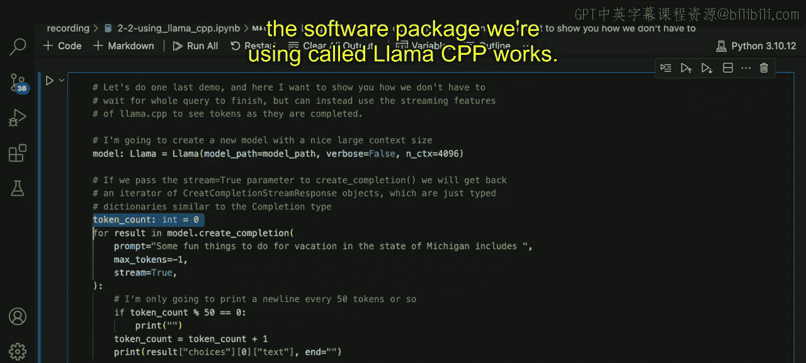

在开始动手实践之前，我们需要明确学习本课程所需的基础知识以及你将如何被评估。

我期望你具备一些Python的基础知识。我的演示将使用Python3。课程中的大部分评估将是简答题、选择题和一些编程题的混合。大语言模型的世界是一个快速发展的领域，我很高兴能为大家带来这门课程。

## 开始学习前的思考

在深入课程材料之前，我想请你花点时间反思一下：你希望在这门课中学到什么？以及为什么？

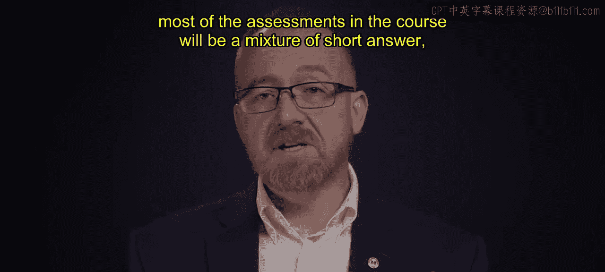

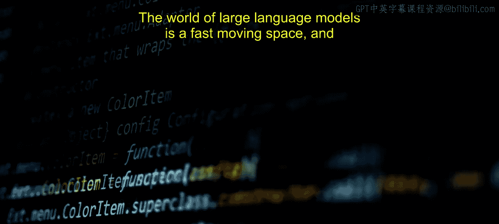

感谢你与我分享你的想法。现在，让我们开始深入学习更多关于Llama2的知识。

---

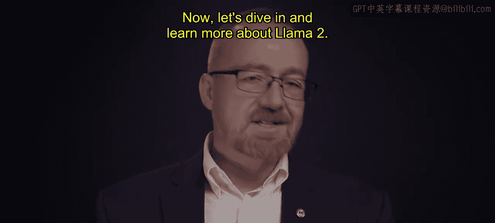

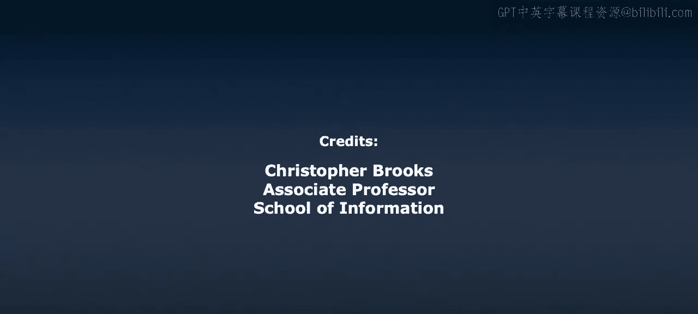

本节课中我们一起学习了这门《Python程序员的Llama》课程的介绍。我们了解了Llama2作为开源大语言模型的重要优势，熟悉了课程将采用的混合教学结构与Coursera平台上的实践工具，并明确了所需的Python预备知识。现在，你已经为接下来的深入学习做好了准备。