# 04：开源LLM——羊驼及其竞争对手 🦙

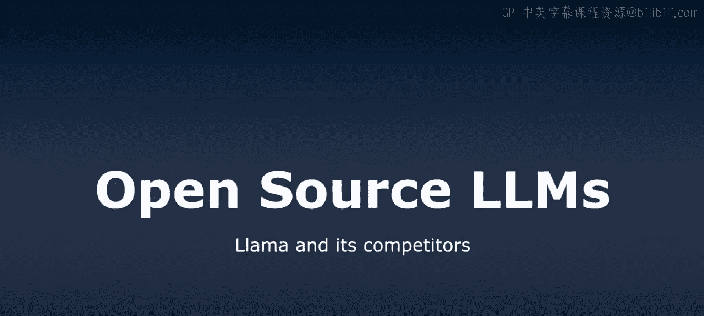

在本节课中，我们将要学习开源大型语言模型（LLM）的概念，特别是以Llama 2为例，探讨其开源定义、许可证特点，并了解其主要的竞争对手。我们将重点关注“开源”在AI模型语境下的特殊含义及其带来的机遇与挑战。

---

## 什么是开源LLM？ 🤔

上一节我们介绍了Llama 2的发布背景，本节中我们来看看“开源”对于大型语言模型意味着什么。

对于传统软件，开源的定义由开源促进会（OSI）设定，其核心在于遵循10项特定原则的许可证。然而，当我们将这个定义应用于大型语言模型时，情况变得复杂。模型的软件部分只是其价值的一小部分。

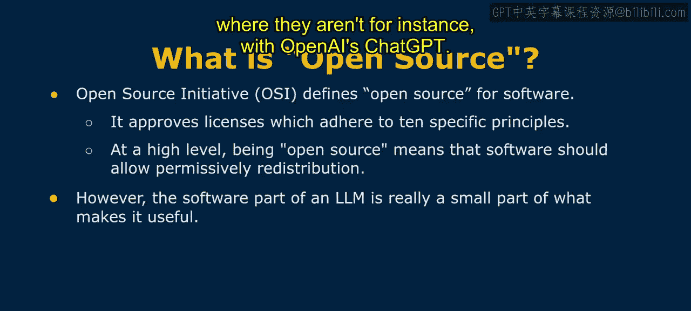

以下是几个关键问题：
*   **训练数据**：模型是否必须开源其训练数据才能被视为开源？
*   **模型权重**：仅提供预训练模型的权重是否足以认定模型本身是开源的？

这些问题目前尚无明确答案。但一个更清晰的区分正在形成：**模型权重是否可供下载**。例如，Llama 2的权重可供下载，而OpenAI的ChatGPT则不行。

Meta发布Llama 2作为开源大语言模型引起了巨大反响，并且他们已承诺未来的Llama模型也将保持开源。

---

## Llama 2的开源之路 📜

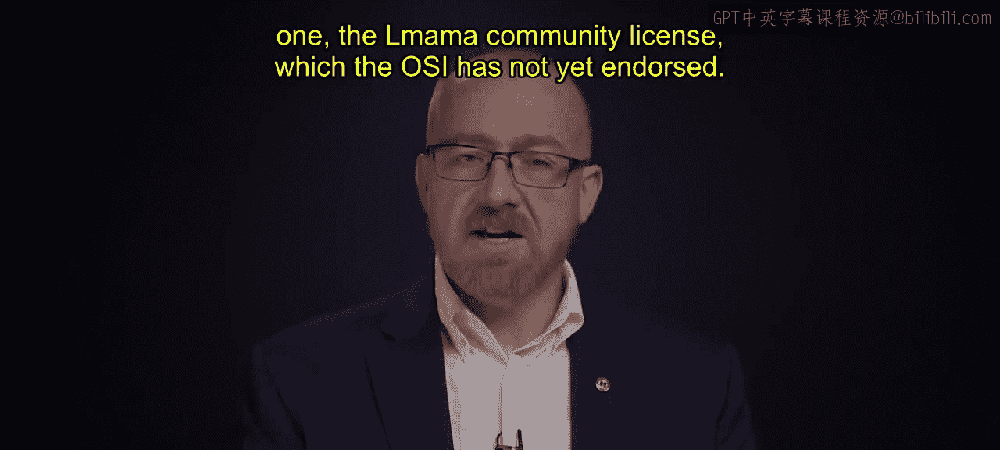

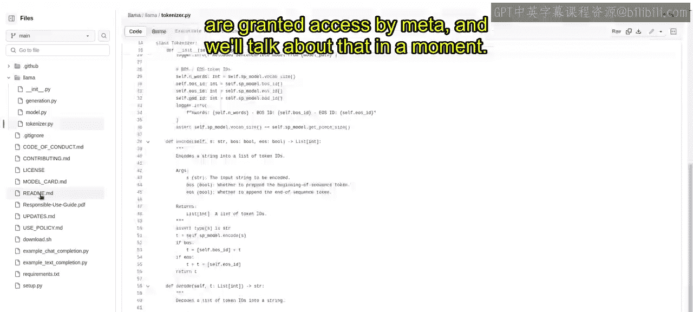

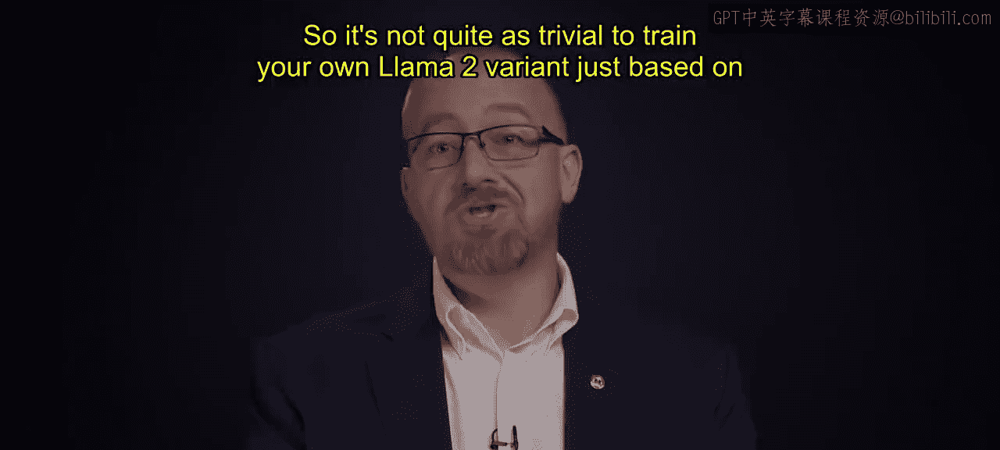

Llama 2的发布过程本身颇具故事性。Meta最初并未公开第一个Llama模型，而是需要申请，仅提供给特定研究人员。

然而，有人通过4chan以种子文件形式泄露了该模型。这至少从实用角度表明，Llama 2的代码库是开放的。

它不完全符合OSI的定义，因为它使用的是**Llama社区许可证**，这是一个专有许可证，尚未获得OSI认可。但你可以在GitHub上自由浏览其模型架构源代码。

同样，预训练模型的权重在申请并获得Meta批准后也可获取。但就整个生态系统而言，包括所有训练数据、强化学习与微调系统等，仍有部分缺失。因此，仅凭已发布的论文和代码，要训练自己的Llama 2变体并非易事。

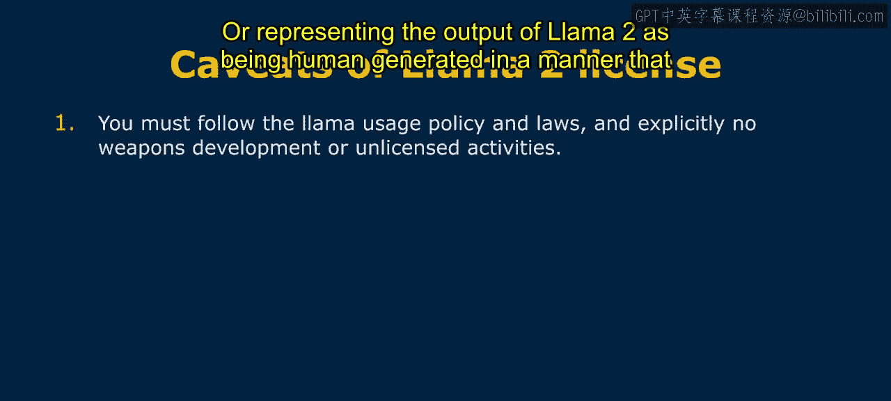

---

## Llama 2许可证详解 📄

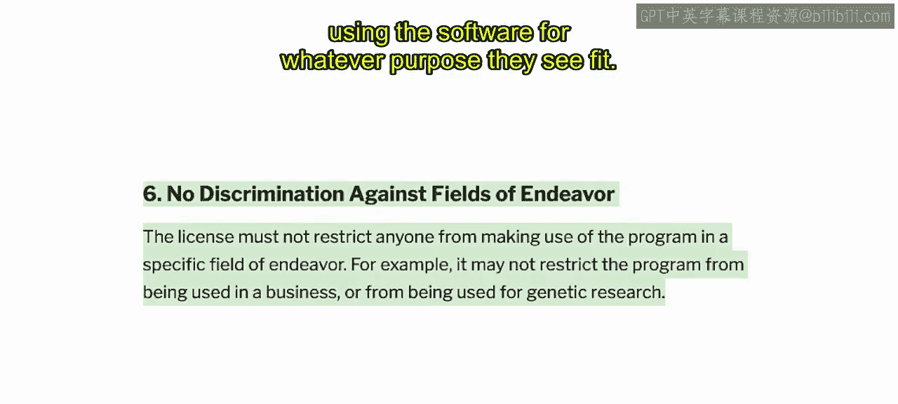

Llama 2的许可证极其宽松且简短。它授予开发者和公司免版税许可，以使用Llama的基础模型、权重及相关软件。

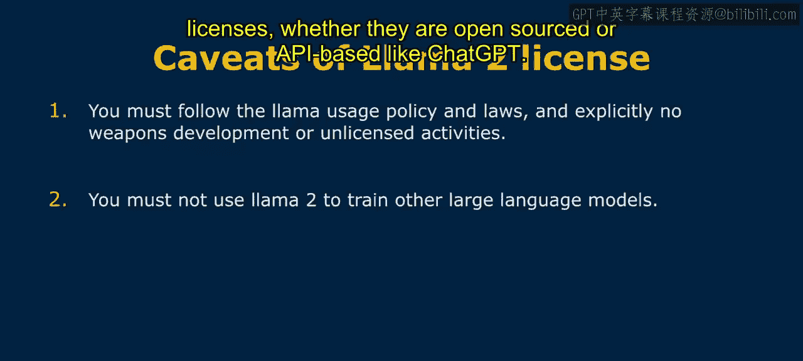

以下是许可证的核心要点：
*   你可以自由微调模型并将其集成到产品中，无需向Meta付费。这对于不希望付费或将数据发送给第三方服务的组织来说意义重大。

许可证仅包含几个注意事项：
1.  你必须遵守当地法律并遵循**Llama使用政策**。该政策充当了Llama的道德约束，强调在使用Llama 2时需遵守法律，并禁止将模型用于可能导致人身伤害的行为（例如武器开发、冒充人类提供无证医疗建议等）。
2.  你必须向最终用户披露AI系统的任何已知风险。
3.  许可证**禁止使用Llama 2来改进其他大型语言模型**。这是大语言模型许可证（无论是开源还是像ChatGPT这样的API服务）的常见做法，主要是出于竞争考虑，考虑到预训练这些模型的巨大成本。
4.  如果你的组织月活跃用户超过**7亿**，则需要向Meta申请单独的商业许可证。这主要影响少数大型科技公司。

课程中链接了许可证和使用条款，它们非常简短，建议你阅读并思考这项新技术如何融入你所在的软件生态系统。

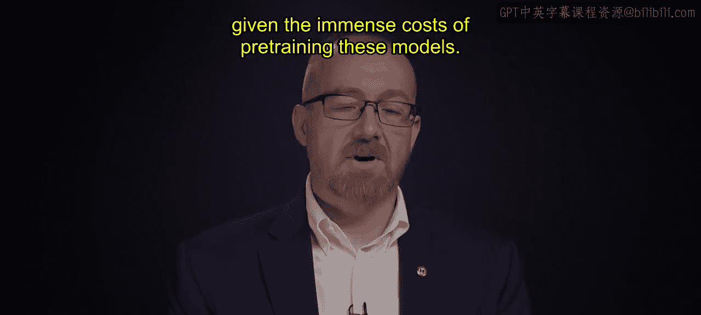

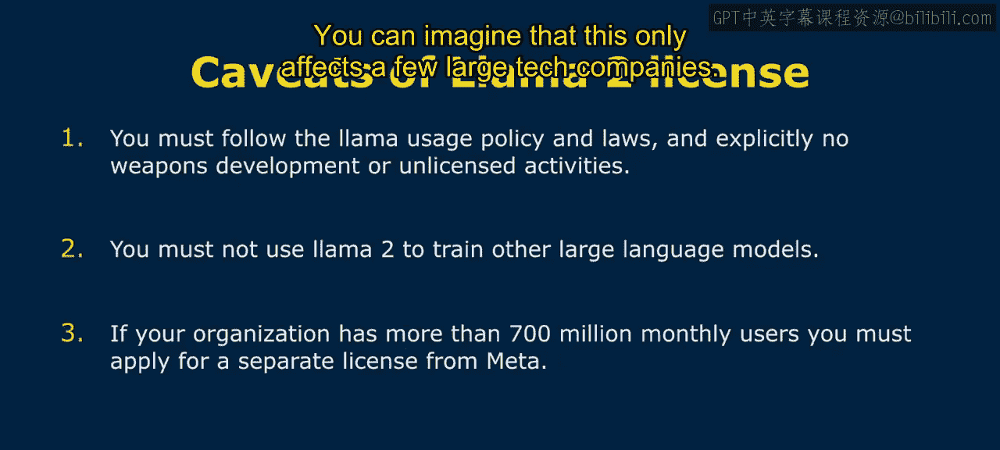

---

## 竞争对手概览 ⚔️

Meta提高了标准，许多其他大语言模型科技公司也开始至少部分开源其模型。

以下是几个主要的竞争对手：
*   **Mistral AI**：训练了多个高性能语言模型，并开源了其中部分（如Mistral 7B和Mixtral 8x7B）的权重。其系统软件部分在OSI批准的**Apache 2许可证**下发布。但其他模型仍像OpenAI一样保留在其服务端点之后。
*   **Microsoft Phi-2**：这是一个27亿参数的小型模型。最初（2023年12月）仅根据微软研究许可证向研究人员发布，到2024年1月中旬，已改为OSI批准的**MIT许可证**。
*   **Falcon模型**：包括400亿和1800亿参数模型。其许可证与Llama 2类似，是未经OSI批准的专有许可证，要求开发者遵守可接受使用政策（该政策可能随时间变化）。此许可证还包含一项条款：如果你将模型作为服务托管给他人使用，则需要获取单独的商业许可证。

庞大的预训练数据、模型权重以及这些数据通常源自版权状态不明或混合的数据集，这些独特因素正在挑战我们对AI产品“开源”含义的理解。

各国政府也在思考“开源模型”的定义。例如，旨在规范欧盟AI行为的《欧盟AI法案》最终草案，为开源模型制定了特定的豁免条款。这无疑将继续推动像Llama 2这样的开源语言模型的创新。

---

## 总结 📝

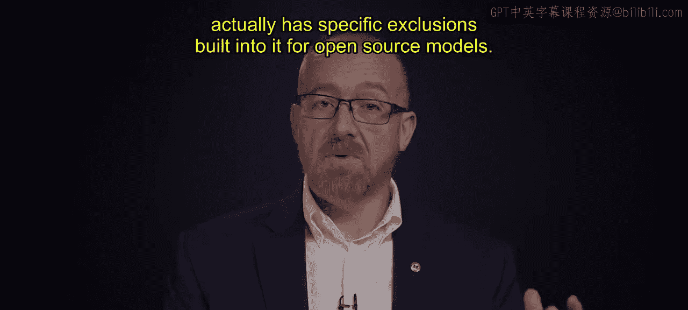

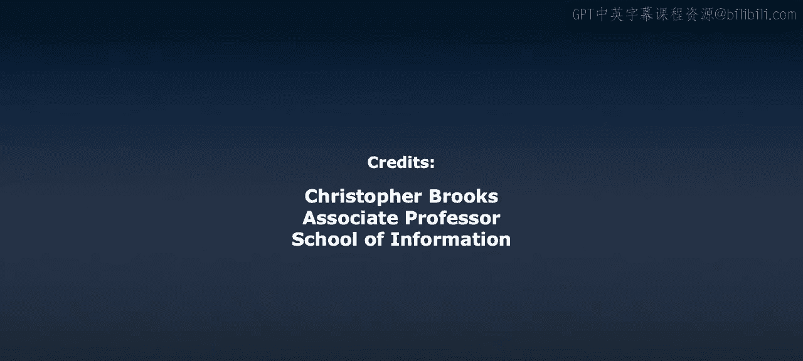

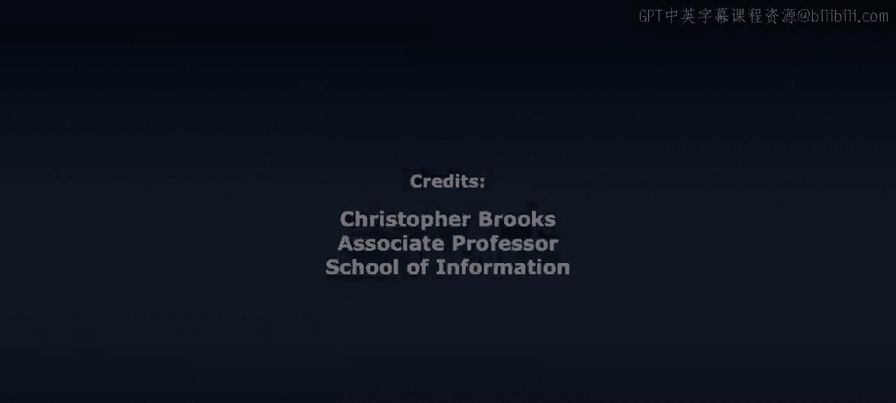

本节课中我们一起学习了开源大型语言模型的核心概念。我们探讨了“开源”在AI模型中的特殊性和模糊性，详细解读了Llama 2宽松但附有使用限制的许可证，并浏览了包括Mistral AI、Microsoft Phi-2和Falcon在内的主要竞争对手及其开源策略。理解这些模型的许可证和开源程度，对于在实际项目中选择和使用合适的工具至关重要。