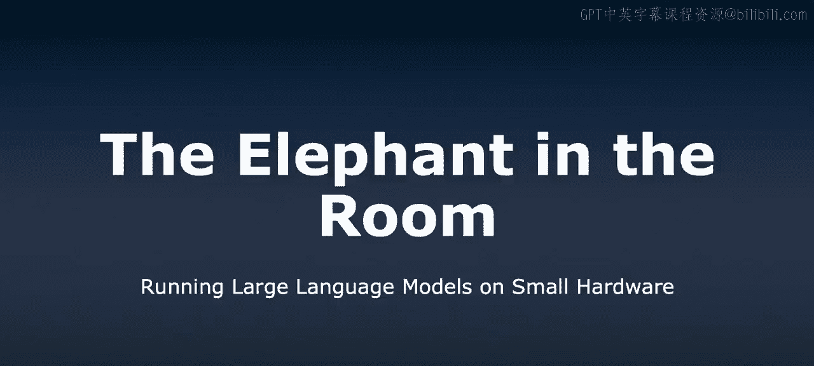
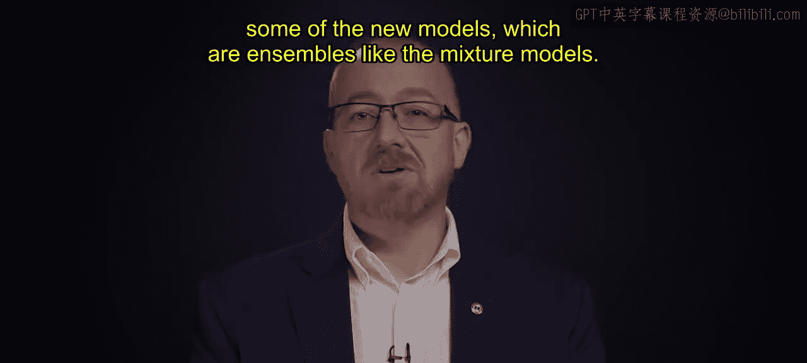
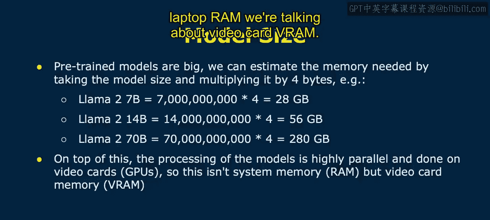
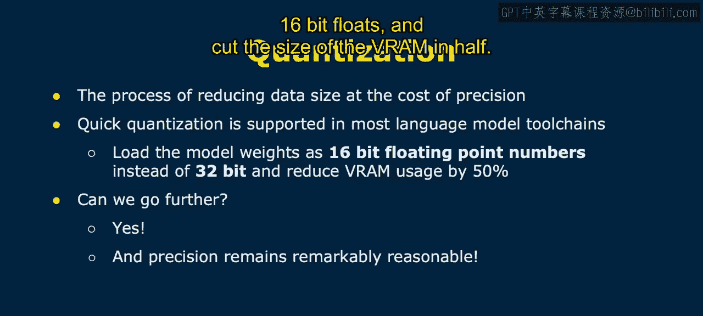
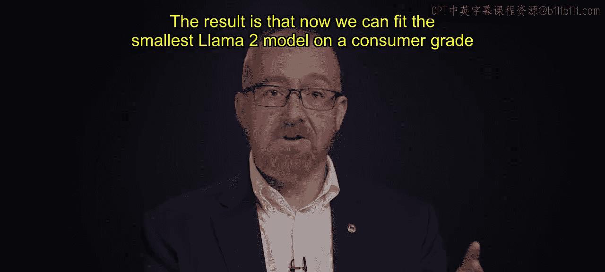
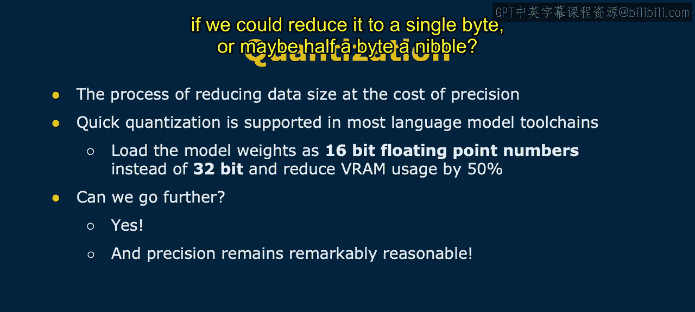
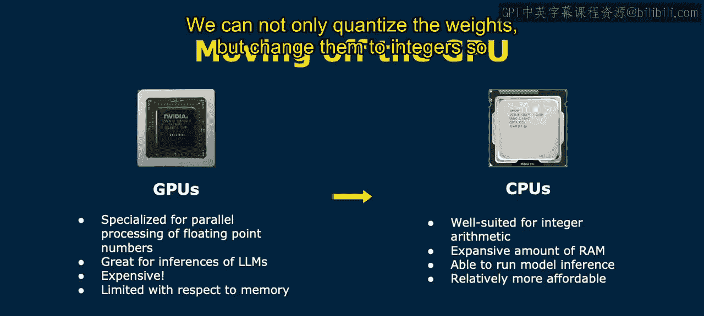
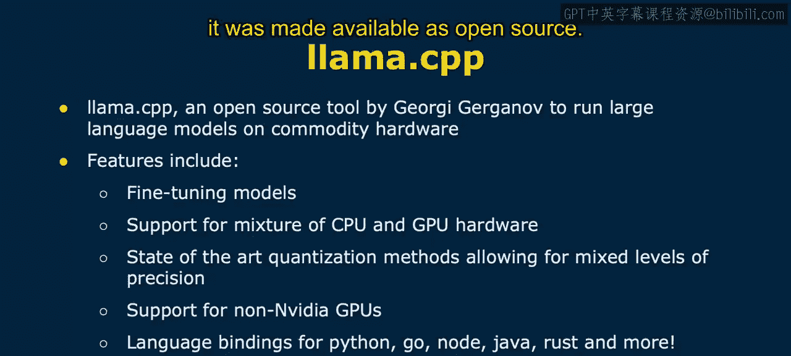
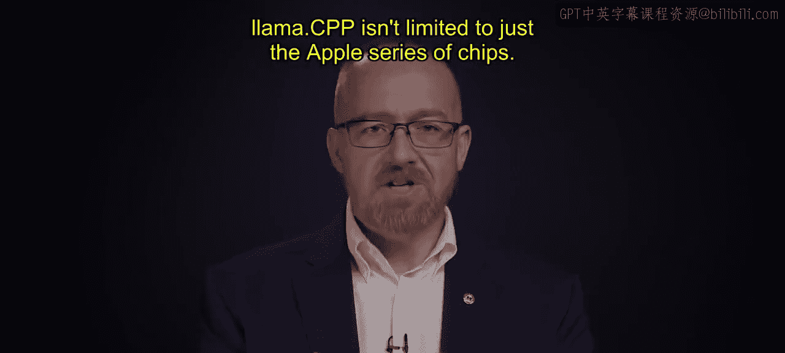
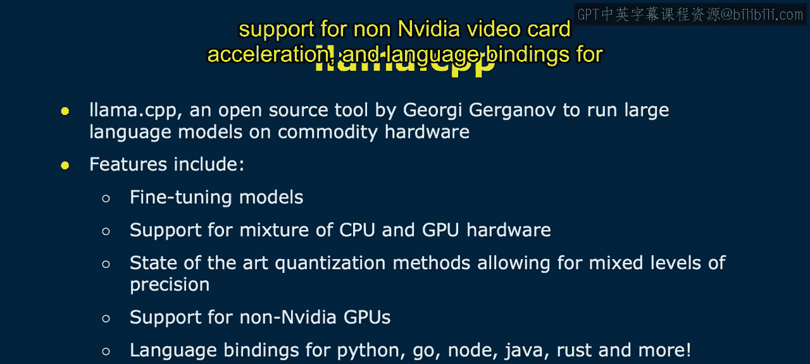

# 05：房间里的大象——在小硬件上运行大型语言模型 🐘

在本节课中，我们将要学习一个关键问题：如何在普通的消费级硬件上运行像Llama 2这样的大型语言模型。我们将探讨模型量化等关键技术，并介绍一个强大的工具——Llama.cpp。

## 核心挑战：模型大小与硬件限制

我们都希望能在自己的台式机、笔记本电脑甚至手机上本地运行代码并使用大型语言模型。但在开始之前，我们必须正视一个核心问题：如何在普通硬件上实际运行这些庞大的模型。

虽然这取决于模型的具体架构（尤其是一些采用混合专家等集成技术的新模型），但我们可以通过一个简单的公式来估算模型所需的内存：

**内存估算公式：`所需内存 ≈ 模型参数量 × 4字节`**

这个公式的假设是，每个模型参数由一个32位（4字节）的浮点数值表示。这意味着，一个拥有70亿参数的模型，仅推理就需要大约28GB的内存。这还不包括你的应用程序可能需要的任何额外开销。

更复杂的是，这类计算最适合在图形处理器上进行。因此，我们讨论的不是台式机或笔记本电脑的RAM，而是显卡的VRAM。

## 量化技术：缩小模型体积

在录制本课程时，顶级的消费级显卡是NVIDIA GeForce RTX 4090，它只有24GB显存，甚至不足以运行最小的Llama 2模型。

但我们可以通过一些技术来缩小模型的体积。缩小模型体积的起点是**量化模型权重**。我们不再将每个权重存储为32位浮点数，而是可以将其降低到16位浮点数，从而将VRAM需求减半。

这样做的结果是，我们现在可以将最小的Llama 2模型装入消费级显卡进行推理。代价是模型会损失一些精度。我们可以将这个技巧更进一步：为什么一定要用2字节存储呢？如果能减少到1字节，甚至半个字节（4位），体积会更小。

当然，精度损失是一个重要的权衡。但在实践中，Llama模型在将每个参数量化到4位、5位或6位时，仍然表现良好。这与我们最初每个参数32位相比，节省了巨大的空间。

## 数据类型转换：从浮点到整数

当我们改变模型权重时，还出现了第二个有趣的机会：将数据类型从浮点数改为整数。

显卡和即将涌现的AI处理单元擅长并行处理浮点数运算，而通常拥有多核心的CPU在处理整数运算时表现尤为出色。

因此，我们不仅可以量化权重，还可以将它们转换为整数，从而直接在CPU上进行推理。

这种权衡——主CPU擅长整数运算但在浮点数学上需要辅助——可能看起来是我们这个时代的独特产物，但其实并非如此。在我成长的过程中，我父亲有一台基于Intel 386 DX的电脑，我尽可能多地使用那台机器。那台机器的特别之处在于，它有一个独立的数学协处理器，专门处理浮点数运算。虽然这两个处理器以33MHz的惊人速度协同工作，但处理器设计已经走过了很长的路。我们现在拥有16核、18核的消费级处理器，以及32GB到超过200GB的RAM。

因此，量化模型以减小体积的技术不仅可以在显卡上使用，我们甚至可以完全不用显卡来运行模型推理。

## 解决方案：Llama.cpp工具

事实上，在本课程中，我们配置的Coursera实验环境完全没有使用显卡，允许你无需安装任何软件即可探索或测试我教授的任何内容。

我们用来转换这些模型的工具，以及我们将用来与它们交互的API，叫做**Llama.cpp**。它是由Georgi Gerganov在一个晚上快速开发出来的，并以开源形式发布。

这个项目蓬勃发展，现在拥有超过500名贡献者，对于一个诞生不到一年的项目来说，这是一个惊人的成就。他的目标是将Meta的Llama代码移植到纯C语言中，并启用量化功能，以便在苹果处理器上运行。但Llama.cpp并不仅限于苹果芯片系列。

实际上，该项目已经发展得远不止于此，现在支持许多调整模型的选项，包括：
*   对模型进行分区，使其部分（而非全部）在GPU上可用。
*   支持混合精度级别的先进量化方法。
*   支持非NVIDIA显卡加速。
*   为多种编程语言提供语言绑定。

## 课程实践与展望

在本课程中，我们将使用Llama.cpp及其Python绑定作为与Llama 2语言模型交互的主要方法。但你实际上完全不必使用Python或任何其他编程语言。

Llama.cpp还会构建一个命令行可执行文件，允许你直接从终端提示模型。我将在下一个视频中为你快速演示这一点，然后在接下来的模块中，我们将使用Llama.cpp深入探讨Llama 2的内部工作原理。

## 总结

本节课中，我们一起学习了在消费级硬件上运行大型语言模型的核心挑战。我们了解到，通过**量化**技术（减少每个参数占用的位数）和**数据类型转换**（从浮点数到整数），可以显著降低模型的内存需求。最后，我们介绍了强大的开源工具**Llama.cpp**，它使得在CPU甚至没有高端显卡的普通电脑上运行Llama 2等模型成为可能，为我们的本地开发和实验铺平了道路。