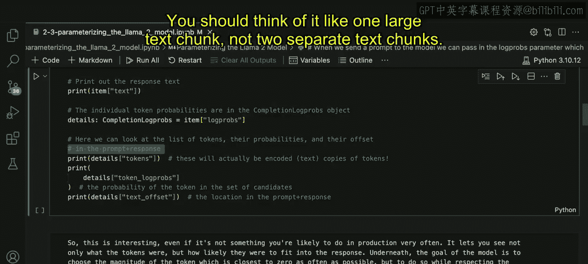
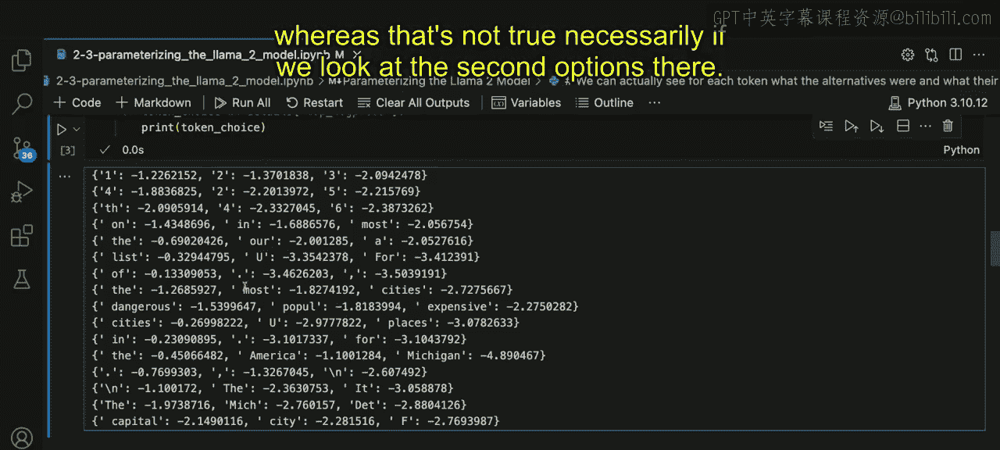
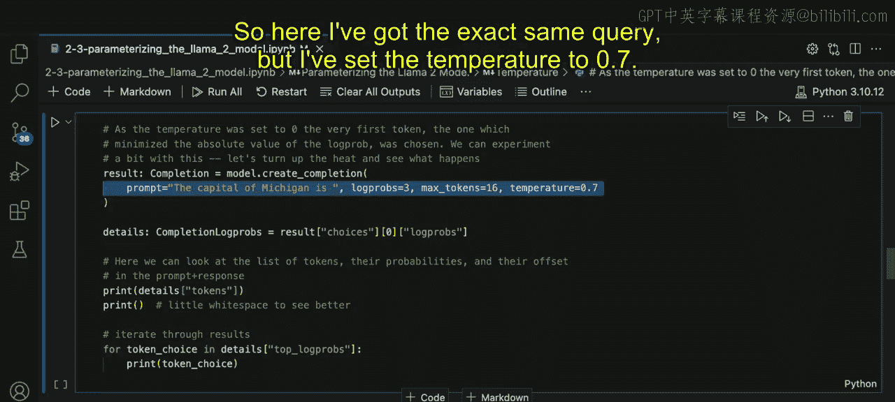
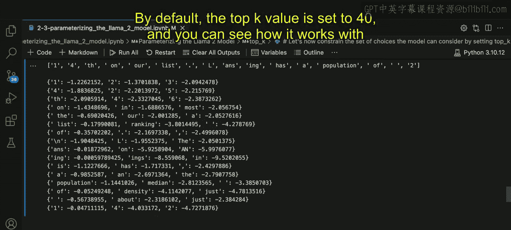
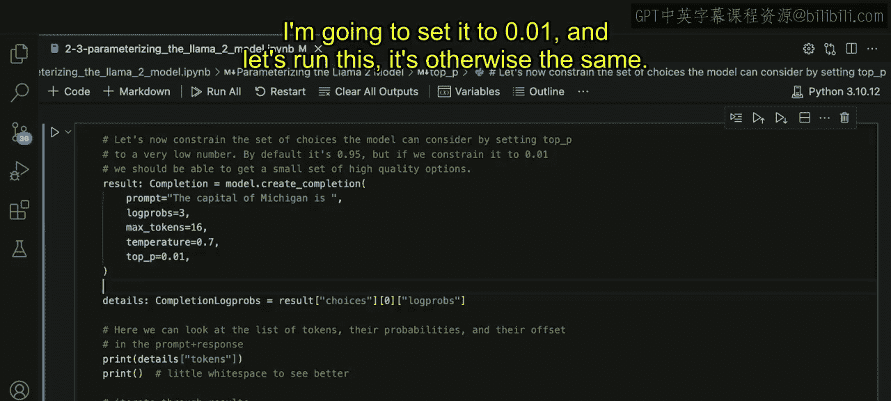

# 08：选择参数 🎯


在本节课中，我们将学习如何通过配置Llama.cpp模型来观察和调整大语言模型（特别是Llama 2）的内部工作机制。我们将重点探讨几个关键参数，如温度（temperature）、top-k和top-p，它们共同决定了模型生成文本的随机性和多样性。通过实际代码示例，我们将直观地理解这些参数如何影响模型对下一个词元（token）的选择。

---

我们已经讨论了大语言模型（特别是Llama 2）的一些基本原理，以及它们如何作为非确定性的概率机器，基于预训练的权重来预测词元序列。


如果我们愿意，实际上可以通过在加载模型时进行配置，来观察Llama.cpp中这种选择的部分内部运作。这在部署中并不常见，但对于更好地理解如何改变模型行为非常有帮助。

让我们来看一下具体操作。

---

首先，我们将像之前一样导入Llama.cpp的绑定。请注意，这里我将所有操作浓缩到了一行代码中。

我们将加载模型并设置其详细程度。这里我们使用了一个新参数：`logits_all=True`。这个设置实际上会捕获每个词元的概率信息。

当我们向模型发送提示（prompt）时，可以传入`logprobs`参数，该参数决定了我们将看到多少个备选词元。这里我们只查看前三个备选。

以下代码中，`max_tokens`设置为16，因此输出会很快被截断。`temperature`设置为0，使其输出几乎是确定性的。`logprobs`设置为3。

```python
# 示例代码结构示意
from llama_cpp import Llama
llm = Llama(model_path="./models/7B/ggml-model.bin", logits_all=True, verbose=False)
output = llm("Q: What is 1+1? A:", max_tokens=16, temperature=0, logprobs=3)
response = output['choices'][0]['text']
print(response)
```

然后，我们从输出内容对象中提取响应并打印出来。



各个词元的概率实际上位于`completion_logprobs`对象中。由于所有内容都是类型化字典，我们可以直接从条目中取出这个`logprobs`。

接下来，我们打印出所有词元、它们的概率以及在提示和响应中的偏移量。需要重点注意的是，这里包含了提示和响应，你应该将其视为一个大的文本块，而不是两个独立的部分。

---

即使这在生产环境中并不常用，但这种方法不仅能让你看到选择了哪些词元，还能看到它们被选入响应的可能性有多大。

模型的目标是尽可能频繁地选择对数概率（logprobs）值最接近零（即概率最高）的词元，但同时要遵循温度参数的设定。

这其实是一种简化。实际上，模型还会考虑另一个名为**top-p**的参数。这个参数决定了我们最初会考虑多少个词元进入候选集。


温度和top-p以不同的方式共同作用，来决定下一个被选择的词元。对于这两个参数，数值越高意味着选择越多，因此输出的确定性越低。

让我们更深入地探讨一下top-p和温度之间的关系。

---

我们可以实际看到每个词元的备选项及其对数概率。

由于我们将`logprobs`设置为3，我们可以遍历词元集，并看到每个词元的前三个选项。

例如，一个词元的对数概率可能是-1.2，第二个是-1.3，第三个是-2.0。如果你跟着操作，得到的数字可能会略有不同，但由于温度设置为0，也有可能得到相同的数字。

有趣且重要的是，这里的一些“词元”（即词汇表中的标记）在开头包含空格，这是Llama2使用的分词器的一个特点。当然，其中也包含控制序列，比如换行符或回车符。

通过查看备选项，你可以感受到对话可能以哪些不同的方式进行。例如，开头可能涉及一系列数字，但在某个部分之后，我们得到了一系列字母，而这在查看第二选项时不一定成立。

---

有几个参数可以用来约束或指导语言模型为下一个词元做出选择。详细探讨这些参数有点超出本短期课程的范围，但我想让你对它们的工作原理有一个直观的理解。

第一个我们已经讨论过的参数是**温度**。我们可以利用新获得的查看词元概率的能力，来更好地理解它的实际工作方式。

当温度设置为0时，实际上选择的是对数概率绝对值最小的第一个词元。让我们稍微实验一下。

这里我有一个完全相同的查询，但将温度设置为0.5。






```python
output = llm("Q: What is 1+1? A:", max_tokens=16, temperature=0.5, logprobs=3)
```

运行并查看输出。

我们可以看到，返回的序列并非仅由候选集中概率最低的词元组成。实际上，由于一定的随机性，你甚至可能看到一些候选集中包含超过三个词元。高温导致模型实际上选择了一个甚至不在前三的备选词元。

这有两点需要注意：首先，即使我们将`logprobs`设置为3，那也不是完整的候选词元集，而只是程序化返回给我们的那部分。

---

我们工具箱中的另一个参数叫做**top-k**。这个参数更强制地约束语言模型，告诉它只能从一个固定数量的可能匹配项中进行选择。

这个参数是一个整数值。例如，如果我们将其设置为1，模型将只有一个选择，温度参数将完全不起作用。让我们看一下。

现在，让我们通过将top-k设置为2来约束模型的选择。我将温度设置得很高，以获得大量的多样性和创造性。我仍然将`logprobs`设置为3，这样我们实际上只能从前两个候选词元中选择，但我仍然想看到前三名的概率。

```python
output = llm("Q: What is 1+1? A:", max_tokens=16, temperature=0.9, top_k=2, logprobs=3)
```


运行这个。

你可以看到，因为我将`logprobs`设置为3，我仍然被展示潜在的词元，但在模型从列表中采样之前，它们实际上已经从候选集中被修剪掉了，因为top-k值被设置为2。

默认情况下，top-k值设置为40。你可以看到它如何与温度共同作用，决定哪些词元被放入输出序列。

---

我们还有另一个可用于调整的变量，称为**top-p**。这个变量稍微复杂一些。



它根据词元的累积概率分布来约束候选词元集。它是一个从0到1的浮点数，其中1代表词汇表中的所有可能词元。

你可以这样理解：每个候选词元都有一个被选中并放入输出序列的概率。我们只想从一组真正好的选项中进行选择。因此，我们取一定数量的高概率项放入候选集。

我们不想将该集合的大小固定为10或15。相反，一旦该集合中的项目其组合概率等于top-p的值，我们就会停止向集合中添加项目。所以它很像top-k，目标都是约束候选集的大小，但对于输出序列中的每个位置，我们将选择的项目数量会根据项目概率的高低而变化。

让我们来看一下。

现在，让我们通过将top-p设置为一个非常低的值来约束模型可以考虑的选择集合。默认值实际上很高，是0.95，但我要将其约束得相当厉害，设置为0.01。其他设置保持不变。

```python
output = llm("Q: What is 1+1? A:", max_tokens=16, top_p=0.01, logprobs=3)
```


运行这个。



如此小的top-p导致的结果是，候选选择集非常小，因此集合中任何给定选择的概率可能会有很大差异。然而，保留在候选集中的词元会被重新加权，然后温度参数决定某个候选词元被选中的可能性。

---

以上所有内容都是一种简化。实际上还有更多参数，其中一些你可以调整，例如typical-p、min-p等等。

如果你对这些生成模型如何选择响应更感兴趣，我鼓励你查阅本周可选阅读材料中Holtzman等人的论文，或者进一步阅读关于核采样（nucleus sampling）、top-k采样和束搜索（beam search）等主题。

---


在本节课中，我们一起学习了如何通过Llama.cpp观察大语言模型的词元选择概率。我们深入探讨了三个核心生成参数：**温度**（影响随机性）、**top-k**（限制候选词数量）和**top-p**（基于累积概率动态限制候选集）。通过代码示例，我们看到了这些参数如何相互作用，共同决定模型输出的确定性与多样性。理解这些参数是控制和优化模型行为的关键一步。