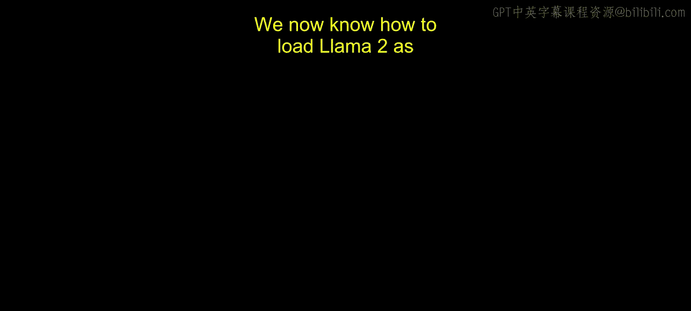
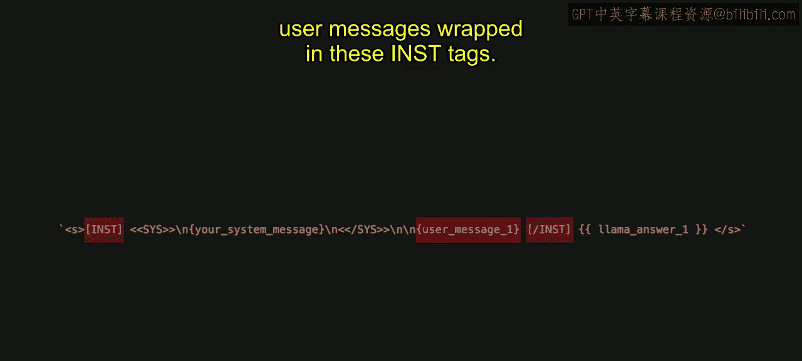
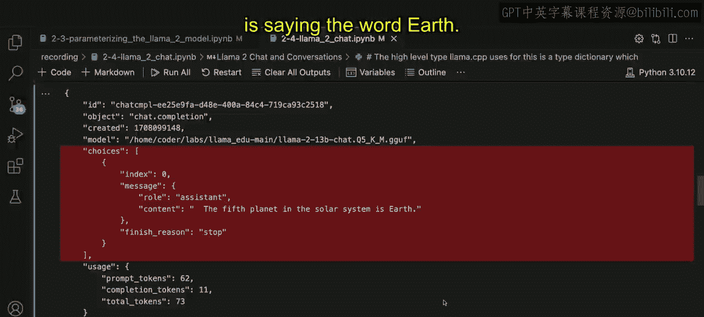
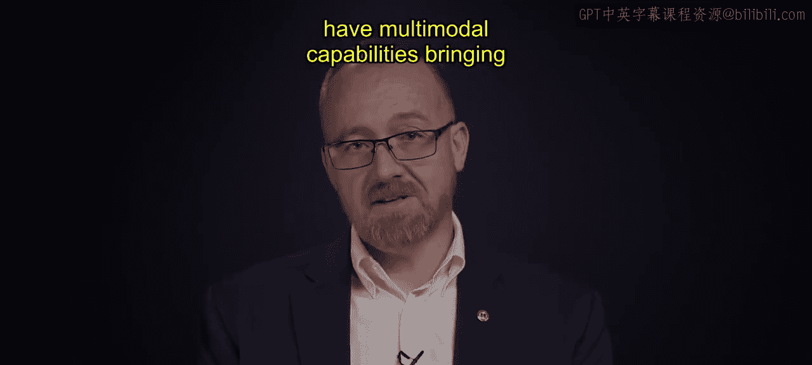
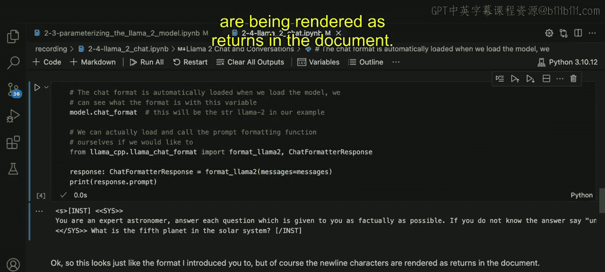
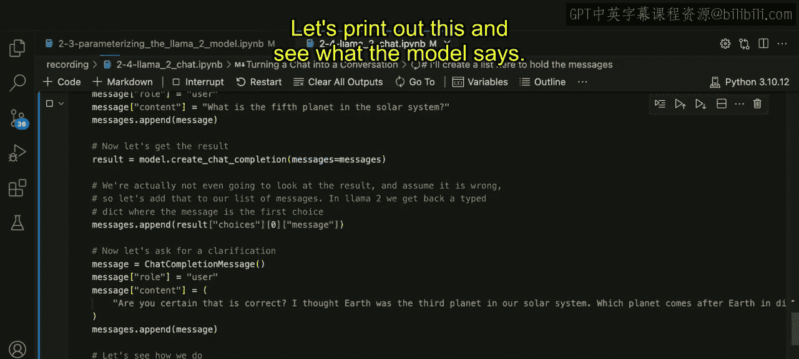
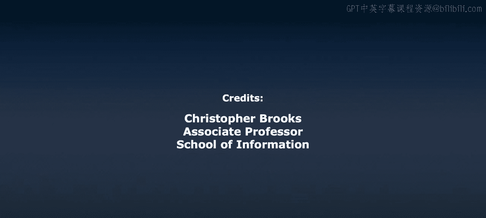

# 09：Llama2的聊天与对话



在本节课中，我们将要学习如何与Llama2聊天模型进行交互。我们将了解其特定的对话格式，如何使用LlamaCPP的Python绑定来简化这一过程，以及如何构建多轮对话。理解这些是有效使用聊天模型的关键。

## 理解Llama2的聊天格式

上一节我们介绍了如何加载基础Llama2模型。本节中我们来看看专为对话设计的聊天模型有何不同。

聊天模型在微调过程中使用了特定的提示模板。根据Llama2论文，其模板结构如下：


*   **序列起始符**：以 `<s>` 开始。
*   **指令开始**：随后是 `[INST]` 字符串，表示一条指令的开始。
*   **系统消息（可选）**：在 `<<SYS>>` 和 `<</SYS>>` 标签内，可以放置系统消息来设定对话背景。
*   **用户消息**：接着是用户的实际查询内容。
*   **指令结束**：以 `[/INST]` 结束指令部分。
*   **助手回复**：模型生成的回复会附加在此之后。
*   **后续对话**：同一对话中的后续查询应作为新的用户消息，同样包裹在 `[INST]` 和 `[/INST]` 标签中。

这种格式在微调数据中被使用，因此遵循它对获得合理响应至关重要。



## 使用LlamaCPP的聊天接口


虽然上述格式需要牢记，但LlamaCPP及其Python绑定为我们封装了这种格式，使操作更简便。

以下是使用LlamaCPP进行聊天交互的核心步骤：

1.  **加载聊天模型**：使用与基础模型类似的方式，但指定聊天模型文件。
2.  **设置参数**：例如，可以设置 `verbose=False` 来减少日志输出，设置 `temperature=0` 来降低回答的随机性。
3.  **构建消息列表**：LlamaCPP使用一个称为“聊天完成消息”的字典列表来管理对话。每个消息都是一个字典，包含 `role`（角色）和 `content`（内容）键。
4.  **调用聊天接口**：使用 `model.create_chat_completion()` 方法并传入消息列表，而不是基础模型的 `create_completion`。

以下是一个简单的代码示例，展示了如何构建一个包含系统消息和用户查询的对话：

```python
# 假设 model 是已加载的LlamaCPP聊天模型
messages = [
    {"role": "system", "content": "你是一位天文学专家。请尽可能准确地回答向你提出的每个问题。"},
    {"role": "user", "content": "太阳系中第五颗行星是什么？"}
]

response = model.create_chat_completion(messages=messages)
print(response['choices'][0]['message']['content'])
```

## 查看与理解底层格式

LlamaCPP的强大之处在于其抽象能力，它能自动为不同模型（如Llama2、Mistral等）处理各自的聊天格式。这些模型在词汇表、架构和消息格式上可能存在巨大差异。



如果我们想了解LlamaCPP是如何将我们的消息字典转换为Llama2所需的特定文本格式的，可以查看模型加载时自动设置的聊天格式化器。

```python
# 查看当前模型使用的聊天格式
print(model.chat_format)
# 对于Llama2，这通常会返回类似 ‘llama-2‘ 的字符串
```

## 构建多轮对话



聊天模型的一大优势是能够进行多轮对话。大语言模型在一个固定的上下文窗口内工作。对于Llama2，这个窗口默认最多可达4000个令牌。

构建对话最直接的方式，就是将一系列消息（用户消息和助手的历史回复）按顺序拼接成一个更长的序列。每次新的用户提问时，我们只需将新的消息追加到历史消息列表中，然后再次调用模型。

让我们看一个多轮对话的例子：

```python
# 初始化对话历史
messages = [
    {"role": "system", "content": "你是一位天文学专家。请尽可能准确地回答向你提出的每个问题。"},
    {"role": "user", "content": "太阳系中第五颗行星是什么？"}
]

# 第一轮对话
response1 = model.create_chat_completion(messages=messages)
assistant_reply1 = response1['choices'][0]['message']['content']
print(f"助手: {assistant_reply1}")




# 将助手的回复加入历史，然后提出新问题
messages.append({"role": "assistant", "content": assistant_reply1})
messages.append({"role": "user", "content": "你确定吗？我记得地球是太阳系的第三颗行星。"})



# 第二轮对话
response2 = model.create_chat_completion(messages=messages)
assistant_reply2 = response2['choices'][0]['message']['content']
print(f"助手: {assistant_reply2}")
```

通过这种方式，模型能够参考整个对话历史来生成更连贯、更相关的回复。

## 总结与思考

本节课中我们一起学习了与Llama2聊天模型交互的核心知识。我们了解了其特定的对话模板，学会了使用LlamaCPP的 `create_chat_completion` 接口和消息字典来简化交互，并实践了如何构建多轮对话。

我们认识到，在消息模板中存在三种主要角色：
*   **系统消息**：可选，用于设定模型的回复风格和行为准则。
*   **用户消息**：代表用户的提问或指令。
*   **助手消息**：代表模型的历史回复。

需要注意的是，模型的性能受多种因素影响，例如模型大小（如130亿参数与700亿参数）、量化程度以及提示词的质量。如果你发现模型的回答不够准确，可以尝试：
1.  使用更大或量化程度更低的模型。
2.  优化你的系统提示词（提示工程）。
3.  在对话中提供更明确的上下文或纠正信息。

现在，轮到你来实践了。你将如何改进Llama2对“太阳系第五颗行星”这个问题的回答？不必局限于本课程所讲的内容，可以尝试你从其他资料中学到的任何方法。请动手操作，运行代码，修改参数和提示词，亲身体验模型的变化。




在下一个模块中，我们将更深入地探讨如何以编程方式与大语言模型集成，并会有一个简短的实践练习。