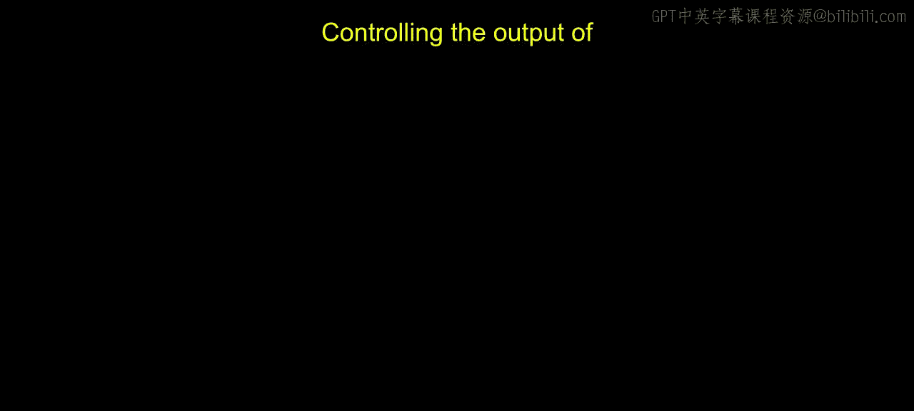
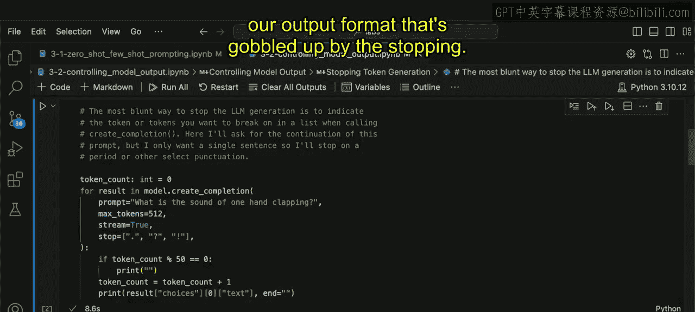
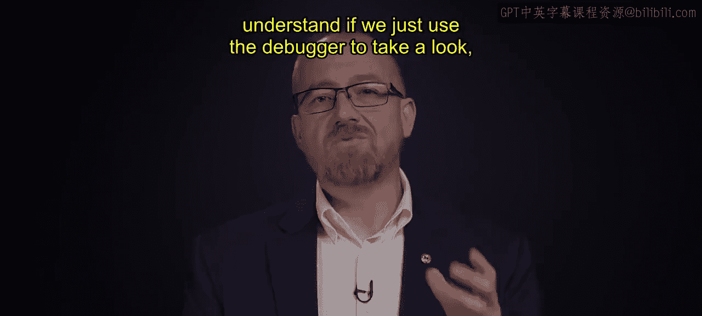
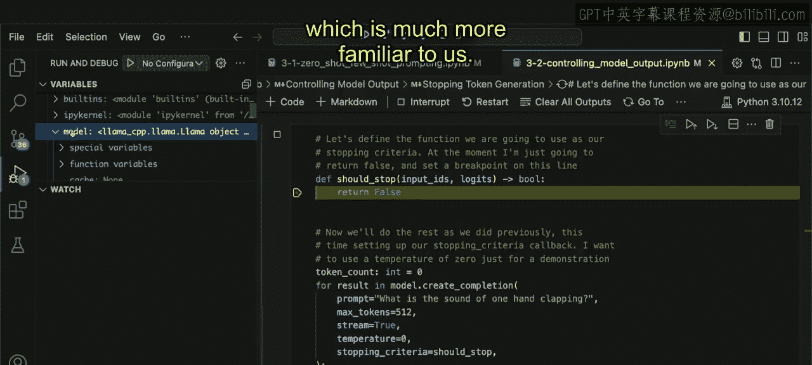
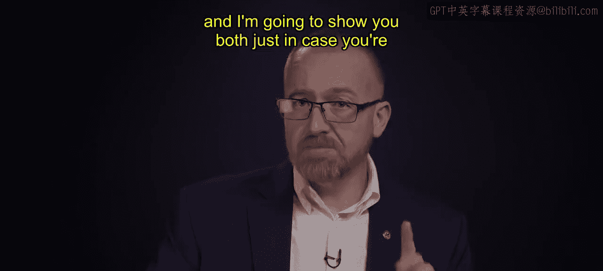
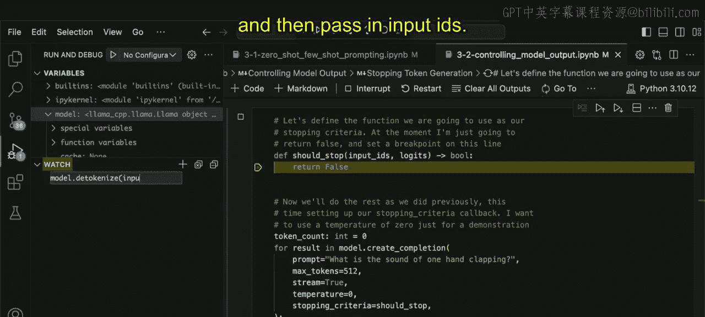
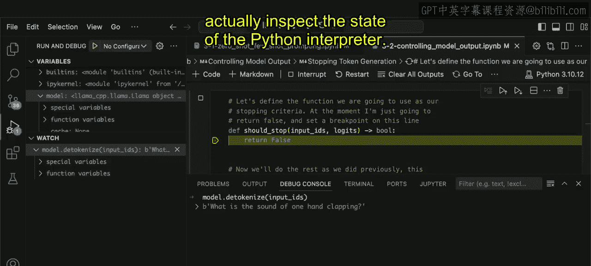
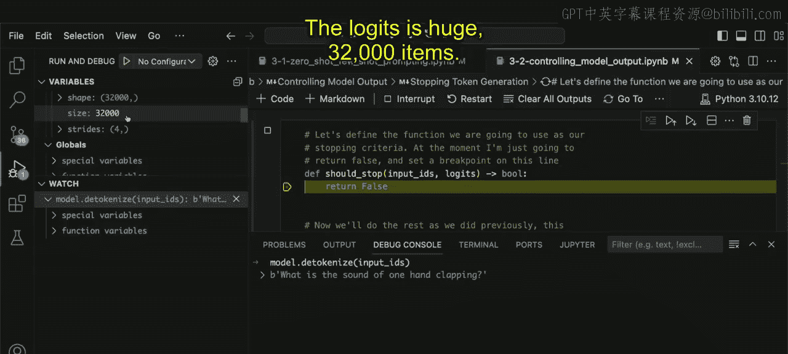
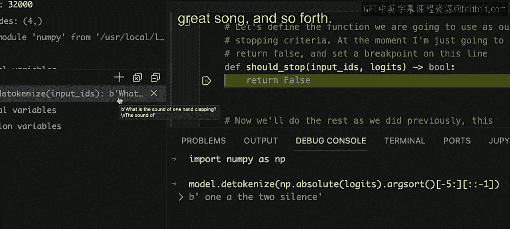

# 11：控制模型输出 🎛️



在本节课中，我们将学习如何控制大型语言模型的输出。控制模型生成的内容是一项具有挑战性的任务。上一节我们介绍了如何使用少量示例提示来满足特定的格式要求，但有时让模型在生成一个项目后停止仍然很棘手。幸运的是，Llama CPP 提供了其他几种机制来增强我们对模型输出的控制。


## 停止标记列表

第一种控制输出的方法是使用**停止标记列表**。这是最直接的方式，通过在调用 `create_completion` 时指定一个标记列表来实现。当模型在输出流中识别到这些标记中的任何一个时，处理就会停止。



以下是具体操作方式：

```python
# 加载和配置模型（此处以非聊天基础模型为例）
model = Llama(model_path="./models/7B/llama-2-7b.ggmlv3.q4_0.bin")

# 定义停止标记列表
stop_tokens = [".", "!", "?"]

# 生成文本，遇到停止标记则中断
output = model.create_completion(
    prompt="What is the sound of one hand clapping?",
    stop=stop_tokens,
    max_tokens=50
)
print(output)
```

在这个例子中，模型可能会因为遇到句号而停止生成。需要注意的是，停止标记本身（如句号）通常不会被包含在最终输出中。



## 停止条件回调函数

第二种更灵活的控制机制是**停止条件回调函数**。与在Python库层面实现的停止标记列表不同，停止条件是在底层的Llama CPP中执行的。它允许你提供一个可调用的函数，该函数根据模型生成过程中的内部状态来决定是否停止。

根据文档，停止条件是一个可调用对象的列表。每个函数接收两个参数：一个无符号整数数组（`input_ids`）和一个单精度浮点数数组（`logits`），并返回一个布尔值（`True`表示停止，`False`表示继续）。

为了更好地理解其工作原理，我们可以使用调试器来观察这些参数。

## 使用调试器探索内部状态

为了理解`input_ids`和`logits`，我们定义一个简单的停止条件函数并设置断点。

```python
def should_stop(input_ids, logits):
    # 在此处设置断点以检查变量
    import pdb; pdb.set_trace()  # 或者使用VS Code的断点功能
    # 初始版本：始终不停止
    return False

# 配置模型并使用停止条件
output = model.create_completion(
    prompt="What is the sound of one hand clapping?",
    stopping_criteria=[should_stop],
    max_tokens=50
)
```





在VS Code中调试此单元格时，执行会在`should_stop`函数内的断点处暂停。此时，我们可以检查局部变量。

### 理解 input_ids



`input_ids` 是一个数字序列。通过模型的 `detokenize` 方法，我们可以将其转换回可读的文本。


在调试器中，你可以通过添加监视表达式来查看：

```python
model.detokenize(input_ids)
```

执行后，你会发现这对应着输入的提示词：“What is the sound of one hand clapping?\n”。这表明 `input_ids` 代表了到目前为止已生成的**所有标记序列**，包括最初的提示词。

### 理解 logits




`logits` 是一个庞大的数组（例如，包含32000个值，与词汇表大小对应）。每个值代表词汇表中对应标记成为下一个输出标记的**对数几率**。

对数几率（logit）是一个从负无穷到正无穷的数值，可以粗略地理解为一种未归一化的概率。值越接近零，对应标记被选中的可能性就越高；值趋向正负无穷，则可能性越低。



为了查看最有可能的下一个标记，我们可以进行如下操作：

```python
import numpy as np


# 获取logits的绝对值并排序，找出最接近零的5个值
abs_logits = np.abs(logits)
top_indices = np.argsort(abs_logits)[-5:]  # 最接近零的5个索引

# 将这些索引对应的标记解码
for idx in reversed(top_indices):  # 反转顺序，让最可能的排在最后
    token = model.detokenize([idx])
    print(f"Token ID: {idx}, Token: {repr(token)}")
```

运行后，你可能会看到类似 `' one'`， `' a'`， `' the'`， `' two'`， `' silence'` 的输出。结合已生成的上下文 “What is the sound of one hand clapping?\nThe sound of”，这些候选标记（如 “one”， “silence”）在语义上都是合理的延续。



## 停止条件的应用场景

掌握了 `input_ids` 和 `logits` 后，你可以在停止条件函数中实现复杂的逻辑。例如：

*   **模式验证**：检查已生成的文本（通过 `detokenize(input_ids)`）是否匹配某个正则表达式。
*   **内容审核**：将部分生成的文本发送给另一个服务、进程或人工进行实时验证。
*   **自定义停止规则**：不仅基于特定标记，还可以基于生成内容的长度、结构或语义来决定停止。

## 总结

本节课中我们一起学习了两种控制LLM输出的方法：
1.  **停止标记列表**：通过提供一组标记，让模型在遇到它们时停止生成。这种方法简单直接。
2.  **停止条件回调函数**：通过编写Python函数，访问模型生成过程中的内部标记序列（`input_ids`）和预测概率（`logits`），从而实现高度定制化的停止逻辑。


此外，我们还演示了如何使用VS Code的调试功能深入探索Llama CPP等软件包的内部工作机制。掌握调试技能是理解和快速上手新兴开发工具的关键，它能极大地提升你解决问题的能力。建议你多加练习，以更深入地理解Llama CPP及其他AI工具包的工作方式。