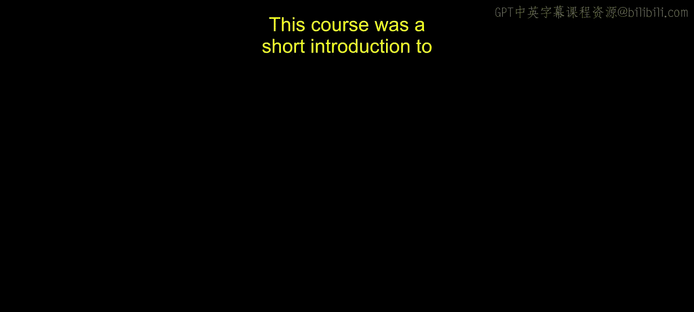
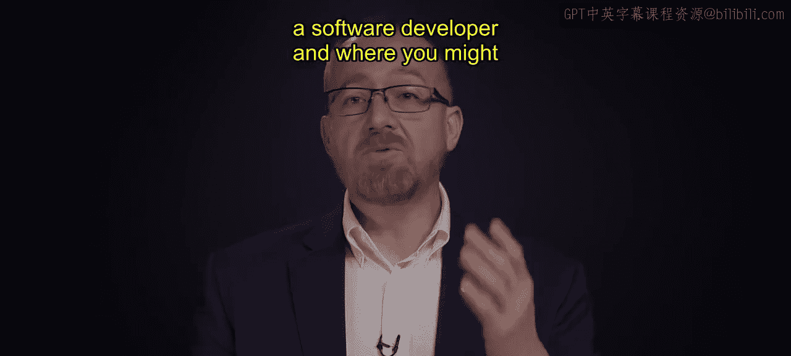

# 13：课程总结 🎯

在本节课中，我们将对《Python程序员的羊驼》课程进行全面的回顾与总结。我们将梳理课程中探讨的核心概念，包括Llama2模型家族、量化技术、推理优化以及提示工程等，并展望未来可能的学习方向与应用场景。

## 课程内容回顾 📚

上一节我们探讨了如何通过提示策略和语法约束来引导模型输出。本节中，我们将系统性地回顾整个课程的核心要点。

本课程是对Meta公司开源Llama2模型的一个简短介绍。我们讨论了Llama2的不同变体，包括基础模型、对话模型和代码模型，以及使用这些模型所面临的挑战，特别是考虑到它们拥有70亿甚至700亿参数，体积高达数十GB。

## 关键技术学习 🛠️

以下是本课程涵盖的几个关键技术领域。

**1. 模型量化与硬件部署**
你学习了量化技术，即通过降低模型精度来压缩模型。这使得模型能够在您可能已经拥有的消费级硬件上运行。同时，你了解了Llama.cpp如何允许你在模型推理中混合使用CPU和GPU。

**2. 分词与模型工作机制**
我们进一步深入实践，探讨了分词的工作原理，以及为什么它在大型语言模型中如此重要。在LLM中，**令牌序列**是模型处理的主要输入和输出结构。

**3. 生成参数调控**
你也看到了如何使用各种参数，如**温度（temperature）**、**Top-p**和**Top-k**，来改变模型对给定提示的响应方式。其底层原理是基于概率从一个潜在的令牌池中进行采样。

**4. 提示与约束策略**
在课程的最后一个模块，我们探索了如何利用提示策略（如少样本提示）以及Llama.cpp的API机制（如语法约束）来引导和限制模型的响应。这只是应用开发者如何集成Llama2并构建引人注目的语言模型应用的一个初步尝试。

## 生态与未来展望 🚀

我们简要讨论了微调，但其细节足以构成一门独立的课程。我们也提到了围绕这些开源模型的软件生态系统如何为我们提供新的能力，例如语法约束。

目前，这个生态系统正在迅速扩张，已经出现了用于更高层次抽象的大型软件框架，例如**LangChain**和**LlamaIndex**，以及用于模型服务和生产的开发运维环境，如**vLLM**。

这个领域有很多东西需要学习，我鼓励你在技术论坛上进行广泛而规律的阅读，并利用你的开发工具链（如VS Code调试器）来理解不断涌现的新技术。

## 课程活动与反思 💭

我们还有最后一项课程活动：一个编码作业。但在开始之前，我想请你从日常经验的角度反思一下这门课程。

你是否在这里学到了关于Llama 2和Llama.cpp的知识，并认为可以在你的日常生活中应用，无论是为了工作、学习还是其他追求？

欢迎与我分享这门课程如何与你作为软件开发者的目标相关联，以及你接下来可能打算如何利用这项激动人心的技术。

## 总结 📝

本节课中我们一起学习了Llama2模型的基础知识、部署优化方法、核心工作机制以及引导模型输出的策略。我们认识到，开源大模型及其快速发展的工具生态为开发者提供了强大的新能力。掌握这些基础是探索更高级应用和框架的第一步。希望本课程为你开启了利用大语言模型进行创新开发的大门。