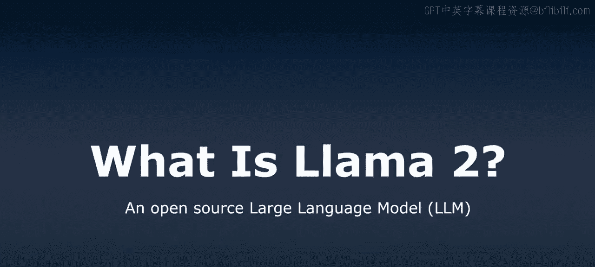
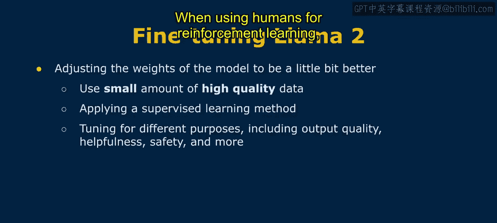
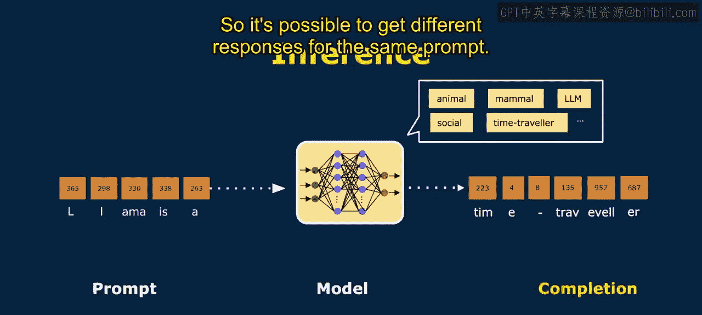

# Python程序员的羊驼：P02：什么是羊驼2，一个开源的大型语言模型

## 概述

在本节课中，我们将要学习什么是大型语言模型，并特别介绍Llama 2这一开源模型家族。我们将了解LLM的基本概念、工作原理、训练过程以及如何与它们进行交互。

---

## 什么是大型语言模型

广义上讲，大型语言模型是经过海量数据预训练的推理引擎，它们能够根据文本输入生成文本输出。

它们属于人工智能方法的一个分支，被称为生成式AI。

生成式AI与我们通常与人工智能和机器学习相关联的其他任务有所不同。

例如，分类任务，我们称之为监督式机器学习。

它通常接收一组带有标签的数据，可能是一批图片，其中一些是猫，一些是狗。

然后我们输入新的图片，模型会根据初始训练数据学习到的知识，自动为它们贴上标签。

或者是聚类任务。

我们称之为无监督机器学习。

我们可能会输入大量未标记的数据，例如关于学生或员工的记录。

然后观察在我们的数据集中，哪些类型的学生或员工最为常见，这是由我们的机器学习算法发现的。

生成式AI建立在这些以及其他机器学习技术之上。

其重点在于，根据输入数据流和预训练语料库，生成新的输出数据。

实际上，可以将其视为监督学习和无监督学习任务的结合，封装在一个具有以下目标的黑盒中。

给定创建这个黑盒模型的数据，例如维基百科上的所有文字或所有已出版的书籍，并给定一些初始提示。

可能是一个谜语或一个问题，这个提示最可能的延续是什么？答案。

这就是生成式AI，而大型语言模型或许是当前最令人兴奋的生成式AI形式之一。

---

## 聚焦Llama 2

在本课程中，我们将特别关注Llama 2这一开源大型语言模型家族。

这些模型有不同的规模和复杂度。

其参数数量以十亿计。

并且存在针对不同任务的几种模型，例如通用推理、问答、聊天，甚至编写代码。

Llama 2之所以有趣，不仅在于其高质量。

还在于其创建者Meta已将其免费提供给全世界使用。Meta甚至称其为开源语言模型，你可以下载该模型，并在自己的硬件上直接使用，无需付费，不仅可用于研究，也可用于商业目的。

但在我们深入探讨Llama 2如何工作以及它有何特别之处之前。

我们应该先多谈谈LLM通常是如何创建的。

---

## LLM的创建：预训练

LLM是经过预训练的。

这意味着它们不仅仅是一个机器学习架构。

而且该架构已经用相关数据进行了初始化。以Llama 2为例。

其数据是免费可得的，并且基于网络，包括维基百科的内容、抓取的网页、Github上的开源代码仓库、古登堡计划的免费在线书籍等。

事实上，Llama 2的作者表示，他们最终使用超过2万亿个标记来训练模型。虽然我们稍后会讨论标记，但你可以暂时将它们视为这些数据中类似于单词的单位。

现在，有多种不同的技术被用来实际生成预训练模型，它们都属于自然语言处理和深度学习领域。

其核心方面是这种Transformer架构。

谷歌研究人员在2017年一篇名为《Attention Is All You Need》的里程碑式论文中发布了它。

我们不会深入探讨其细节。但如果你想要一个编程类比。

你可以将预训练模型视为一个具有非常简单的API的复杂数据结构。

这个API允许你用一些文本调用该数据结构，它会返回它预测接下来会出现的文本。

同时，这个数据结构已经通过预训练过程填充了我们称之为模型权重的东西。

即通过训练输入模型的所有文本片段之间的关系，而这些权重的质量真正决定了模型预测文本的准确性和好坏程度。

实际上，我认为“权重”是预训练模型中参数的一个好名字。

最小的Llama 2模型由70亿个参数组成，存储为单个文件，大小为13 GB。

最大、能力最强的Llama 2模型，即700亿参数模型。

由八个文件组成，数据量高达136 GB。

要使用这些模型，它们实际上都必须加载到高性能显卡的内存中。

这意味着，即使是高性能的台式计算机，也往往无法运行较大的模型。

但我们稍后会讨论一些调整方法。

---

## 从预训练到微调

让我们再回到这些预训练模型。一旦我们有了一个预训练模型。

我们可以通过一个称为微调的过程来改进它。

我们在底层真正做的是调整模型中的那些权重，使其变得更好一些。

微调所需的数据量要小得多。

但我们希望其质量比用于预训练的数据更高。在某些情况下，我们使用高质量的数据集进行微调。

但使用一种称为“基于人类反馈的强化学习”的过程也非常常见。

Meta在开发Llama 2时实际上同时使用了这两种方法。

在微调过程中，我们切换到监督学习方法，将文本输入模型，并将预测输出（即LLM对查询的响应）与预期的黄金标准进行比较。

当使用人类进行强化学习时，这些人类会从模型生成的一组备选方案中提供他们的偏好。

这个过程有很多有趣的细微差别，因为首先，人类并不总是彼此一致；其次，我们可以从许多不同的角度来考虑一个响应是否真正合适。

对于Llama 2，投入了大量精力进行不同方法的微调。

包括针对模型输出质量、帮助性和模型安全性等方面的微调。

每当你看到一个由LLM驱动的聊天代理响应，表示由于安全考虑无法执行你的请求时。

你正在体验这种微调过程的结果。

---

## 与模型交互：推理与提示

好的，现在我们有了这个经过海量数据预训练的数据结构，我们想使用它，那么API看起来是什么样呢？实际上它简单得令人惊讶。调用模型的行为被称为推理。

简单来说，你向模型提供一个提示，这只是一系列已转换为数值的文本标记，模型将预测哪个标记是该提示的最佳延续。

以Llama 2为例，模型在调用之间不会改变。

但它给出的响应带有一定程度的随机性。

因此，对于相同的提示，有可能得到不同的响应。这一切看起来似乎很简单。

但你输入模型的文本的形式和内容，即提示，确实可以极大地改变模型的响应方式。

这是因为微调步骤，模型根据人类偏好调整了其权重。

这意味着，当你了解模型是如何被微调的，并据此创建合适的提示时，你才能最大程度地利用模型。

虽然本课程专注于Llama 2，但人们正在投入大量工作创建其他LLM，而微调过程是你在构思提示时真正需要考虑的事情。

除此之外，你还可以通过提出自己的训练数据集或自己的人类强化学习偏好机制，来微调你自己的模型，包括Llama 2。

---

## 总结与展望

因此，请允许我用一个谜语来结束本讲，事实上，这是世界上有记录的最古老的谜语之一，来自大约公元前18世纪的苏美尔，这里翻译成了英文。我认为这个谜语以一种独特的方式与LLM相关。它是这样的：

一座建立在基础之上的房子，像天空一样。
一座房子，被面纱覆盖，像一块秘密的泥板。
一座像鹅一样安放在底座上的房子。人盲目进入，离开时却看见了。

那么，这是什么？
什么是由我们周围几乎所有事物构成的基础。
却常常被锁在一个黑盒子里，或许由像守护巢穴的鹅一样的守门人守卫着。
这是一个什么样的地方，你盲目进入，却可能离开时能看见。

记录这些公元前18世纪苏美尔泥板的下一行，就是这个提示的延续：一所学校。

我希望通过这门课程，能打开这个泥板书盒的秘密。
到本课程结束时，你将获得一种新的方式来理解大型语言模型究竟是什么。
虽然我不能承诺给你任何鹅，但我保证你会大量谈论Llama。