# Python程序员的羊驼：P03：Llama2模型家族详解

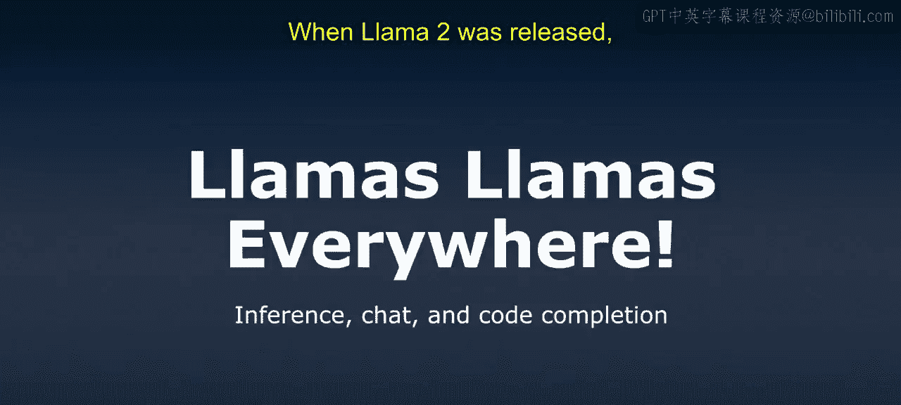

在本节课中，我们将深入了解Meta发布的Llama2模型家族，包括其基础模型、聊天模型以及专门为编程任务设计的Code Llama模型。我们将探讨这些模型的不同之处、训练过程以及它们各自的应用场景。

## 基础模型与聊天模型

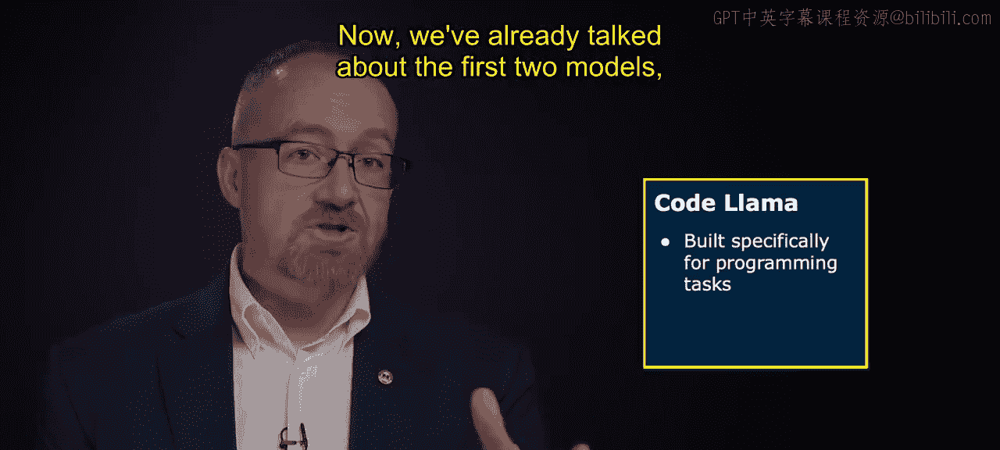

上一节我们介绍了Llama2的发布背景，本节中我们来看看Meta最初提供的三种核心模型。

Meta在发布Llama2时，主要提供了三种不同定位的模型。

*   **基础模型**：这是一个经过良好训练的模型，适用于**推理**任务。当你向模型提供一个提示时，它会以**完成该提示**的形式返回响应。该模型的训练重点是生成高质量、事实准确的回答，这主要依赖于其预训练过程。
*   **聊天模型**：这是一个专门为**通过聊天进行人机交互**而构建的模型。其训练重点在于**对话交互**。通过使用基于人类偏好的强化学习在一系列不同指标上进行微调，该模型的聊天能力得到了提升。重要的是，Meta在此微调过程中投入了大量精力，以确保该模型具备适当的安全性和无害性护栏。
*   **Code Llama**：这个模型实际上在其他模型发布几个月后才推出，是专门为**编程任务**构建的。

我们已经讨论了前两种模型。那么Code Llama有何不同？

## Code Llama：专为代码而生

现在，让我们聚焦于专为程序员设计的Code Llama系列模型，了解其种类和独特的训练方式。

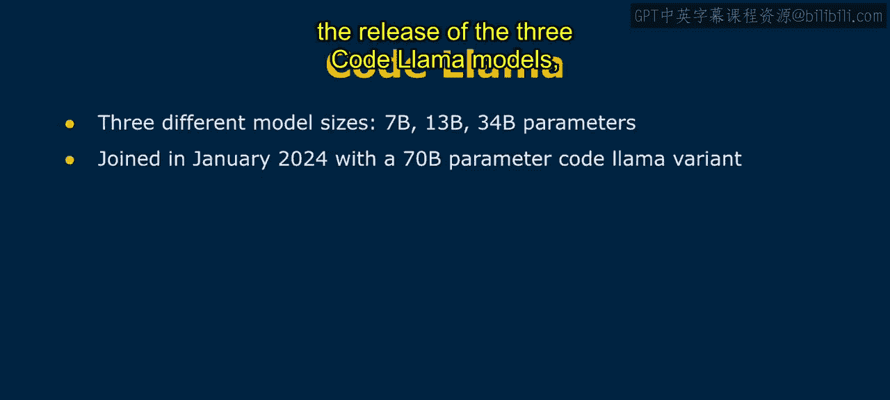

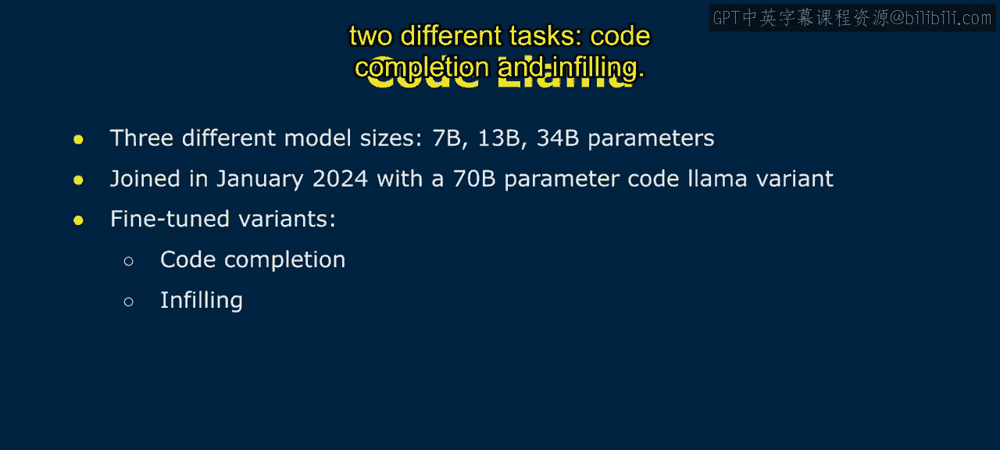

实际上，Code Llama包含三种不同的模型，它们都是基于Llama 2的基础模型进行训练的。请记住，Llama2的基础模型使用了**2万亿个标记**进行训练，并提供三种参数规模：**70亿、130亿和700亿参数**。

事实上，还有一个未发布的**340亿参数**模型。Code Llama的发布部分基于**70亿、130亿和340亿参数**的模型。在2024年1月，即三个Code Llama模型发布大约四个月后，Meta发布了**700亿参数**的Code Llama变体。我认为这应该能让你感受到训练这些模型所需投入的巨大努力。生成这些大型统计模型需要**数月的高性能计算**，并且可以想象，试验不同的模型架构可能需要更长时间。

对于每个基础模型，Meta通过两种不同的任务创建了微调版本：**代码补全**和**代码填充**。

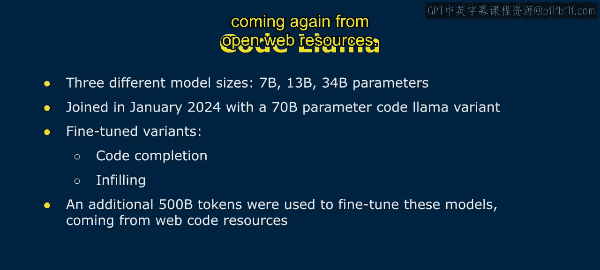

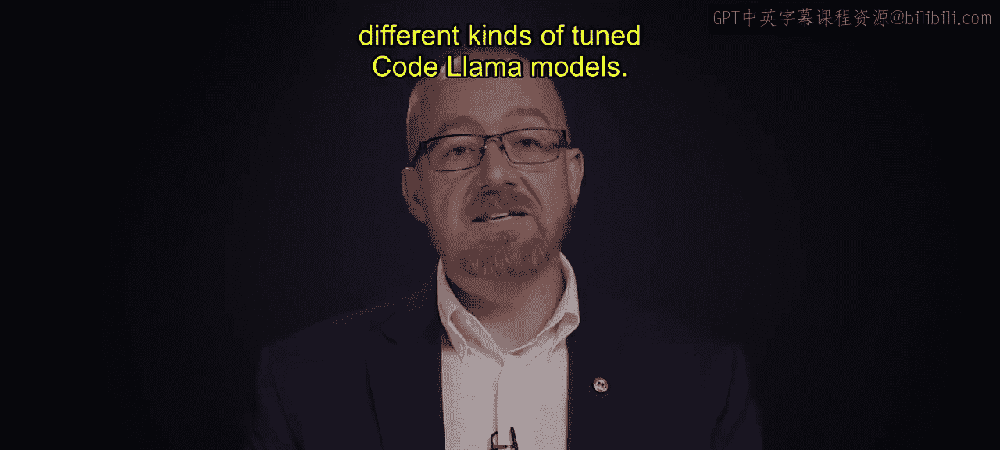

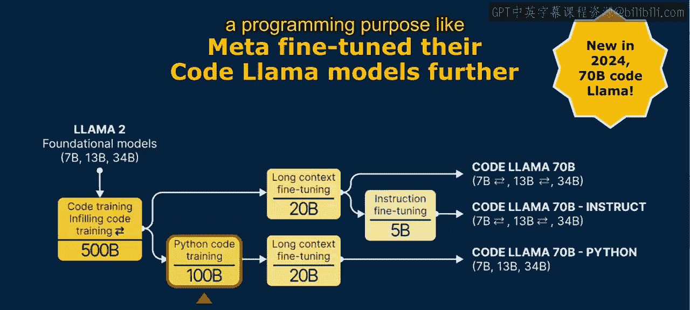

*   **代码补全**任务与基础模型的推理机制非常相似。给定一些输入数据（即代码），模型预测接下来应该出现的代码。如果你使用过GitHub Copilot或类似工具，你可能体验过这种功能，即模型根据你已经编写的上下文来预测你接下来可能写什么。
*   **代码填充**任务则更为专业。在这个任务中，模型同时接收已编写代码的**前缀**和后续代码的**后缀**。可以想象成将光标放在你已编写的两个函数之间，然后询问Llama 2，让它编写位于两者之间的代码。

在这两种情况下，都额外使用了**5000亿个标记**（同样来自开放的互联网资源）来微调模型。

然而，这还不是全部。Meta还花时间创建了不同类型的微调版Code Llama模型。

*   例如，他们通过使用额外的**1000亿个Python训练代码标记**进行微调，创建了**Code Llama Python**模型。这个模型特别擅长编写Python代码。从这里你可以看到，为特定编程目的（如Python编程）微调这些基础模型（有时称为基础模型）所需的工作量要小得多。
*   Meta还创建了一个名为**Code Llama Instruct**的模型，这是一个通用目的的Code Llama模型，额外使用了**50亿个自然语言标记**进行微调。这个模型提高了根据自然语言指令生成高质量代码的能力。但有趣的是，他们在此微调过程中**没有使用基于人类偏好的强化学习**。

相反，由于代码实际上可以被执行，从而可以确定其输出结果，Meta采用了以下方法：他们使用**700亿参数的基础模型**生成了大约**5万个独特的面试风格编程问题**。对于每个问题，他们让Code Llama生成一系列单元测试以及10个不同的Python解决方案。然后，在这些测试解决方案上运行单元测试，并将第一个通过测试的解决方案、其来自700亿参数模型的问题提示以及单元测试一起添加到微调数据库中。

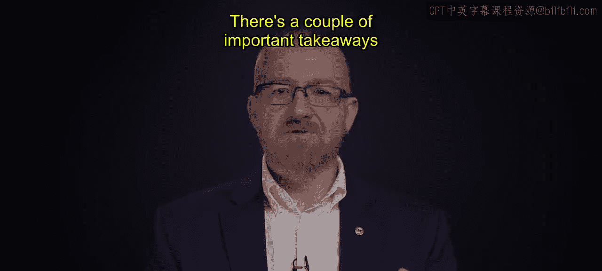

这种面试风格的机制，结合代码本身的执行来微调模型，是一种巧妙的方法。它适用于那些你可以客观衡量成功与否、且不需要人工评估结果的领域或任务。

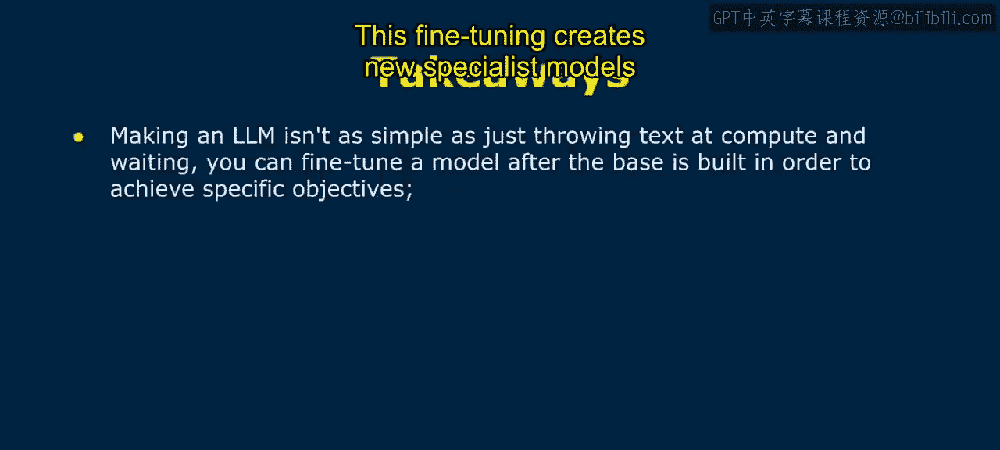

## 核心要点与启发

从这些关于Llama 2的早期课程中，我们可以得出几个重要的结论。

以下是本课程的核心要点总结：

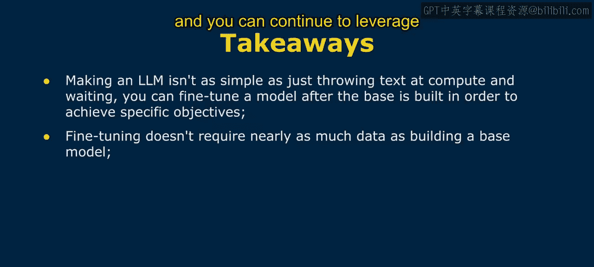

1.  **模型训练是一个持续的过程**：你并非训练一个模型后就结束了，而是可以**持续微调模型**，以特定方式提升其性能。这种微调会创造出新的专业模型，这些模型可以有不同的输入假设（例如Code Llama的代码填充任务），以及经过修改的权重，从而改善特定任务的结果。
2.  **微调所需数据相对较少**：与训练基础模型相比，微调过程可以**使用非常少的数据**，并且你仍然可以充分利用基础模型的能力。例如，Code Llama Instruct系列模型仅在基础Code Llama模型之上使用了50亿个标记，而基础Code Llama模型使用了5000亿个标记，并且基于2万亿个标记的基础模型。随着标记数量的减少，这意味着你的训练数据所需时间大大缩短，成本也低得多。
3.  **强化学习方法的多样性**：尽管人类偏好在生成这类模型（尤其是聊天模型）时被大量使用，但我们还可以使用其他有趣的机制进行强化学习。强化学习领域远比大语言模型广泛。我认为Code Llama Instruct的训练过程是一个很好的例子，它展示了**由任务独特性（编写可运行代码）所促成的一种流程**。

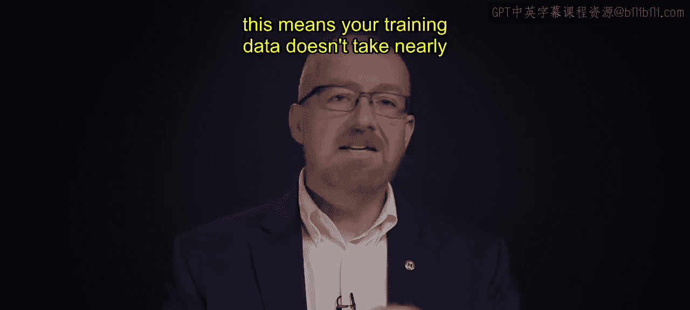

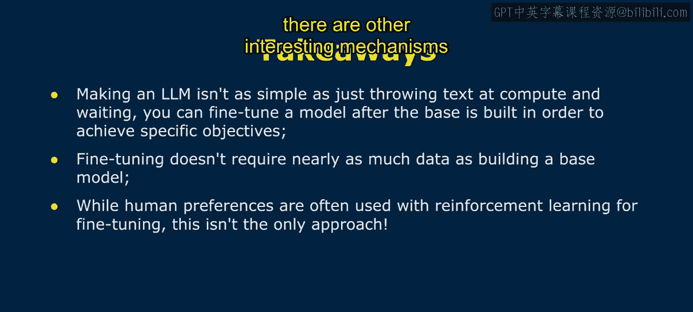

我认为这一点值得反思片刻：利用类似Meta所做的架构，我们还能为哪些其他类型的任务生成强化学习数据集？无论你是想为工作、爱好还是其他目的微调一个模型，你该如何进行呢？

本节课中，我们一起学习了Llama 2模型家族的构成，包括基础模型、聊天模型和Code Llama系列。我们深入探讨了Code Llama的两种核心任务（补全与填充）、其Python特化版和Instruct版的训练方法，并总结了微调的核心价值与启发。理解这些模型的不同定位和训练逻辑，将帮助你在实际项目中更好地选择和应用合适的工具。