# 密歇根大学《Python程序员的羊驼”课程｜Llama2 for Python Programmers》中英字幕 p04 3_开源LLM——羊驼及其竞争对手.zh_en -BV1vi421a7NL_p4-

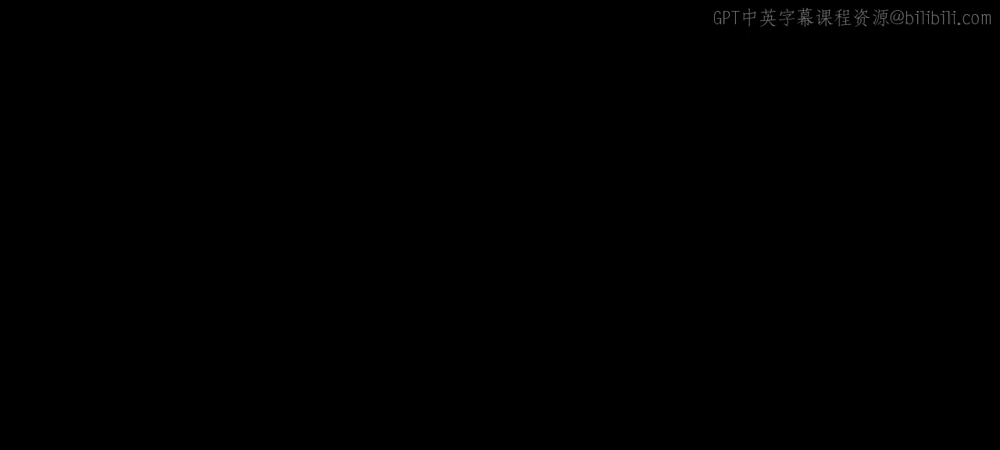

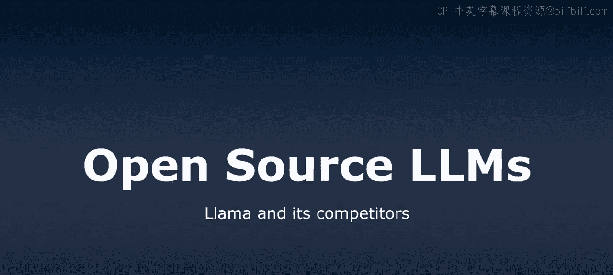

Perhaps the most exciting thing about Lama 2 is that metata announced it as an open source L L M and has pledged to continue open sourcing Lama in future variants as well。

 But what's it mean for a large language model to be open source。 Well。

 that's not totally clear with software， the definition of open source is set by the open source initiative。

 The O S I， and it focuses explicitly on improving licenses， which adhere to 10 specific principles。

😊，But are these principles as relevant or even appropriate when we consider that the software part of the large language model is really only a small part of what makes the model useful。

For instance， what about the data that the model was trained on。

 should that have to be open and freely distributed for a model to be considered open source。

 or what about the weights of the pretrained model。

 is that sufficient in order to consider the model itself is open source？

These questions aren't well answered， but nonetheless。

 we're starting to see a more clear distinction that arises between models where the weights are available for download。

 like with Lama 2 and where they aren't。 For instance， with Open AI's Chad GBT。 Now。

 Meta certainly made waves when they released Lama2 is an open source large language model。 And。

 as I've said， they've doubled down on this and have pledged that future Lama models will be open source 2。

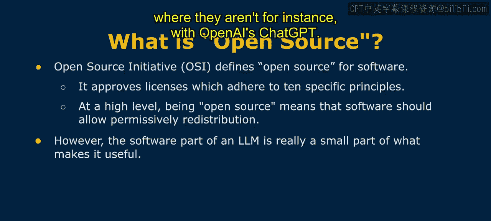

The historical aspect of how Lama 2 was released is actually quite intriguing。

 and it turns out that metata didn't release the first Lama model openly。

 Instead you needed to apply for access and it was only provided to certain researchers。However。

 someone else ended up releasing the model as a torrent on Forchann。

 presumably after getting a copy from someone who is registered with metata as a researcher。

And using at least a pragmatic definition of what it means to be open。

 it does seem like the Lama2 code base is indeed open source。

 It doesn't fit the OsI definition as the license being used here is a proprietary one。

 the Lama community license， which the OsI has not yet endorsed， but you can go to Github。

 and you can freely browse the model architecture source code。 Similarlyly， the pretrain model data。

 the way its are also available， at least once you apply for an or granted access by meta。

 and we'll talk about that in a moment。 But if you consider the larger ecosystem of activities。

 all of the training data， the system for doing reinforcement， learning and fine tuning and so forth。

 there are some pieces missing。 So it's not quite as trivial to train your own Lama2 variant just based on the papers that you've read and the code that's been provided。

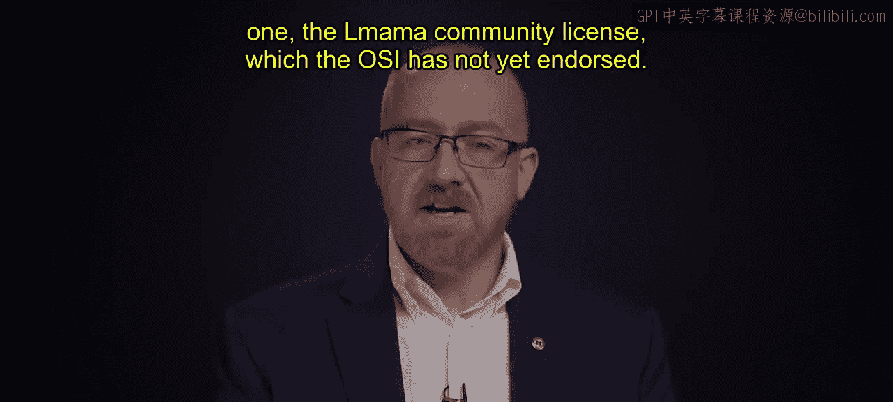

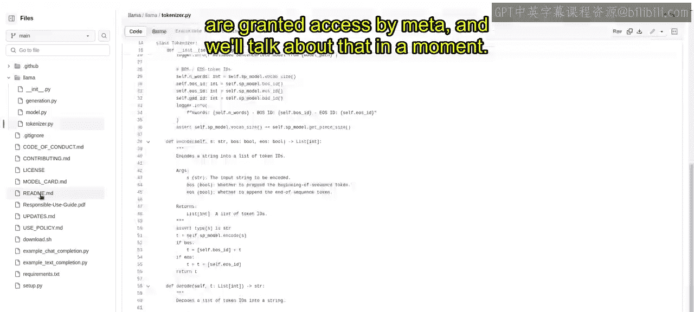

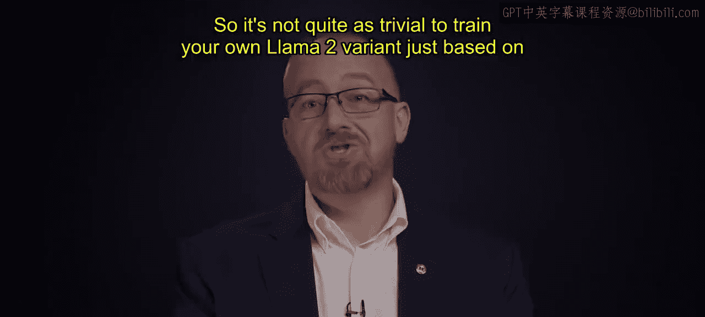

The Lama 2 license is extremely permissive and short， too。 Megrs developers and companies。

 a royalty free license to use Lamma， both the foundational model。

 the weights and the associated software。 You can also redistribute the models you fine tune and build them into products without paying meta。

 And this is huge for any organization who doesn't want to pay or send their data to a third party service。

There's just a couple of small caveats。 First， you have to comply with local laws and follow the Lamma usage policy。

 Now， the usage policy acts as a sort of moral wrapper for Lamma and emphasizes the need to follow laws in the use of Lama 2。

 as well as prohibits the use of the model for actions that might cause bodily harm to people。

 And this includes activities， such as weapons development or representing the output of Lama 2 as being human generated in a manner that might cause bodily harm。

 such as unlicensed medical advice。

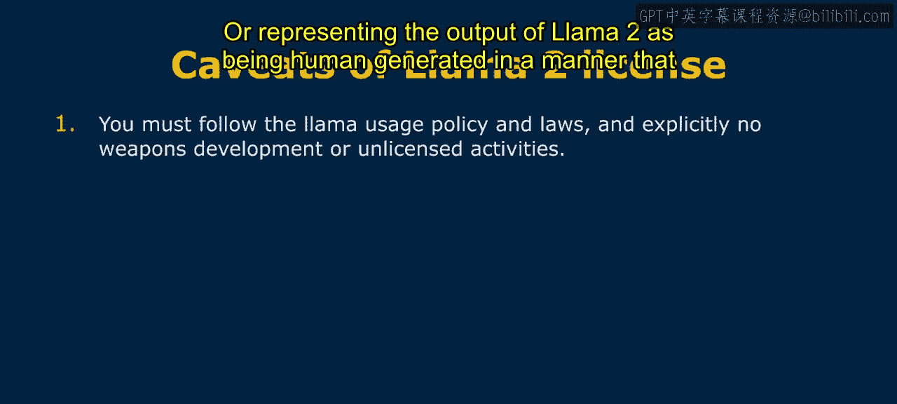

The usage policy also explicitly indicates that you must disclose to end users any known dangers of your AI system。

 so you have an obligation here to disclose。This usage policy requirements。

 they kind of conflict with the OSI principle of no discrimination against fields of endeavor。

 which essentially means that an OSI approved license can't stop people from using the software for whatever purpose they see fit。

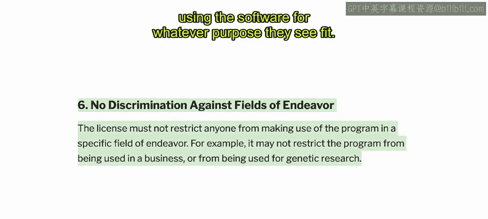

The license also prohibits the use of Lama2 to improve other large language models。

 which is actually a pretty standard practice for large language model licenses。

 whether they are open sourced or API based like ChaGBT。

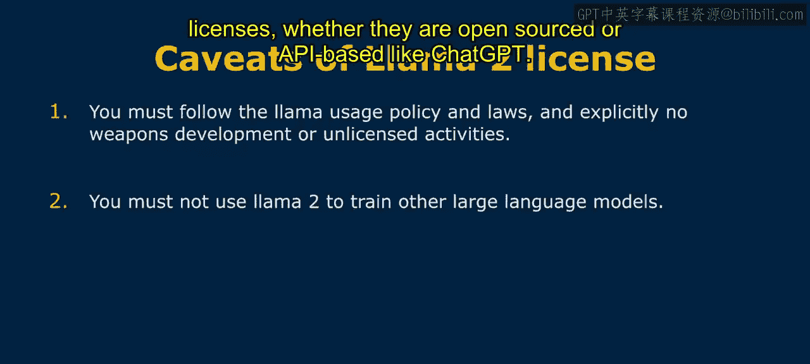

You can immediately see the kind of competition concerns that crop up here and why Me might build that into the license。

 given the immense costs of pretraining these models。 In addition。

 if your organization has more than 700 million monthly users。

 you actually have to apply to meta for a separate commercial license。

 you can imagine that this only affects a few large tech companies。

 I've linked a copy of the license and the terms of use in the course。

 and they're really quite short。 So I encourage you to read them and think about them and how this new technology fits into the larger software ecosystem that you might be dealing with。

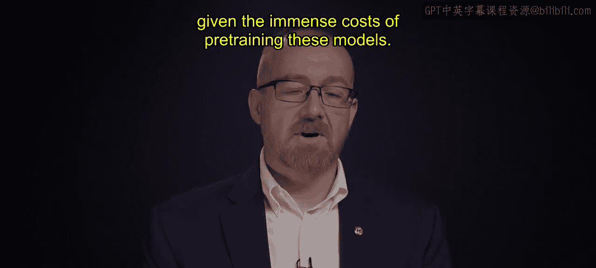

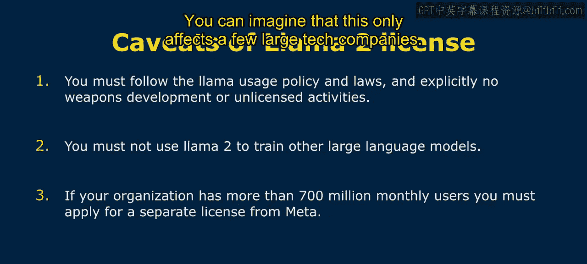

Meta raised the bar， and numerous other large language model tech companies have begun to release at least some of their models as open source。

For instance， minstrel AI has trained several high performing language models and released a few of them as open weights。

 They have also released the software portion of the system under an OS S I approved license。

 the Apache 2 license。 However， this only applies at the moment to their minstrel 7 B and Miel 8 by 7 B models。

 and not for the models they keep behind their service endpoints similar to open AI。

Perhaps most interesting to me was the Microsoft's small 2。7 billion parameter model Phi2。

 which was released only to researchers under the Microsoft Research license in December of 2023。

 By mid-jaary 24， this had changed to the OSI approved MIT license。The last1 I'll mention。

 but there are certainly more are the Falcon 40 billion and 180 billion parameter models。

 These models fall into a similar category isma 2， where the license is a proprietary one。

 not approved by the OSI， and it also requires developers to follow these acceptable use policies。

 and that policy might change over time。This license also contains a provision。

 which requires you to get a separate commercial license if you are hosting the model for others to use as a service。

 The unique aspects of huge pretrain data， the model waits and that this data is derived from other data。

 often with unclear or at least mixed copyright statuses。

 is challenging our understanding of what it means to be open source when it comes to AI products。

Governments are also considering， what does it mean to be an open source model at the time of filming this lecture。

 the final draft to the E U AI Act， which aims to regulate AI efforts in the European Union。

 actually has specific exclusions built into it for open source models。

 This will undoubtedly continue to drive innovation in open source language models like Lama 2。

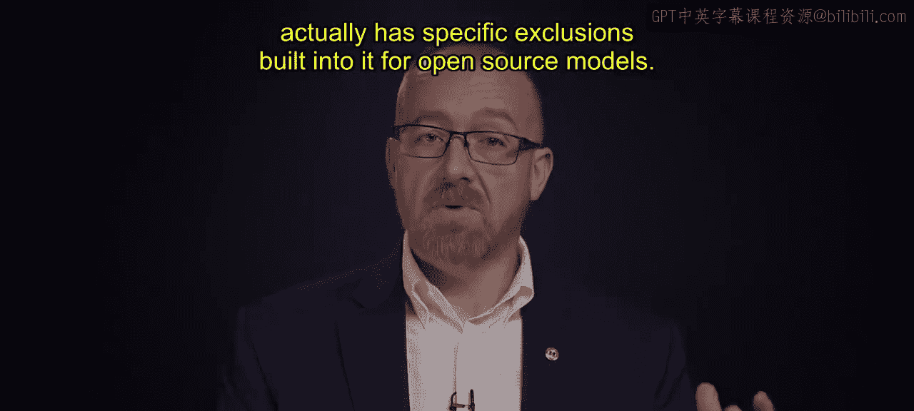

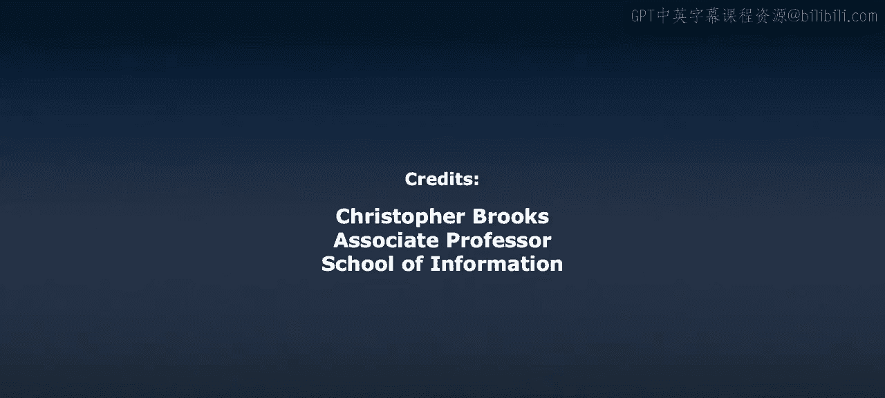

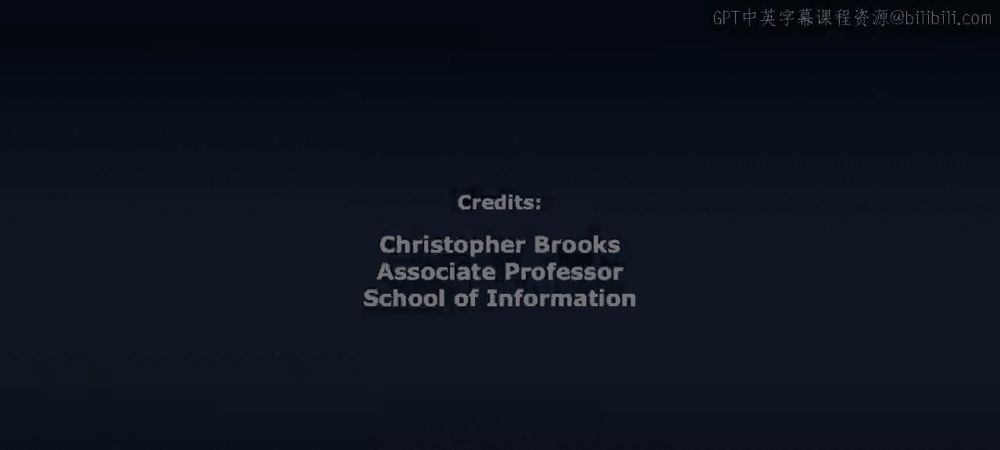