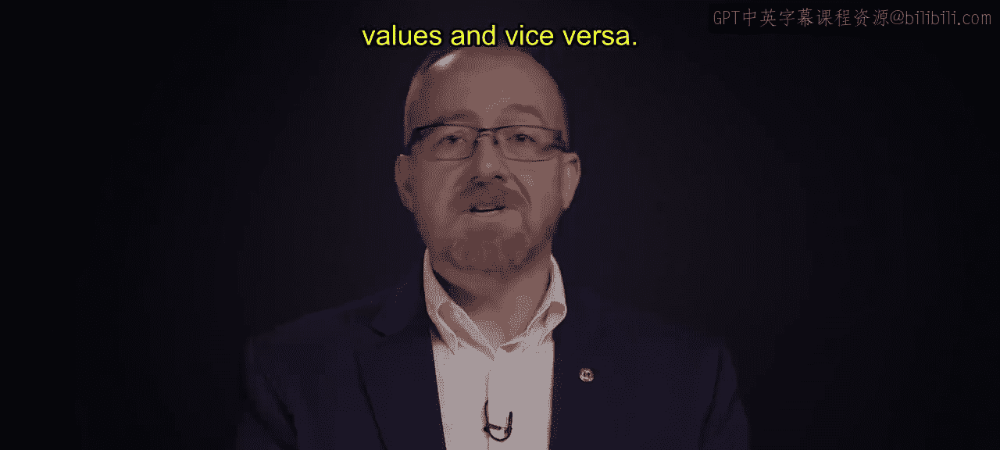
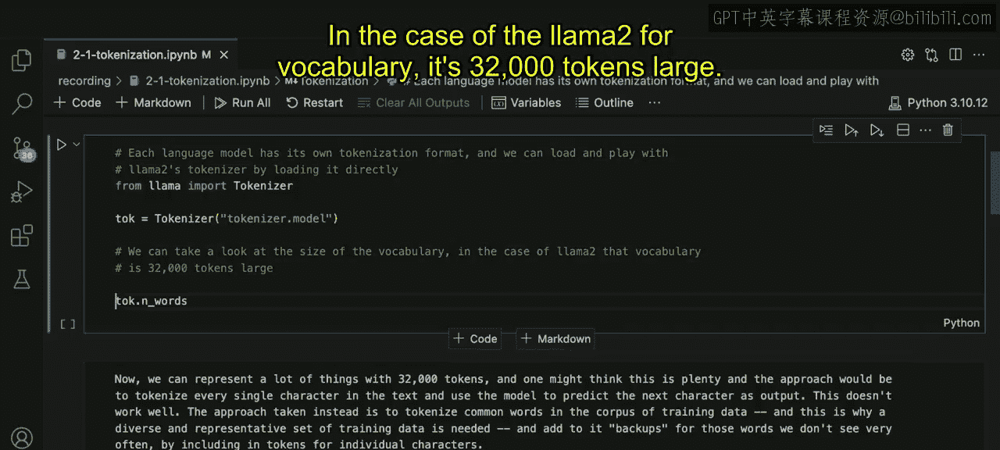
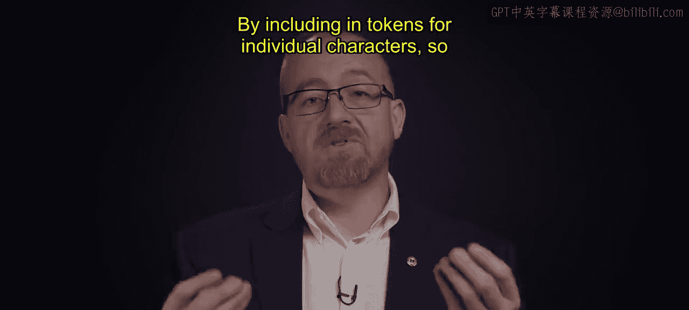
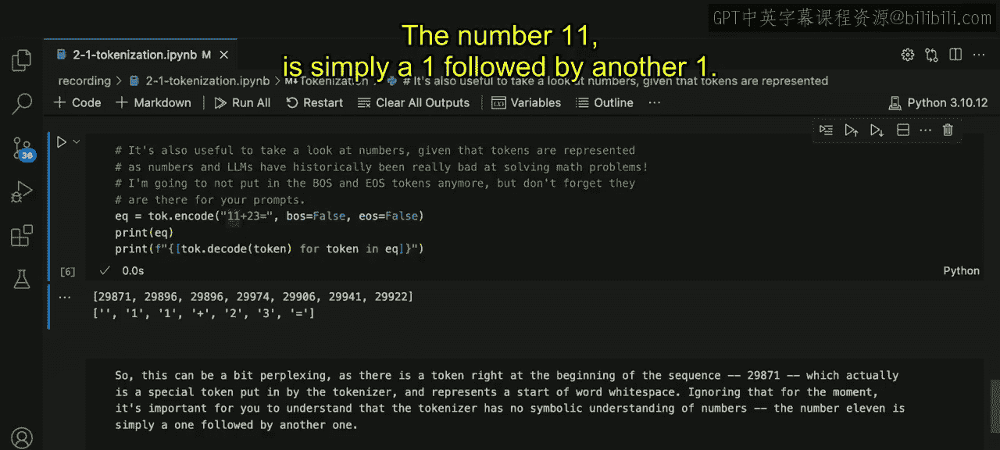
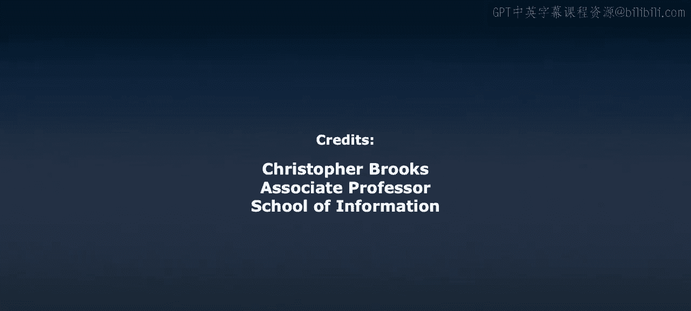

# Python程序员的羊驼：06：羊驼2的标记化 🦙


在本节课中，我们将要学习大型语言模型（如Llama 2）如何处理文本。核心在于理解“标记化”这一过程，它负责将人类可读的文本转换为模型能够处理的数字序列。

## 文本与标记的区别



上一节我们介绍了模型的基本概念，本节中我们来看看文本与标记的具体区别。虽然它们非常相似，但存在一个关键差异：模型的神经网络架构并非直接处理文本，而是处理数值。模型通过数学运算处理输入的数字序列，这些运算的权重是在预训练过程中学习得到的。标记化的作用，正是将输入文本转换为这些数值，反之亦然。

## 探索Llama 2的标记器



每个语言模型都有其独特的标记化格式。我们可以直接加载并使用Llama 2的标记器。以下是加载代码：
```python
tokenizer = AutoTokenizer.from_pretrained(“meta-llama/Llama-2-7b”)
```
Llama 2的词汇表大小为**32,000**个标记。这足以表示许多内容。一种朴素的想法是对文本中的每个字符进行标记化，让模型预测下一个字符。但实践证明这种方法效果不佳。

## 标记化的策略

实际采用的策略是：对训练数据语料库中的常见单词进行标记化。这强调了拥有多样化和代表性训练数据集的重要性。对于不常见的单词，则通过包含单个字符的标记作为后备方案，从而拼写出这些单词。

以下是标记化过程的核心步骤：
1.  **编码文本**：使用 `encode` 函数将句子转换为标记数字序列。
2.  **处理特殊标记**：需要注意 `BOS`（序列开始）和 `EOS`（序列结束）等特殊标记。可以通过参数控制是否包含它们。
3.  **解码标记**：使用 `decode` 函数将单个标记转换回文本，以理解标记器的工作方式。



## 标记化实例分析

让我们通过一个例子来具体分析。对句子 `“Llama is an animal.”` 进行编码（包含BOS和EOS标记），会得到9个标记。除了首尾的特殊标记，还有7个标记，这比句子中的4个单词要多。

通过解码每个标记，我们发现：
*   `BOS` 和 `EOS` 标记没有可见的文本表示。
*   单词 `“Llama”` 并不在词汇表中。因此，标记器回退到按字母拼写它，直到遇到词汇表中存在的子串 `“ama”`。
*   单词 `“is”`、`“an”`、`“animal”` 以及句号 `“.”` 都在词汇表中。

## 影响标记化的因素

接下来，我们通过一些变化来进一步探究标记器。

以下是影响标记化结果的关键因素：
*   **大小写**：`“Llama”` 和 `“llama”` 的标记化结果会产生不同长度和数值的序列。
*   **拼写**：拼写错误（如 `“animle”`）会导致返回两个标记，而不是正确单词 `“animal”` 对应的一个标记。
*   **数字处理**：标记器对数字没有符号化的理解。数字 `“11”` 只是被当作字符 `“1”` 后跟另一个 `“1”` 来处理。例如，`“11 plus 23”` 的标记化结果可能包含一个代表“单词起始空格”的特殊标记（如29871），然后才是数字和单词的标记。

## 标记的重要性与上下文长度



从高层次理解这个过程至关重要，因为我们的语言模型并不直接操作单词、句子或文本，而是操作**标记序列**。这一点在理解使用LLM的更高级概念（如检索增强生成RAG）时非常重要。在RAG中，LLM访问的文档数据库索引是基于“块”的，这些块实际上就是表示为向量的标记。

标记及其序列是大型语言模型输入和输出的基本单位。这也引出了另一个重要概念：**上下文长度**。我们将在下一讲中通过编写提示词来探讨它。

## 总结




本节课中我们一起学习了Llama 2的标记化过程。我们明确了文本与标记的区别，探索了标记器的工作方式，了解了词汇表大小和标记化策略，并通过实例分析了大小写、拼写和数字如何影响标记化结果。最重要的是，我们认识到**标记序列是LLM处理信息的基本单元**，这是理解模型能力与限制的基础。