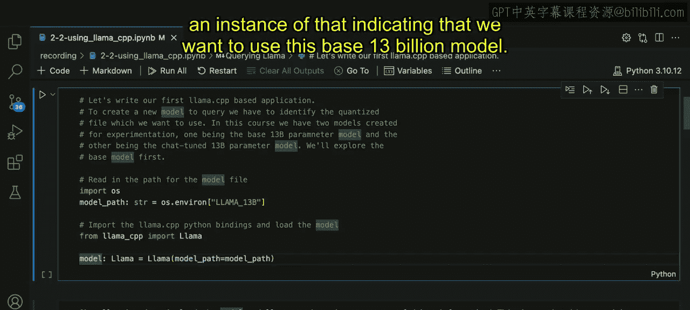
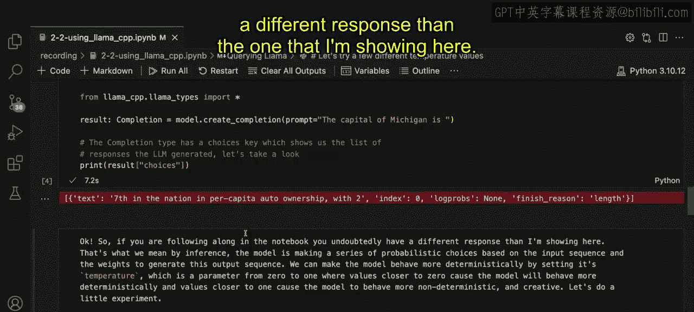
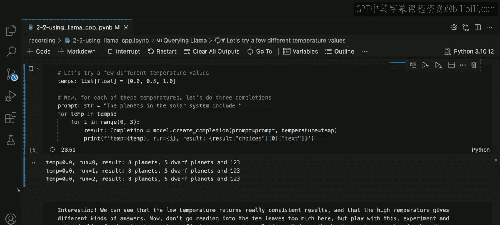
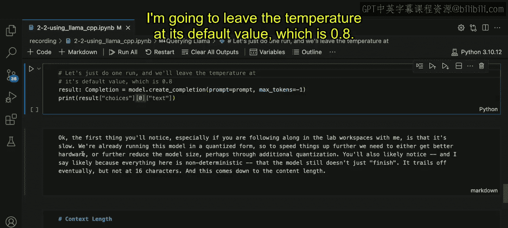
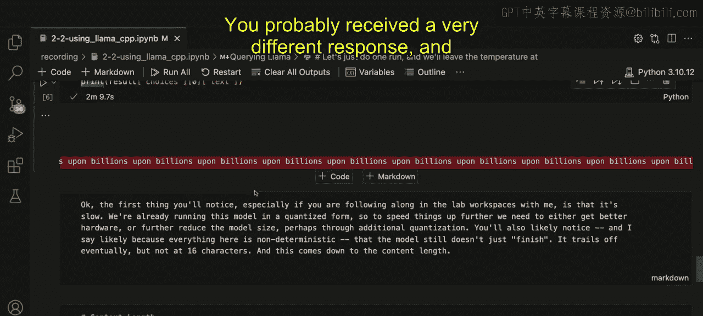
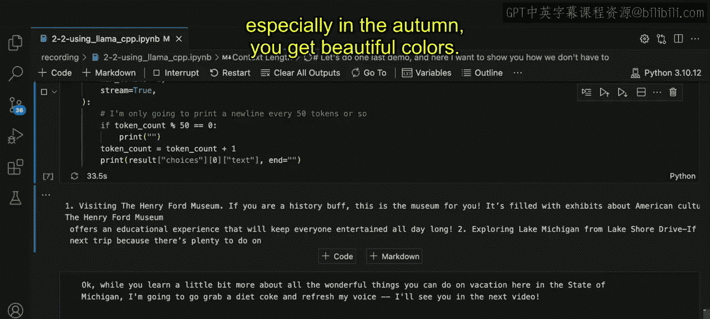

# Python程序员的羊驼：P07：用Llama.cpp构建第一个Llama2应用程序 🦙


在本节课中，我们将学习如何使用Llama.cpp库来加载Llama2模型，并进行基础的文本生成（推理）。我们将探索如何设置模型参数，如温度和上下文长度，并了解如何以流式方式获取模型的输出。

---


## 模型加载与初始化

上一节我们介绍了Llama2模型的数据表示基础。本节中，我们来看看如何实际加载一个量化模型并进行查询。



首先，我们需要导入Llama.cpp库并指定要使用的模型文件。在本课程中，我们准备了两个用于实验的模型：基础的130亿参数模型和经过对话微调的版本。

```python
import llama_cpp

# 假设环境变量已设置模型文件路径
model = llama_cpp.Llama(model_path="llama-13b.gguf")
```

加载模型后，控制台会输出详细的调试信息，包括模型架构、上下文长度（例如4096个词元）、特殊词元以及层数等。这些信息对于理解模型配置很有帮助。Llama.cpp的一个有趣特性是支持同时使用CPU和GPU进行计算。


为了简化输出，我们可以将详细模式关闭。

```python
model.verbose = False
```

---

## 执行基础推理

现在我们已经加载了模型，让我们执行一些推理任务。我们将使用 `create_completion` 方法，它默认只需要一个提示词（prompt）并返回一个完成对象（completion object）。




```python
prompt = "What is the capital of Michigan?"
completion = model.create_completion(prompt)
print(completion['choices'][0]['text'])
```

语言模型的推理具有非确定性（non-deterministic），这意味着相同的输入可能产生不同的输出。这与确定性（deterministic）的数据库查询不同。



---

## 理解温度参数

我们可以通过调整“温度”（temperature）参数来影响模型输出的随机性。温度值范围在0到1之间：接近0会使输出更确定和一致；接近1则使输出更多样化和具有创造性。

以下是测试不同温度值的示例代码：


```python
temperatures = [0, 0.5, 1]
prompt = "The sky is"



for temp in temperatures:
    print(f"\n--- Temperature: {temp} ---")
    for _ in range(3):  # 每个温度生成3个补全
        completion = model.create_completion(prompt, temperature=temp, max_tokens=16)
        print(completion['choices'][0]['text'])
```

温度参数实质上改变了模型从候选词元中选择下一个词元的概率分布。较高的温度会导致重复查询时输出更快地产生分歧。

---

## 控制生成长度与上下文窗口


默认情况下，`create_completion` 方法只生成16个词元。我们可以通过设置 `max_tokens=-1` 来允许模型生成尽可能多的词元，直到达到上下文窗口的限制。

```python
prompt = "Tell me about Mars."
completion = model.create_completion(prompt, max_tokens=-1, temperature=0.8)
print(completion['choices'][0]['text'])
```



请注意，生成大量词元可能速度较慢，并且模型有时可能会陷入重复循环，因为它总是基于当前完整的词元序列来预测下一个最可能的词元。

**上下文长度**（context length）是指模型训练时所能处理的最大词元序列长度。对于原始的Llama模型，约为2000个词元；Llama2则提升到了约4000个词元。你可以将其理解为LLM处理单次查询时的“记忆容量”。更大的上下文长度可以提升输出质量，但也会增加计算成本。在Llama.cpp中，默认的上下文长度是512个词元。

```python
# 创建模型时指定更大的上下文窗口
model = llama_cpp.Llama(model_path="llama-13b.gguf", n_ctx=2048)
```

---


## 使用流式输出

我们不必等待整个查询完成，可以使用Llama.cpp的流式功能来实时查看生成的词元。

以下是使用流式输出的方法：

```python
prompt = "Some fun things to do for vacation in the state of Michigan."
stream = model.create_completion(prompt, max_tokens=256, stream=True)

token_count = 0
for output in stream:
    token = output['choices'][0]['text']
    print(token, end='', flush=True)
    token_count += 1
    if token_count % 50 == 0:  # 每50个词元换行
        print()
```

这种方式可以让你观察到模型是如何逐步生成文本的，提供了更交互式的体验。

---



本节课中我们一起学习了如何使用Llama.cpp加载Llama2模型、执行基础推理、通过温度参数控制输出随机性、理解并设置上下文长度，以及利用流式输出实时观察生成过程。这些是构建Llama2应用程序的基础步骤。