# 密歇根大学《Python程序员的羊驼”课程｜Llama2 for Python Programmers》中英字幕 p09 8_羊驼2的聊天和对话.zh_en -BV1vi421a7NL_p9-

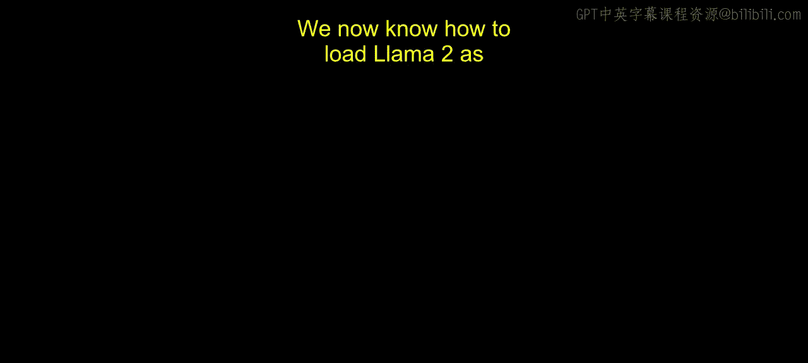

We now know how to load Lama2 as a local large language model that fundamentally it takes a sequence of tokens and uses its pretrained weights to generate a sequence of output tokens。

 and that this process is probabilistic in nature and that we have some techniques to help guide that randomness。

Remember， these pretrained weights come from a large corpus of data， over 2 trillion tokens。

 and how this data was fed into the model determines the weights， representation。

 the relationship between tokens and so forth。It's important then to understand how that data was formatted when it was fed into the model in order to generate reasonable prompts。

The base model， which we've been using up until this point doesn't have any particular template。

 but the chat model does as it went through a fine tuning process。From the Lama2 paper。

 the template is as follows。 First， the sequence starts with the letter S enclosed in less than in greater than symbols。

 Then the string inst appears， indicating that a single instruction is being given。

 Youd see that this is mirrored at the end of the string with a slash int。

 indicating that the closing of the instruction is happened。

 Then we have a set of less than and greater than indicators inside a set of ASIgis。

 indicating that the prompt begins with a system message to the context。

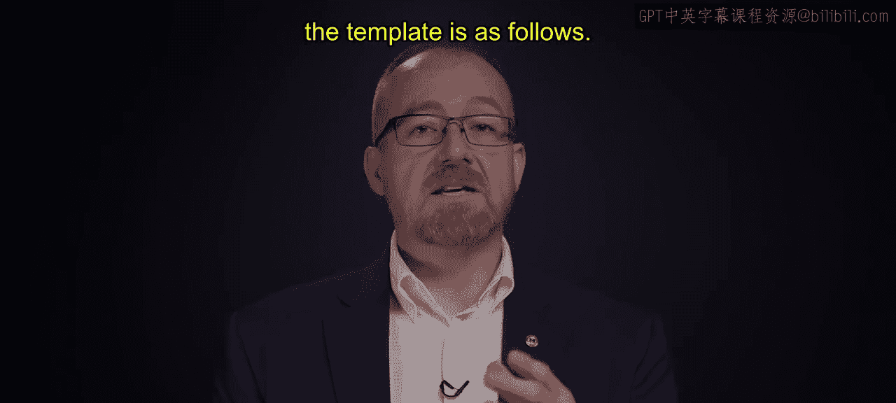

There's a variety of whitespace， which is important because it was used in the fine tuning data and a user message which is actually the content of your prompt query。

The system will append to this， its responses in the query and future queries in the same conversation should be user messages wrapped in these Ist tags。

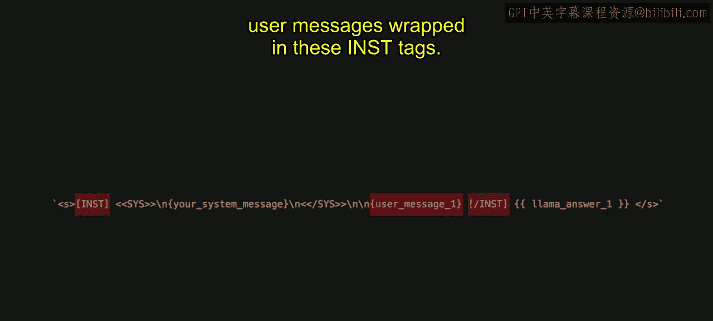

Now， this could be a lot to keep in mind， but Lama CPP and its python bindings help wrap this format a bit for us。

 so let's take a look at that。 Okay， so this just looks the same as before。

 but here you'll note I'm using a different environment variable， Lama 13 B underscore chat。

 so that's actually a completely different model。 I'm going to set the verbosity to false and the temperature to0。

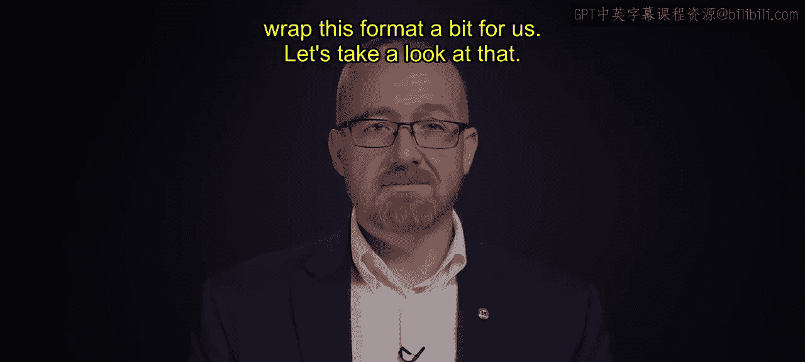

So the high levelvel type Lama CPPP uses for this type dictionary is called the chat completion message。

 this dictionary is going to be converted at inference time to the underlying LLM format you need based on the model type。

 now that's going to be Lama2 for us， but you can actually use Lama CPPP with lots of different kinds of models。

Since everything is these type dictionaries， I'm actually going to bring an adjacent library here too。

 just to make reading and formatting a little bit easier。

I've got this conversation history I'm just going to call it messages as a list and then I'm going to add different messages to it the very first message is going to be the system message so I set the role and then I set the content you are an expert astronomer。

 answer each question which is given to you as factually as possible and so forth。

Now that's just the system message as we talked about here I also want to add what the actual query is。

 and so the user query in this case， the completion that I want to get the agent to respond with is what is the fifth planet in the solar system？

To run this， we actually just use model dot create chat completion instead of create completion and pass in the messages。

 and then I'll pretty print out to everything we get back。Okay。

 so we could see we get back at Uu I and it looks like it's some reference to the chat and the model that was used。

 Now inside of this choices， just like before， we see the response。 And in this case。

 the assistant is saying the word Earth So this is a little confusing to me。 I mean。

 I know we got rid of Pluto since I was a kid。 but do we add more planets before Earth， Well。

 let's give the model pass on accuracy for the moment。

 how do we know what our message actually looked like and what kind of rules are available to us。

 Well， this comes down to abstractions。 See Lama CPppP isn't just for Lama2 and each model has created its own chat format depending on how it's been finetd。

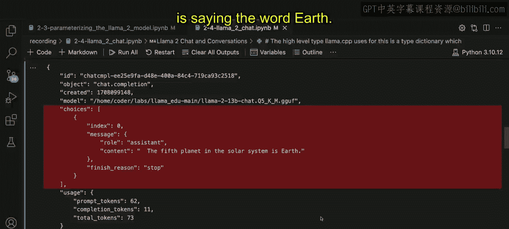

Despite models seeming similar in how we might use them。

 there's potential for huge variation and Lama CPP has been abstracted to work with a number of models。

 including other open source models like minstrel not only does each model have its own vocabulary model architecture。

 pre-trained wayss and finet message format， some just don't include text as a sequence input and have multimodal capabilities。

 bringing in images and videos， it's an exciting time but back to Lama2 here。

 if we want to see how the message is being translated into text。

 we can take a look at the chat formatters that are available in Lama CPP so Lama CPP actually loads the chat format automatically and so here we have this model dot chat format and this is going to be this string Lama dash too we can also set some of these values or change some of these values。

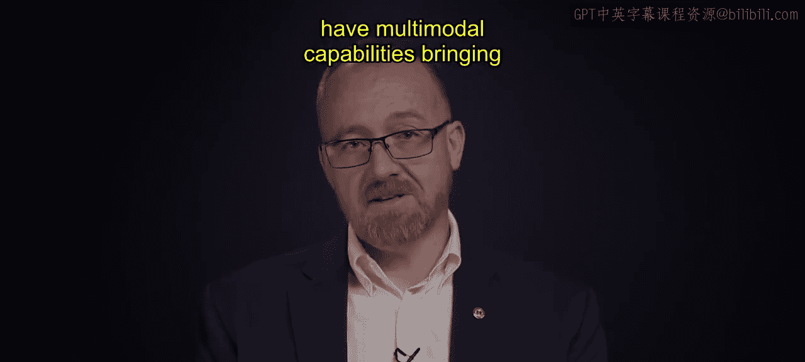

Okay， so this looks just like the format I introduced you to。 But of course。

 the new line characters here are being rendered as returns in the document。

 One of the real powers of the chat modules that we can have multiturn conversations。

 large language models work with a set context window we've already discussed that in Lama2。

 this context window up to 4000 tokens large by default。

 Lama CP creates a context window of 512 tokens to save us some computational resources。

 the most straightforward conversation for Lama2 model then is just a series of these messages that are all appended together into one larger sequence。

 iteratively adding in the responses from the model through turn takingking with the person。

 Let's take a look at this example。 So I'm going to create a list here to hold the messages just like before I've got the same system prompt that I'm giving here about it being an expert astronomer。

 although a kind of question after our previous result， whether that's true。

 but let's convince that it is and I've got the same query。 Now I'm not actually。

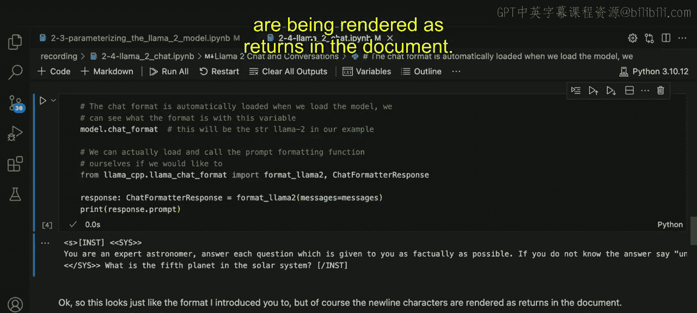

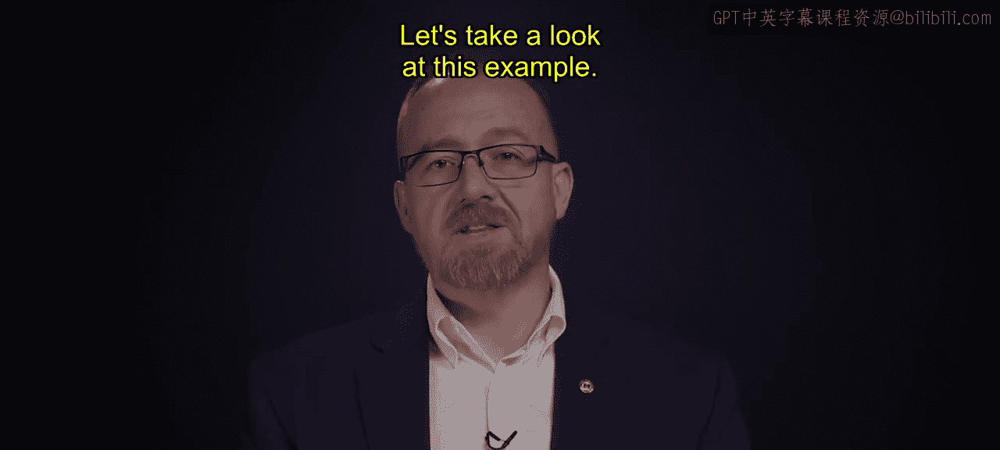

Even going look at this result， I don't have a lot of confidence in it after our last play。

 instead I'm going to ask another question， I'm going to say are you sure this is correct。

 I thought Earth was the third planet in our solar system and let's print out this and see what the model says。

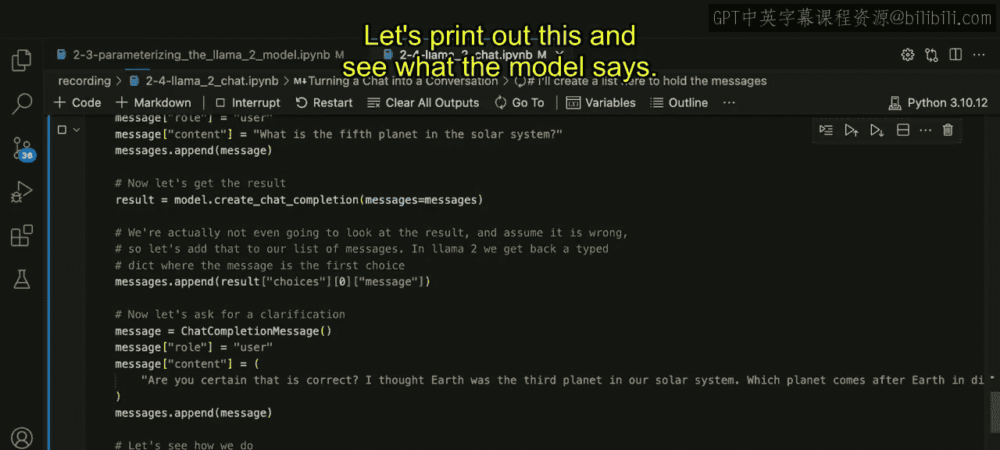

Well， I'm a bit disappointed in this result， but keep in mind that we're talking about a smaller model。

 the 13 billion parameter model， we've quantized it to run heavily on this CPU in the Coursera web environment for the class。

 a less compressed that is a less quantized model may perform better。

 as might a larger model like the 70 billion parameter model。

 we could also try and tune our prompt a bit more and use some prompt engineering strategies。

And actually that's kind of a nice way to end this module we've gotten our hands dirty with Lama2 and Lama CPP using Python。

 we've explored how tokenization works and the parameters by which we can tune how probabilistic the model is when it's actually choosing new output。

We've also seen that different models can have different kinds of interaction norms。

 depending on how they've actually been fine tuned with the Lamaou chat being a good example of a pretty simple but important template。

And we've seen in this template that there are three kinds of ruless that exist for messages。

 a system message， which is optional but sets the norm for how the model should respond。

 and then any number of user and assistant messages representing turns in a dialogue but now I'd like to learn from you。

 How might you tackle improving the response from Lama2 on this question。

 You don't have to limit yourself to just the concept we've talked about here in the course。

 feel free to bring in the knowledge you might have from other videos or readings that you might have seen。

 and feel free to try things， actually get into the notebooks。

 run some queries and try these models and change them In the next module。

 we're going to look a bit more at how we can programmatically integrate with large language models and I'll give you a short practice assignment。

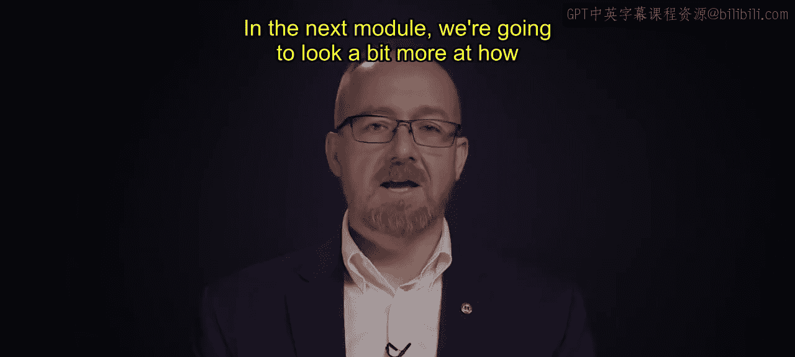

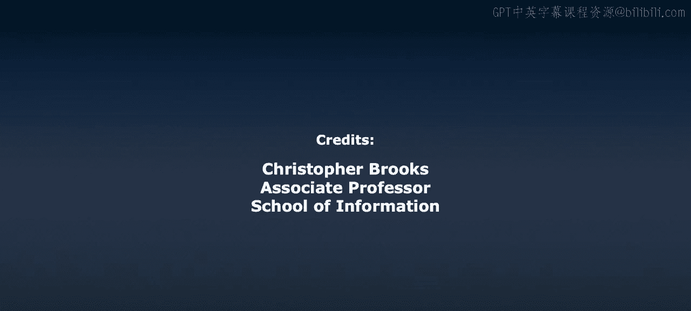