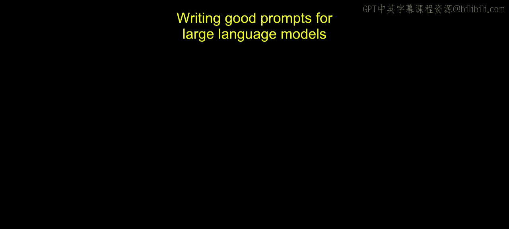
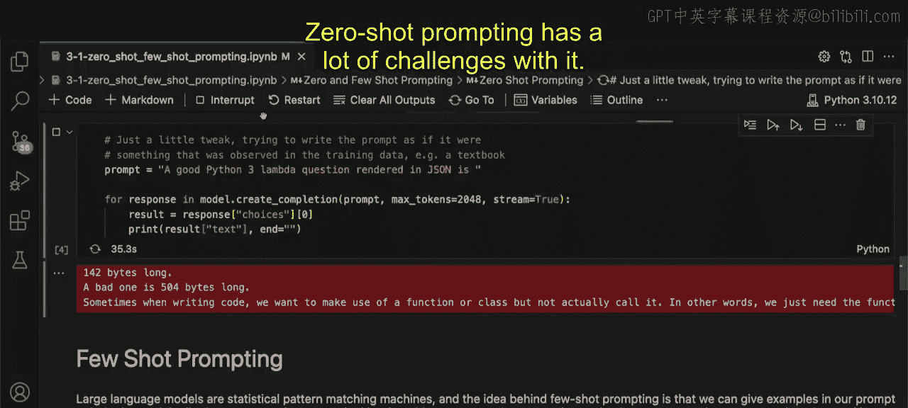
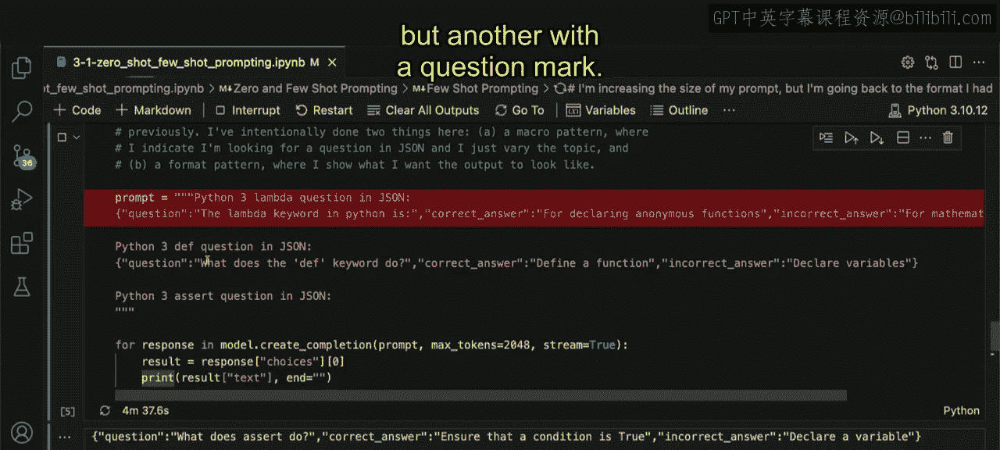
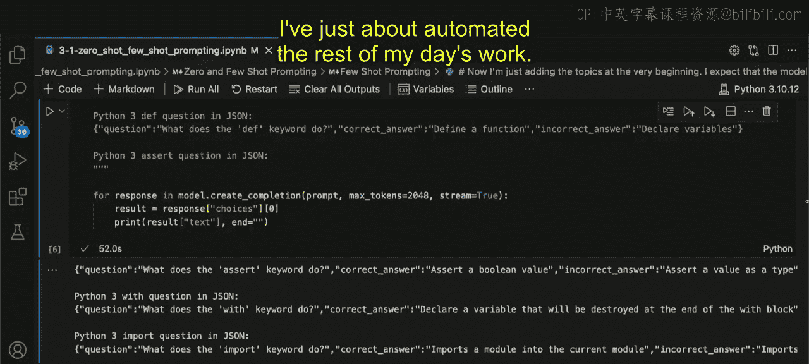
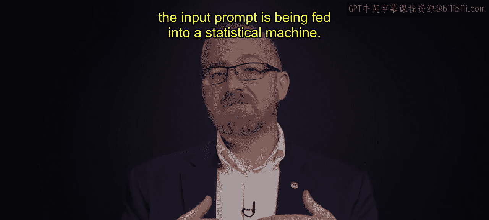
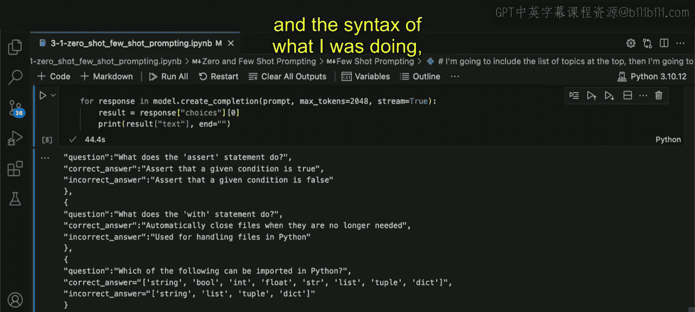

# 密歇根大学《Python程序员的羊驼》课程：P10：零次与少量提示 🧠



在本节课中，我们将学习两种核心的提示工程策略：零次提示和少量提示。我们将通过一个实际任务——生成JSON格式的Python测验题——来演示这两种方法，并理解它们如何影响大型语言模型的输出。

## 概述

为大型语言模型编写优秀的提示，是艺术、科学，或许还需要一点技巧和运气的结合。模型本质上是一个统计机器，它接收数字化的输入序列，并根据模型中的预训练数据、输入序列本身以及调用模型时可用的各种参数，来生成匹配的输出序列。

上一节我们介绍了模型的基本工作原理，本节中我们来看看两种具体的提示策略：零次提示和少量提示。这两种策略构成了当前实践的良好基础，并且与Llama模型配合良好。

## 零次提示


零次提示是课程中多次出现的第一种策略。它简单地给予模型一组指令让其响应，并让模型使用其预训练的权重来生成输出序列。实际上，将这些输入称为“指令”可能并不完全准确，因为模型本质上只是在做输出序列预测。因此，零次提示就是提供一个输入序列，并从模型中获取一个预测的、合适的输出序列。

在本讲座中，我将使用一个非常真实的任务。我在密歇根大学和Coursera平台上教授大量编程课程，内容涵盖Python、数据科学和应用人工智能。我喜欢给学生提供快速测验题来测试他们的知识，但构思好问题很困难，而且我需要将它们全部输入到某种测验工具中。有趣的是，大多数工具可以接受JSON格式的问题，但我发现手动输入JSON文档既慢又容易出错。因此，让我们看看是否能共同构建一个对话代理来帮助完成这个任务。

### 初次尝试

首先，我们设置Llama模型，这次稍微增加上下文窗口的大小。这可能会减慢速度，但也会返回更多的输出标记，这对当前任务特别有用。

在零次提示中，我们只是要求语言模型使用其预训练权重来续写我们的文本。由于我想生成一些JSON格式的Python 3 Lambda问题，这似乎是一个好的起点。我输入：“Python3 Lambda question in JSON:”，然后观察结果。

**代码示例：初始零次提示**
```python
# 伪代码示意
prompt = "Python3 Lambda question in JSON:"
response = model.generate(prompt)
```



结果并不理想。模型回复的内容像是遇到了错误，而不是生成一个问题。因此，我调整了提示，试图让它看起来更像训练数据中可能出现的文本：“A good Python3 Lambda question rendered in JSON is:”。然而，模型的回复是关于问题长度的描述，这很奇怪，并且开始讨论不好的问题示例和编写代码。这并没有很好地工作，零次提示面临很多挑战。

## 少量提示

大型语言模型是统计模式匹配机器。少量提示背后的理念是，我们可以在提示中提供一些示例，以帮助模型将其输出定制为我们实际寻找的内容。这被证明是提示工程中一种非常简单的“超能力”，当你希望将模型的响应约束到特定格式时非常有用。


让我们看看它是否能帮助我们。我增加了提示的长度，并回到了之前的格式。我在这里特意做了两件事：一是创建了一个宏观模式，表明我正在寻找一个JSON格式的问题，并且只改变主题；二是创建了一个格式模式，展示我希望输出看起来是什么样子。

以下是少量提示的示例结构：

**代码示例：少量提示结构**
```python
prompt = """
Topics: lambda, def, assert, with, import.

A Python3 lambda question in JSON:
{
  "question": "What does the 'lambda' keyword in Python do?",
  "correct_answer": "It creates an anonymous function.",
  "incorrect_answer": "It defines a new class."
}

A Python3 def question in JSON:
{
  "question": "What does the 'def' keyword do?",
  "correct_answer": "It defines a new function.",
  "incorrect_answer": "It creates a lambda expression."
}

A Python3 assert question in JSON:
"""
response = model.generate(prompt)
```

重要的是，我提供了多个示例，这就是“少量”的含义。我们不是在预训练或微调模型，而是给它几次“尝试”来改进自己。我以“A Python3 assert question in JSON:”结束，并让模型来完成它。

### 结果分析



运行后，效果比之前的尝试好得多。模型正确地续写了关于`assert`的问题。然而，有趣的是，由于LLM的响应被添加到提示中并以循环方式持续进行，它可以拾取自己的模式。它开始生成诸如“A Python3 list question in JSON is:”这样的条目，但后面的问题变得重复且教学性很差（例如“a list is:”）。

这是因为我在少量示例中提供的模式多样性不足。如果我增加示例的数量和多样性，模型就不会拾取这种微观模式，从而产生更好的输出。


### 约束主题与改进格式

为了确保模型只创建我教授的主题相关的问题，我可以在少量提示的开头添加主题列表。此外，为了获得更结构化的JSON输出，我决定将整个提示写成JSON格式，让模型续写这个JSON文档。





**代码示例：JSON格式的少量提示**
```python
prompt = """
{
  "topics": ["lambda", "def", "assert", "with", "import"],
  "questions": [
    {
      "question": "What does the 'lambda' keyword in Python do?",
      "correct_answer": "It creates an anonymous function.",
      "incorrect_answer": "It defines a new class."
    },
    {
      "question": "What does the 'def' keyword do?",
      "correct_answer": "It defines a new function.",
      "incorrect_answer": "It creates a lambda expression."
    },
"""
response = model.generate(prompt)
```

运行这个提示后，结果非常扎实。模型不仅理解了我正在做的事情的含义（编写带有正确和错误答案的问题），还理解了我正在做的事情的语法（编写格式良好的JSON）。这一切都是在一个量化到130亿参数的模型中完成的。

## 实践任务

现在是跳转到Coursera实验环境，使用Notebook进行实验并亲身体验的好时机。以下是两个你可以尝试的任务，它们运用了你所学到的知识：

以下是你可以尝试的任务列表：
1.  你如何用Llama 2 Chat模型重新实现这段代码？
2.  你如何重写这些提示，使得每个问题有多个错误答案（都放在它们自己的JSON列表中）？

请在实验工作区中尝试这些任务，并随时在课程讨论区分享你对这些任务的回答或你的任何成果。

## 总结




本节课中我们一起学习了两种核心的提示策略。**零次提示**简单直接，但可能无法产生精确或符合格式的输出。**少量提示**通过提供输入输出示例，能更有效地引导模型生成符合特定格式和内容要求的文本，是约束模型输出的强大工具。我们通过构建一个JSON格式的Python问题生成器，实际演练了如何从零次提示过渡到少量提示，并通过调整示例的多样性和结构（如使用JSON格式）来优化结果。记住，提示工程的关键在于通过示例与模型清晰沟通你的意图。