# 密歇根大学《Python程序员的羊驼”课程｜Llama2 for Python Programmers》中英字幕 p11 10_控制模型输出.zh_en -BV1vi421a7NL_p11-

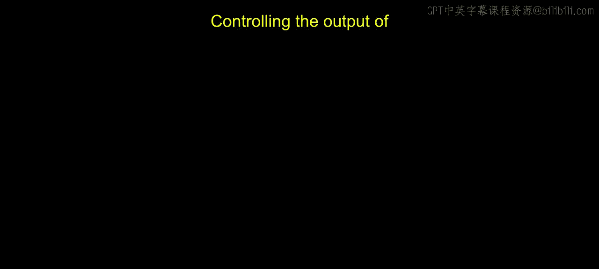

Controlling the output of the language model is a difficult task。

 and as you saw in the previous lecture， we can use few shot prompting to help with some of these kind of formatting requirements。

 but it can be a bit tricky to have the model just stop after one item。Thankfully。

 Lama CPP has a couple of other mechanisms we can leverage to improve our control over the model output the first of these is called the stopping criteria。

 so I'm just going to load and configure the model as usual and this is the noncha model so the base model。

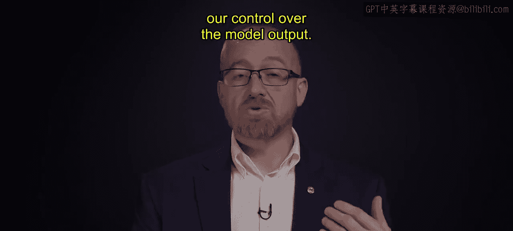

So the most blunt way to stop the LLM generation is to indicate the token or tokens that you want to break on in a list when you call this create completion。

 and so the way we do that is we just indicate here a list of all of the tokens。

 these end up being tokenized， of course they're not tokens themselves here and if any of these is identified in the output stream and when it's identified the processing will stop。

So we'll see in this example that it actually stopped because it ran into likely a period。

 the period doesn't actually come into our output format that's gobbled up by the stopping。

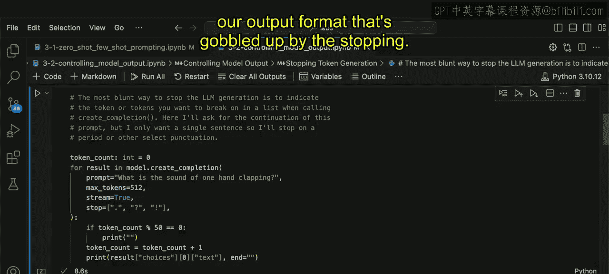

Now， this form of stopping is actually done in the Python library itself and not the underlying Lama CBP。

There's also an option to set a callback function though， to determine when to stop as well。

 and this stopping criteria is actually done in Lama CPP itself。Now I have a confession here to make。

 this is a sort of frustration that I have with some of the tools that we're using while the tools work well。

 the docs sometimes lag or or unclear the newness of these tools and the lack of a clear standard or even a dominant tool for development in this space also makes it a bit of a hard work to understand what's happening under the hood。

If we go to the documentation on the Lama CPP Python Bidings website。

 we see that the stopping criteria is actually a list of callable objects， so functions。

 which take in two parameters， both nuumpy arrays。The first parameters is an array of unsigned ints and the second an array of single precision float values。

The expectation here is that the callback function will return a boodion。

 presumably whether we should stop processing or not。

I think this is actually a bit easier to understand if we just use the debugger to take a look。

 so let's do that now。

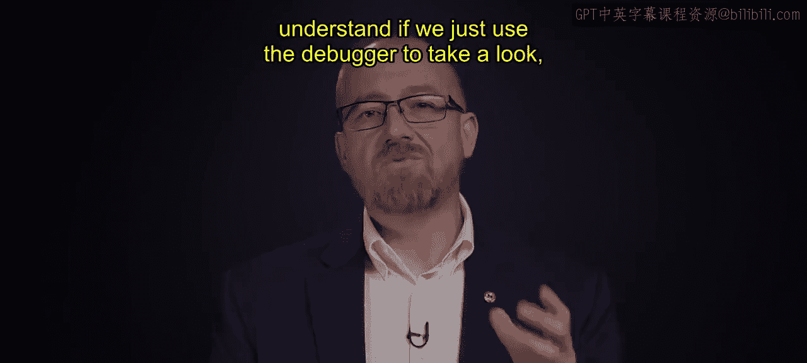

So I'm going to define this function for our stopping criteria， the should stop。

 and this just follows the exact signature as we talked about， it。

 takes the input IDs and the logicits and it's going to return a Boolean and here we're just going to always return false。

We're going to set up the model the exact same way。

 but one of the differences I'm going to do is I'm going to add one of these debug breakpoint。

 and so I'm going to set a breakpoint here on the return false in particular。

 to debug this cell in VS code， we actually use this drop down and then debug cell。

 So normally when you run a cell， you either use run from the toolbar or a control enter。

 but here I want to debug this cell。So now the debuggers run and it's broken on this line。

 which means our callback is being called， and you can see we have this debug toolbar up at the top and we can use that to control some of the back and forth。

So in the debug panel to the left we can see our local variables and so we've got this input IDs variable and the logics variable and those are right here input IDs and logics from our should stop function that's been created if we expand the input IDs we'll see a whole bunch more information about it one of the things that we'll see if we scroll down here is its shape and its size that indicate that there's 11 values in it Now they're all numbers and those numbers are actually of size4 themselves。

So take a moment to think about this based on the problem and what we've talked about so far。

 what do you think those numbers actually are？It turns out that these are a sequence of tokens。

 If we expand the global section of the debugger， we could see that the Lamo object is here as a model。

 We looked at tokenization previously， and the model object has a handy function to detokenize a sequence。

 converting it back to the text representation， which is much more familiar to us to do this。

 we've got a couple of options available to us。 and I'm going to show you both just in case you're unfamiliar with the VS code debugging facilities。

 The first is to add a watch variable。 This is some expression which will persist across various debugging runs。

 and it's a handy method when you're debugging loops。 I'm going to add the watch expression here。😊。

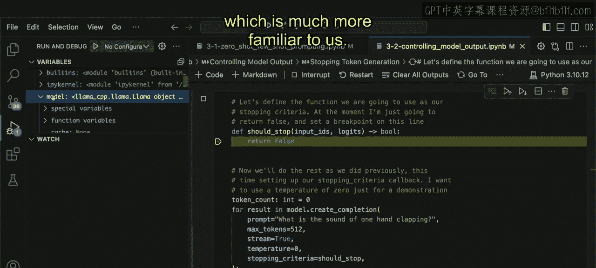

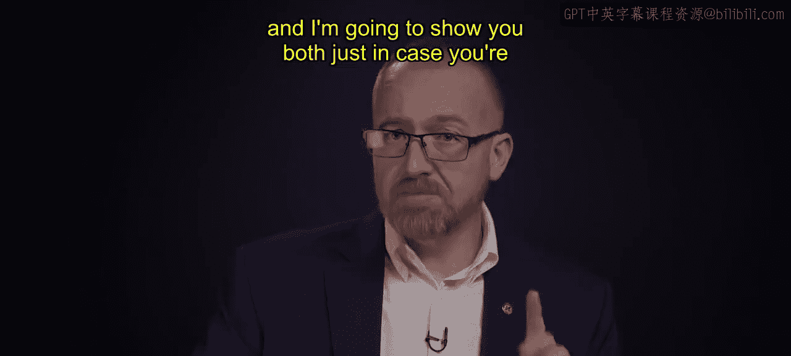

So I just hit plus and what I'm going to use is model dot D tokenize。And then pass in input Is。

 Once I do this， it becomes much more clear that the prompt actually is what's in here。

 and we can slide this window over a little bit more。 What is the sound of one hand clapping。

 So that's great。 It's very clear here that the input Is are the tokens in a sequence。

 And when we detokenize it， we get our prompt back。

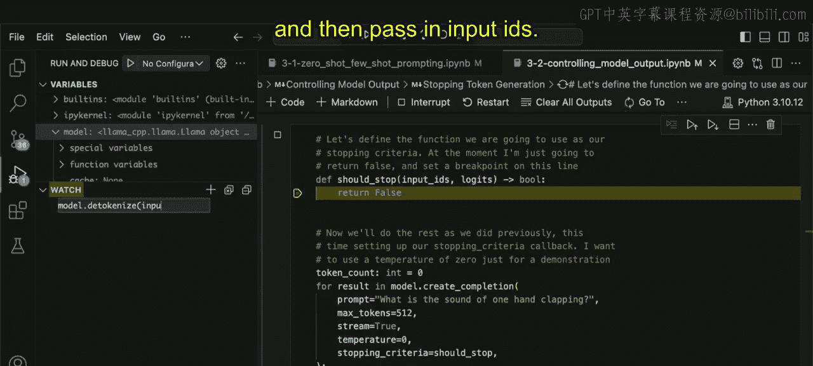

Another option is to use the debug console at the bottom of the window。

 this allows you to write arbitrary Python to interact with the interpreter if I put the same code here。

 we should get the same result。

So a handy way to do this is we just go up to view and we can indicate that we want the debug console and now we've actually got a full on console。

 a Python interpreter or access to the running Python interpreter and we can put the same code in here。

Great， so we get the exact same output， and these are two different ways you can use the debugger when we're broken on a line when we've actually stopped to actually inspect the state of the Python interpreter。

 Now this isn't at all unique to Lama 2。 but it's an important skill that you need to have if you want to be able to understand new and emerging packages。

 If you haven't seen this before， I'd encourage you to try it out and perhaps look up a video to on debugging in VS code。

 if you can master your toolkit。 your ability to solve problems will increase twofold。

 Now let's go back to this function。 We're returning false here。

 and that indicates that we shouldn't actually stop processing。 We have a couple of options。

 if we just want to keep running， we can press this play button at the top or we can hit F5。

 So I'm just going to press this a few times。😊。

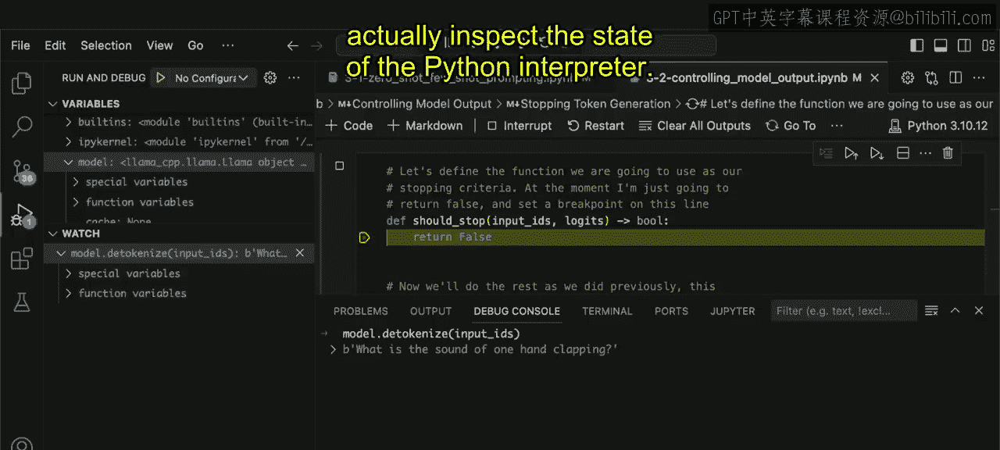

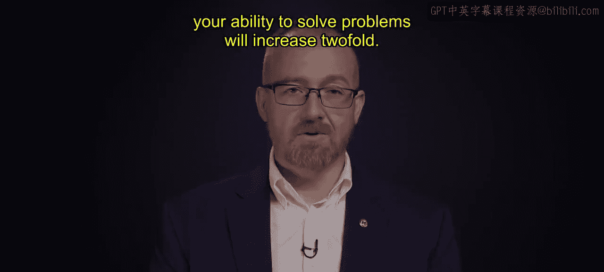

You see that when I press it， the Python interpreter starts up and then it breaks again because the next token has come through。

 If we press it a few times。Then we can go and look at our text string here and we see what is the sound of one hand clapping slash n the sound of has been returned now that we understand that input Is。

 let's turn our attention to the logics the logics is huge 32。

000 items so you can imagine that this aligns with our vocabulary。

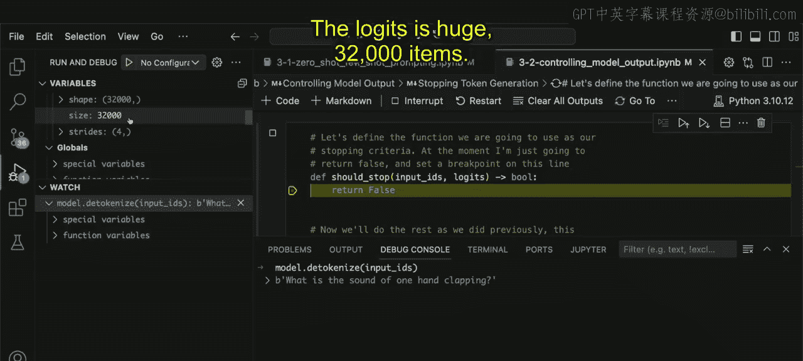

Each of the values in the logs arrays， the log odds that a given token will be the right one for the next response Now don't let this scare you away。

 the log odds， a logit is basically just a probability value that ranges from negative infinity to positive infinity。

I'm not going to go into details about how this mapping is actually done。

 but what we actually want are the values here that are closest to zero。

 these are our most likely candidates and the values which are out towards positive or negative infinity are our least likely candidates。

To do this， I'm going to first import numppy， and then I'm going to take the absolute value of the logs array。

 and to sort it by size， then take the last five items。

 these are going to be our five closest to zero and detokenize them to see if they make sense。

Keep in mind that when you see the string output， it's actually in reverse order。

 the most likely token and then is the very last one。

 so we can slice the last five items using the Numpy syntax to reverse them。

So we can see that the best choices the model has suggested are the tokens 1， a， the two and silence。

 and where it's gotten to thus far is what is the sound of one hand clapping。

 the sound of and you can see all of these would make sense， the sound of one。

 maybe it's going to go off and talk about one hand clapping， the sound of silence， great song。

 and so forth。

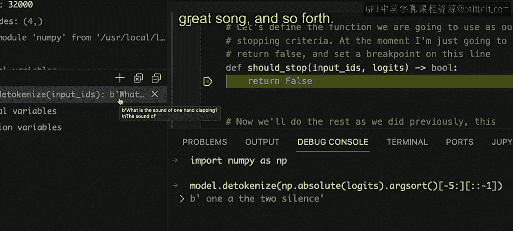

Okay in this lecture I wanted to show you two different ways that you can control the output of the LLM The first is through a sequence of stopping items that you provide as a list and the second is through the stopping criteria where you can provide multiple different callback functions which operate on the underlying probabilities of the model responses both are useful and you can imagine that with a function in the stopping criteria。

 you can do anything that you might want to do in Python。

 including validating that the response fits a specific regular expression pattern or even raising a partially completed prompt to another service。

 a process or a person to validate along the way I demonstrated how you can use the VS code environment to dig into the underlying operation of the LLM and frankly I just showed a really simple example once you've mastered debugging skills within the platform you can quickly pick up software packages like Lama CPP's Python bindings by just stepping through the code to see how it works。

I think that this is an incredibly important developer skill that often we don't do a good job of teaching。

 so I hope you'll consider exploring this on your own to better understand the Lama CPP package and how it works。

