# 密歇根大学《Python程序员的羊驼”课程｜Llama2 for Python Programmers》中英字幕 p12 11_使用语法.zh_en -BV1vi421a7NL_p12-

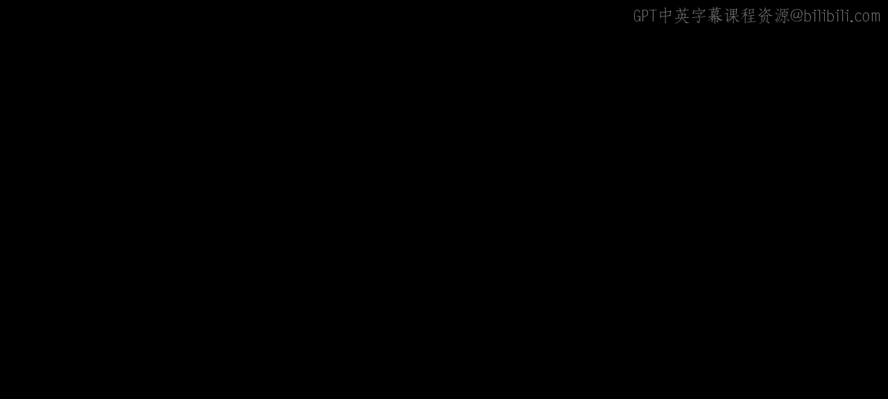

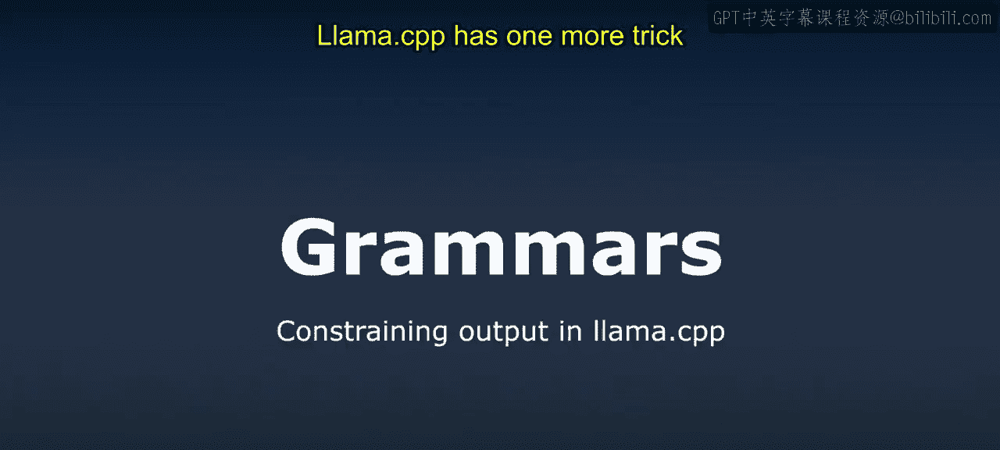

Lama CPP has one more trick up its sleeve to control model output。

 and that's through a concept called grammars grammars are formal definitions for the syntax and semantics of documents and they describe and define most of the processes we take for granted when using a computer。

 theyre grammars for programming languages for web documents。

 for protocols to download or even reference resources on the web and so much more。

The principal language for writing grammars and computing。

 both used for web standards and used in Lama CPPP， is called the extended Bas Now form， or EBNF。

Now if you don't have a traditional computer science background which includes courses on formal languages or compilers or maybe like me you haven't been writing EBNF documents since grad school。

 you might need a little refresher， so let's take a look at what an EBNF grammar looks like and then we'll see this in action with the Lama CPP stack。

Now for this task， I went back to using Lamma2 to generate multiple choice questions if you'll recall from the lecture on fu shot prompting。

 we could just give a prompt which is an example of what we're looking for and the language model will complete it with a high probability of adhering to the syntax and the semantics we put in the prompt。

There's actually a really simple format for multiple choice questions called the Acon format here's an example and this question is actually all about fungi and mushrooms several years ago when we were all at home。

 my daughter and I began to grow gourmet mushrooms as a project to better understand the fungal world around us and I thought it'd be nice to get a set of questions together to refresh or maybe even stretch our knowledge。

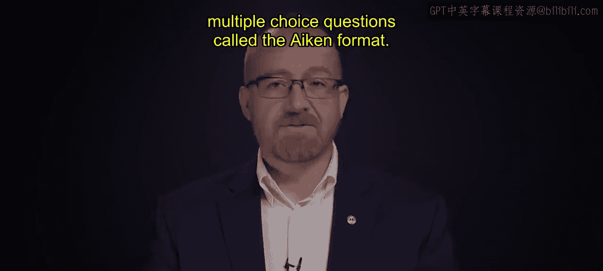

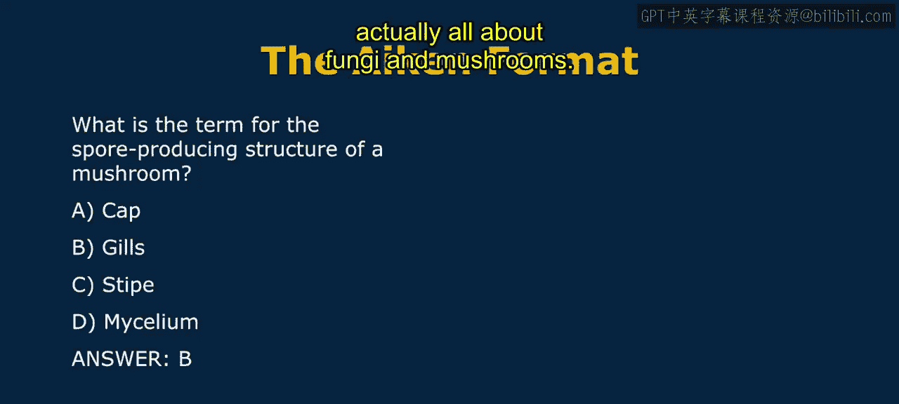

In the an format， a question is a sentence or two followed by a list of choices。

 each denoted by a capitalized letter， followed by a single line which has the word answer in all caps and indicates which letter is correct。

Let's translate this simple format into the extended BNF format used by Lama CPP。

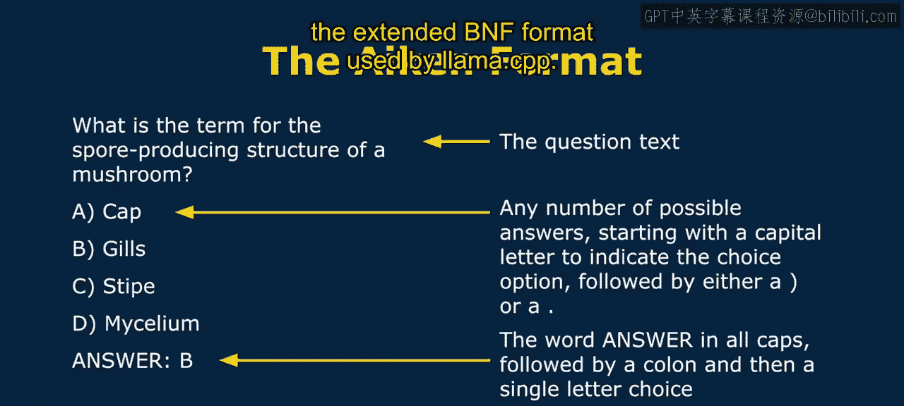

At the highest level， you can think of a grammar as a set of rules where the left hand side indicates the rule name。

 these are called non terminalmins， and the right hand side indicates the available formatting choices for that rule。

The formatting choices can be made up of any non terminal references as well as terminals。

 which in this case are all string values。Many of the conventions we would find with regular expressions are also supported。

 such as indicating the kinds of characters which can be outputted or whether given text value is optional or required in Lama CPP we always start with the root rule。

 I'm going to model the root is being made up of a question。

 at least one answer and an epilogue and this is what I'm calling the line which will indicate which answer is the correct one。

 and then I'll put a new line character at the end。

For this group of things， I want to be present at least once。

 but potentially any number of additional times or questions is always better。

 you'll notice here that the only terminal I have on the right hand side is the new line character。

 which means I'm going to have to create at least three more rules， one each for the question。

 answer and epilogue。Also， the plus sign here indicates that an item must exist at least once。

 but could appear multiple times， if there is no indicator， then it must appear once and only once。

 Lama CPPP grammars also allow you to indicate whether something appears zero or more times with an asterisk or is completely optional with a question mark。

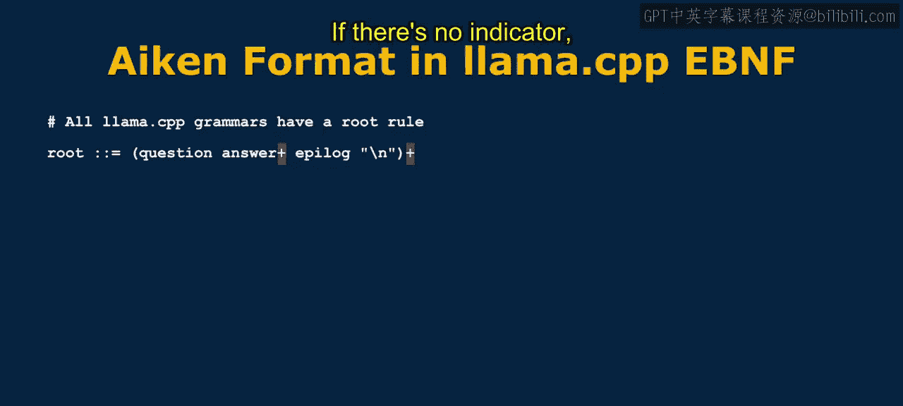

Before we go on to create those rules though， I want to add a helper rule which defines a sentence When I first started using fu shot prompting to generate some of the questions。

 I found that Lama2 would add more explanation than I wanted in the answers。

 including often large parenthetical statements that basically gave away the answer。

Now there's no way to constrain the length of the number of tokens returned except for the plus asterisks or question mark symbols。

 but given that Lamatu is trained on large amounts of natural text， we can constrain it a bit more。

 which will help guide how much it responds。

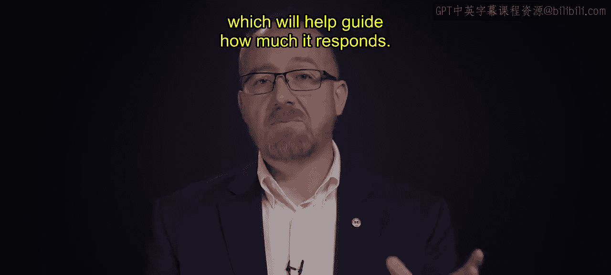

I'm defining a sentence here to start with a capital letter。

 and I'm only using a Latin alphabet by giving the A is Z range inside of square brackets。

 Then the model is free to choose any capital， lowercase or numeric characters。

 as well as a space a comma a period or a question mark。

 I'm not allowing parenthetical statements in this grammar。

 but the asterisk gives quite a bit of freedom for the model to determine how long the sentence actually is going to be。

Note that all of the items on the right hand side of the sentence rule are terminals。

 and there are no rules on the right hand side。Moving on to the question。

 I'll just reuse the sentence rule we created， I want a question to be a sentence that ends in a new line character where two sentences separated by a space and then ending in a new line character。

 it's a simple rule that should give me a few more options than a single sentence alone。

In our root rule， we indicated that at least one answer must exist。

 but that there can be multiple answers。 I'm going to define an answer as starting with a single capital letter followed by a closing parenthesis and a space。

 then a sentence and a new line character。 This aligns well with my few shot example data and should suffice for my needs。

Note that there's no easy way to enforce that answers need to have a unique label or that they must go in alphabetical order。

Finally， we end by adding in the epilogue， which is the word answer in all caps followed by a colon and a space。

 and then the letter which is the correct answer Now this isn't a perfect representation of the Akin format。

 but it does demonstrate the basics of what is supported and the Lama CPP documentation includes more information in several other examples。

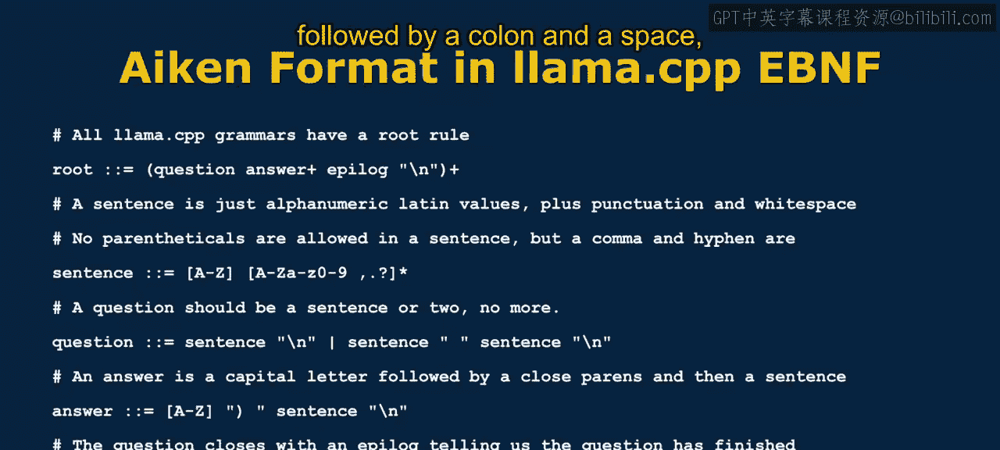

Now that we've defined the grammar， let's go see how to use it in Lama CPP。

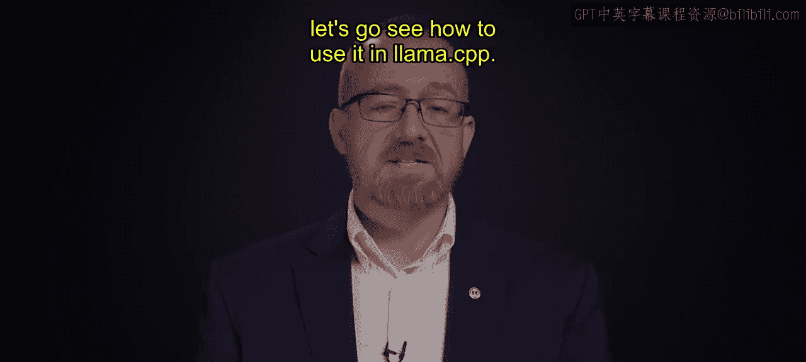

Okay， so I'm just going to load the model and you'll see here I'm using the base model。

 not the chat model， and I've set the context window to about the half size 2048， which is quite big。

Here I've got a number of different prompts， a number of different examples， if you will。

 a few short examples of questions all in the AN format。Now， our grammar。

 let's talk through the grammar here。We're starting with the root。

 which is a question in a number of answers and an epilogue followed by a slash N One thing that's interesting about the grammar in Lama CPP is that we can have comments in here。

 so I've included some of those comments。So the grammar is exactly as we talked about it in the lecture Now when we want to invoke this on the model。

 all we do is indicate that the grammar should be sent in here。

 so here I'm just adding the model create completion I'm indicating the grammar I want enforced。

 indicating that I wanted to stream and giving it the max number of tokens Now let's see this in action。

Okay， so we see here that we've got the grammar being described as a graph and that we're starting to get responses back from the Lama2 engine for inference just finishing off our questions。

 creating for us more questions ideally in the Acon format， and if it's not in the Acon format。

Then we must have hit the very end of the processing because Lama CPP is changing those logics underneath。

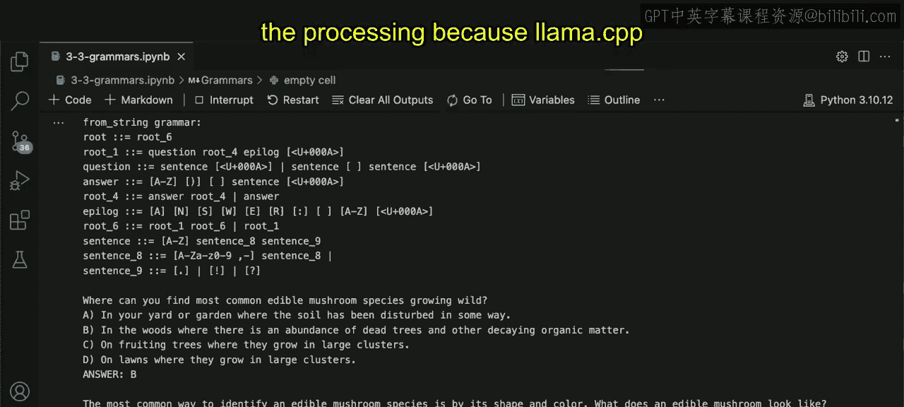

Now that you know how to use the grammars to enforce a kind of output from Lama 2。

 we should touch on how it works underneath。Remember。

 the model itself is only predicting the next token based on the input set of tokens。

 and it does this by examining the logics for all of the tokens available and then uses the various parameters like temperature to sample from that set。

The way Lama CPP enforces grammars is that it sets the value of the loits for the tokens which do not conform to the grammar to negative infinity。

That's really all there is to it Lama2 actually has no knowledge or role here。

 it's a statistical machine choosing tokens based on their logics the toolkit on top of the model is changing the weights of possible tokens to enforce a syntax that we're interested in。

And to be honest， using grammars is a bit like trying to build a birdhouse with a sledgehammer you see the model isn't planning to conform to the grammar or even aware of the grammar if you try and use a grammar without few shot prompting。

 you're likely to be really disappointed in the results。When you have multiple examples。

 the model can learn from the patterns in those examples。

 this is called in context learning because the examples exist within the context window。

There are other options that are available to you， for instance。

 you could just try a few shot prompting then enforce the grammar in your application code using whatever parsing libraries you might want。

 or maybe you could finet the model based on some known good training data though this is relatively expensive in comparison Now I rarely use grammars and when I do it tends to be in situations where I'm sending a query or variances of a query to multiple small models and then taking a majority vote on the results coming back。

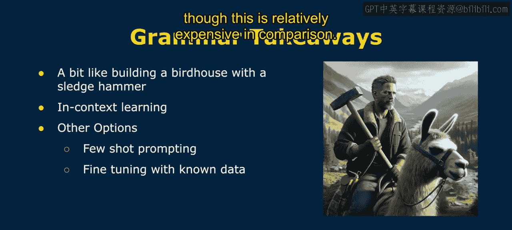

