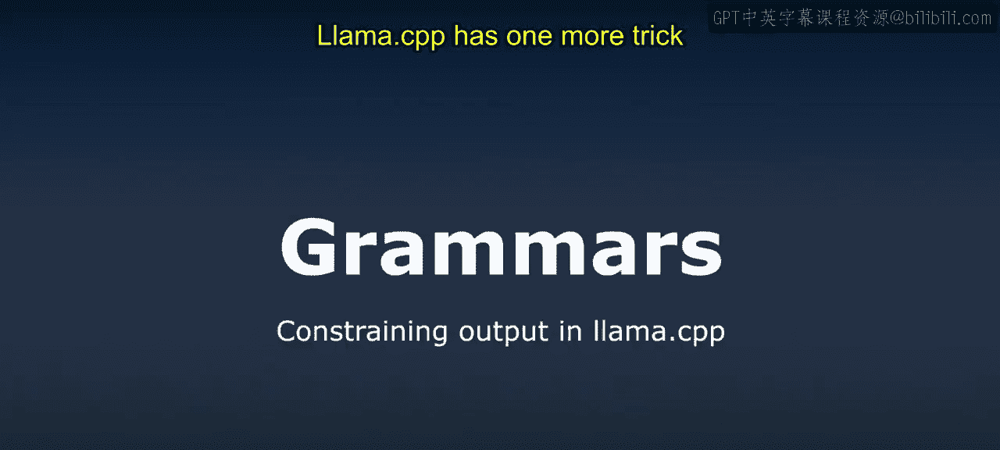
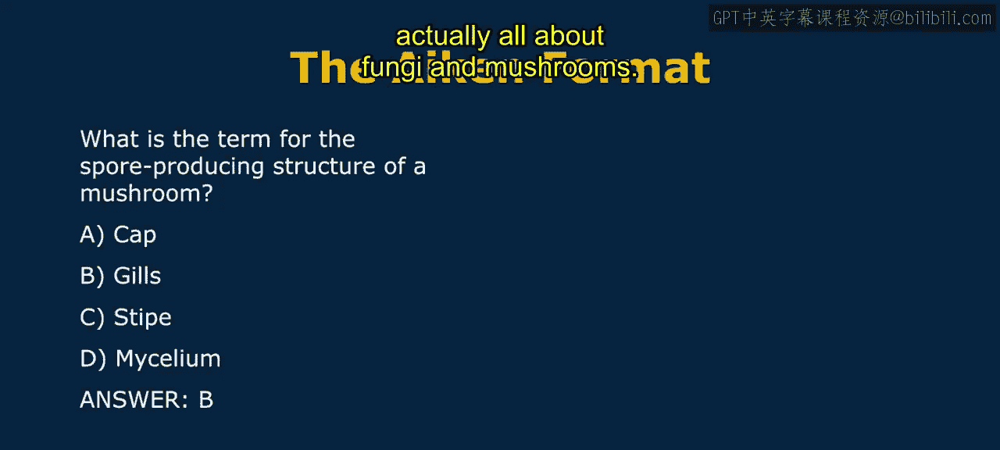
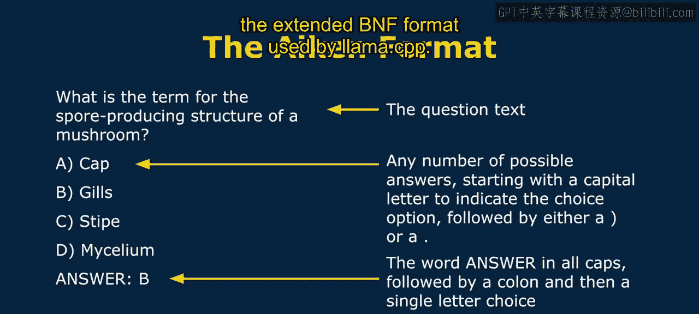
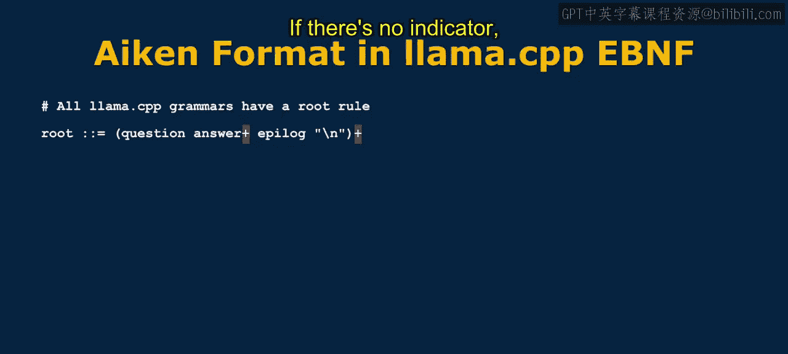
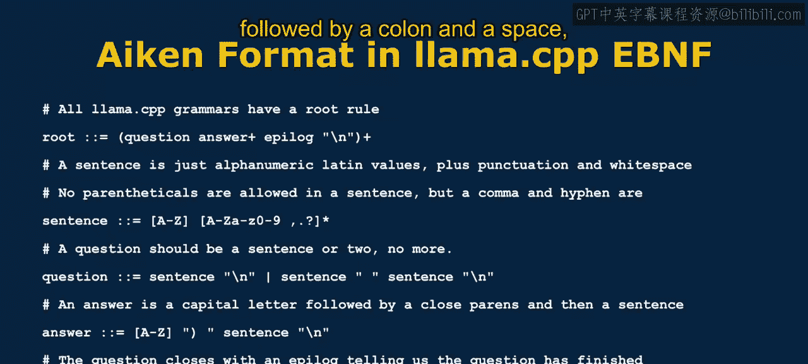
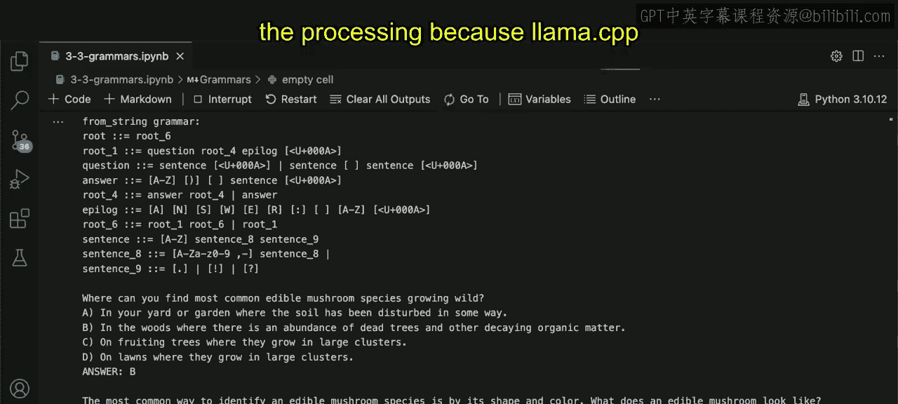
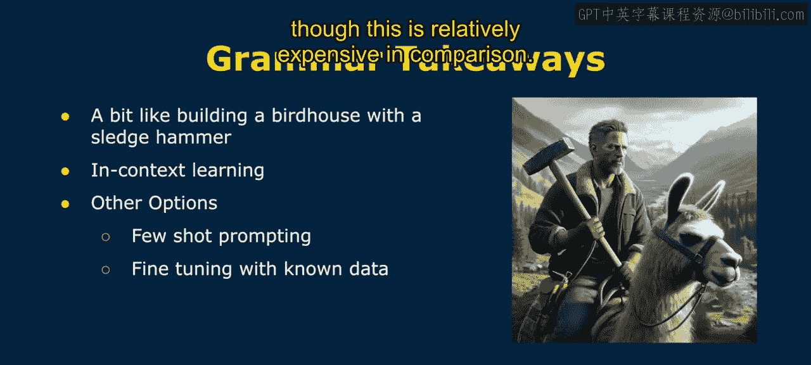

# Python程序员的羊驼：12：使用语法 🧠




在本节课中，我们将学习如何使用Llama CPP的“语法”功能来控制语言模型的输出格式。语法是一种形式化定义，用于描述文档的结构和规则。通过定义语法，我们可以强制模型按照特定格式（例如多选题的Aiken格式）生成文本，从而获得更结构化、更可控的输出结果。

上一节我们介绍了如何通过提示工程来引导模型，本节中我们来看看如何使用更严格的语法规则来约束输出。

## 语法基础与EBNF格式

Llama CPP使用一种称为“扩展巴科斯范式”的语言来定义语法。EBNF是一种用于描述编程语言、文档格式等正式语法的标准方式。即使你没有计算机科学的背景，理解其基本概念也并不困难。

一个EBNF语法由一系列规则组成。每个规则包含一个左侧的“非终结符”和一个右侧的格式定义。右侧可以包含对其他规则的引用，也可以包含具体的“终结符”（即字符串值）。





以下是定义语法时的一些常用符号：
*   `rule ::= definition`：定义一个规则。
*   `"text"`：一个具体的字符串终结符。
*   `(a | b)`：表示`a`或`b`。
*   `[a-z]`：表示从`a`到`z`的字符范围。
*   `item+`：表示`item`必须出现至少一次，可以出现多次。
*   `item*`：表示`item`可以出现零次或多次。
*   `item?`：表示`item`是可选的（出现零次或一次）。
*   没有符号：表示必须出现且仅出现一次。



## 构建一个多选题语法示例

我们将以生成Aiken格式的多选题为例。Aiken格式非常简单：一个问题句子，后跟多个以大写字母标记的选项，最后一行以`ANSWER:`指明正确答案。

我们的目标是创建一个EBNF语法，强制Llama2模型按照此格式输出。


首先，我们定义最顶层的根规则。一个完整的输出应包含一个问题、至少一个答案和一个指明正确答案的结尾。

```ebnf
root ::= question answer+ epilogue "\n"
```



接下来，我们需要定义`question`、`answer`和`epilogue`的具体规则。在此之前，我们先创建一个辅助规则`sentence`，用于控制句子结构，避免模型生成过长的解释或括号内容。

```ebnf
sentence ::= [A-Z] [a-zA-Z0-9 ,.?]*
```
这个规则规定：句子以一个大写字母开头，后面可以跟任意数量的小写字母、数字、空格、逗号、句号或问号。


现在，我们可以基于`sentence`规则定义其他部分：

```ebnf
question ::= sentence "\n" | sentence " " sentence "\n"
answer   ::= [A-Z] ") " sentence "\n"
epilogue ::= "ANSWER: " [A-Z]
```

*   `question`：可以是一个句子加换行，或者是两个由空格分隔的句子再加换行。
*   `answer`：以一个大写字母、一个右括号、一个空格开始，接着是一个句子，最后换行。
*   `epilogue`：以字符串`"ANSWER: "`开始，后跟一个大写字母。

将以上规则组合起来，就得到了完整的语法定义。

## 在Llama CPP中应用语法

定义好语法后，在代码中使用它非常简单。在调用模型生成文本时，只需将语法对象作为参数传入即可。



以下是关键代码示例（概念性代码）：
```python
# 加载模型
model = Llama(model_path="llama-2-7b.gguf", n_ctx=2048)


# 定义你的提示词（包含少量示例）
prompt = """What is the capital of France?
A) London
B) Berlin
C) Paris
D) Madrid
ANSWER: C

"""

# 定义语法（使用前面描述的EBNF字符串）
grammar_str = """
root ::= question answer+ epilogue "\\n"
question ::= sentence "\\n" | sentence " " sentence "\\n"
answer   ::= [A-Z] ") " sentence "\\n"
epilogue ::= "ANSWER: " [A-Z]
sentence ::= [A-Z] [a-zA-Z0-9 ,.?]*
"""
grammar = LlamaGrammar.from_string(grammar_str)

# 使用语法生成文本
output = model.create_completion(
    prompt,
    grammar=grammar,
    max_tokens=150,
    stream=True
)
```
当模型运行时，Llama CPP会在后台根据语法规则，将不符合当前语法位置的token的logits（概率分数）设置为负无穷大，从而确保模型只能从符合语法的token中进行选择。



## 语法的工作原理与局限性

语法强制的工作原理本质上是**后处理筛选**。模型本身依然在预测下一个token，但工具包（Llama CPP）在采样前修改了token的概率权重，屏蔽了所有不符合语法规则的选项。

需要认识到语法的局限性：
1.  **模型无感知**：模型本身并不“知道”或“理解”语法，它只是在被限制的范围内进行统计选择。
2.  **需结合少量示例**：单独使用语法而不提供格式示例（少量提示），效果往往不佳。结合少量示例，模型能通过上下文学习更好地适应格式。
3.  **并非万能工具**：就像用大锤做鸟窝，语法是一个强大的强制工具，但可能不够精细。有时，先让模型自由生成，再用代码解析和验证结果，可能是更灵活的方法。


因此，语法的典型使用场景包括：需要与多个小型模型交互并确保返回格式统一以便进行多数投票时，或者在自动化流程中必须保证输出能被下游程序准确解析时。

## 总结

本节课中我们一起学习了如何使用Llama CPP的语法功能来控制模型输出格式。我们了解了EBNF的基本写法，动手构建了一个用于生成Aiken格式多选题的完整语法，并看到了如何在代码中应用它。最后，我们探讨了语法在底层的工作原理及其适用场景与局限性。




语法是一个强大的工具，它能将语言模型的自由创造力引导至我们所需的结构化框架内。掌握它，能让你在构建依赖LLM输出的应用时，获得更高程度的可靠性和可控性。