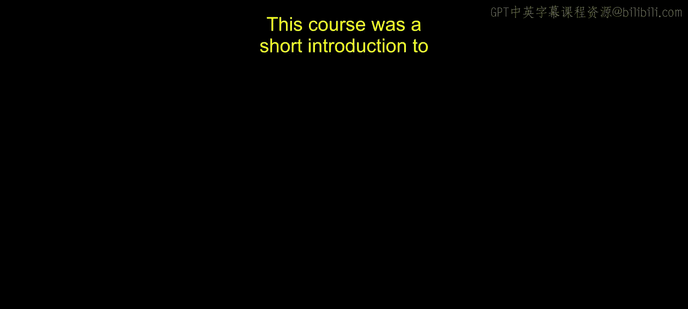
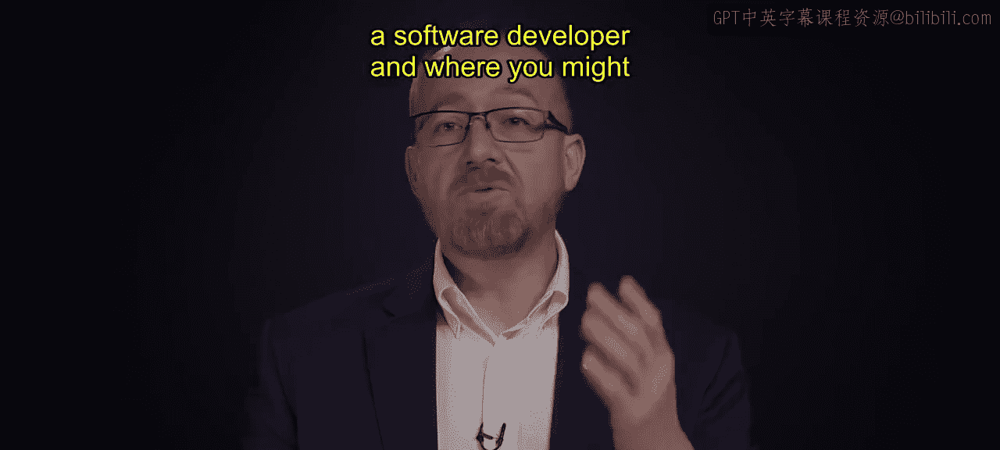

# 密歇根大学《Python程序员的羊驼”课程｜Llama2 for Python Programmers》中英字幕 p13 12_课程结论.zh_en -BV1vi421a7NL_p13-

This course was a short introduction to the open source Lama2 model from Meta we've talked through the different flavors of Lama2 which are available。

 the base， chat and code models， as well as the challenges of using these models。

 given that they have 713 or even 70 billion parameters in them and are tens of gigabytes in size。

You've learned how quantization， the act of compressing the models by reducing precision。

 allows for the models to be used on commodity hardware you might already have。

 and how Lama CPP allows you to use and mix CPU and GPU for model inference。

We've gone further and gotten our hands a little dirty too。

 looking at how tokenization works and why this is so important in large language models。

 where sequences of tokens are the primary input and output structure that the model works on。

You also saw how various parameters such as temperature。

 top P and top K can be used to change how the model responds to a given prompt。

 and that underneath it all involves sampling from a pool of potential tokens based on their probabilities the logics in the last module of this course we explored how prompting strategies such as few shot prompting as well as Lama CPP API mechanisms such as grammars can be used to guide and constrain model responses。

 This has just been a taste of how application developers can work to integrate Lama2 and build compelling language model applications。

We talked a bit about fine tuning， but the details of that are enough for its own course。

 we also touched on how the software ecosystem around these open source models gives us new capabilities such as grammars。

 now that ecosystem has been rapidly expanding and there exist large software frameworks for higher abstraction。

 things like Langchain， Lamma index as well as DevOs environments for model serving and production such as VLLM。

There's a lot to learn in this space， and I encourage you to read broadly and regularly in tech forum。

 as well as to use your development tool chain like the VS code debugger to understand new technologies as they come out。

We have one more course activity， a coding assignment， but before we go there。

 I'd like to ask you to reflect on the course from the position of your day to day experiences have you learned something here about Lama 2 and Lama CPP。

 which you think you can use in your daily life， whether it be for work， school or other pursuits？

Feel free to share with me how this course relates to your goals as a software developer and where you might be going next with this exciting technology。

