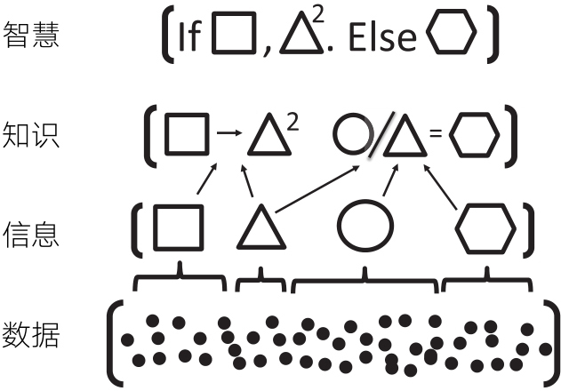

# 手里多备几把尺子

有位投资家提醒过：想变得明智，脑子里不能只装一套解释世界的方法；无论经验来自亲历还是旁听，都要挂到多套认知架子上对照。

这本书谈的就是这些认知架子，也就是人们常说的“模型”。作者用不绕弯的语言梳理几十种工具，并说明怎么用。所谓工具，是把现实压缩成可推演的方程、图形或规则组合，帮我们看见世界的骨架。练熟不同工具，推演、说明、设计、交流、行动、预判、探索的本领会一起长。

书里主张的是复式思考：不要指望一条逻辑链包打天下，而要让多套彼此不同的推理框架共同催生判断力。每套框架会照亮不同的力量，它们给出的洞见互相覆盖、缠绕。只有把多套框架并置，才可能对世界形成既丰富又细密的把握。书里也给出较正式的论证，说明这套办法怎样落到现实中。

这套办法很实在：面对复杂局面，推演更稳；在职场、社群和私人生活里，判断与选择更少失准；甚至可能让人显得更明智。

四分之一个世纪前，这类书多摆在教授和研究生的案头，服务于商科、公共政策和社会科学；金融分析人员、保险精算人员、情报研判人员也是常客。他们整天和海量资料打交道，这并不奇怪。如今读者圈已经扩张到大量靠信息吃饭的人。数据洪流一来，框架成了日常装备。

今天，商业谋划、城市设计、经济研究、医疗判断、工程开发、保险定价、环境评估等岗位，都把“用框架组织数据”当作硬本领。只要工作里涉及读数据、定路线、分资源、做产品、写合同，哪怕只是招一个人，都离不开模型化思路。书里关于创新、预判、信息加工、学习曲线、进入市场时点的那部分，对很多人都有直接用处。

比工作效率更重要的，是它会改变一个人的思考质地。你会更会评估接连冒出的经济与政治事件，更容易识破自己和旁人推理里的漏洞；也会懂得分辨什么时候意识形态挤走了理性，对扩建绿地、强制药检之类的政策建议，能看出更立体的层次。

这些好处来自和多种工具长期打交道。好消息是，不必一口气吞下成百上千套，先握住几十套就够用。书里挑出来的这些就是不错的起点。它们来自不同学科，既有大家熟悉的囚徒两难、向下竞逐，也有描述疫病扩散的三分法框架。它们大多先设定若干角色——人或机构——再说明这些角色怎样彼此影响。

书里谈到的工具大致分三路：把现实削简的、借概率做类比的、人为搭建出来供探索的。形式不同，但都得“好上手”。只有足够简洁，才能在其中做逻辑推演。以疫病传播为例，把人群分成未染病、正在染病、康复三类，就能推出扩散概率、越过哪个临界点会蔓延，以及需要多少人打疫苗才能拦住。

单套工具已经有力，成套工具能做得更多。多套并用，可以避开每套工具自带的死角。只靠一幅地图做政治选择，容易漏掉贫富鸿沟、身份差异、系统之间的牵连。几幅地图叠在一起，才能对多条流程做推演，看见不同因果过程怎样叠加、互动，也才可能理解经济、政治和社会世界的复杂。这样做并不牺牲严谨，因为框架思维本身要求逻辑自洽；判断也建立在可检验的证据上，因为工具要拿数据去检验、修正、打磨。总之，当思考跑在多套逻辑自洽、经过经验检验的框架里，做出明智选择的概率会明显上升。

### 数据汹涌时，为何还要框架

在数据铺天盖地的今天，出一本谈框架的书好像有点逆潮流。信息正以更细的颗粒、更快的速度涌来。零售账单不再只是月底一张汇总表，而能带着时间、地点、顾客标签一起流动；孩子的学习记录不再只有期末总分，而细到每次练习、每篇作业；田地干湿与肥力，由农机按平方米回传；资管机构盯着大量证券的几十项指标，还用语言处理工具读文件；大夫调阅病历时，连相关基因信息也能一并看到。

四分之一个世纪前，多数人的知识来自书架上有限的几本书，或单位小图书室、家里的百科。学者即使能进大图书馆，也常要亲自跑卡片柜、翻缩微胶片，在书架与私人收藏之间穿梭。

现在，被纸张困了几个世纪的内容，以数据包的形式在空中流动；此时此地的消息也一样。新闻从每天一份的报纸，变成持续不断的数字流。证券价格、比赛比分、政治经济与文化动态，随时可查。

但数据再惊人，也不是包治百病的药。它能告诉我们发生了什么、正在发生什么，却常说不清背后的缘由。眼见的事实也可能把人带偏。按件给钱的统计常给人奇怪印象：每件酬劳越高，出货反而越少。真正起作用的可能是干活环境。环境差，做出一件很难，单件酬劳就显得高；环境顺，单件酬劳自然低。所以不是高单价压低了效率，而是糟糕条件同时塑造了两者。

而且经济、社会、政治类数据往往只是长时段里的一个切面，不能直接当成永恒规律。世界本身在动：这十年某类学生在统考中领先，下个十年可能换人领先；今天选民走进投票站的理由，几十年后未必相同。

没有框架，我们很难读懂眼前不断刷新的信息流。也正因如此，这个年代或许该叫“复式思考的年代”。环顾学术、政府、商业与公益领域，几乎找不到完全不受框架影响的研究，也几乎找不到不需要框架的决策。咨询公司用推演工具定商业路线，资管与投行用工具挑资产，保险公司用风险校正工具定价，大型互联网企业的人力团队用预测式分析筛候选人，高校招生办用规则从海量申请里挑人；联邦预算机构用经济模拟测算税收方案，影视公司用数据工具判断观众反应，电商平台用学习算法推荐商品，医学研究团队用遗传信息数学工具寻找癌症疗法，公益基金用疾病扩散框架安排接种方案；连职业球队也靠工具评估新人、换人与战术。那支熬过百年低谷后夺冠的棒球队，就是选人和布阵都借了框架之力。

对使用者来说，更直白的理由是：框架能补脑。没有它，人容易被认知陷阱牵着走——最近发生的事被放大，概率按“听起来合理”来分，底层比例被忘在一边；面对海量资料也容易手忙脚乱。有了框架，假设被摊开，推理更有章法，还能拿数据去校准、验证因果与关联。总的说，思考效率会上去。甚至有实验显示，让框架与人对垒，框架常常赢。

### 为什么不能只靠一套解释

书里主张在具体情境下同时拿几套工具，而不是抱住一套不放。这个道理并不新，古人就说过，看豹子不能只从一个竹管望出去。古希腊哲人强调过把众人的长处汇到一起；西方经典阅读计划也相信，多摆几种视角，才接近完整。一套经典观念汇编收了百余个可长久流传的思想，背后也是这个信念。

一位华裔作家写过，要把心胸和思路撑开，天地这么大，矛盾当然有地方安放。现实中的商业与政治行动也需要这种容量。理解国与国之间的互动，既不能只把参与者当成目标明确的逐利行为体，也不能只当作企业与官方机构之间的连接网，而要把两幅图叠在一起。

道理看似平常，却和过去课堂上的教法相反。老办法常是“一道题配一套公式”：这类题用运动第一规律，那类题用第二规律；解释兔群规模变化，就搬出某个复制方程；目标是找到唯一合适工具并套准。复式思考偏偏要打破这种唯一答案的执念，鼓励同时拿几套工具试手。初中低年级时这么做，老师也许会觉得你跑题；今天这么做，反而可能让你走得更远。

不少论文也延续“一题一解”：有人把某次大选的某类选民统一说成经济失意者；也有人把成年收入高低追到低年级老师质量上。近年的畅销书也常见单因解释：学习成绩只看恒心，贫富分化只怪资本聚集，健康状况只赖糖摄入。每条或许都抓住一角，却都撑不起全貌。面对复杂挑战，我们需要的不再是孤零零一根柱子，而是一张由多套框架编成的网。

学完书里的工具，你就可以动手编自己的网。它们跨学科，涉及贫富鸿沟从何而来、权力怎样分配、疫病与风尚如何扩散、群体冲突需要什么前奏、合作为何长出来、秩序如何自发出现，以及城市与网络空间的结构。

这些工具的假设和结构各不相同。有的写少数理性且自利的行为体怎样互动，有的写大量按规则行事的利他者；有的盯均衡，有的谈历史惯性与复杂。用途也不一样：有的用来说明和预判，有的用来指导行动、推动设计、促进交流，还有的搭出虚拟世界等你去探索。

它们共享三件事。第一，主动删繁，砍掉无关枝叶，抽象掉现实因素，甚至从零重造。第二，表达必须精确，常写成数学式或图示；把信念写成各种可能情形的概率，把偏好变成选项排序。删繁与精确化造出一个能动手推演的空间：可以在里面做有步骤的推演、摆出假设、设计方案、用数据校准。框架给了我们按逻辑思考的结构。逻辑能帮说明、预判、交流、设计，但也要付代价，于是有第三点：没有哪套框架能完全正确。统计学家提醒过，地图再精细也不是领土。连牛顿的定律也只在限定范围内成立。工具因删繁而漏掉细节；把几套工具摆在一起，让不同可能交叉，才能抵消单套工具因过度整齐而产生的窄视角。

只拿一把钥匙开所有锁，是危险的自信。一个公式包打天下，会让真理被漂亮而简洁的数学外壳绑架。谁也不能指望某套工具准确说出遥远未来的海面高度，或下一年度的就业景气。政经格局、国际互动、大脑运行都在变，常在秩序与偶然之间冒出结构。复杂现象本来就难测，单靠少数零件拼成的框架更不够用。即便牛顿，也写不出只含三个变量的公式来同时解释就业、选举与犯罪趋势。想理解疾病扩散、教育变化、物种丰枯、智能机器对岗位的冲击、气候影响、社会动荡风险，就得让统计学习、系统模拟、策略互动、个体仿真等多种工具一起上场。

### 从原始记录到判断力

为说明复式思考的好处，可以借一位诗人的连声追问：知识越积越多，智慧为何不见了；信息越滚越大，知识又去了哪儿？顺着这话，还能再问：数据铺天盖地时，信息是否也悄悄溜走了？

把这几问画成阶梯，就是图1-1。最底层是未经整理的原始记录：生与死、买卖、投票、听歌、下雨、球赛、物种出没。它们可能是二进制串、时间标记或网页链接，本身没有含义和结构。

**图1-1　从原始记录到判断力的阶梯**

上一层是信息：给原始记录命名、分堆。雨点落在你头上，那只是原始记录；某地某月降水总量，就成了信息。集市上红椒与黄玉米是眼前景象；把它们汇总成农户销售总额，就是信息。

今天信息多到溢出屏幕。一个半世纪前，谁掌握信息，谁就更容易获得财富和地位。十九世纪英国小说里，人物还把“消息灵通”当作择偶优点；换到今天，这问题几乎不成立：那位青年大概率也随身带着联网设备，真正的差别变成会不会筛选和运用。有小说家借人物之口提醒：真相不等于全部，分歧常常出在人们怎么使用事实。

知识比信息再上一层。古典定义讲“有依据的真信念”，现代说法更强调对关联、因果和逻辑的把握。知识把信息组织成可解释的框架：市场竞争的经济学说明、网络的社会学说明、地震的地质学说明、生态位形成、学习心理机制，都是知识形态。它们能说明和预判。比如分子间作用力的框架能说明金属为何坚硬到无法徒手推开钢制的门，也能说明人下水时身体为何有轻重变化。

最上面是判断力，也就是知道在什么场合挑哪套知识，并且真能用出来。它往往要求同时握住几套框架。有时是像从工具袋里抽出最合适的一把；有时是把多套预判取平均；行动时则像大夫安排几项化验再综合判断。有智慧的人会用框架排除坏选项、锁定好选项，也会让不同框架彼此参照，看看它们在哪里重叠、在哪里分歧。

这种判断力还包括选对知识。设想一只轻软的玩具豹从六公里高处的飞行器上坠落，落地会造成多大伤害？学生手里也许有两套思路：一套只算重力，另一套把空气阻力下的终端速度算进去。答案会完全不同。前者会让人以为它能砸穿车顶；后者告诉你，它落地前速度有限，大约每小时十六公里。真正的智慧是知道该用哪套思路。站在地面的人，伸手就能接住这只轻软玩具。有位进化生物学家打过比方：把田鼠放进很深的竖井，井底足够软，它落地只是晃一下还能跑；换成大老鼠会丧命，人下去骨头散架，马则连完整尸体都留不下。

**别再迷信“唯一答案”：真正的高手，都在让模型互相“对话”**

一个毛绒玩具从高处落下会怎样？要答对，光有数据还不够：知道它多重，是信息；懂自由落体规律，是知识；挑对适合的模型，才是智慧。企业高管和政治人物做判断，同样离不开信息与知识托底。

**一、冰岛很小，但“选对模型”这件事不小**

2008年10月9日，冰岛克朗开始像断线一样急跌。甲骨文公司的财务主管埃里克·鲍尔刚处理完美国房贷危机带来的冲击，又要面对新问题：公司持有数十亿美元海外资产，冰岛局势已引发国际关注。

他先想到金融崩溃的网络传染模型，又想到供需经济学模型——价格波动幅度与市场冲击大小相关。那年冰岛GDP只有120亿美元，约等于麦当劳半年的销售收入。鲍尔事后回忆：冰岛经济体量比美国弗雷斯诺市还小，“回去工作吧，不用多管”。

这里的关键，不是他把模型库翻个遍、只为既定判断找证据；他真正做的是检查两个可能派上用场的模型，再挑出更合适的那一个。正确信息、正确模型、明智选择，三者齐了。

**二、2008年金融危机：每种解释都缺一块拼图**

2008年全球金融市场崩盘，让总财富蒸发数万亿美元，并拖出长达四年的全球经济衰退。对原因的解释很多：外资流入过多；投行杠杆过高；房贷审批缺监督；家庭消费者过度乐观；金融工具太复杂；风险被误读；贪婪的银行家明知泡沫却冒险，还指望政府兜底……

表面证据似乎都能对上：海外资金涌入；贷款发起人放出“有毒”抵押贷款；投行杠杆确实高；复杂工具多数人看不懂；不少银行预判政府会救助。模型能帮我们在这些解释之间“裁决”：看逻辑是否自洽，用数据校准，再检验推断。

经济学家罗闻全用多模型方法评估了关于危机的20种解释，发现每一种都有短板。很难想象投资人明知会引爆全球危机，还主动吹大泡沫；泡沫的严重程度大概超出许多人预料。金融机构或许以为同行已做完尽职调查，实际却没有。回头看，明显“有毒”的抵押贷款组合也找到了买家；若崩盘早已注定，这些资产就不会还有人接盘。杠杆从2002年起走高，但相比1998年并未高出一大截。至于“政府必定救银行”，雷曼兄弟给了反例：2008年9月15日倒闭，资产超6000亿美元，美国史上最大破产案，政府没有介入。

罗闻全的结论是：每种解释都有逻辑缺憾，单看数据也没有哪一种特别站得住。应从一开始就对同一组客观事实给出尽可能多的解释，再交给时间；更细致、更一致的解释会浮现。唯有收集多样化且往往相互矛盾的解释，才能更完整地理解危机。任何单个模型都不够用。

**三、古巴导弹危机：三副“思维眼镜”看同一件事**

1961年4月17日，美国中情局训练的半正规武装在古巴登陆，企图推翻菲德尔·卡斯特罗政权，美古关系及苏联紧张升级。赫鲁晓夫把短程核导弹运进古巴，肯尼迪以封锁回应，最终苏联让步。

政治学家格雷厄姆·艾利森在《决策的本质》中用三个模型解释此事。

理性行为者模型：肯尼迪有核战争、入侵、封锁三种选择，最终选封锁。假设他为每种行动画出博弈树，附上苏联反应，再按苏联最优反应反推。若核战，苏联会反击，可能数百万人死亡；若封锁，古巴挨饿，苏联可能撤退或发射导弹。权衡之下，苏联应让步。这个模型揭示了核心策略逻辑，也为大胆封锁提供了理由。但它像所有模型一样会出错：它忽略苏联已把导弹运进古巴；若苏联理性，就该像肯尼迪一样画博弈树，认识到必须拆除导弹；它也解释不了苏联为何没把导弹藏好。

组织过程模型补上了不一致：苏联没藏好导弹，问题出在组织执行能力。它也能解释封锁——当时美国空军无法一次打击摧毁全部导弹，哪怕只剩一枚，也可能造成数百万美国人伤亡。组织过程视角一加入，理性选择模型算出的结果就变了。

政府过程模型则提醒：国家不能化约为领袖。肯尼迪要面对国会，赫鲁晓夫要维持政治基础；在古巴部署导弹，也是一种力量宣示。

三个模型各照一角：理性行为者模型确定导弹到达后可能采取的行动及含义；组织过程模型提醒实施者是组织而非个人；政府过程模型突出入侵的政治成本。三视角合起来，理解才更全面、更深刻。单个模型都有偏差，同时运用多个模型却很有价值。

**四、尺度不同，模型也得换**

有个故事：孩子说地球驮在大象背上；科学家问大象站什么上，答“乌龟”；再问，孩子说“别问啦，乌龟驮乌龟，一直驮下去”。若世界真自相似，顶层模型可通吃每层。但经济、政治、社会不是乌龟队列，大脑也不是。

在亚微米层面，大脑由构成突触的分子组成，突触组成神经元，神经元在神经网络中结合；不同网络相互重叠，可用脑成像研究。这些网络层级低于小脑等功能系统。每个层级都不同，就需要不同模型：解释神经网络稳健性的模型，与解释脑细胞功能的分子生物学模型几乎不像，后者又与解释认知偏差的心理学模型不同。

多模型思维依赖适度可分离性。分析2008年危机，需要外国人购买资产模型、资产组合模型、金融杠杆模型等；艾利森按博弈论推导时，不必同时考虑组织过程模型；医生研究人体，也会把骨骼、肌肉、大脑、神经分开。这不是把系统切成互不相关的碎块。用柏拉图的话说，不能“将整个世界雕刻在关节上”；但可以部分分离主要因果，再探讨它们如何交织。这样，经济、政治、社会系统的数据会显出一致性，不再像家猫吐出的毛球那样令人费解。

**五、做一个多模型思考者**

我们身处信息与数据爆炸的时代，技术压缩时空，让行动者瞬间反应，也增加连通性与复杂性。悖论在于：了解得更多更深，世界也更复杂。单个模型更容易失手。别抛弃模型，而应把逻辑一致性放在直觉之前；别满足于双模型、三模型甚至四模型，要成为多模型思考者。

这需要学习掌握多种模型，获得实用知识，理解形式化描述并会应用；不必人人成专家。相关书籍在可读性与论证深度间权衡，可作学习资源或指导，正式描述放在独立专栏；不会满篇方程式，少数方程容易理解且应掌握。建模是艺术，要靠刻意练习，不是观赏活动；数学和逻辑像教练，帮我们纠漏。

内容安排上，第二、三章讨论多模型思维方法，第四章谈对人类建模的挑战；之后20多章每章讲一个模型或一类模型，一次一个，便于厘清假设、含义和应用。纸质书或电子书都可直接跳到感兴趣的章节；每章都用多模型方法解决不同问题。最后还有两个深度分析：类药物流行现象与收入不平等。

所以，别把某个模型当真理。让模型彼此对话，才是面对复杂世界的清醒。