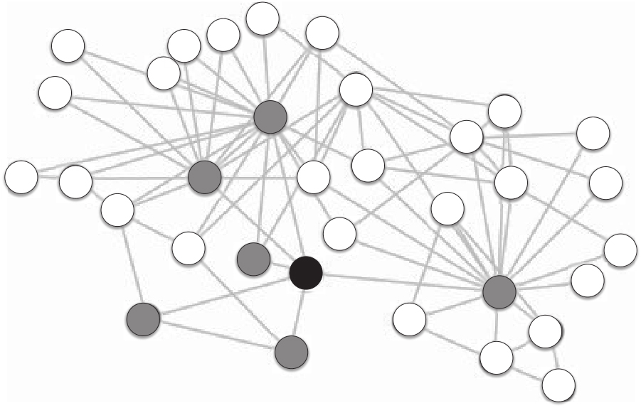
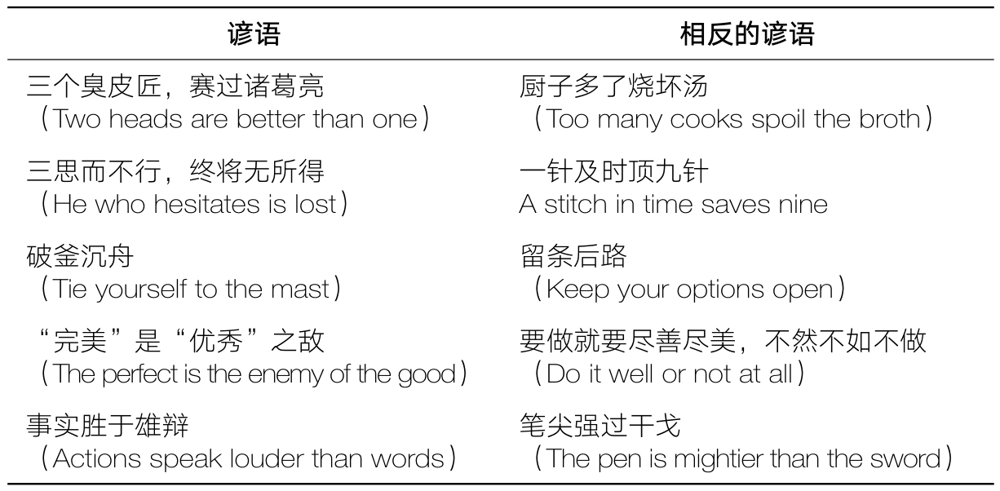
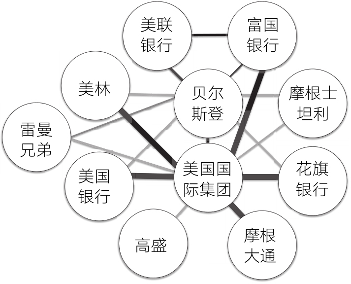

# 

你有没有想过，我们其实生活在一大堆“模型”里？小到天气预报，大到经济政策，背后都是一套套精心构建的转换系统。认知心理学家皮亚杰早就点破：理解现实，本质就是构建与之对应的模型。

很多人觉得模型就是简化版的现实，这没错，但它只是其中一种。模型可以是类比，也可以是一个纯粹的虚拟世界，用来检验我们的想法。更关键的是，模型不只是用来“看”的——在学校里我们用它解释数据，但到了真实世界，它还能预测、设计、行动、沟通，甚至帮我们探索前所未有的可能性。

那模型到底怎么造？通常有三条路。

第一种叫“具身法”，有点像做雕塑——保留关键结构，去掉无关细节。生态沼泽、立法机构、交通系统、气候模型，甚至大脑模型，都是这么来的。

第二种是“类比法”，拿一个熟悉的东西去理解另一个陌生的领域。比如把犯罪传播比作传染病扩散，把政治立场看成左-右光谱上的一个点。最经典的是“球形牛”的段子：想估算一张牛皮有多大？那就假设牛是球形的——因为微积分公式里有cos(x)、tan(x)，可没有cow(x)。

第三种是“另类现实法”，干脆不模仿现实，专门建一个思想实验室。大名鼎鼎的“生命游戏”就是这个路子：一个棋盘，格子或生或死，按规则切换。它不描述任何真实世界，却让我们看清了“自组织”和“复杂性”的底层逻辑。

无论选哪条路，好模型得满足两件事：一是能编码，比如用数学公式、计算机代码；二是能处理，过去靠数学推导，现在还能靠计算机模拟。奥卡姆剃刀说“如无必要，勿增实体”，爱因斯坦补充说“要尽可能简单，但不要过于简单”。而今天的复杂模型，比如全球气候模型，则让我们明白：简单不是简陋，而是该精细的时候，就得精细。

下面重点来了——模型有七种用途，它们首字母组成“REDCAPE”，字面意思是“红色披风”。这就像在提醒我们：握有多模型思维，你就披上了隐形的力量斗篷。

**推理**，是先把关键角色和互动规则定下来，然后推出逻辑后果。它经常得出让你意外的结论。阿罗定理指出，在看似合理的前提下，无法把个人偏好“公正”地汇总成集体排序。辛普森悖论更是反直觉：每个系的女生录取率都更高，但全校总体却是男生录取率更高——这事真的发生在伯克利。还有帕隆多悖论：两个稳赔的赌局，轮着玩反而能赚钱。更神奇的是，在通信网络里多加点节点，总线路长度居然能缩短。别把这些当成数学游戏，它们能实实在在指导现实：想提高女性总体比例，可能适得其反；把不赚钱的投资组合起来，可能稳赚；加几个中转站，线缆成本反而更低。

推理还特别擅长揭露所谓“真理”的条件。政客常说“减税能刺激经济、增加收入”，但如果你用最简单的恒等式——政府收入=税率×税基，很容易推出：只有当税基增长率超过减税幅度时，收入才真会增加。减税10%，经济必须增长超过10%才行。否则，就是空中楼阁。同样，“大石头优先”原则听起来很对，但在国际空间站那种多维度、强耦合的任务里，它反而很糟糕。模型能划清界线：什么条件下该用，什么条件下不该用。

所以，别再说模型只是把常识“重新包装成数学”。从模型推出来的结论，往往是“如果A成立，则B成立”的严谨条件句。而民间谚语呢？“三个臭皮匠顶个诸葛亮”和“厨子多了烧坏汤”，哪个都对？没有条件地生活，只会掉进自相矛盾的汪洋。但定理不会打架——若两个定理结论相反，必然假设不同或预测不同。

**解释**，是拿着模型说“原来如此”。经济模型解释价格为什么涨跌，物理定律解释苹果为什么落地，流行病模型解释感染曲线为什么先慢后快。玻意耳定律就解释了氧气压力和体积的关系：pV=k。它的预测准，是因为气体分子数目巨大、行为同质、规则固定。可惜社会现象没这么乖：人各有异、小圈子互动、没有固定规则、还会思考。所以社会学比物理学难预测得多。

但好模型依然能解释谜题。教科书里的市场模型能告诉你：正常商品需求突增，短期价格会上升；长期看，价格变化取决于边际成本。更吊诡的是，在规模收益递增时，需求增加反而会让价格下降。钻石几乎没用却贵得离谱，水不可或缺却便宜得惊人——这个钻石-水悖论，模型也能给出漂亮的解释。当然，模型的解释必须包含清晰假设、明确因果链，而且能拿到数据面前检验。否则就只是故事。

**设计**，是用模型搭建制度框架。工程师设计供应链、计算机科学家设计协议、社会科学家设计制度。最精彩的案例是1993年的频谱拍卖。当时美国政府决定拍卖手机电子频谱，但频谱许可证的价值互相牵制——拿到南加州的牌照，北加州牌照就更值钱。怎么设计拍卖规则，才能防操纵、高效率、又让参与者看得懂？经济学家用博弈论建模、计算机模拟对比方案、再通过真人实验校准参数，最终搞出了多轮拍卖法，允许中途退出，禁止早期虚报意图。这套规则后来给美国国库带来近600亿美元的收益——这正是模型用于“设计”的力量。

**沟通**，是模型当翻译官，把复杂知识变成可共享的理解。就像一幅地图、一张图表、一个沙盘，让不同背景的人在同一页上对话。模型让专家和非专家能够对齐认知，把“我知道”变成“我们都懂”。

**行动**，是把模型直接变成指挥棒。政策建议、战略选择、军事部署……模型不满足于“说”，它要你“做”。它把条件和结果串起来，告诉你此刻该按哪个按钮。

**预测**，是模型最传统的业务。数值预测、分类预测——明天几点涨潮、哪块市场会爆发、谁会赢下选举。模型不承诺一定会准，但它给你一个概率性的未来，让你提前做好准备。

**探索**，是模型的“开脑洞”模式。如果能量能无线传输会怎样？如果人类大脑能加速进化会怎样？这些现实世界没法做的实验，在模型里随便做。它不是为了解释现在的世界，而是为了寻找可能的世界，并从中提炼出通用规律。

所以，模型不是什么高冷术语，它就是一个思维工具箱。你可以用它理解一个突发事件，也可以用它设计一套制度，更可以拿它去探索一个从未存在过的世界。真正的高手，不会只信一个模型，而是会披上“REDCAPE”，带着多种模型一起思考——这才是应对复杂世界的终极姿态。

沟通的效率，往往取决于我们手里有没有同一份说明书。当一个概念被拆成可操作的定义和关系式，交流就从猜谜变成了对表。

可复用的记号系统能让理解几乎零损耗。模型逼着我们把相关要素和它们之间的联系写清楚，于是对话可以精确落地。*F = ma* 就是典型：力、质量、加速度三项都能测量，都能换算成单位，关系被写成等式，别人一看就知道在说什么，不会产生歧义。反过来，“更大更快的东西产生更大的力”这类描述就充满陷阱。翻译的过程里大量信息会流失：更大是指重量还是体积？更快指速度还是加速度？力是指合力还是能量？更大和更快又该怎么合成？于是会出现 *P = W+V*、*P = W V*、*P = W+A* 等各种自说自话的写法，结论自然各不相同。

把这种操作化思路搬到抽象领域，效果也一样。给“政治意识形态”这类看似虚无的概念配上可复制的定义，它立刻获得了接近质量、加速度的实在感。我们可以基于议员的投票记录建立一个模型，断言在可度量的意义上，甲比乙更“自由”或更“保守”。“自由”不再是口号，而是有明确标尺、可以比较的指标，他人只要用同一套规则就能复核。投票记录不是唯一标尺，随后还能用第二个模型——从演讲文本做语义分析来给立场打分。两种路径都能把主观感受翻译成可传递的结论。

人们常低估沟通对文明的推动力。想不出表达的思想，就像森林里倒下的树，无人知晓。启蒙时代的经济腾飞，很大程度上靠的是知识的可迁移性，而知识在当时多以模型形式存在。研究显示，当时思想的传播能力对增长的贡献，甚至超过了识字率本身。最直观的佐证是18世纪法国，各城市的经济增速与《百科全书》订阅量的相关性，远高于与识字率的相关性。¹¹

#### REDCA PE：行动
弗朗西斯·培根说过，人生的目的不在于知道，而在于做到。好的行动离不开好的模型。政府、公司、非营利组织都在用模型做决策：调价、开新店、并购、推行全民医保、资助课外项目，背后都是模型在支撑。关键决策往往叠加多个复杂模型，数据是它们的血脉。

2008年，在《问题资产救助计划》框架下，美联储向美国国际集团提供了1820亿美元援助。财政部的说法很清晰：不是为了救AIG本身，而是防止它在金融危机中倒下导致系统崩塌。企业倒闭是常态，政府很少出手。¹³
每一次具体操作都建立在特定模型之上。图2-2是国际货币基金组织画出的一个金融网络图，节点是金融机构，连线表示它们在资产持有上的关联，颜色和粗细反映相关强度。¹⁴

**图 2-2　金融机构的网络模型**

从图中看，AIG处于网络核心，因为它向多家机构出售保险。一旦被保险对象的资产受损，AIG就要赔付，资产价格下跌就等于AIG负债上升。网络的含义很直观：AIG若倒下，关联方会连锁倒闭，形成多米诺效应。稳住AIG，就等于托住了网络中一大块市场价值。¹⁵
同一幅图也解释了为何雷曼兄弟被放任破产——它在网络里并非枢纽。我们无法重走历史验证美联储是否做对，但事实是雷曼的崩盘并未摧毁金融体系，而AIG的贷款最终为政府带来230亿美元收益。

指导行动的模型不全靠数字。政策模型多用数学公式，但历史上也出现过物理模型。上世纪中期，菲利普斯为英国经济搭了一个水力模型，用来推演政策效果；旧金山湾的实体模型曾帮助叫停把海湾改成淡水湖的计划。¹⁶ 密西西比河流域模型水道试验站建了一个1:100的缩微流域，面积近80万平方米，能模拟大坝和水库对上游下游的影响，水流遵循真实物理规律，数据与规律共同完成推理。

组织用模型，个人也能用。当要买房、换工作、重返校园深造、或在买车租车之间选择时，一个定性的模型也会逼出关键问题。多模型思维的价值，就在于不断自问。

#### REDCAP E：预测
预测一直是模型的本能用法。气象员、分析师、央行行长、警察、情报人员、流行病学家，都在用模型猜下一步会发生什么。随着数据更丰富、更细，预测变得更普遍，Twitter转发和Google搜索词也被用来捕捉消费趋势和社会波动的苗头。

模型既可以锁定单一事件，也可以描绘整体趋势。2009年6月1日，法航AF477从里约飞往巴黎的航班在南大西洋坠毁，搜救只找到残骸，7月信标断电后搜索中止。一年后，伍兹霍尔海洋研究所用侧扫声呐和无人潜航器再次搜寻无果。法国国家统计分析局转而用概率模型模拟洋流，最终圈出一个很小的矩形海域作为最可能沉没区。按此指向，搜救队一周内就找到机体。¹⁷

解释与预测常常同行。解释电压规律的电工模型也能预测电压大小，解释投票历史的空间模型也能预测未来选择。最经典的案例是勒维耶，他用牛顿定律解释行星运动，进而推算出一个未知天体来解释天王星轨道的异常。1846年9月18日他把预测寄给柏林天文台，5天后海王星正好出现在预测位置。

但两者并不等价。深度学习可以准确预测销量、天气、价格走势和健康风险，却几乎不提供可解释的因果，它像嗅弹犬，能闻出危险却说不清原理。我们不应要求它讲理由，也问不出拆弹方法。

反过来，解释力强的模型也可能预测力弱。板块构造论能解释地震成因，却无法给出发生时间；动力系统模型能解释飓风形成机制，却难以精确预报路径和登陆点；生态模型能描绘物种演化规律，却无法预知下一个新物种的形态。

#### REDCAPE ：探索
模型还能用来拓展直觉。假想一下：如果所有城市公交免费会怎样？如果学生用自己选的作业来证明成绩会怎样？如果草坪上标出能量消耗会怎样？提出假设、让模型演练，是检验政策想法的低成本方式。

模型也可以探索现实中不可能发生的世界。若拉马克是对的，后天获得的性状可以遗传，那把牙齿矫正好的父母，孩子是否就不需要牙套了？世界会变成怎样？暂时悬置现实约束，能极大激发创造力，这也是批判性设计圈热衷科幻叙事的原因。¹⁸

探索还常涉及跨领域的假设对照。为了理解网络效应，研究者会从多种程式化网络结构出发，比较结构如何影响合作、传染和动乱；也可以把同一类学习模型放到单人决策、双人博弈、多人博弈里，只为学习和发现规律，而不是为了解释或预测。

同一个模型在实践中往往身兼数职。2003年8月14日，俄亥俄托莱多附近树木倒压电线，加上监控软件失灵，导致美国东北部和加拿大超过5000万人停电；同年意大利-瑞士电网因风暴受损，6000万欧洲人断电。工程师随后用网络模型刻画电网：既能解释故障如何传导，也能预测高风险区域，还能指出该在哪儿增建线路、变压器和电源以提升韧性，从而指导行动。

一个模型有多重用途，一对多是对多模型并用来理解复杂世界这一主题的必要补充。