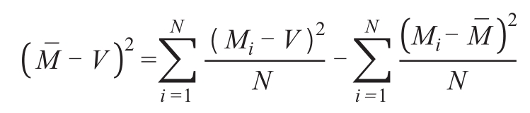
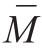
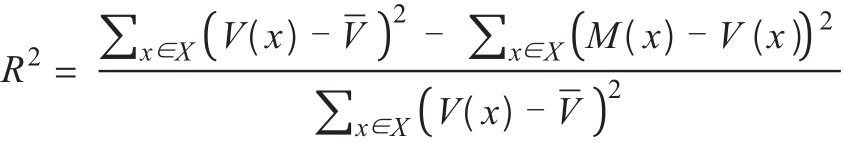
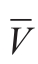
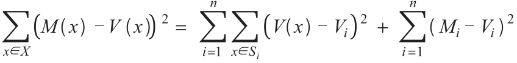
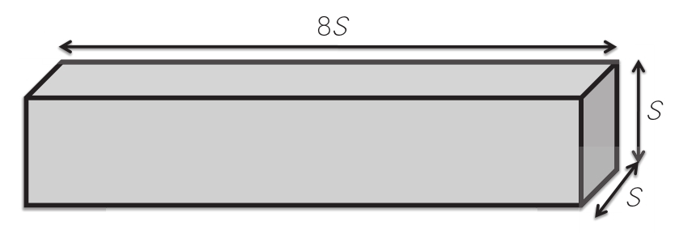
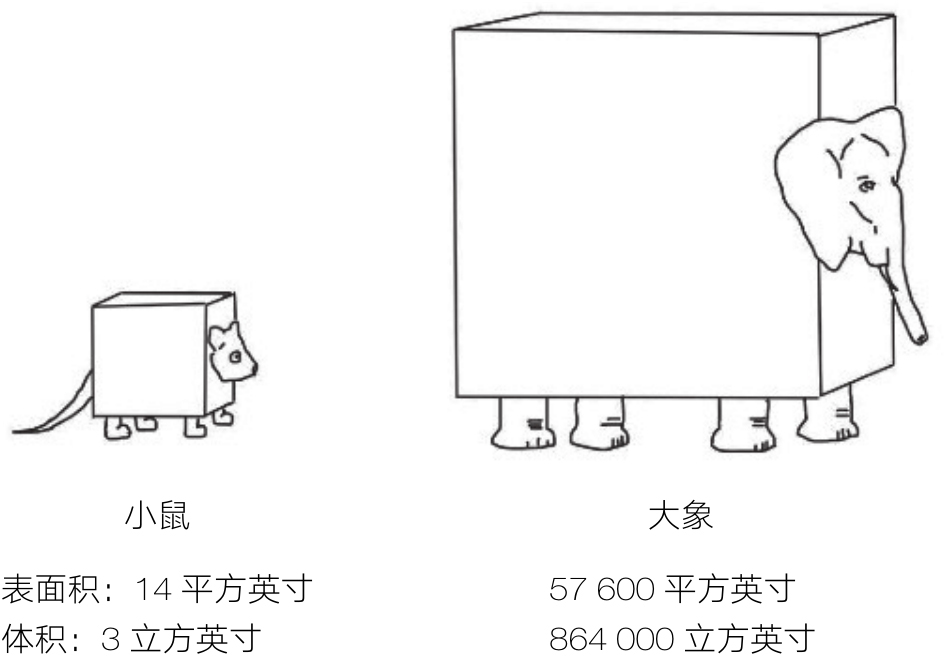
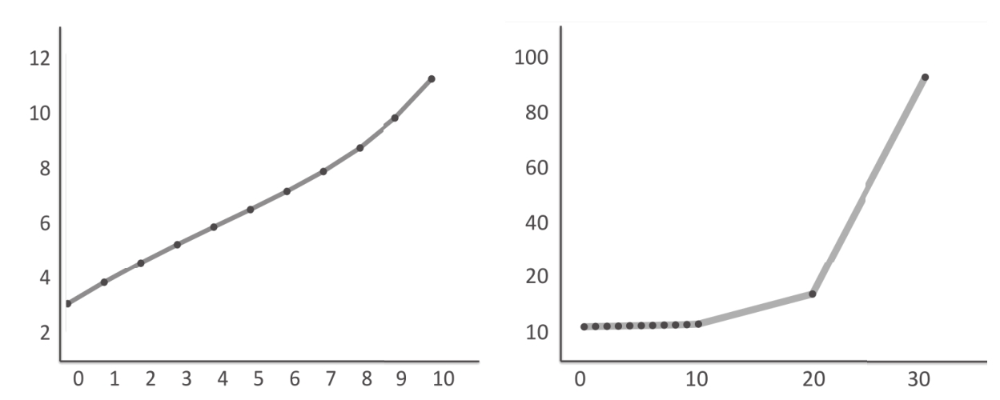
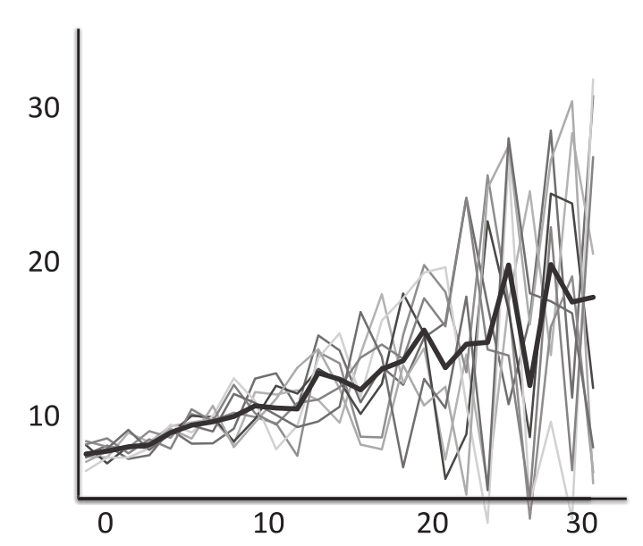

# 别把判断押在一个模型上：多模型思维的真正用法

有时，越执着于所谓“现实的全貌”，越容易被细节淹没。真正有价值的意义，往往不是自动浮现的，而是经过筛选、删减和强调之后才显露出来。本章想做的，就是用更科学的方式把“多模型思维”讲清楚。

先给结论：多模型思维确实有价值，但它并不是模型越多越好，更不是要求你背下上百个模型。真正关键的是模型的多样性、适用性和粒度。孔多塞陪审团定理与多样性预测定理，为多模型思维提供了可量化的依据；但这两个定理也可能高估了“堆模型”的效果。分类模型会告诉我们，构建多个独立而有效的模型其实比想象中难。至于模型粒度，也就是一个模型该做到多具体，则取决于用途：做预测时，大模型常常更合适；做解释时，小模型反而更清晰。

## 一、两个定理：多模型为什么有用

孔多塞陪审团定理来自一个讨论多数决策优势的模型。设想一群陪审员，每个人都要判断被告有罪或无罪，而且每个人判断正确的概率都高于出错概率。把陪审员换成模型，把每个模型的判断看作一次分类，这个定理就适用于模型集合了。分类结果可以是行动，比如买入或卖出；也可以是预测，比如某党胜选还是败选。定理的条件是：模型数量为奇数，每个模型正确分类的概率大于二分之一，而且模型之间的正确性在统计上彼此独立。满足这些条件时，多数投票的正确率会高于任何单个模型；当模型数量足够大，多数判断的准确率会趋近于百分之百。

这里还涉及“世界状态”的概念，也就是对全部相关信息的完整描述。对陪审团来说，世界状态是庭审中呈现的所有证据；对评估慈善项目的模型来说，世界状态可能对应团队、组织结构、运营计划以及项目要解决的问题特征。

生态学家理查德·莱文斯曾把这种思路讲得很透彻：面对同一个问题，可以用几个简化方式不同、但共享某些基本假设的模型分别处理；如果它们最后指向相似结果，就得到了一个相当稳健的结论，不容易被模型细节左右。换句话说，真理有时是若干独立谎言的交集。要注意，莱文斯看重的是多个模型在分类上达成一致；当许多模型给出相同判断时，我们的信心会明显增强。

多样性预测定理则适用于数值预测或估值。它把模型准确性和多样性如何共同影响“多模型平均表现”量化了出来。其表达是：多模型误差等于平均模型误差减去模型预测的多样性，即：

其中，\(M_i\) 表示第 \(i\) 个模型的预测， 等于模型平均值，\(V\) 等于真值。

这是一个数学恒等式，不需要去检验它是否成立，因为它总是成立。举个例子：用两个模型预测某部电影能拿几项奥斯卡奖，一个说 2 项，一个说 8 项，平均预测是 5 项。电影最终拿了 4 项。第一个模型的误差是 4，也就是 \(2^2\)；第二个模型的误差是 16，也就是 \(4^2\)；平均模型误差为 10。多模型预测值 5 与真值 4 的误差是 1。两个模型各自与平均预测相差 3，所以预测多样性为 9。于是就有了：1（多模型误差）＝10（平均模型误差）－9（预测多样性）。

这个定理背后的道理是：方向相反的误差会互相抵消。一个模型估高了，另一个估低了，平均之后反而更接近真实值；即使两个模型都估高，平均预测的误差通常也不会比两个高估值的平均误差更糟。但要注意，它不保证任意一组不同模型的平均预测一定准确。如果所有模型共享同一种偏差，平均值也会带着这个偏差。它真正说明的是：一组多样化的模型或人，平均起来会比其中普通成员更准确，这就是常说的“群体的智慧”。这也解释了计算机科学中的集成方法为什么有效，也解释了为什么同时使用多个模型和框架思考的人，往往比只依赖单一模型的人预测得更准。任何单一视角都会漏掉一些细节，也更容易制造盲点；只靠一个模型思考的人，很难准确预见 2008 年金融危机那样的重大事件。

## 二、模型不是越多越好

这两个定理听起来很有力：模型足够多，几乎不会犯错；只要有一组多样且中等准确的预测模型，多模型误差就可以被压到接近零。但问题在于，我们构建多个多样模型的能力是有限的。

分类模型正好能说明这一点，它也为孔多塞陪审团定理提供了微观基础。分类模型把世界状态切成一个个互不重叠的类别。亚里士多德在《范畴篇》里就描述过十个范畴，包括实体、数量、地点、状态等，每个范畴都在制造不同类别。我们平时用普通名词时，其实就在分类：“裤子”是一个类别，“狗”“勺子”“壁炉”“暑假”也都是。分类会指导行动：按族裔给餐馆分类，决定中午去哪儿吃；按市盈率给股票分类，决定买卖；说亚利桑那州人口增长是因为气候宜人，是用分类做解释；判断退伍军人候选人在选举中更容易获胜，则是用分类做预测。

从智慧层次看，对象构成数据，把对象分门别类产生信息，而给类别赋予估值则需要知识。评价孔多塞陪审团定理时，我们依赖的是一个二元分类模型：把对象或状态分成“有罪”和“无罪”两类。关键点是，相关属性的数量限制了可区分的类别数量，也限制了有用模型的数量。

分类模型可以这样理解：世界上的对象或状态由一组属性定义，每个属性都有取值；模型 \(M\) 根据属性把对象划分成有限个类别 \(\{S_1,S_2,\ldots,S_n\}\)，再给每个类别赋值 \(\{M_1,M_2,\ldots,M_n\}\)。

假设有 100 份学生贷款，一半按期还款，一半违约。我们知道每笔贷款的两个信息：金额是否超过 5 万美元，以及借款学生主修工科还是文科。两个属性可以区分出四类贷款：工科生大额贷款、工科生小额贷款、文科生大额贷款、文科生小额贷款。二元分类模型要把这四类分别归入“按期还款”或“违约”。一种模型可能认为小额贷款会按期还、大额贷款会违约；另一种模型可能认为工科生的贷款会按期还、文科生的贷款会违约。这两种模型都有可能在一半以上的情况下判断正确，而且大体上相互独立。

但继续增加模型就麻烦了。四个类别映射到两个结果，最多只有 16 种模型。上面两个只是其中之二；剩下 14 个模型中，每一个都有一个完全相反的模型。只要某个模型的分类是对的，它的相反模型就是错的。因此，这 14 个模型里最多只有 7 个可能在一半以上情况下正确；而如果某个模型恰好在一半情况下正确，与它相反的模型也必然如此。数据的维数决定了可创建模型的数量上限，在这个例子里最多是 7 个。我们造不出 11 个独立模型，更别说 77 个。

就算数据维度更高，比如还知道贷款者年龄、平均成绩、收入、婚姻状况和住址，也不能想当然地认为按这些属性分类就能准确预测。它要求每个属性子集都与贷款是否已偿还相关，同时还必须与其他属性无关，这是很强的假设。比如收入、婚姻状况和住址彼此相关，那么交换这些属性的模型也会彼此相关。在严格的概率模型里，独立性假设看起来合理：不同模型会犯下独立的错误；但用分类模型的逻辑去审视孔多塞陪审团定理，就会发现构建多个独立模型有多困难。

构建多样且准确的模型，也会遇到类似难题。假设要预测 500 个中型城市的失业率。一个准确模型必须把城市分成若干类别，使同类城市失业率相近，并且能准确预测该类别的失业率。若两个模型要进行多样性预测，它们必须在分类上不同，或在预测上不同，或两者兼有。这两个标准并不冲突，却很难同时满足。一个模型按平均教育水平分类，另一个按平均收入分类，分类结果可能很相似；这样它们也许都准确，却不够多样。按城市名称首字母造 26 个类别，倒是能制造多样性，但很可能并不准确。最重要的是，实践中所谓的“许多模型”，可能更接近 5 个，而不是 50 个。

实证研究也支持这个判断。增加模型能提高准确性，这是多样性预测定理保证的；但在已有一定数量模型后，继续增加模型的边际贡献会下降。谷歌在实践中发现，只用一位面试官评估求职者，而不是随机挑人，录用高于平均水平员工的概率会从 50% 提高到 74%；加入第二位面试官，概率提高到 81%；第三位只能提高到 84%；第四位提高到 86%；就算用 20 位面试官，也只是提高到 90% 多一点。增加面试官的作用是有限的。

经济学家对失业率、经济增长率和通货膨胀率做过成千上万次预测，也可以把每位经济学家看成一个模型。加入一位经济学家，准确率大约提高 8%；加入两位，提高约 12%；加入三位，提高约 15%；加入十位，提高约 19%。而且，即使你知道谁是最好的经济学家，那位最佳预测者的表现也只比平均水平高约 9%。所以，随机选三位经济学家的平均预测，就已经胜过那位历史最佳。另一个原因是世界一直在变：今天预测得好的经济学家，明天可能就泯然众人。这也解释了为什么美联储要依赖一系列经济模型，而不会只押注某一个模型。

这里的启示很清楚：如果能构建出多个多样且准确的模型，我们就能做出更准确的预测和估值，并选择更正确的行动。这些定理验证了多模型思维的逻辑可靠性，但它们并不负责、也不应该负责替你造出那么多满足假设的模型。实践中，能凑出 3 个或 5 个不错的模型，已经很好。加入一个模型可能改进 8%，加入三个可能改进 15%；第二个、第三个模型不一定比第一个更好，甚至可能更差，但只要它们的分类确实不同，就值得纳入进来。

## 三、模型粒度：该粗还是该细

模型多，不等于方法一定对。有时，构建一个单一的大型模型反而更合适。这里的关键是粒度：数据该切到多细，模型该做到多具体。

先回顾模型的七种用途：推理、解释、设计、沟通、行动、预测和探索。其中，推理、解释、沟通和探索这四种用途都需要简化。简化之后，我们才能用逻辑解释现象、交流思想、探索各种可能。孔多塞陪审团定理就体现了这种简化：分析其内在逻辑，可以解释为什么多模型方法更容易产生正确结果，也有利于传播发现。反过来说，如果构建一个按人格类型给陪审员分类的模型，再把证据描述成词语载体，我们就会迷失在细节丛林里。博尔赫斯曾讲过一个寓言：制图师协会想绘制一幅与国家等大的地图，土地上的每一点都一一标在图上；可后代并不喜欢研究地图，只觉得这幅巨型地图毫无用处。

但另外三种用途——预测、设计和行动——却可能因高保真模型而受益。所以，如果有大数据，就应该利用它。经验规则是：数据越多，模型可以越精细。食品支出数据可以说明这一点。

假设从很多杂货店取得大量数据，详细记录数百万家庭每月食品支出。家庭支出各不相同，我们用“变差”衡量这种差异，也就是每个家庭支出与所有家庭平均支出之差的平方和。如果月平均支出是 500 美元，某个家庭支出 520 美元，那么这个家庭对总变差的贡献就是 400，即 \(20^2\)。统计学家把模型能解释的变差比例称为 \(R^2\)。如果总变差是 10 亿，模型解释了其中 8 亿，那么 \(R^2\) 就是 0.8。解释变差的比例，对应模型在平均估计上的改进程度。若模型估计某家庭月支出 600 美元，而实际也是 600 美元，模型就解释了该家庭对总变差的全部贡献。若实际支出是 800 美元，模型预测 700 美元，那么该家庭对总变差的贡献就从 9 万［\((800-500)^2\)］变成 1 万［\((800-700)^2\)］，模型解释了其中 8/9 的变差。

\(R^2\) 的定义是解释变差的百分比：

其中，\(V(x)\) 等于 \(X\) 中的 \(x\) 的值， 等于平均值，\(M(x)\) 等于模型的估值。

在这个场景里，分类模型把家庭划入不同类别，再估计每个类别的值。更精细的模型会创建更多类别，而更多类别需要更多家庭属性；类别增加后，可解释的变差比例也会提高。如果像博尔赫斯笔下的制图师那样，把每个家庭单独设为一类，当然可以解释全部变差；但这种解释和 1:1 地图一样，没什么实际用处。

类别过多会造成过度拟合，反而破坏对未来事件的预测。假设想用上个月食品采购数据预测本月数据，而家庭月支出本来就会波动。若每个家庭自成一类，模型就会预测本月支出与上月相同；由于存在月度波动，这不是一个好预测器。把某个家庭与其他类似家庭归入同一类别，再用同类家庭的平均支出来预测，反而更准确。

可以假设每个家庭的月支出来自某个分布，且分布的均值和方差已知。构建分类模型的目的，就是根据属性划分类别，让同一类别中的家庭具有相近均值。若能如此，一个家庭第一个月的消费，就能提示其他家庭第二个月大概会花多少。当然，没有完美的分类。每个类别中的家庭均值可能略有差异，这叫分类误差。类别越大，分类误差通常越大，因为把不同均值的家庭塞进同一类的可能性更高；但更大的类别也依赖更多数据，这会使每个类别均值的估计更准确，也就是第五章会讨论的平方根规则。因估计均值出错而产生的误差叫估值误差。类别数量增加，估值误差会减少。不同家庭月支出各异，一个只包含一个家庭的类别，甚至只包含十个家庭的类别，都无法准确估计均值；而包含 1000 个家庭的类别，则能较准确地估计均值。

## 结语：会选模型，比会背模型更重要

多模型思维曾经让很多人担心：是不是非得学很多模型才行？答案是否定的。我们当然要掌握一些模型，但不需要像某些人想象的那样掌握 100 个，甚至连 50 个都不必。因为模型具有“一对多”的性质：通过重新命名、更换标识符或修改假设，同一个模型可以被应用到多种情境中。这种性质正好平衡了多模型思维的需求。

不过，把模型迁移到新领域，对创造力、开放性和怀疑精神的要求很高。我们必须承认，不是每个模型都适合每项任务；如果一个模型无法解释、预测或帮助推理，就应该把它放到一边，换别的模型。这种“一对多”的能力，和很多人以为优秀建模者必备的数学分析才能并不相同。它更像一种高强度的创造力练习：面对随机游走，你能想到多少种用途？

本章最后就用几何学中的面积公式和体积公式做了示范：它们可以作为模型，用来解释超级油轮的大小、评估身体质量指数、预测新陈代谢的比例，甚至解释为什么女性 CEO 很少见。说到底，多模型思维不是比谁模型背得多，而是看谁能在合适的场景里选出合适的模型，并用足够的多样性抵消单一视角的盲点。预测时，不妨让模型更精细；解释时，则要让模型足够简洁。多样优于单一，适用胜过堆砌。

在建立模型的路上，我们首先获得了一个关键洞见：如果把均值不同的家庭划入同一个类别，分类误差反而会变小——统计学家把这称为“模型偏差”。但类别越多，我们对每个类别均值的估计就越容易偏离，这就是所谓的“均值方差增大”。于是，一个根本性的取舍出现了：类别数量到底该多还是该少？这个难题被总结成了“模型误差分解定理”，也就是统计学家常说的“偏差-方差权衡”。

**模型误差分解定理**

偏差-方差权衡

模型误差=分类误差+估值误差

其中，*M* （*x* ）和*M* * [i] * 分别代表数据点*x* 以及类别*S* * [i] * 和*V* （*x* ）的模型值，而*V* * [i] * 对应的是它们的真实数值。⁶

### 从“一”到“多”：模型的迁移力

学习模型并不轻松，它需要投入时间、精力，还要有广泛的好奇心与知识储备。为了降低这种学习成本，我们可以走一条“一对多”的捷径。我们提倡掌握适量且灵活的模型，并善于创造性地把玩它们。比如，用流行病学的框架去理解玉米良种推广、Facebook 的火爆、犯罪扩散乃至明星圈粉；用信号传递模型去拆解广告、婚姻、孔雀羽毛和保费背后的逻辑；用进化适应中的“崎岖景观”模型来解释为什么人类不像鲸鱼那样需要喷气孔。当然，我们不能随手抓一个模型就往所有地方硬套。但大多数模型其实相当灵活，而且每次失败的尝试都不会白费——尝试本身会暴露模型的边界，这本身就是一种有趣的收获。

“一对多”的思路其实是后来才兴起的。早年间，每个学科都有自己的专属模型：经济学家守着供求、垄断竞争和增长模型；政治学家摆弄选举竞争模型；生态学家琢磨物种形成与复制模型；物理学家则握着运动定律的模型。大家各用各的工具，互不跨界。那时，科学家既不会拿物理模型去解释经济，也不会用经济模型来研究大脑，就像普通人不会用缝纫机去修漏水的水管一样。

如今，把模型从学科的小隔间里“放出来”，用“一对多”的方式重新接入不同领域，已经收获了许多亮眼成果。经济学家保罗·萨缪尔森改造了物理学模型，用来解释市场如何走向均衡；安东尼·唐斯把海滩上冰淇淋店的竞争模型，平移到了政治候选人的意识形态定位上；社会学家借用粒子相互作用模型，去分析不同国家的贫困陷阱、犯罪率起伏，甚至经济增长；经济学家则把基于经济原理的自我控制模型拿来理解大脑的决策机制。⁷

#### 一对多：更高的“幂”

要玩转创造性应用，离不开反复练习。这里我们用一个大家都很熟悉的公式*X* * ^N * ——也就是求一个变量的*N* 次方——来展示“一对多”的巨大能量。当幂为 2，它给出正方形的面积；幂为 3，它算出立方体的体积；而当幂继续升高，它就能描述几何意义上的膨胀或衰减。

**超级油轮。** 先看一艘长方体状的超级油轮，其长度是深度和宽度的 8 倍，记为*S* 。从图 3-1 可知，它的表面积为 34*S* ² ，体积是 8*S* ³ 。造油轮的成本主要取决于表面积——因为钢材用量与表面积直接挂钩；而油轮的赚钱能力则由体积决定。算一下体积与表面积的比值：8*S* ³ /34*S* ² ≈*S* /4。这说明，尺寸越大，盈利能力会随尺度线性上升。

**图 3-1　长方体状的超级油轮：表面积=34S² ，体积=8S³** 

航运巨头斯塔夫罗斯·尼阿科斯正是看准了这个比例关系，造出了第一艘现代超级油轮，在二战后的重建浪潮中大赚数十亿美元。二战时的 T2 油轮长约 152 米、深约 7 米、宽约 15 米；而现代超级油轮，比如诺克·耐维斯号，长超过 450 米、深超过 20 米、宽超过 50 米。要感受诺克·耐维斯号的巨大，不妨想象把芝加哥的西尔斯大厦放倒，让它漂在密歇根湖上。诺克·耐维斯号相当于把 T2 油轮放大了 3 倍多。可相比之下，它的表面积是 T2 的 10 倍，体积却达到了 T2 的 30 倍。为什么不再造得更大一点？道理很简单——超级油轮得穿过苏伊士运河。实际上，诺克·耐维斯号每次过运河都是“挤”过去的，两侧只剩一点点缝隙。⁸

**身体质量指数。** 医学界常用身体质量指数（BMI）来划分体型类别。这个概念起源于英国，算法是体重除以身高的平方。⁹ 所以如果身高不变，BMI 会随着体重线性变化——比同等身高的人重 20%，BMI 也就高 20%。

我们不妨把人想象成一个近似完美的立方体，由脂肪、肌肉和骨骼混合而成。令*M* 为一立方米立方体的重量，那么“人体立方体”的重量就是体积乘以密度，即*H* ³ ×*M* ，而它的“BMI”等于*H* ×*M* 。但这个模型明显有缺陷：它让 BMI 随身高线性上升，而且肌肉比脂肪重，健美的人*M* 更大，BMI 反而更高。身高本应与肥胖无关，肌肉发达更是肥胖的反面。即便把模型做得更“真实”，这些问题依然存在。

如果用参数*d* （前胸到后背的厚度）和*w* （宽度）来表示身体尺寸，并假设它们与身高成比例，那么 BMI 可以写成：。这样一来，许多 NBA 球员和其他球类明星会被划进超重范围（BMI>25），甚至不少世界顶尖的男子十项全能运动员也逃不掉。¹⁰ 既然身材适中、身体健康的人也可能有高 BMI，那就不难理解为什么一项覆盖近百项研究、样本总数达数百万的荟萃分析显示：体重稍稍超标的人反而活得更久。¹¹

**代谢率。** 再用这个模型去预测动物大小与代谢率之间的反向关系。所有生物体都在不断进行新陈代谢，即通过一系列化学反应分解有机物、释放能量。以卡路里计量的代谢率，就是维持生命所需的最低能量。如果给小鼠和大象建立立方米模型，从图 3-2 能直观看到：小立方体的表面积与体积之比远大于大立方体。

我们可以把小鼠和大象都看成由 1 立方英寸细胞组成的身体，每个细胞都在代谢并产热，而热量必须通过体表散出。小鼠的表面积约为 14 平方英寸，体积约 3 立方英寸，两者之比大约是 5:1。¹² 也就是说，小鼠每 1 立方英寸细胞对应 5 平方英寸皮肤去散热；大象的每个发热细胞却只有 1/15 平方英寸皮肤可用。换句话说，小鼠的散热速度是大象的 75 倍。

**图 3-2　膨胀的大象**

因此，要让两种动物保持相近的体温，大象的新陈代谢必须显著放缓。事实也的确如此。如果大象拥有小鼠的代谢速率，它每天得吃掉 6 800 千克食物，同时大量热量无法及时散出。最终，大象会热到冒烟，甚至爆炸。现实世界的大象没有爆炸，因为它们的代谢率只有小鼠的 1/20。这个模型虽然无法精确预测代谢率随体型变化的速率，但它准确预测了方向。更精密的模型还能进一步解释比例定律。¹³

**女性 CEO。** 最后，我们把指数再调高一点，用它解释为什么女性 CEO 如此稀少。统计显示，2016 年《财富》500 强企业中，女性 CEO 占比不到 5%。要成为 CEO，一个人得反复晋升。我们可以把这些晋升机会当作概率事件：每次晋升都像一次抽签，有一定概率成功。进一步假设，想当 CEO 必须抓住每一次机会。

不妨设定：要成为 CEO 至少要升职 15 次，相当于每两年升一次，30 年走完整个过程。大量证据表明，晋升过程中存在对男性“温和”的偏袒。我们把这个偏差建模为男性每次晋升的概率更高。¹⁴ 具体来说，假如男性每次晋升概率为 50%，女性为 40%，那么男性最终成为 CEO 的可能性几乎是女性的 30 倍！¹⁵ 这揭示了一个惊人的事实：温和的偏差经过多次累积，会被放大成悬殊的差距——区区 10%的晋升概率差异，最终变成了 30 倍的差距。

这个模型还能解释另一个现象：为什么女性大学校长的比例（约 25%）远高于女性 CEO？相比《财富》500 强企业，高校的管理层级要少得多。从教授到校长，只需升职 3 次：系主任、院长，然后就是校长。层级只有 3 个，偏差的累积效应自然有限。因此，女性大学校长比例更高，并不代表教育机构比企业更平等，只是“晋升台阶”更少而已。

### 多模型思维

本章开头，我们用孔多塞陪审团定理和多样性预测定理，为“多对一”的方法打下了逻辑地基。随后，用分类模型展示了模型多样性的边界，也论证了多个模型如何提升我们的预测、行动和设计能力。同时我们也承认：构建多个不同的模型并不容易。如果真能做到，我们几乎可以实现完美的预测——但我们心里清楚，这不可能。即便如此，我们的目标仍是尽可能积累有用且多样的模型。

接下来各章会介绍一系列核心模型。它们各自看世界的角度不同，对因果关系的假设也各异。正是这种多样性，让多模型思维成为可能。每一个模型都像聚光灯，照亮复杂整体的某个侧面；而当它们被组合在一起，就构成了更强大的模型集合。

需要强调的是，多模型思维确实要求我们掌握多个模型，但数量不必惊人，关键是每个模型都能跨界使用。而这并不容易。成功的“一对多”思维，依赖创造性地调整假设、构建新颖的类比，把原本为特定目的设计的模型移植到新领域。所以，成为一个多模型思考者，光有数学能力远远不够，更需要创造力。这一点已经越来越清晰。

**装袋法：给模型减过度拟合**

通常的建模流程是：先用一部分样本拟合模型，再用另一部分数据检验；有时也会用当前数据拟合，然后预测未来。但这里存在一个张力——模型中参数越多，拟合现有数据的效果往往越好，可同时也越容易“过度拟合”。好拟合并不等于好模型。

物理学家弗里曼·戴森讲过恩利克·费米评价他研究的一段往事。那项研究有极高的拟合度。“我忍不住问费米，他是否对我们算出的数值与实测值之间的高度一致有什么印象。他反问我：‘你用了多少个任意参数？’我回忆了一下，回答‘4 个’。他说：‘我记得我的朋友约翰·冯·诺伊曼说过，有 4 个参数就能拟合一头大象，用 5 个参数还能让大象摆动它的鼻子。’然后对话就停止了。”¹⁶

通常，那些“能让大象甩鼻子”的估计会用到更高阶项，比如平方、立方甚至四次方。高阶项很危险，因为它们有强烈的放大效应——10 是 5 的两倍，但 10⁴ 是 5⁴ 的 16 倍。下图就是一个过度拟合的例子。

**过度拟合与样本外误差**

左图展示了一家工业 3D 打印机企业的销售数据（假设值），横轴是销售团队每月平均上门推销次数。左图里有一个非线性最优拟合曲线，包含 5 次方项。右图则显示，如果上门推销次数达到 30，模型预测销量会达到 100 台。可如果每个客户最多只买一台打印机，这个预测显然不现实。于是，过度拟合带来了巨大的样本外误差。

怎么避免？最简单的做法是不使用高阶项。不过还有一种更巧妙的思路：自举聚合法，也叫装袋法。做法是先通过有放回地随机抽样，从原始数据中生成若干个同样大小的新数据集。每次抽完一个数据点，就把它放回“袋子”，下次还有可能再抽到它。这样得到的一组数据集，有些样本会重复出现，有些则缺席。

接着，将（非线性）模型分别拟合到这些数据集上，得到多个模型。¹⁷ 把所有拟合线画在同一组坐标轴上，就得到一张“意大利面图”——图中颜色最深的那条线是各模型的平均值。

**意大利面图**

装袋法擅长捕捉稳健的非线性效应，因为这些效应在数据的多个随机样本中反复出现；同时它能避免在单一数据集上拟合出偶然的特定模式。通过随机样本制造多样性，再对多个模型取平均，装袋法恰好运用了多样性预测定理的逻辑。它构建出一个个多样的模型，而就像我们前面说的，这些模型的平均结果，往往比任何单一模型都更可靠。