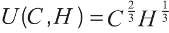
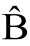
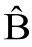
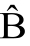
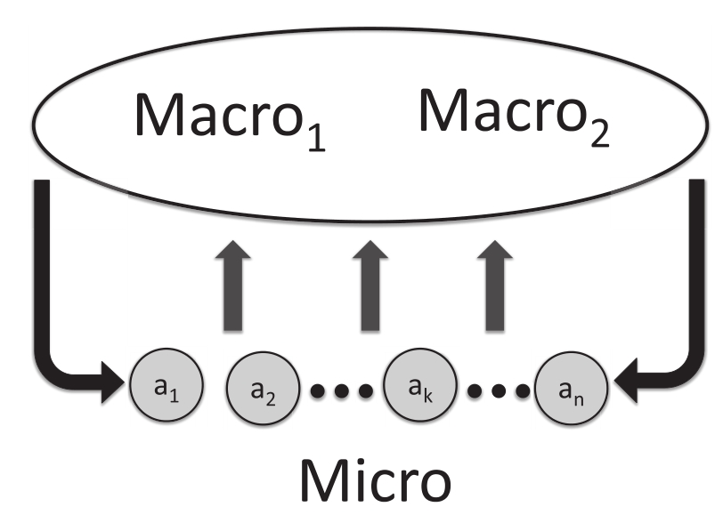

# 04　对人类行为者建模

时至今日，我们仍然无法说出哪一种人类行为理论是设定很成功并在各种环境下都通过了检验的。

埃莉诺·奥斯特罗姆（Elinor Ostrom）

这一章讨论本书的一个核心问题：应该怎样对人进行建模？在接下来将要给出的众多模型中，人都将成为分析的基本单元。我们将构建关于人们投票、合作、参与时尚活动、投资退休账户，以及毒品上瘾的模型。在每一个模型中，我们都必须对“人”做出假设：他们的目标是什么？他们是只关心自己的利己主义者还是利他主义者？他们可能采取的行动是什么？他们如何选择自己要采取的行动？或者说他们是否拥有选择权？

我们可以为每个模型构建任意的特殊假设，但这种做法会引起混乱并错过真正的机会。如果这样做，最终将只剩下一组特殊的构造，而且每一次要构建新模型时，都需要对人们的行为方式进行新的思考。由此产生的异质性会限制我们思考和组合模型的能力，我们将不可能成为有效率的多模型思考者。

我们遵循的方法强调一致性和多样性。或者将人建模为基于规则的行为者（rule-based actor），或者将人建模为理性行为者（rational actor）。在基于规则的行为者集合中，我们考虑那些基于简单固定规则行事的人以及基于适应性规则行事的人。基于适应性规则行事的人能够根据信息、过去的成功或者通过观察他人的行为而改变自己的行为。正如我们在下文中将会详细讨论的那样，在这些不同的情况之间并不存在明确的界线：适应性规则有时可以解释为一个固定规则，理性行为有时也会采取简单规则的形式。

我们怎样对人建模，归根到底取决于问题的背景和想要实现的目标。我们是在预测还是在解释？是在评估政策行动吗？是在尝试设计一种制度吗？或者，是在探索？在低风险的环境中，例如要构建一个预测人们会购买什么颜色的外套或者他们会不会在看完演出后起立鼓掌的模型时，我们通常会假设人们采用固定规则。而在构建关于人们决定是不是要合作创业或信任他人的模型时，我们假设人们会学习和适应。而在高风险的环境中，我们将假设知晓相关信息的、经验丰富的人会做出最佳选择。

在更详细地描述我们的方法之前，先来澄清一些常见的误解。许多人都是在经济学入门课程中第一次接触到描述社会现象的正式模型的，而且那些经济学模型通常依赖一个基本的理性行为者模型。在这个基本模型中，每个人都是自利的，并且有能力实现优化。这个模型通常还假设每个人都有相同的偏好和收入水平，经济学家在这些模型中求解均衡，并在此基础上评估各种冲击对市场或政策变化的影响。这些模型虽然基于不准确的假设，但却很有用。这些模型方便了经济学家之间的交流，也更有利于学生理解。

基于这种经验，许多人推断，构建正式的模型需要一种狭隘的、不切实际的“人性观”，也就是说，必须假设所有人都是自私的，而且从来不会犯错。但事实并非如此。事实上，即便是经济学家也不会这样认为。在经济学的前沿领域，早就出现了包含不完全信息和异质性行为主体的模型。在这些模型中，行为者会根据他们所了解到的东西做出调整，他们有时（尽管不总是）会关心他人的收益。当然，人们会在何种程度上表现出涉他偏好（other-regarding preferences）则取决于具体情况。例如，当向慈善机构捐款或从事志愿工作时，一个人可能会显得比在购房时更加关心他人。

尽管如此，令人遗憾的是：经济学模型总是假设自私的、不切实际的理性行为者。我们必须放弃这种观点。打个比方，如果你只是在沙滩边的海水里走了几步，那么你可能会推断海水是浅的。但是，当你游到更远的地方时，你就会开始感受到海水的深度。在这里，就让我们从近岸的浅水地带开始尝试。有时，我们会冒点儿险，进一步说明模型如何能够容纳关心他人的、有限理性的行为者。

无论做出什么假设，我们都无法摆脱假设的影响。我们被绑在逻辑一致性的“桅杆”上，不能随便制造影响。如果假设消费者的选择具有强大的社会影响力，那模型就会产生若干占据很大市场份额的产品。如果假设人们通过网络获得信息，那么填补结构漏洞的那些人将会拥有权力。

在本章的其余部分，我们先概述了在对人建模时会遇到的一些挑战：人是多样性的、易受社会影响的、容易出错的、有目的的、有适应能力且拥有自己主体性的。我们不能在一个模型中包含所有这些特征而不会产生复杂的混乱，因此我们必须做出选择。如果异质性无关紧要，那我们也许可以假设完全同质的行为主体。如果问题很简单或人们很精明，那也许可以假设人们不会犯错误。

接下来描述理性行为者模型，并讨论其理论基础以及运用这种模型的理由（尽管它在描述层面上是不准确的）。我们的结论是，理性行为者模型是起到“黄金标准”的作用，还是“稻草人”的作用，抑或是介于这两者之间，都取决于模型的目的。理性行为者模型在预测人类行为方面的作用，不如作为沟通、评估行动和设计政策的工具那么成功。

然后，我们阐明了如何在标准的理性行为者模型中加入心理偏差和利他偏好。是否让模型包含心理偏差或（和）关心他人的偏好，仍然取决于我们正在研究的内容。某些人类心理偏差，例如损失厌恶和现世主义偏差（presentist bias）。这些假设对于退休储蓄或社会骚乱的模型可能很重要，但对于驾驶行为或疾病传播的模型可能不那么重要。

然后，我们将描述基于规则的行为。这类模型的优点是既灵活（我们可以把任何行为记下来，作为一个规则），又易处理。我们所要做的，是将这种行为用计算机程序编好码，也就是一个基于主体的模型，然后观察接下来会发生什么。这种自由当然也伴随着责任。由于我们可以选择任何一种行为规则，所以必须小心不要做出特殊的假设。在某些情况下，当给定目标函数时，可以证明所用的行为规则是一种最优行为，尽管情况并非总是如此。

最后，在本章的结束部分，我们又回过头去重新讨论理性行为作为基准行为的价值。即使人们没有优化，他们也会适应不断变化的环境和新的知识。这个观察结果带来了各种各样的难题。如果我们根据人们有心理偏差的假设，或者他们会做出不符合自身利益的行为的假设设计制度或政策，我们就不得不承担人们会改变行为的风险。你也许可以愚弄人们一次，但很难愚弄他们两次、三次。尽管不一定能得出理性是唯一合理的假设这种结论，但是逻辑确实支持将理性作为相关的基准。逻辑还支持考虑作为理性下限的简单行为规则。而且，在对任何给定情况进行建模时，我们可以应用任意数量的适应性规则和心理规则，作为探索这些极端之间巨大空间的方式。

### 对人建模的挑战

对人建模是一个很大的挑战，虽然模型要求低维表征，但人却是天生无法简单地加以表征的。人是多样性的、易受社会影响的、容易出错的、有目的的、有适应能力且拥有自己主体性的，也就是说，我们有行动的能力。

相比之下，诸如碳原子和台球之类的物理对象是没有上述这 6 个属性的。碳原子不具备多样性，尽管它们可以在化合物中占据不同的位置，例如在丙烷中。碳原子从不违反物理定律，也不会主导有目的的生命。它们不会根据过去的经验改变自己的行为，没有主体性，也不会发起行动或转行。因此，社会科学家会时不时地讽刺：如果电子可以思考，那么物理学就会面临非常大的困难。如果电子也拥有构建模型的能力，那么物理学无疑会变得更加困难。

我们可以从多样性所带来的问题开始讨论。人们的偏好、行动能力不同，形成的社交网络、利他主义倾向以及分配给不同行动的认知资源（注意力）也有所不同。如果每个人都一样，那么建模工作就会轻松得多。有时我们会根据统计原理假设行为的多样性可以相互抵消。例如，我们可以构建一个模型，预测慈善捐赠额是收入水平的函数。对于给定的收入水平和税率，有些人可能比我们所假设的（偏好）更利他，而另一些人则可能比假设的更利己。如果偏离模型的偏差达到平均值（在第五章中，我们将给出一些能够解释为什么会是这样的分布模型），那么这个模型的预测就可能是准确的。当然，除非不同人的行动是相互独立的，否则不会出现多样性可以抵消掉的结果。在行为受到社会影响的时候，极端行为会产生溢出效应（spillovers）。当政治活动家鼓动选民时，就会发生这种情况。在下文中模拟社会骚乱时，我们会讨论多样性的这种影响。

人们所犯的错误是否能够相互抵消，取决于具体情境。认知依恋（cognitive attachment）缺失导致的误差就可能是随机且独立的，认知偏差导致的误差可能是系统性的、相关的。人们对最近发生的事件往往更加重视，并且更容易回忆起故事性的情节而不是统计数字。这类共同偏差不会被消除。

还有一个挑战与人们所渴望得到的东西有关。构建与人相关的模型时，一个主要的挑战是如何准确评估他们的目标和目的。有些人渴望财富和名声，有些人则希望为自己所在的社区乃至全世界变得更好做出贡献。在理性行为者模型中，我们直接以函数的形式表示一个人的收益。在基于规则的模型中，目的可能更加隐而不露。这是一种行为规则，人们愿意生活在一个“融合”的社区中，但如果与自己同一种族的人在社区中的比例低于 10%，人们就选择离开。这样的规则显然包括人们对自己渴望得到的东西的信念。

对人建模的最后一个挑战来自人的主体性：我们有采取行动的能力，改变行为的能力以及学习的能力。也就是说，在某些情况下，人类可能是一种“习惯生物”：行动可能会超出我们的控制范围。也很少有人会主动选择沉迷于阿片类药物或贫穷。但是，归根到底是人们采取的行动产生了这些结果。

通常，当人们采取的行动产生了不好的结果时，他们会修正自己的行为。我们可以通过在模型中加入学习来捕捉这一点。人们采取的学习方式因环境而异。为了搞清楚自己需要学习多少个小时才能在考试中取得好成绩，或者自己需要每个星期锻炼多少次才能保持好身材时，人们可以根据个人经历或通过内省来学习。而在了解要到哪家杂货店购买食品，或者要不要为某个慈善项目捐款时，人们可以通过观察他人来学习。在第二十六章中，我们证明，在非策略性行为的环境中，学习机制一般能发挥作用，人们能够学习最好的行动。我们还将证明，在策略性的博弈环境中，则“世事难料”。而且，无论是个人学习还是社会学习，都不一定会带来好的结果。

人的这 6 个特征的每一个都是潜在的模型特征。如果建模时决定只包含一个特征，那么我们还必须决定在多大程度上来体现它。例如，我们要如何使演员变得多样性？需要包括多少社会影响力？人们会向他人学习吗？要如何定义目标？能拥有多大的主体性？我们所拥有的主体性（或活力）可能比自己所认为的要少。美国社会心理学家乔纳森·海特（Jonathan Haidt） ^((3))  用骑手和大象的比喻描述了我们缺乏主体性的状态。他这样写道：“当我对自己的弱点感到惊讶时，我所想到的自我形象是一个骑在大象背上的骑手。我手中紧握着缰绳，以为自己只要动一动缰绳，就可以指挥大象，告诉它是该转弯、停步或前行。我是可以指挥它的，但只有当大象没有它自己的欲望时，我才能这么做。一旦大象自己真的想做什么事情，我根本不能左右它。” ¹  我们有时候能够驾驭大象，有时候却不能。没有任何一种单一对人进行建模的方法适用于所有环境，我们不得不用多种方法对人进行建模。

### 理性行为者模型

理性行为者模型假设人们在给定收益或效用函数的情况下做出最优选择。这里所说的行为既可以是决策，其收益只取决于行为者个人的行为；也可以发生在博弈中，其收益取决于其他人的行为。在同时进行选择或信息不完全的博弈中，理性行为者模型还需要设定关于其他人将会做什么的信念。

**理性行为者模型** 

行为者个体的偏好由在一组可能的行为上定义的数学形式的效用函数或收益函数（payoff function）来表示。行为个体选择函数值最大化的行动。在博弈中，这种选择可能需要相信其他博弈参与者的行为。

我们构建了一个原始的理性行为者模型，用于描述一个人如何决定将多大比例的个人收入分配给住房支出。这个模型将行为者的效用描述为住房和所有其他消费的函数，后者包括食品、服装和娱乐。这个模型假设了住房的价格和所有其他商品的价格。当然，这个模型并不完全符合现实世界，它认为所有住房都是一样的，并将所有其他商品都归为一个名为消费品的类别，并认为它们完全等价。在这里可以暂且将这些不准确的情况放在一边不予考虑，因为这个模型的目的是解释住房支出占收入的比例。

**消费的理性行为者模型** 

假设：行为者个体的效用来自总消费*C* 和住房支出*H* ，其效用函数可以写成如下形式：

结果：效用最大化的行为者个体会将自己收入的 1/3 用于住房。 ²  

在这个模型中，个体用于住房的收入比例不取决于住房价格与收入水平。这两个结果在数据上都是合理近似值。 ³  除了位于收入分布极端位置上的那些人之外，大多数人都将自己收入的 1/3 用于住房。这个发现具有重要的政策意义：如果房价下跌了 10%，人们将会多购买 10%的住房。这个结果也为假设同质性行为主体提供了理由。既然人们将收入的某个固定比例用于住房支出，那么住房总支出将只取决于平均收入。

使用效用函数能使模型成为可分析、可检验且易于处理的。我们可以用数据估计函数，可以推导出最优行为，还可以通过更改参数值来提出各种各样“如果……将会怎样”的问题。假设了一个效用函数，也就意味着假设了偏好一致性，尽管那在现实世界中可能并不存在。任何偏好，要想用效用函数来表示，就必须满足某些公理。证明效用函数存在的定理需要假设一个备选方案集并确定偏好排序。想象一下，我们可以列出一个人可能购买的所有可能商品的组合，偏好排序就是这些商品组合从最受欢迎到最不受欢迎的排序。一个人可能更喜欢加牛奶的咖啡，而不怎么喜欢加柠檬的茶，如果真的是这样，那么他就将咖啡、牛奶的组合排在茶、柠檬的组合前面。

当且仅当在偏好排序中，A 排在了 B 的前面时，效用函数赋予 A 的值高于赋予 B 的值，我们就说这个效用函数表示了偏好。偏好要与效用函数一致，就必须满足完备性、传递性、独立性和连续性。完备性要求对所有备选方案定义偏好排序。传递性排除了偏好循环，也就是说，如果有人偏好 A 甚于 B，偏好 B 甚于 C，那么他必定偏好 A 甚于 C。换句话说，如果一个人在苹果与香蕉之间更喜欢苹果，在香蕉与奶酪之间更喜欢香蕉，那么他在苹果与奶酪之间必定更喜欢苹果。这个条件排除了不一致的偏好。

独立性要求人们分别评估彩票的结果。彩票是备选方案的一种概率分布，而不是备选方案本身，比如，一个可能的彩票形式是 A 的概率为 60%，是 B 的概率为 40%。如果，某个人对 A 的排序高于 B，而且对于任何结果中包含了 B 的彩票，这个人都偏好用 A 代替 B，那么他的偏好就满足独立性。独立性排除了过于强烈的风险规避。一个厌恶风险的人可能会在“去新奥尔良玩一趟”与“到迪斯尼世界玩一下”之间更偏好“去新奥尔良玩一趟”；同时在“肯定可以去迪斯尼世界”与“一半的机会去新奥尔良、一半的机会去迪斯尼世界”之间更偏好“肯定可以去迪斯尼世界”。

连续性要求，如果一个人偏好 A 甚于 B、偏好 B 甚于 C，那么必定存在这样一个彩票，以概率*p* 得到 A、以概率（1-*p* ）得到 C，他对 B 的偏好与对这个彩票的偏好完全一样。连续性条件排除了对某些确定结果的强烈偏好。 ⁴  

除了人们进行优化这一可疑主张外，人们违背独立性和传递性的假设导致许多人质疑理性行为者模型的广泛使用，特别是经济学家。但是，作为建模者，我们有充分的理由采用理性行为者模型。

第一，人们往往会表现得“似乎”在最优化。他们可能会应用产生近似最优行为的规则。当人们打桌球、玩飞盘或开车时，他们当然不会写下一堆数学方程式。为了计算出接住飞盘的准确时机所需要的数学方程式的高深程度，可能会让所有人震惊。然而，人们确实能够接住飞盘。顺便说一句，狗也接得住。因此，从人和狗接飞盘的行为来看，“似乎”两者都解决了一个困难的最优化问题。

同样的逻辑还可以扩展应用到更高维的问题上。对威斯康星州麦迪逊市大都会巴士公司（Metropolitan Bus Company）运维主管哈罗德·泽克（Harold Zurcher）的工作进行分析发现，他在是否要更换公交车引擎以及什么时候更换方面做出的决策，近乎最优。 ⁵  虽然泽克没有用过任何数学方程式，但是他依靠启发式方法取得了成功。这些启发式来自经验，通过利用它们，泽克就能表现得“似乎”一个（几乎）完美的理性行为者了。

第二，即便人们确实会犯错，但在重复的情况下，人们的学习能力也会推动人们接近最优行为。

第三，在“赌注”（利害关系）很大的情况下，人们更应该投入足够的时间和精力来做出接近最优的选择。人们可能会为了喝一杯咖啡或买一节电池而多付 30%，但他们不会在购买汽车或房子时多付 30%。学习与更大的“赌注”会使人们表现得更理性，这个观点有充分的经验和实验证据支持。 ⁶  

第四，理性行为者模型简化了分析。大多数效用函数都只有一个唯一的最优行为。一个人可以有上千种次优行为，说人们没有实现最优，就打开了一个拥有巨大可能性的盒子。如果假设人们会通过选择来维护自己的身份或捍卫文化规范，那么我们就可能无法得到一个清晰的答案。理性选择也许是不现实的，但现实主义却是以混乱为代价的。即使知道某个答案是错误的，它也可能比完全没有答案更有用，因为它至少允许我们将模型转化为数据，并讨论某些变量的变化会带来什么影响。 ⁷  

第五，理性行为者假设保证了内部一致性。如果模型假设了次优行为且模型在公共域中，它就可以用来学习。人们可以改变自己的行为，可能不会最优化，但除了最优之外的任何假设都会受到批评，也就是不一致。我们在本章的末尾还会回到这一点。

第六，有人认为这是最重要的一个原因，也就是理性可以作为基准。 ⁸  在设计政策、做出预测或选择行动时，我们应该考虑如果人有理性偏好并且进行最优化时会发生什么。这种做法可能帮助我们找出思维中存在的缺陷。还应该接受这样一种可能性，也就是这种做法会使我们得出这样的结论：理性行为者模型不适用，我们应该选择其他模型。有鉴于此，我们可能会再增加第七个原因：多模型思维。如果人们应用多模型方法，犯错的可能性就会大大减少。

**选择理性行为者模型的理由** 

**“似乎”：** 基于智能规则做出的行为可能与最优或近似最优行为无法区分。 

**学习：** 在重复的情况下，人们应该能够接近最优行为。 

**大的“赌注”：** 在重大决策中，人们会收集信息并认真思考。 

**唯一性：** 最优行为通常是唯一的，从而使模型成为可检验的。 

**一致性：** 最优行为创建一致的模型。如果人们学会了利用这样的模型，就不会改变自己的行为。 

**基准：** 最优行为提供了一个基准，作为人们认知能力的上限。 

#### 损失厌恶和双曲贴现

理性行为者模型受到心理学家、经济学家和神经科学家的挑战。他们指出，这种模型与人类的行为方式不符。来自实验室和自然实验的经验证据表明，人在决策时会受到各种各样的偏差（包括现状偏差）的影响。我们在进行概率计算时会忽略基本比率，对确定的事情赋予的权重过高，也会表现出损失厌恶。

随着越来越多的研究者开始将行为、信念与大脑内的神经过程联系起来，硬连线偏差的证据变得非常引人注目。例如，神经经济学使用脑成像技术来研究与经济相关的行为，如对风险的态度、信心水平和对信息的反应等。 ⁹  著名心理学家丹尼尔·卡尼曼（Daniel Kahneman）指出，到目前为止，我们已经掌握了大量支持区分两种思维方式的证据：快速、直观的基于规则的思考（快思考）和深思熟虑（慢思考）。快思考更容易受到上述各种偏差的影响。 ¹⁰  从长远来看，我们可以从大脑的结构中推断出一些行为模型，但是一定要记住，大脑具有巨大的可塑性。能够通过慢思考来克服各种偏差。

此外，对于仅在少数研究中可见的任何发现，我们都应该保持谨慎。许多心理学研究的结果尚未完全得到证实。2015 年一项研究表明，在主要心理学期刊上发表的 100 个研究结果中，有一半都无法复制。 ¹¹  更何况可复制性本身也并不意味着普遍性。而且，许多研究的被试池也没有足够的经济和文化上的多样性。 ¹²  如果利用更加多样性的被试池，我们应该会看到更少的行为规律，从而提供更大的理由避免对行为进行概括。

在尝试构建更符合现实的模型时，我们必须牢记易处理性这个原则。更符合现实的模型可能需要更复杂的数学。 ¹³  这些困难或担忧当然并不意味着我们必须放弃那些心理现实行为模型，但它们确实意味着我们应该谨慎行事，并将更多的注意力放到那些已经得到很好证明的行为规律上。

下面就来讨论两种已经多次复制成功的偏差：损失厌恶和双曲贴现（hyperbolic discounting）。损失厌恶是指面对收益时，人们表现为风险厌恶，面对损失时，人们却表现为风险偏好。卡尼曼和行为科学家阿莫斯·特沃斯基（Amos Tversky）提出了一个关于这种行为的一般理论，也就是前景理论（prospect theory）。 ¹⁴  损失厌恶初看上去似乎并不是非理性的，但是它意味着对于一个相同的情景，在呈现为潜在损失与潜在收益时，人们会选择不同的行为。 ¹⁵  

例如，人们更偏好肯定能赢得 400 美元，而不怎么喜欢有机会赢得 1 000 美元的彩票。然而，他们却更愿意选择有可能损失 1 000 美元的彩票，而不愿意选择肯定会损失 600 美元。同样的不一致性也延伸到非货币领域。医生在收益情境时的选择是风险厌恶的，而当备选方案以损失的形式呈现给他们时，他们则愿意冒更大的风险。

**前景理论：示例** 

**收益框架：** 有两个备选方案。

备选方案 A：肯定可以赢得 400 美元。

备选方案 B：如果硬币正面朝上，可以赢得 1 000 美元；如果背面朝上，什么也得不到。

**损失框架：** 先给你 1 000 美元，然后给你两个备选方案。

备选方案Â：肯定会损失 600 美元。

备选方案：如果硬币正面朝上，不会损失什么；如果背面朝上，你将损失 1 000 美元。

在这里，A 和Â是等价的，B 和也是等价的。根据前景理论，会有更多的人选择 A 和。

双曲贴现意味着，人们对近期的贴现更强。标准经济模型假设的是指数贴现（exponential discounting），也就是说，人们对未来会以恒定的贴现率贴现。对于一个年贴现率为 10%的人来说，明年的 1 000 美元，相当于今天的 900 美元；而且他在未来的每一年，都会以 10%的贴现率对下一年贴现。但是，大量证据表明，大多数人都不会以固定的贴现率去贴现未来。相反，他们会受即时性偏差的影响：他们对近期的贴现率远远高于更远的未来。 ¹⁶  例如，如果你问人们，在从今天起 20 年后得到 9 500 美元与从今天起 20 年多一天后得到 10 000 美元之间，更愿意选择哪一个，几乎每个人都会再等一天以便多得到 500 美元。但是，如果你问同样一批人，在今天就可以得到 9 500 美元与明天才能得到 10 000 美元之间，更愿意选择哪一个，那么多数人都会选择现在就得到 9 500 美元。这就是即时性偏差的一个例子。 ¹⁷  

这种偏差会导致时间不一致的行为。20 年后，大多数人更愿意再等一天，以得到 10 000 美元。这种偏差在逻辑上并不一致。双曲贴现可以解释人们为什么会欠下巨额信用卡债务、吃不健康的食品、做出无保护措施的性行为，也可以解释许多人不能为退休进行储蓄的原因。

总之，根据对模型用途的设想，我们可以选择假设损失厌恶和双曲贴现，只要这些假设似乎更能匹配大多数人的行为。但我们也可以不这样做，主要原因是，它们可能使模型更加复杂，而不能改变我们所发现的东西的性质；或者，如果假设双曲贴现，模型可能产生不符合实际的行为。

#### 基于规则的模型

现在讨论基于规则的模型。 ¹⁸  基于最优化的模型假设人们最大化的效用函数或收益函数，而基于规则的模型则假设特定的行为。基于规则的模型可能会假设，在拍卖中，一个人的出价总是比拍卖物品的真实价值低 10%；或者，如果一个人的朋友一直可以获得更高回报的话，那么这个人会“复制”这位朋友的行为。

许多人将基于最优化的模型等同于数学（模型），而将基于规则的模型等同于计算（模型）。但是基于最优化的模型和基于规则的模型之间的区别并不像人们想象的那样清晰。不妨回想一下前面给出的住房支出模型。最优行为是以一个简单规则的形式呈现的：将 1/3 的收入用于住房。这两种方法的关键区别在于它们的基本假设。在基于最优化的模型中，对偏好或收益的假设是最基本的；而在基于规则的模型中，对行为的假设才是最基本的。

行为规则既可以是固定的，也可以是适应性的。固定规则意味着始终适用相同的算法。正如理性选择模型可以作为人类认知能力的上限，固定规则模型则可以作为人类认知能力的下限。在市场中，一个常见的固定规则是零智能规则（zero intelligence rule），也就是接受任何能够带来更高收益的报价。这个规则意味着永远不会采取愚蠢的（即减少效用的）行动。假设我们想要衡量单边市场机制的效率，在这种市场中，卖方对某种商品发布报价，买方要么接受、要么放弃。遵循零智能规则的卖方会随机选择一个高于该商品价值的价格，买方则会以低于该商品价值的价格购买。当我们在计算机模型中对这些行为进行编码时发现，在该市场中，零智能交易者可以得到接近完全有效的结果。因此，交易市场即便在买卖双方不理性的情况下，也可以良好地运行。 ¹⁹  

而适应性规则可以在一系列行为之间切换，演变出新的行为或者复制其他行为。之所以要采取这些行动，是为了提高收益。因此，与固定规则不同，适应性规则需要效用函数或收益函数。这种方法的支持者认为，在任何情况下，只要人们倾向于采取简单而有效的规则，就应该采用基于适应性规则的模型，也就是说，既然人们以这种方式行事，那么就得按这种方式来建模。 ²⁰  虽然基于规则的模型没有对理性做出明确的假设，但适应性规则确实表现出了生态理性（ecological rationality）——更好的规则会占据主导地位。 ²¹  

为了解释基于适应性规则的模型的工作原理，我们在这里不妨以“爱尔法鲁”（El Farol） ^((4))  自组织协调模型为例。 ²²  爱尔法鲁是美国新墨西哥州圣塔菲的一家夜间营业的酒吧，每个星期二的晚上都会举办很吸引人的舞会。每个星期，都有 100 名潜在舞者要决定是去爱尔法鲁酒吧跳舞还是留在家里。所有这 100 个人都喜欢跳舞，但是如果酒吧过于拥挤，他们也就不想去了。这个模型假设了一个明确的偏好结构：一个人留在家里的收益为 0；如果只有小于或等于 60 个人参加，那么收益为 1；如果有超过 60 个人参加，收益为-1。

如果我们构建一个固定规则模型，那么任何结果都可能出现。假设为每个人分配这样一个规则：第一个星期，去酒吧，如果发现到场的人超过了 60 人，那么下一个星期就不去；再下一星期，去。那么，在爱尔法鲁酒吧，第一个星期将会涌进 100 个人，第二个星期却一个人都不会来，然后第三个星期又会有 100 个人来……与此不同，爱尔法鲁模型通过赋予每个人一组规则来创建适应性规则。每条规则都告诉个体是不是应该去爱尔法鲁酒吧。规则有几种形式。有些是固定的规则，例如，每隔一星期去一次。其他规则是根据最近几个星期前往爱尔法鲁酒吧的人数变化趋势来制订的。例如，其中一条规则可能预测这个星期去爱尔法鲁酒吧的人数将与上个星期相同。如果上个星期到场的人数少于 60 人，那么这个规则就会告诉你这个星期应该去。

基于适应性规则的模型将会给每个规则分配一个分数，这个分数等于该规则给出正确建议的星期所占的百分比。然后每个人都可以采取规则集合中分数最高的那个规则。最好（分数最高）的规则将在几个星期内发生变化。对这类模型的模拟发现，如果每个人都拥有大量的规则集合，那么每个星期二都会有大约 60 人到场，这就是说，在没有任何中央计划者的情况下实现了协调。或者换句话说，这个适应性规则系统通过自我组织实现了几乎完全有效的结果。

**爱尔法鲁模型：适应性规则** 

有 100 个人，每个人每个星期都要独立地决定是否前往爱尔法鲁酒吧。如果决定前往，且只有 60 个人或更少的人到场，那么这个人的收益为 1，否则收益为-1，决定不前往爱尔法鲁酒吧的人收益为 0。

每个人都有一套规则来决定是否参加。这些规则可以是固定的，也可以依最近一段时间以来的参加人数而定。每个星期，每个人都要按照遵循他的规则集合中曾产生过最高收益的规则行事。

我们可以在（图 4-1）微观-宏观循环的框架内解释适应性规则模型（例如，爱尔法鲁模型）中的行为。在微观层面，一组个人（用*a* * [i] * 表示）根据规则采取行动，这些规则创建了宏观层面的现象（用 Macro[1] 和 Macro[2] 表示），如图 4-1 中向上的箭头所示。在爱尔法鲁酒吧问题中，宏观现象是过去的博弈参与者人数的序列，向下的箭头表示这些宏观现象是如何反馈到个人的行为中的。在爱尔法鲁模型中，每个人可能在应用不同的规则。如果人们所用的规则连续 4 个星期都导致爱尔法鲁酒吧人满为患，那么规则就会告诉人们较少参加将会带来更高的收益。当一些人转而采用这些规则后，前往爱尔法鲁酒吧的人数就会减少。微观层面的规则产生宏观层面的现象（过高的“出勤”率），后者又反馈回微观层面的规则。

**图 4-1　微观-宏观循环** 

### 模型产生了什么样的结果

微观-宏观循环揭示了一个关键问题：模型中的行为主体应该有多聪明？人们有能力推断出他们行为的所有后果吗？这个循环还暗示了本书中要讨论的一个更大的问题：模型会产生什么样的结果？它是否会达成均衡？还是会产生随机性、创建一个循环，抑或导致一系列复杂的结果？

我们先从行为主体应该有多聪明这个问题开始讨论。现在不妨假设，我们认为个体都只拥有适度的认知能力，因此我们构建了一个零智能行为主体模型。个体的行为集结到一起会产生宏观层面的总体现象。如果宏观层面出现了有效或近乎有效的结果——由买方和卖方组成的单边市场就是如此，那么我们的假设就可能是合理的。既然如此易于遵循的固定规则会产生很好的结果，那么人们将几乎没有动力去开发更精致复杂的规则。

但是，当我们的模型只能产生效率低下甚至糟糕的宏观结果时，就会产生张力，爱尔法鲁模型就是这种情况。在爱尔法鲁模型中，一个共同的固定规则可能会导致完全无效率的周期性结果：这个星期爱尔法鲁酒吧是过度拥挤的，而下个星期却空无一人。面对这种效率低下的结果，我们可能更倾向认为人们会适应。他们可能会试错，可能会考虑整个形势，然后制订新的行动规则。如果将这个逻辑推向极致并假设思考成本很低，我们就会发现自己实际上已经在倡导理性行为者模型了。任何表现不佳的人都可以做得更好。虽然这是事实，但是人们也得有能力制订更好的行动规则才行。

这也就引出了一个大问题：模型产生了什么样的结果？我们有四种选择：均衡、周期、随机性或复杂性。结果的类别将决定我们对于人们应该学会实现均衡的论点的重视程度。如果模型会在宏观层面上产生随机性，那么个人可能无法学到任何东西。好在我们的模型没有这个问题。同样的逻辑也适用于产生复杂模式的模型。在这些情况下，我们可以假设人们能够继续适应新规则，但不能假设他们可以选择最优规则。相反，宏观现象的复杂性会使最优反应显得难以置信。人们更有可能像在爱尔法鲁模型中一样，通过一系列简单的规则来应对复杂性。

产生周期或均衡的模型则可以创造一个稳定的环境，因此我们有理由期望人们可以学习，没有人会持续采取次优的行动。假设现在有这样一个交通模型：每个人都利用一个固定规则选择一条通勤路线。在这个模型中，交通系统处于某个均衡状态。假设在这个均衡中，有一个名叫莱恩的人，每天早上都要花费 75 分钟从卡拉巴萨斯前往洛杉矶市中心。在给定这个均衡的情况下，如果莱恩从托潘加峡谷（Topanga Canyon）抄近路走，那么她这段行程将只需要 45 分钟。考虑到每天能够节省 30 分钟的价值以及住在洛杉矶的人谈论交通的频率，莱恩确实很可能会找到这条更短的路线。事实上，她有很多种方法：可以利用地图软件的线路推荐，或者问一下自己的邻居，也可以自己多探索几次。

因此，如果模型产生了均衡（或简单的周期），并且均衡与优化行为不一致，那就意味着我们的模型存在逻辑缺陷。如果人们可以采取更好的行动，他们应该可以弄清楚，他们应该学习。需要注意的是，为了达到均衡，我们并不需要假设最优化行为。人们可以通过遵循简单的规则来产生均衡；在这种均衡中，任何人都无法通过改变自己的行为来让自己受益。在这种均衡状态下，人们看上去“似乎”正在最优化，事实上确实是。同样，这个逻辑不一定适用复杂或随机的结果。如果洛杉矶的交通模式产生一系列复杂的交通拥堵和通行减速，那么我们没有理由相信莱恩每天都能选择最优路线。事实上，她几乎肯定不能。

如果可以采取任何行动的适应性规则产生了均衡，那么这种均衡必定与致力于最优化的行为主体的行为一致。如果同样这些适应性规则产生了复杂性，那么行为主体的行为就不一定是最优的。我们还可以将这个观点表述为如下形式：最优行为可能是一种不切实际的假设，特别是在复杂情况下。另一方面，如果一个系统产生了稳定的结果，而且某个人可以采取更好的行动，那么这个人很可能会找到这种更好的选择。

同样的逻辑还延伸适用于政策干预。假设我们现在要利用数据来估计人们的行为规则，比如，一个人因为很轻微的健康问题而在午餐时间出现在医院急诊室的可能性。如果假设一个固定规则，那么我们可能会扩建医疗设施，以保证求医的人们不必过多等待。如果人们一直持续遵循这个固定规则，就会达到新的一个均衡：中午的等待时间将会变得很短。然而，在等待时间变得更短了之后，本来不会因为扭伤了脚踝或小小的感冒就去急诊的人，也可能会决定去。这种均衡依赖于人们对次优行为的选择，例如，即使不必等待也不去急诊室。如果人们会学习，我们就不能依靠过去的数据来预测政策变化之后的结果。这个见解被称为“卢卡斯批判”（Lucas critique），是坎贝尔定律（Campbell's law）的一种变体，它指出人们对任何措施或标准的反应都会使其效率降低。 ²³  

**卢卡斯批判** 

政策或环境的变化可能引起受影响者的行为反应。因此，使用过去的行为数据估计的模型将不准确。模型必须考虑到人们对政策和环境变化做出反应这一事实。

这一点我们应该已经很清楚了：对于如何对人进行建模这个问题，并不存在一个固定不变的最优答案。如何理性地制订规则及如何根据具体情况制订。我们需要的是在每种情况下尽可能做出最好的判断。考虑各种各样的不确定性，我们应该往构建更多模型的方向试错，而不是更少的模型。

即便我们倾向认为理性选择模型不切实际，也必须认识到它们的易处理性，它们所拥有的揭示激励的正确方向的能力，以及它们作为基准的价值。简单的基于规则的行为，比如零智能，也是不现实的。虽然这些假设是“错”的，但是它们仍然可以使用。它们都很容易分析，可以用来揭示给定环境下智能的重要性。

毫无疑问，人类行为发生在零智能与完全理性这两种极端情况之间，因此构建行为个体利用适应性规则的模型是有意义的。这些规则应该考虑到人们在同一个领域内的认知依恋和认知能力各不相同这一事实。因此，我们应该期待行为多样性会涌现出来，也可以期待群体内部的某种一致性。这些也都可以包含在模型当中。 ²⁴  

总而言之，考虑到对人建模所涉及的复杂性，我们有充分的理由去利用多种不同的模型。我们可能无法准确地预测人们会做什么，但是也许能够确定一系列可能性。如果可以的话，就应该多构建一些模型，我们已经从构建模型中获益，因为我们知道会发生什么。

最后，我们呼吁大家保持谦卑和同理心。在构建关于人的模型时，建模者必须非常谦卑。由于面临着多样性、社会的影响、认知错误、目的性和适应性等多种挑战，我们的模型不可避免地会出现这样那样的问题，这也正是需要采用多模型方法的原因。严谨的行为模型能够很好地拟合某些情况，并使我们能够专注于环境的其他方面。当我们拥有更多更好的数据时，更丰富的行为模型将会更合适。我们必须保持适度的期望。人是多样性的、易受社会影响的、容易出错的、有目的的、有适应能力且拥有主体性的。怎么能认为单一的人类行为模型不会出错呢？一定会。我们的目标是构建许多模型，作为一个整体，它们将是有用的。