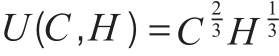
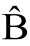
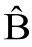
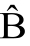
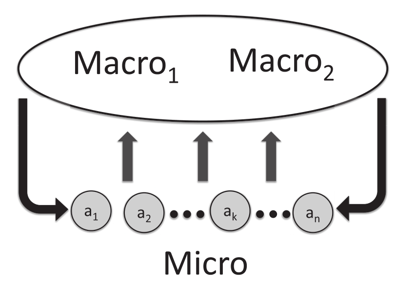

关于“人”的假设，一直是建模时最棘手也最迷人的问题。哪怕到今天，学界也没能拿出一套放之四海而皆准的理论，来解释人的行为。奥斯特罗姆对此早有感慨，而这也正是本章想要探讨的：我们究竟该把人放在什么样的框架里来理解？

在后面的讨论中，我们会见到大量模型，从投票、合作，到追逐潮流、存退休金，甚至成瘾行为都包含在内。每个模型都得先回答一些关于“人”的根本设问：他们到底在追求什么？是只顾自己，还是也会为他人着想？他们会怎么行动，又凭什么做出选择？——或者说，他们真的有选择吗？

如果每个模型都临时编一套关于人的假设，那当然也行，但这样做会让我们陷入混乱，错失许多相互印证的机会。到头来，我们只会得到一堆互不相干的拼装模型，每新建一个模型，就得从头再猜一次人的行为。这种“异质性”会让我们的思考变成一盘散沙，难以积累，更谈不上成为一位高效的多模型思考者。

所以我们采用的方法，既强调一致性，也兼顾多样性。大体上，人可以分成两类模型：一类是“基于规则”的行动者，另一类是“理性”的行动者。在基于规则的阵营里，又可以细分为固守简单规则的人，以及会依据新信息、过往成功经验或旁人做法而调整规则的适应性行动者。需要说明的是，这些类型之间并不存在一道清晰的墙——一个适应性规则，换个角度看可能就是一条固定规则；而理性行为，有时看上去也像在遵循简单的规则。

到底把人建模成什么样，最终要看我们做模型的目的：是在预测，还是在解释？是为了评估政策，还是在设计一项制度，抑或只是想探索可能性？在风险低的情境里，比如猜人们会买什么颜色的外套、演出结束后会不会起立鼓掌，固定规则就够了；而在讨论是否合伙创业、是否该信任他人的模型里，我们可能会让人物学习和适应；至于高风险环境，我们则倾向于假设那些经验丰富且信息完备的人会做出最优选择。

在展开细节之前，有必要先澄清一个常见的误解。不少人第一次接触正式的社会模型，是在经济学导论课上，而那些模型大多建立在“理性人”的基础之上：每个人都是自利的，并且具备最优化的能力；同时还常常假设大家偏好和收入都差不多。经济学家在这样的模型里求解均衡，再判断各种冲击或政策改变带来的影响。这些模型的假设虽然很不真实，却非常有用，还方便教师教学和学者之间交流。

但很多人因此误以为，做正式的模型就必须采用一套狭隘而冷酷的人性观，把人全看成自私自利、永远不犯错的计算器。事实远非如此，连经济学家也不这么看。在前沿研究中，早就有模型引入了不完全信息和异质性的参与者，这些人会依据自己学到的东西调整行为，有时候（也并非总是）会在意他人的收益。当然，人们对别人的事儿到底有多上心，得看具体场景——给慈善机构捐钱时可能格外大方，但买房时多半不会那么“利他”。

尽管如此，经济学模型中充斥着自私、不切实际的理性人，这仍然是一件遗憾的事，我们必须放下这种刻板印象。打个比方，只在海边涉水几步，你会以为海水很浅；但等你游到远处，才会真正感知它的深邃。那我们就先在这片近岸浅水里试探，偶尔再往深处走一走，看看模型是怎么容纳那些关心他人、理性有限的行为者的。

不管我们假设了什么，都不意味着假设无关紧要。我们被绑在逻辑一致性的“桅杆”上，不能信口开河。如果假设消费者的选择受强大的社会潮流影响，模型就会催生少数几款霸占市场的产品；如果假设人们靠网络获取信息，那些填补结构洞的人就会掌握权力。

谈到对人建模的挑战，有几条绕不开：人各不相同，容易受别人影响，会犯错，有目的，会适应，也有自己的主动性。想把所有这些塞进同一个模型而不变得一团糟，基本不可能，所以我们必须做取舍——如果多样性无关紧要，那么可以干脆假设所有人是一样的；如果问题足够简单，或者人足够精明，也可以假定他们不会出错。

之后我们还会细谈理性行为者模型的底子：为什么这个描述上不准确的模型，依然值得使用。理性行为模型究竟是“黄金标准”，还是“稻草人”，或者介于两者之间，完全取决于模型用在哪儿。客观地讲，它在预测人类行为这件事上，并没有那么成功；它真正的长项，是作为一种沟通语言、政策评估和制度设计的工具。

再往后，我们再讨论怎么在标准理性模型的基础上，把心理偏差和利他偏好加进来。要不要加偏差，加多少，依然得看我们研究的内容。比如损失厌恶和现世主义偏差，对退休储蓄或社会骚乱的模型可能至关重要，但在驾驶行为或疾病传播的模型里就可能无足轻重。

然后我们还会讲基于规则的模型。这类模型的最大优势是既灵活又好处理——我们可以把任何行为写成规则，编码成基于主体的计算机程序，然后观察后续的演化。当然，自由也意味着责任；既然什么规则都允许，就得警惕别做出太特殊的假设。有些情况下，给定目标函数后，我们能证明所用的行为规则其实是最优的，但并非总是如此。

到了章末，我们会重新讨论理性作为基准的价值。即使人们并不会真的去“最优化”，他们也会适应环境和新的知识。这个观察会带来一系列问题：如果我们基于“人们有心理偏差”或“人们会做损己之事”来设计制度或政策，就得承担一个风险——人们会改变自己的行为。你也许可以愚弄人们一次，但很难愚弄他们两次、三次。尽管这可能不足以证明理性是唯一合理的假设，但至少逻辑上支持把理性当作一个相关基准；也支持把简单行为规则视为理性的下限。在这两个极端之间的辽阔空间里，我们还可以放上无数种适应性与心理层面的规则，用来探索各种可能。

现在，我们不妨把目光对准“人”本身。人的复杂度，恰恰构成了建模的挑战。我们是多样的：偏好、能力、社交网络、利他倾向和注意力分配千差万别。如果每个人都一样，建模会轻松很多。幸好，有时候我们可以依赖统计规律，让多样性相互抵消。例如，预测慈善捐赠随收入变化的模型：对给定收入水平和税率，有些人会比我们假设的更利他，有些人则更利己。只要偏差能在样本中抵消，模型的预测就仍有参考价值。但这种抵消有一个前提，那就是人们的行为彼此独立。一旦行为受到社会影响，极端行为就会产生溢出效应——竞选活动中，活动家鼓动选民就是一个例子；在下文模拟社会骚乱时，我们还会看到这一类多样性引发的问题。

错误能否抵消，也要看情境。认知依恋缺失所导致的误差，大概是随机且独立的；但认知偏差导致的误差往往是系统性的、相关的。人们对近期事件更看重，对生动故事比冷冰冰的统计数字更买账，这种共同偏差不会消失。

另一个挑战，是如何准确把握人们所欲何为。有人渴望财富和名望，有人想为社区乃至世界谋福祉。在理性行为者模型中，我们直接用效用函数来表示收益；在基于规则的模型里，目标可能更隐蔽——比如一条规则，说一个人如果看到社区里同种族的比例降至10%以下就搬走，这条规则背后就藏着他所看重的东西。

最后一重挑战来自人的主体性：我们能行动、能改变、能学习。但有时我们也是“习惯生物”，行为并不完全受意识控制。很少有人会主动选择对阿片类药物上瘾或陷入贫困，但归根到底，是这些行动带来了相应结果。

而当行动产生不好的结果时，人们通常会调整行为。这种学习机制因环境而异：为了搞清楚该学多久才能考好，该每周锻炼几次才能保持健康，人们可以从亲身经历或内省中学习；而在选择去哪家杂货店、要不要捐款这类事上，则可以通过观察他人来学习。在非策略性环境里，学习机制一般能让人找到最好的行动；但在策略互动的博弈中，结果就很难说了——个人学习和社会学习，都不必然导向好的结局。

人的这六种特性，每一种都可以作为模型的特征。假如只取其一，还要决定取到什么程度：如何让行动者彼此不同？社会影响力放多大？他们会不会向他人学习？目标怎么定义？主体性到什么水平？有趣的是，人的主体性可能比自己以为的要少。社会心理学家乔纳森·海特用“骑手与大象”来比喻这种情况：我紧握缰绳，以为自己能指挥大象转弯、停步或前行；但只有当大象没有自己的欲望时我才做得到。一旦大象真想做点什么，我根本拉不住它。我们有时能驾驭大象，有时不能。所以，没有任何一种单一人性模型能适配所有环境，我们必须使用多种模型来理解人。

再来看看理性行为者模型。它假设人在给定的效用或收益函数下做出最优选择。这种行为可以单方面决定（收益只取决于自己的行为），也可以出现在博弈中（收益取决于所有人）。而在同时行动或信息不全的博弈中，理性模型还必须给出关于他人行为的信念。

我们来看一个例子：一个人如何决定把多少收入花在住房上。效用函数包括住房和所有其他消费（食品、衣服、娱乐），假设了住房价格和别的商品价格。它的假设显然和现实有出入——所有住房被看成一样，所有其他商品被塞进一个“消费品”袋子里。但这些不准确并不妨碍模型的目的：解释住房支出占收入的比例。

这个模型的结果是：效用最大化的个体会把自己收入的1/3花在住房上。而且这一比例，不随住房价格或者收入水平变化。有意思的是，这两个结论和数据都很吻合——除了收入分布极端的人之外，多数人确实把约三分之一的收入用于住房。这有政策含义：如果房价下降10%，人们会多买10%的住房。同时也为同质性行为主体的假设提供了辩护：既然人们花固定比例的收入在住房上，那么住房总支出就只取决于平均收入。

运用效用函数，让模型变得可分析、可检验、易处理：我们可以用数据去估计函数，推导最优行为，还能通过调整参数问各种“如果……会怎样”。但假设一个效用函数，就等于假设了偏好的内在一致性。效用函数能够存在，需要满足一些公理：假设有一个备选方案集，以及偏好排序——比如列出所有能购买的商品组合，然后从最喜欢到最不喜欢排个序。若一个人在咖啡加奶和茶加柠檬之间更喜欢前者，那么咖啡加牛奶的组合就排在前头。

效用函数能表示偏好，当且仅当A排得比B高时，函数值也更高。而要让偏好和效用函数相容，需要具备完备性、传递性、独立性和连续性：完备性意味着所有备选方案都得能排序；传递性排除了循环偏好——偏好A胜过B、B胜过C，就必须偏好A胜过C；独立性要求人们分别评估彩票的结果，不能因为A比B好，就在所有涉及B的彩票中都以A替代B，因为这会排除掉过强的风险规避；连续性则要求偏好关系没有“跳跃”——如果A胜于B、B胜于C，则必有某个概率p，使“以p得到A、以1-p得到C”的彩票与B无差异。

然而，除了“人会优化”这个可疑主张外，人们还会违背独立性和传递性，这让许多人——尤其是经济学家——对理性模型的广泛使用提出质疑。但作为建模者，我们依然有充分的理由采用理性行为者模型。

第一，人们的行为常常显得“好像”在做最优化。他们可能使用能产生近似最优结果的规则。打桌球、玩飞盘或开车时，没有人会列方程，但要准确算出接住飞盘的时机，方程式之复杂会让人惊叹，而人们（以及狗）就是接得住。从行为来看，人和狗“好像”都解决了一个高难度的最优化问题。同样的逻辑也适用于更复杂的场景：威斯康星州麦迪逊市公交公司维修主管哈罗德·泽克，在何时更换公交引擎上的决策，就近乎最优。他从没写过公式，靠的是经验得来的启发式方法，结果却像一位近乎完美的理性行动者。

第二，即便人们一开始会犯错，只要情境反复出现，学习会把他们推向更优的行为。

第三，当“赌注”很大时，人们更愿意投入时间和精力去接近最优选择。买咖啡或电池，可能多付30%也无所谓；但买车买房，绝不会这么随意。大量证据支持：学习和更大利害关系，都会使人表现得更理性。

第四，理性模型简化了分析。大多数效用函数有唯一的最优行为；而次优行为有成千上万种可能。如果说“人们不是在优化”，那就打开了一个充满无穷可能性的潘多拉盒子。假设人们为了维护身份或捍卫文化规范而选择，我们可能永远得不到清晰的答案。理性选择也许不现实，但现实主义的代价是混乱。一个知道是错的答案，可能也比没有答案更有用——至少它能帮我们让模型面对数据，去衡量变量变化的影响。

第五，理性假设保证了内部一致性。反过来，如果模型假设了次优行为，就会面临挑战：一旦人们看到这个模型，并学会利用它，他们的行为就会改变，于是模型也就跟着失效。所以除了“最优”之外，任何假设都可能面临这种自相矛盾的问题。

第六，也是最重要的一点：理性可以作为一个基准。在设计政策、做预测、选择行动时，不妨先考虑“有理性偏好且做最优化的人会怎么做”。这种做法能帮我们找出思维中的缺陷，也可能让我们得出结论：理性模型并不适用，得换别的模型。顺着这个思路，还能加上第七个原因：多模型思维本身就能降低犯错概率。

总结一下选择理性行为者模型的几大理由：

“好像”：聪明的规则行为，可能与最优行为难以区分。

学习：在重复情境中，人们会接近最优。

大赌注：面对重大决策，人们会搜集信息并认真思考。

唯一性：最优行为通常是唯一的，这让模型可被检验。

一致性：最优行为让模型保持内在一致，人们学了也不会去改变它。

基准：最优行为提供了一个认知能力上限的参照。

当然，理性行为者模型并非没有反对者。心理学家、经济学家和神经科学家经常指出它和真实人类行为不一致。大量实验室和实地证据显示，人在决策时会受各种偏差影响，包括现状偏差；我们在算概率时忽视基本比率，给确定性结果以过高的权重，并且表现出损失厌恶。

这些批评都值得认真对待，但正如我们前面的讨论所表明的，理性的价值不一定在于描述人“是什么”，而在于给我们的建模提供一个参照系。在这片深浅难测的水域里，理性模型和规则模型并不是非此即彼的敌人，而更像远近不同的航标。至于每一次该看哪一盏灯，得由我们要航向何处来决定。

越来越多的学者开始把行为、信念和大脑内部的神经活动放到一起观察，硬连线偏差的证据也随之变得愈发有说服力。比如，神经经济学这门学科就借助脑成像手段，去探讨与经济决策相关的行为，包括人们怎么看待风险、有多自信，以及如何回应信息。⁹ 著名心理学家丹尼尔·卡尼曼曾表示，迄今已有大量证据能支撑一种划分：一类是快速、直觉、依赖规则的思考（也就是“快思考”），另一类是慢速、审慎的思考（即“慢思考”）。那些偏差往往更容易在快思考里冒出来。¹⁰ 放眼长远，我们确实能从大脑结构里推导出某些行为模式，但千万别忘了，大脑拥有很强的可塑性——我们完全可以用慢思考来对冲各种偏差。

另外，如果某个发现只在少数研究里出现过，我们就得留个心眼。心理学领域的很多结论还没有被完全证实。2015年的一项研究发现，在主流心理学期刊上发表的100项研究成果里，居然有半数无法被重复验证。¹¹ 而且，就算能复制，也不代表它就具备普遍性。很多研究的被试样本在经济背景和文化构成上都缺乏足够的多样性。¹² 如果被试池更多元，我们大概率会观察到更少的行为规律，这反而提醒我们：别急着对行为做概括。

在搭建贴近现实的模型时，“易处理性”这个原则也不能丢。越贴近现实，往往意味着数学上越复杂。¹³ 这些困难和顾虑，并不意味着我们就该放弃具有心理现实性的行为模型；但它们确实在提醒我们：要保持谨慎，把注意力集中在那些已被反复验证过的行为规律上。

下面聊两种被多次成功复制的偏差：损失厌恶和双曲贴现。损失厌恶的意思是：面对收益时，人通常规避风险；面对损失时，人反而偏好冒险。卡尼曼和阿莫斯·特沃斯基提出了一个一般性理论来解释这种表现，也就是前景理论。¹⁴ 乍一看，损失厌恶似乎不算非理性，但关键在于：同一个情境，如果用“潜在损失”来呈现和用“潜在收益”来呈现，人们会做出完全不同的选择。¹⁵

举个例子，人们更喜欢稳拿400美元，而不太愿意选择一张有机会赢1000美元的彩票；可一旦换成损失，大家却更愿意选可能亏1000美元的彩票，也不肯接受确定亏600美元。这种不一致并不只发生在钱上面。医生在收益框架下会偏向保守，但如果把选项包装成损失，他们立刻变得愿意冒更大风险。

前景理论：示例

收益框架：两个选项。
选项A：确定得到400美元。
选项B：抛硬币，正面得1000美元，反面则一分不得。

损失框架：先给你1000美元，再给你两个选项。
选项Â：确定损失600美元。
选项：抛硬币，正面不损失，反面损失1000美元。

这里，A和Â其实是等价的，B和也等价。按照前景理论，更多人会选A和。

双曲贴现说的是：人们对越近的未来，贴现得越厉害。传统经济学模型通常假设指数贴现——也就是用恒定贴现率去折算未来价值。一个人如果年贴现率是10%，那么明年拿到1000美元，就相当于今天的900美元；而且往后每年他都按10%来折算下一年的价值。但大量证据表明，绝大多数人并不会用固定贴现率来面对未来；相反，他们身上有一种“即时性偏差”：对近期时间的贴现率，远高于对远期时间的贴现率。¹⁶ 比如，你问别人：从今天起20年后拿到9500美元，和从今天起20年零1天后拿到10000美元，选哪个？几乎所有人都会愿意多等一天去拿那10000美元。但同样一批人，如果问他们：今天拿9500美元，还是明天拿10000美元？多数人就会选择今天先拿9500。这就是即时性偏差。¹⁷

这种偏差会带来时间上的不一致行为。毕竟，20年后，大多数人都愿意多等一天换更高的金额；这在逻辑上显然站不住脚。双曲贴现还能解释：为什么有人背上一堆信用卡债务、总吃不健康的食物、发生没有保护措施的性行为，以及为什么很多人迟迟不为退休做储蓄。

总之，具体怎么选建模假设，取决于这个模型用来干什么。我们可以把损失厌恶和双曲贴现放进去，只要这些假设看起来更符合大多数人的真实行为；当然也可以不放，理由可能是它们会让模型变得更复杂却改变不了我们最终发现的本质，或者一旦加入双曲贴现，模型可能会跑出和现实不符的奇怪行为。

基于规则的模型

接下来看看基于规则的模型。¹⁸ 最优化模型假设人会把效用或收益最大化，而基于规则的模型则直接假设人会采用某些特定行为。比如，一个基于规则的模型可以设定：某人在拍卖中的出价总是比他内心估值低10%；或者，如果他的朋友一直赚得更多，他就会模仿朋友的做法。

很多人习惯把最优化模型等同于数学模型，把基于规则模型等同于计算模型。但这两类模型之间的分界线，其实没想象中那么清晰。想想前面提到的住房支出模型——最优行为完全可以用一条简单规则来表达：把收入的三分之一花在住房上。两者的真正区别，在于基本假设不同：最优化模型把偏好或收益作为最基本的假设，而基于规则的模型则把行为本身当作基本假设。

行为规则既可以是固定不变的，也可以是适应性的。固定规则就是指不管什么时候都套用同一套算法。理性选择模型可以看成人类认知能力的天花板，那么固定规则模型就是地板。市场里有个常见的固定规则叫“零智能规则”——只要报价能带来更高收益就接受。这规则意味着一个人永远不会犯傻，也就是不会去做那些降低效用的行为。假设我们要衡量一种单边市场的效率：卖方报出商品价格，买方选择接受或者放弃。采用零智能规则的卖方会随机报一个高于商品价值的价格，买方则会随机接受一个低于商品价值的价格。当我们把这些行为写进计算机模型后会发现：在这个市场里，零智能交易者居然能达到接近完全有效的交易结果。这说明，就算买卖双方并不理性，市场照样能运作得不错。¹⁹

适应性规则则能在不同行为之间切换、演化出新行为，或者复制别人的行为。做这些事的目的很明确——为了提升收益。所以，和固定规则不同，适应性规则需要依赖效用函数或收益函数。这套方法的支持者认为，只要人们在现实里更倾向于使用简单又有效的规则，那我们就应该采用基于适应性规则的模型——既然大家就是这么做的，建模也该这么做。²⁰ 虽然基于规则的模型没有对理性做出明确假设，但适应性规则其实体现出了一种“生态理性”：更好的规则会渐渐占据上风。²¹

为了说明适应性规则模型是怎么运作的，这里不妨以经典的“爱尔法鲁”自组织协调模型为例。²² 爱尔法鲁是美国新墨西哥州圣塔菲一家夜间营业的酒吧，每周二晚上都有很吸引人的舞会。每个星期，有100个潜在舞者要决定：去酒吧跳舞，还是待在家里。这100个人都喜欢跳舞，但如果酒吧太挤，他们就不愿去了。模型假设了一个明确的偏好结构：一个人待在家里收益为0；如果到场人数小于等于60，则收益为1；如果到场人数超过60，收益为-1。

如果我们用一个固定规则模型来模拟，可能会出现任何结果。假设给每个人分配一条规则：第一周去，如果发现到场人数超过60，下一周就不去；再下一周继续去。那么爱尔法鲁酒吧就会第一周挤进100个人，第二周空无一人，第三周又挤进100个人……如此循环。而爱尔法鲁模型的不同之处在于：它给每个人准备了一整套规则，从而形成适应性规则。每一条规则都会告诉这个人，这个星期该不该去酒吧。这些规则形式多样，有固定模式，比如每隔一周去一次；也有根据最近几周人数趋势制定的，比如某条规则可能会预测：这周去的人数跟上周一样。如果上周到场人数少于60，那这条规则就会告诉你，这周应该去。

在基于适应性规则的模型里，每条规则会被打个分，分数等于这条规则在过往星期里给出正确建议的占比。随后，每个人会从自己的规则集合里挑出得分最高的那条来行动。而“得分最高”的规则，会随着时间推移而改变。模拟结果表明：如果每个人都拥有足够庞大的规则库，那么每个星期二到场的差不多就是60人——也就是说，在没有中央计划者的情况下，人们实现了协调。换句话讲，这套适应性规则系统，靠自我组织就得到了几乎完全有效的结果。

爱尔法鲁模型：适应性规则

一共100个人，每个人每周都要独立决定是否去爱尔法鲁酒吧。如果决定去，而到场人数不超过60，则收益为1；如果超过60，收益为-1；决定不去的人，收益为0。

每个人手里都有一套决定是否参加的规则，这些规则可以是固定的，也可以基于近期参加人数来变化。每星期，人们都会照着自己规则集合中过去表现最好的那条规则去行动。

我们可以在微观-宏观循环的框架里理解适应性规则模型中的行为。在微观层面，一组个人（用a[i]表示）根据规则行动，这些行动又产生了宏观层面的现象（用Macro[1]和Macro[2]表示），就像图4-1中向上的箭头。在爱尔法鲁问题里，宏观现象就是过去酒吧出席人数的序列；向下的箭头则说明，这些宏观现象又如何反馈到每个人的行为中。在爱尔法鲁模型里，每个人应用的规则可能都不一样。如果大家所用的规则连续四个星期都导致酒吧爆满，那么规则就会告诉人们：少去一点反而能获得更高收益。当一些人转而采纳这些规则后，酒吧的出席人数就会降下来。微观层面的规则产生了宏观现象（过高的“出勤率”），而宏观现象又反过来影响微观层面的规则。

图4-1 微观-宏观循环

模型产生了什么样的结果

微观-宏观循环暴露了一个关键问题：模型中的行为主体，到底应该多聪明？人们能完全推算出自己行为的所有后果吗？这个循环还引出了更宏观的疑问：模型最终会带来什么结果？是会收敛到均衡，还是产生随机性、形成循环，或者演化出复杂的结果？

先来思考行为主体有多聪明。假设我们认为个体的认知能力有限，于是构建了一个零智能行为主体模型。这些个体的行动汇聚在一起，形成了宏观层面的总体现象。如果宏观结果看起来有效或接近有效——比如前面提到的单边市场——那么我们的假设就可能站得住脚。如果一条如此简单的固定规则就能带来不错的结局，那人们自然没有动力去发明更精巧复杂的规则。

可是，当模型给出的宏观结果很低效甚至很糟糕时，麻烦就来了，爱尔法鲁模型就是如此。在爱尔法鲁模型里，一个固定的共同规则可能导致完全低效的周期性结果：这周酒吧挤爆，下周却空荡荡。面对这种低效，我们很自然会认为人们会去适应。他们可能试错、可能通盘考虑形势、然后制定新的行动规则。如果把这个逻辑推到极致，并假设思考成本很低，那我们实际上就已经在宣扬理性行为者模型了——任何表现不好的人都能做得更好。这话虽然没错，但前提是，人们得有能力想出更好的规则才行。

这就引出了一个更大的问题：模型到底会产出什么结果？有四种可能：均衡、周期、随机性或复杂性。结果属于哪一类，决定了“人们应该学会实现均衡”这种论点值不值得重视。如果模型在宏观层面表现出随机性，那个人可能什么也学不到。好在我们的模型没有这毛病。同样的道理也适用于产生复杂模式的情况。在这些场景里，我们可以假设人们会继续适应新规则，但不能假设他们能选中最优规则。因为宏观现象的复杂性会让“最优反应”显得匪夷所思。人们更可能像在爱尔法鲁模型里那样，用一批简单的规则去应对复杂。

而能产生周期或均衡的模型，则提供了一个稳定的环境，所以我们有理由相信人们会学习，不会有人一直坚持次优行动。假设有个交通模型，每个人都用固定规则选择通勤路线，并且系统处于均衡。在这个均衡里，有个人叫莱恩，她每天早上从卡拉巴萨斯开到洛杉矶市中心，要花75分钟。如果她改从托潘加峡谷抄近路，那这段路只要45分钟。考虑到每天省下30分钟的价值，再加上洛杉矶人有多爱聊交通，她确实很可能会找到这条捷径。事实上，她有很多办法：用地图软件、问邻居、自己多试几次。

因此，如果模型产生了均衡（或简单周期），但这个均衡和最优行为不一致，那就说明模型有逻辑问题。如果人们明明能做得更好，他们应该能搞清楚，也应该会去学习。注意，要达到均衡，并不一定需要假设最优化行为。人们完全可以靠简单的规则走到均衡；在这种均衡下，任何人想靠改变行为来占便宜都做不到。在这种状态下，人们看起来“好像”在优化，实际上也确实是。但同样的逻辑，在复杂或随机的结果里未必成立。如果洛杉矶的交通模式是一连串复杂的拥堵和减速，那我们就没理由相信莱恩每天都能走最优路线。事实上，她几乎肯定做不到。

如果适应性的行为规则最终产生了均衡，那么这个均衡一定和那些真正做最优化的行为主体的选择一致。反过来，如果适应性规则带来了复杂性，那行为主体的行为就不一定是最优的。也可以换个说法：最优化行为可能是个不切实际的假设，尤其是在复杂情况下。但另一方面，如果系统产生了稳定的结果，而且有人能采取更好的行动，那这个人很可能会找到那个更好的选择。

同样的逻辑也适用于政策干预。假设我们用数据去估计人们的行为规则，比如，一个人因为一点小毛病就在午餐时间跑医院急诊室的概率有多大。如果按固定规则来推，我们可能会扩建医疗设施，让求医者不用等太久。只要人们一直遵守那条固定规则，系统就会达到新的均衡：中午的等待时间大大缩短。可一旦等待时间变短了，那些本来不会因为扭伤脚踝或轻微感冒就跑急诊的人，也可能决定来一趟。这个均衡其实依赖人们选择次优行为——比如即使不用等，也不去急诊。如果人们会学习，我们就不能依靠过去的数据来预测政策落地后的结果。这个洞见就是著名的“卢卡斯批判”，也是坎贝尔定律的变体——坎贝尔定律指出：任何措施或标准一旦被用来做指标，反而会让人围绕它做出反应，使它丧失原有的效度。²³

卢卡斯批判

政策或环境一旦变化，受影响的人就可能做出行为上的反应。因此，用过去的行为数据估算出来的模型会失准。模型必须把人会对政策和环境变化做出反应这件事考虑进去。

到这儿，事情应该很清楚了：人们该如何建模，从来没有固定答案。既要在具体情境里想清楚怎么设定规则，也要明白怎么取舍。我们需要做的，是在每种情形下尽可能做出最好的判断。面对各种不确定性，我们应该朝着“多建模型”的方向去试错，而不是“少建模型”。

哪怕我们认为理性选择模型不太现实，也得承认它容易处理、能揭示激励的正确方向，并且可以作为基准。简单的基于规则的行为，比如零智能，同样也不现实。这些假设虽然是“错的”，但它们依然可以用。它们分析起来方便，又能帮我们揭示特定环境下“聪明”到底有多重要。

毫无疑问，人类行为落在“零智能”和“完全理性”这两个极端之间，所以构建用适应性规则来行动的行为主体模型，是有意义的。这些规则应该考虑到：同一领域里，人们的认知附着和认知能力参差不齐。因此，行为多样性会出现，群体内部也会有一定的共性——这些都可以放进模型里。²⁴

总而言之，考虑到建模的复杂性，我们有充分理由去同时使用多种不同的模型。我们也许无法精确预测每个人会做什么，但或许能圈定一系列可能性。如果可以做得到，那就该多建一些模型——我们已经能从建模中得到回报，因为我们至少知道了会发生什么。

最后，我们需要保持谦卑和同理心。在构建关于人的模型时，建模者必须非常谦逊。因为面对着多样性、社会影响、认知错误、目的性和适应性带来的各种挑战，我们的模型一定会出这样或那样的问题——这正是需要多模型方法的原因。严谨的行为模型能很好地拟合某些情境，还能帮我们把注意力放到环境里的其他因素上。当我们拥有更多、更好的数据时，更丰富的行为模型也会变得更合适。期望要合理。人是多样的、易受社会影响的、会犯错的、有目的的、有适应能力的，同时还拥有主体性。又怎么能指望一种模型就能准确刻画人类行为呢？肯定不能。我们的目标，是建构出许多模型，而作为一个整体，它们将是有用的。