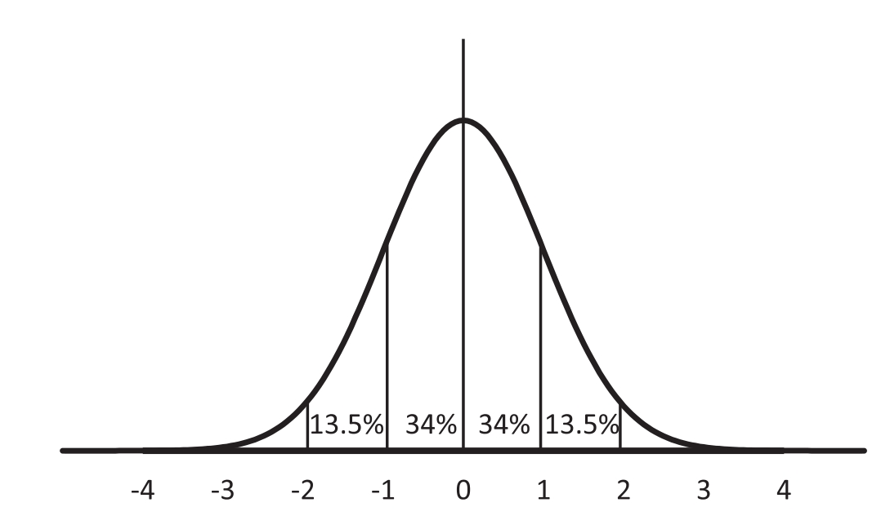
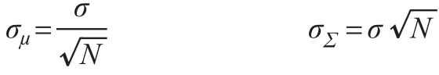
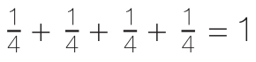
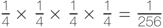
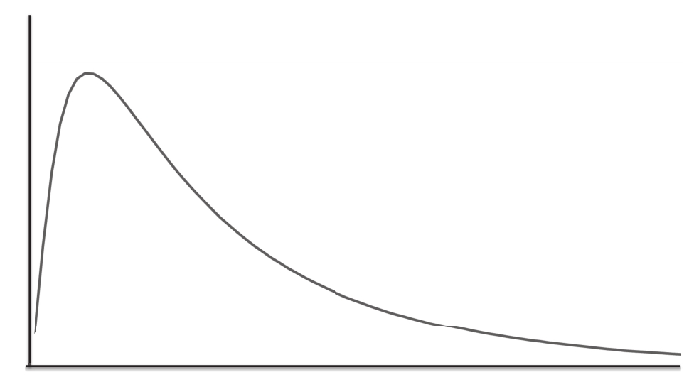

# 05　正态分布

我不敢说自己比其他 65 个人都更聪明——但是我当然要比那 65 个人的平均水平更高。

理查德·费曼（Richard Feynman）

分布构成任何建模者核心知识库的一部分。从本章开始，我们将利用各种分布来构建和分析路径依赖、随机游走、马尔可夫模型，以及各种搜索模型和学习模型。如果想要度量权力、收入和财富的不平等，并进行统计检验，也需要关于分布的知识。在本书中，我们花了篇幅不大的两章专门讨论分布。本章先讨论正态分布（normal distribution），下一章讨论幂律分布（长尾分布）。我们都是从建模者而不是从统计学家的角度来讨论的。作为建模者，我们对两个主要问题感兴趣：为什么要这样看待分布？为什么分布很重要？

要解决第一个问题，就需要重新认识分布。分布以数学的方式刻画变量的变差（在某个类型内部的差异）和多样性（不同类型之间的差异），将变量表示为在数值上或类别上定义的概率分布。正态分布的形状是我们熟悉的钟形曲线形状。大多数物种的高度和重量都满足正态分布，它们围绕着均值对称分布，而且不会包含特别大或特别小的事件，例如，我们从来没有遇到过 1 米长的蚂蚁，也没有看到过 1 千克重的麋鹿。我们可以通过中心极限定理（Central Limit Theorem）来解释正态分布的普遍性。中心极限定理告诉我们，只要把随机变量加总或求其平均值，就可以期望获得正态分布。许多经验现象，特别是像销售数据或投票总数这样的总量数据，都可以写成随机事件总和的形式。

当然，并不是所有事件的规模（大小）都是正态分布的。地震、战争死亡人数和图书销量都呈长尾分布，这种分布主要由很小的事件组成，也包括极少数非常巨大的大型事件。加利福尼亚州每年都发生超过 10 000 次地震，但是除非你一直盯着茉莉花的花瓣看它们是否在颤动，否则你不会注意到这些地震。然而，偶然也会出现大的地震：地面裂开、高速公路塌陷，整个城市都在颤抖。

了解系统是否由于多种原因产生正态分布或长尾分布是非常重要的。例如，我们可能想了解电网是否会受到大规模停电的冲击，或者市场体系是否会产生少数亿万富翁和数十亿穷人。有了相关的分布知识，就可以预测洪水超过堤坝的可能性、达美航空 238 航班准时抵达盐湖城机场的可能性，以及交通枢纽成本超过预算金额两倍的可能性。分布知识对设计也很重要。正态分布意味着不会有太大的偏差，因此飞机设计师不需要为身高 5 米的人预留腿部空间。对分布的理解也有利于指导行动。正如我们在下文中将会了解的那样，防止骚乱在更大程度上取决于能不能在极端情况下安抚人群，而不在于平时能不能减少不满情绪的平均水平。

在本章中，我们按结构—逻辑—功能的顺序来展开论述。我们先定义了何为正态分布，并描述它们是怎样产生的，然后回答它们为什么这么重要。我们将应用分布知识，解释为什么好的东西总是以小样本的形式出现，检验哪些效应是有显著性的，解释六西格玛（Six Sigma）过程管理为什么有效。然后回到逻辑问题，追问如果我们将随机变量相乘而不是相加会发生什么，结果是获得对数正态分布（lognormal distribution）。对数正态分布可以包括更大的事件，且均值不对称。由此，我们可以推导出，多重效应会导致更大的不平等，这个深刻的结论对提高工资的政策如何影响收入分配有重要的意义。

### 结构：正态分布

分布为事件或价值分配概率。每日降雨量、考试分数或身高的分布为每一个可能的结果值分配一个概率。各种统计量将分布中包含的信息压缩为单个数值，例如均值，分布的平均值。德国黑森林中树木的平均高度可能达到 24 米，开胸手术后的住院时间平均为 5 天。社会科学家经常通过均值来比较各个国家的经济和社会条件。2017 年，美国的人均国内生产总值为 57 000 美元，远超法国的 42 000 美元，但是法国人的平均预期寿命则比美国人高出 3 年。

均值之外的第二个重要统计量是方差，可以衡量一个分布的离散程度，也就是数据与均值之间距离的平方的平均值。 ¹  如果分布中的每个点具有相同的值，那么方差等于零。如果一半数据的值为 4，一半的值为 10，那么平均来说，每个点与均值的距离为 3、方差等于 9。分布的标准差是另一个常用的统计量，等于方差的平方根。

可能的分布集合是无限的。我们可以在纸上任意画出一条线并将它解释为概率分布。幸运的是，我们经常遇到的分布一般都属于有限的几种类型。最常见的分布就是正态分布，也就是钟形曲线，如图 5-1 所示。

**图 5-1　正态分布及其标准差** 

正态分布的均值是对称的。如果一个正态分布的均值等于零，那么抽取到大于 3 的概率等于抽取到小于-3 的概率。正态分布的特征在于其均值和标准差（或者等价地，其方差）。也就是说，所有正态分布的图形看上去都是相似的，大约 68%的结果在均值的一个标准差内，大约 95%的结果在两个标准差内，并且超过 99%的结果在三个标准差内。正态分布允许任何大小的结果或事件，不过“大”事件是非常罕见的，与均值距离超过五个标准差的事件发生的概率为 200 万分之一。

我们可以利用正态分布的规律给各种范围的结果分配概率。如果位于美国威斯康星州密尔沃基市房子的平均面积是 2 000 平方英尺（1 平方英尺≈0.09 平方米）、标准差为 500 平方英尺，那么那里 68%的房子面积介于 1 500 平方英尺到 2 500 平方英尺之间，95%的房子面积介于 1 000 平方英尺到 3 000 平方英尺之间。如果 2019 年的福特福克斯汽车平均每加仑（1 加仑≈3.79 升）汽油可以行驶 40 英里（1 英里≈1.6 千米），且标准差为每加仑 1 英里，那么超过 99%的福特福克斯汽车每加仑汽油可以行驶 37 英里至 43 英里。尽管消费者希望自己的汽车越省油越好，但是一般来说不可能每加仑汽油行驶 80 英里。

### 逻辑：中心极限定理

非常多的现象都表现为正态分布：动物和植物的体型大小，学生在考试中的成绩，便利店每天的销售额，海胆的寿命，等等。中心极限定理表明为什么对随机变量求和或取均值会产生正态分布。

**中心极限定理** 

只要各随机变量是相互独立的，每个随机变量的方差都是有限的，且没有任何一小部分随机变量贡献了大部分变差，那*N* ≥20 个随机变量的和就近似一个正态分布。 ²  

中心极限定理一个非常重要的特征是，随机变量本身不一定是正态分布的。它们可以有任何分布，只要每一个随机变量都具有有限的方差，并且它们中的任何一小部分随机变量都不贡献大部分方差。假设，在一个 500 人的小城镇中，人们的购买行为数据显示，每个人平均每个星期花费 100 美元。在这些人中，可能有些人这个星期只花 50 美元、下个星期则花 150 美元，另一部分人可能每 3 个星期花费 300 美元。而其他人则可能每个星期的花费在 20 至 180 美元之间。只要每个人的支出都只有有限的变差并且没有任何一小部分人贡献了大部分变差，那么分布的总和必定是一个正态分布，其均值为 50 000 美元。每个星期的总支出也将是对称的：可能高于 55 000 美元，也可能低于 45 000 美元。根据同样的逻辑，人们购买的香蕉、牛奶以及炸玉米饼的数量也都是正态分布的。

我们还可以应用中心极限定理来解释人类身高的正态分布。一个人的身高取决于基因、环境以及两者之间的相互作用。基因的贡献率可能高达 80%，因此不妨假设身高只取决于基因。研究表明，至少 180 个基因有助于人体长高。 ³  例如，一个基因可能有助于长出较长的颈部或头部，另一个基因可能有助于长出更长的胫骨。虽然基因之间存在相互作用，但我们可以假设在“长高”这件事情上，每个基因都是相互独立的。如果身高等于 180 个基因贡献的总和，那么身高将呈现正态分布。相同的逻辑可以证明，狼的体重和大熊猫的拇指长度也是如此。

### 功能：应用分布知识

我们对正态分布的第一个应用将揭示：为什么罕见结果在规模小的群体中更常见，为什么最好的学校往往规模较小，为什么癌症发病率最高的郡县人口较少。回想一下，在一个正态分布中，95%的结果位于两个标准偏差内，99%的结果位于三个标准偏差内，根据中心极限定理，一组独立随机变量的均值将是正态分布的（当然方差要满足前述要求）。由此可见，我们可以非常确信：考试分数的总体平均值也将是正态分布的。然而，随机变量平均值的标准差并不等于变量标准差的平均值，而且总和的标准差也不等于标准差的总和。相反，这些关系取决于总体大小的平方根。

**平方根法则（The square root rules）** 

*N* 个相互独立的随机变量，都具有标准差*σ* ，对这些随机变量的值的标准差*σ* * [μ] * 和对这些随机变量总和的标准差*σ* * [Σ] * ，分别由以下公式给出： ⁴  

均值的标准差公式表明，大的总体的标准差要比小的总体的标准差低得多。由此可以推断，在小的群体中应该会观察到更多的好事和更多的坏事。事实上我们确实观察到了：最安全的居住地是小城镇，但最不安全的地方也是小城镇；肥胖率和癌症发病率最高的那些郡县的人口较少。这些事实都可以通过标准差的差异来解释。

如果不考虑样本量，直接根据离群值（异常值）推断因果关系可能会导致相当糟糕的政策行为。出自这个原因，美国统计学家霍华德·魏纳（Howard Wainer）将均值标准差公式称为“世界上最危险的方程式”。例如，在 20 世纪 90 年代，盖茨基金会和其他一些非营利机构以“最好的学校都是小学校”为依据，倡导将大学校分拆为小学校。 ⁵  为了揭示这种推理的逻辑缺陷，试想一下，现在有两所学校，一所是只有 100 名学生的小学校，另一所是有 1 600 名学生的大学校，并假设这两所学校学生的成绩均来自相同的分布，平均分为 100，标准差为 80。在小学校中，平均值的标准差等于 8，即学生成绩的标准差 80 除以学生人数的平方根 10。而在大学校中，平均值的标准差则等于 2。

如果以平均分为标准，把那些平均成绩在 110 以上的学校称为“优秀”，把平均成绩在 120 以上的学校称为“非常优秀”，那么将只有小学校才有可能达到这个标准。对于小学校而言，平均成绩为 110 时，只比总体均值高出了 1.25 个标准差，这类事件发生的概率大约为 10%。而平均成绩为 120 时，则比总体均值高出了 2.5 个标准差，这类事件大约 150 所学校发生一次。对大学校进行相同的计算时，我们却会发现“优秀”阈值意味着比均值高 5 个标准差，而“非常优秀”阈值则比均值高 10 个标准差！实际上这类事件永远不会发生。因此，最好的那些学校普遍规模较小这个“事实”并不能证明小学校的表现更好。即便学校规模本身完全没有影响，“最好的学校都很小”这种事情也会发生，因为平方根法则会起作用。

#### 检验显著性

我们还可以利用正态分布的规律来检验各种平均值的显著性差异。如果经验均值与假设均值之间的偏差了超过两个标准差，那么社会科学家就会拒绝这两种均值相同的假设。 ⁶  现在提出这样一个假设，即巴尔的摩的通勤时间与洛杉矶的通勤时间相同。假设数据表明，巴尔的摩的通勤时间平均为 33 分钟，而洛杉矶为 34 分钟。如果这两个数据集的均值标准差都是 1 分钟，那么我们就不能拒绝巴尔的摩和洛杉矶两地通勤时间相同的假设。虽然二者的均值不同，但只存在 1 个标准差。如果洛杉矶的平均通勤时间为 37 分钟，那么我们就会拒绝这个假设，因为均值之间相差 4 个标准偏差。

但是，物理学家可能不会拒绝这样的假设，至少当数据来自物理实验时不会。物理学家采用更严格的标准，因为他们拥有更大的数据集（原子的数量远远超过了人的数量），数据也更“干净”。物理学家在 2012 年证明希格斯玻色子（Higgs boson）存在时所依据的证据，在 700 万次试验中随机出现不到一次。

美国食品药品监督管理局（FDA）所使用的药物批准程序也包含了显著性检验。如果一家制药公司声称自己研发的某种新药可以减轻湿疹的严重程度，那么这家公司就必须进行两项随机对照试验。为了构建一项随机对照试验，该公司组织了两个相同的湿疹患者群体。一组接受这种药物治疗，另一组则只使用安慰剂。试验结束后，比较平均严重程度和平均副作用发生率。然后，该公司还要进行统计检验。如果药物显著地缓解了湿疹症状（以标准差衡量）且没有显著地导致副作用，则可以批准该药物。美国食品药品监督管理局并没有使用严格的双标准差规则。治疗某种致命疾病且同时只会导致轻微副作用的药物比能够缓解真菌导致的灰指甲症状但同时却会导致骨癌发病率高于预期的药物的统计标准更低。美国食品药品监督管理局还关注统计检验的效力，也就是测试能够证明药物有效的概率。

#### 六西格玛方法

这里要讨论的正态分布规律的最后一个应用是六西格玛方法，我们将说明正态分布是如何通过六西格玛方法为质量控制提供有效信息的。六西格玛方法是摩托罗拉公司于 20 世纪 80 年代中期提出的，目的是减少误差，该方法根据正态分布对产品属性进行建模。试想这个例子：一家企业专业生产制造门把手所用的螺栓。它生产的螺栓必须天衣无缝地与其他制造商生产的旋钮组装在一起。规格要求是螺栓直径为 14 毫米，但是任何直径介于 13 毫米与 15 毫米之间的螺栓也可以接受。如果螺栓的直径呈正态分布，均值为 14 毫米，标准差为 0.5 毫米，那么任何超过两个标准差的螺栓都是不合格的。两个标准差事件发生的概率为 5%，这个概率对于一家制造企业来说太高了。

六西格玛方法涉及缩减标准差的大小从而降低生产出不合格产品的可能性。各企业可以通过加强质量控制来降低误差率。2008 年 2 月 26 日，星巴克超过 7 000 家门店停止营业 3 小时，目的是重新培训员工。与此类似，航空公司和医院所用的检查清单也有助于减少变差。 ⁷  六西格玛方法降低了标准差，这样即使出现了 6 个标准差的误差，也可以避免出现故障。在生产螺栓这个例子中，就要求必须把螺栓直径的标准差减少至 1/6 毫米。而 6 个标准差的含义是，误差率仅为十亿分之二。实际使用的阈值假设 1.5 个标准差的出现是不可避免的。因此，一个六西格玛事件实际上对应于一个四个半西格玛事件，这时允许的误差率大约为三百万分之一。

在六西格玛方法中应用中心极限定理（即隐含的加性误差模型）是如此微妙，因而几乎没有什么人注意到。螺栓制造企业不可能精确地测量每个螺栓的直径，它可能会抽样几百个，并根据这样一个样本来估计均值和标准差。然后通过假设直径的变差源于多种随机效应的总和，例如机器振动、金属质量变化以及压力机温度和速度的波动，就可以利用中心极限定理推断出正态分布。这样一来，这家螺栓制造企业就可以得出一个基准标准差，然后花大力气去降低它。

### 对数正态分布：乘法冲击

中心极限定理要求我们对随机变量求和或求平均值，以获得正态分布。如果随机变量是不可相加而是以某种方式相互作用的，或者如果它们不是相互独立的，那么产生的分布就不一定是正态分布。事实上，一般情况下都不会是。例如，独立随机变量之间的乘积就不是正态分布，而是对数正态分布。 ⁸  对数正态分布缺乏对称性，因为大于 1 的数字乘积的增长速度比它们的和的增长速度快，比如，4+4+4+4=16，但 4×4×4×4=256；而小于 1 的数字的乘积则比它们的和小，比如，，但。如果将 20 个不均匀地分布在 0 到 10 之间的随机变量相乘，那么多次相乘后所得到的乘积将会包括一些很接近于零的结果与一些相当大的结果，从而生成如图 5-2 所示的对数正态分布。

**图 5-2　一个对数正态分布** 

一个对数正态分布的尾部长度取决于随机变量相乘的方差。如果它们的方差很小，尾巴就会很短，如果方差很大，尾巴就可能会很长。如前所述，将一组很大的数相乘会产生一个非常大的数字。在各种各样的情况下都会出现对数正态分布，包括英国农场的大小，地球上的矿物质的浓度，从受到感染到症状出现的时间，等等。 ⁹  大多数国家的收入分布也近似于对数正态分布，尽管在最顶端，许多点会偏离对数正态分布，因为高收入的人“太多”了。

一个简单的模型可以解释为什么收入分布更接近于对数正态分布而不是正态分布。这个模型将与工资增长有关的政策与这些政策所隐含的分布联系起来。大多数企业和机构都按某种百分比来分配加薪，表现高于平均水平的人能够得到更高百分比的加薪，表现低于平均水平的人则只能得到更低百分比的加薪。与这种加薪方法相反，企业和机构也可以按绝对金额来分配加薪，例如普通员工可以获得 1 000 美元的加薪，表现更好的人可以获得更多，而表现更差的人则只能获得更少。

百分比加薪方法与绝对金额加薪方法两者之间的区别乍一看似乎只是语义上的区别，但其实不然。 ¹⁰  如果每一年的绩效都是相互独立且随机的，那么根据员工绩效按百分比加薪，就会产生一个对数正态分布。即使后来的表现相同，未来几年的收入差距也会加剧。假设一名员工因过去几年表现良好，收入水平达到了 80 000 美元，而另一名员工则只达到了 60 000 美元。在这种情况下，当这两名员工的表现同样出色并都可以获得 5%的加薪时，前者能够获得 4 000 美元的加薪，后者却只能得到 3 000 美元的加薪。这就是说，尽管绩效完全相同，不平等也会导致更大的不平等。如果企业按绝对数额分配加薪，那么两名绩效相同的员工将获得相同的加薪，由此产生的收入分布将接近正态分布。

### 小结

在本章中，我们讨论了正态分布的结构、逻辑和功能。我们看到，正态分布可以用均值和标准差来表示。中心极限定理说明，当我们将有限方差的独立随机变量相加或求平均值时，正态分布是如何产生的。还给出了随机变量的均值与总和的标准差公式，阐述了这些性质会带来的后果。我们现在已经知道，小的群体更有可能呈现异常事件，如果缺乏对这类事件的洞察力，就会做出不正确的推断并采取不明智的行动。我们还了解到，假设随机变量服从正态分布，科学家就可以对统计检验的显著性和效力做出判断。本章还分析了在过程管理中如何利用正态假设来预测失败发生的可能性。

并不是每个量都可以写成独立随机变量的总和或平均值，因此并非所有事件都满足正态分布。有一些量是独立随机变量之间的乘积，因此它们是对数正态分布的。对数正态分布只取正值，有更长的尾巴，意味着更大的事件和更多非常小的事件。当高方差的随机变量相乘时，尾部会变得更长。长尾分布的可预测性较差，而正态分布则意味着很强的规律性。作为一个预测规则，我们当然更倾向于规律性，而不是发生很大事件的可能性。因此，如果了解了生成各种各样分布的逻辑，我们将会获益匪浅。我们可能更希望随机冲击相加，而不是相乘，以减少发生很大事件的可能性。